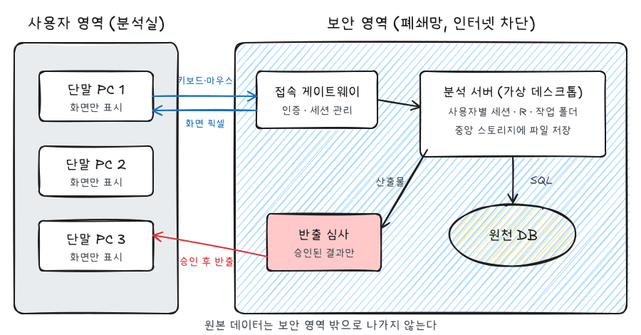
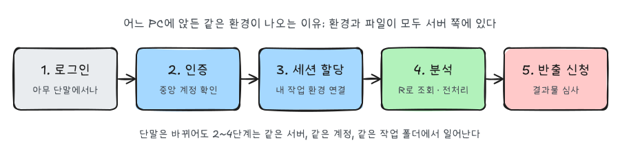
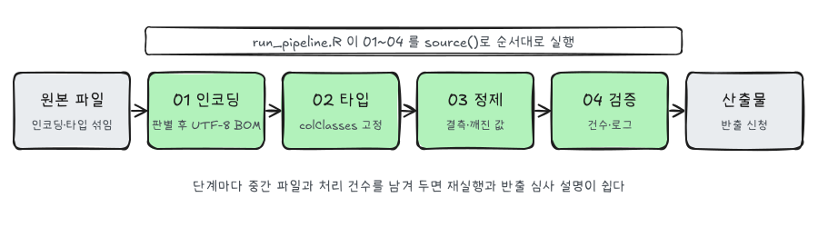

민감한 데이터를 다루는 분석 환경은 일반 PC와 다르다. 인터넷이 없고, 패키지를 마음대로 설치할 수 없고, 데이터는 정해진 서버 밖으로 나가지 않는다. 이 글은 그런 환경을 처음 접했을 때 생기는 질문을 기준으로, 망분리 분석 환경의 **일반적인** 구조와 동작 원리를 정리한 것이다. 특정 기관의 구성이 아니라 이런 환경이 보통 어떻게 만들어지는지를 다룬다.

## 처음 보면 궁금한 것들

| 질문 | 짧은 답 |
|---|---|
| 내 앞의 PC에서 R이 돌아가는가? | 아니다. 단말은 화면만 받고, 연산은 서버에서 한다 |
| 왜 아무 자리에 앉아도 내 작업이 보이는가? | 작업 환경과 파일이 단말이 아니라 서버·중앙 스토리지에 있다 |
| 여러 사람이 한 서버를 쓰는데 섞이지 않는가? | 계정별 세션·프로세스·폴더가 운영체제 권한으로 분리된다 |
| 결과를 어떻게 가지고 나가는가? | 반출 신청 → 심사 → 승인된 산출물만 나간다 |
| 패키지는? | 보통 미리 반입된 것만 쓴다. 없으면 Base R로 해결한다 |

아래에서 하나씩 그림으로 풀어 본다.

## 전체 구조



구성 요소는 크게 두 영역으로 나뉜다.

- **사용자 영역**: 분석가가 실제로 앉는 단말 PC가 있다. 여기에는 데이터도 분석 도구도 없다. 키보드·마우스 입력을 보내고 화면 픽셀을 받아 그리는 일만 한다.
- **보안 영역(폐쇄망)**: 인터넷과 물리적·논리적으로 끊긴 망이다. 접속 게이트웨이, 분석 서버, 원천 DB, 반출 심사 지점이 모두 여기에 있다.

두 영역 사이를 오가는 것은 **입력 신호와 화면 이미지뿐**이다. 화면에 표가 보여도 단말이 받은 것은 그 표를 그린 픽셀이지 데이터 파일이 아니다. 그래서 복사·붙여넣기, USB, 파일 전송 같은 경로는 보통 막혀 있고, 데이터가 밖으로 나가는 유일한 길은 반출 심사다.

### 각 구성 요소의 역할

| 구성 요소 | 하는 일 |
|---|---|
| 단말 PC (Thin Client) | 원격 화면 프로토콜(RDP, PCoIP, ICA 등)로 서버 화면을 표시한다 |
| 접속 게이트웨이 | 로그인 요청을 받아 인증하고, 사용자를 알맞은 서버 세션에 연결한다 |
| 분석 서버 (가상 데스크톱) | 사용자별 데스크톱을 실행한다. R, 편집기, 작업 폴더가 여기에 있다 |
| 원천 DB | 분석 대상 데이터가 저장된 곳. 분석 서버에서 SQL로만 접근한다 |
| 반출 심사 | 산출물에 개인 식별 정보나 원자료가 섞이지 않았는지 확인한 뒤 내보낸다 |

이런 방식을 **VDI(Virtual Desktop Infrastructure)** 라고 한다. 데스크톱 자체를 서버에서 돌리고 사용자는 화면만 받아 본다. 단말을 잃어버리거나 바꿔도 데이터가 남지 않고, 통제 지점을 서버 쪽 한 곳으로 모을 수 있다는 것이 핵심 장점이다.

## 로그인부터 반출까지



1. **로그인**: 비어 있는 아무 단말에서 접속 프로그램을 띄우고 계정을 입력한다.
2. **인증**: 게이트웨이가 중앙 계정 저장소에 확인한다. 보통 Active Directory나 LDAP 같은 디렉터리 서비스가 계정을 통합 관리하고, 리눅스 서버라면 PAM(Pluggable Authentication Modules)이 이 인증 요청을 디렉터리로 연결한다.
3. **세션 할당**: 인증이 끝나면 내 계정의 데스크톱 세션이 열린다. 이전에 끊긴 세션이 있으면 그대로 다시 붙는다.
4. **분석**: 서버 안에서 R을 실행해 DB를 조회하고 전처리한다. CPU·메모리는 가상화 호스트나 컨테이너가 사용자별로 나눠 준다.
5. **반출 신청**: 집계표, 그래프, 모형 결과 같은 산출물을 반출 폴더에 두고 신청한다. 승인된 것만 바깥으로 나온다.

### 어느 PC에 앉아도 같은 환경이 나오는 이유

단말은 바뀌어도 2~4단계는 항상 같은 서버, 같은 계정, 같은 작업 폴더에서 일어난다. 작업 파일은 단말 디스크가 아니라 서버나 중앙 스토리지의 **내 계정 홈 디렉터리**에 저장되고, 단말은 그 화면을 보여 주는 창일 뿐이다. 그래서 어제 쓰던 R 스크립트가 오늘 다른 자리에서도 그대로 열린다.

### 여러 사람이 써도 섞이지 않는 이유

같은 서버에 여러 명이 로그인해도 각자의 R 프로세스는 **그 사용자 계정 권한으로** 실행된다. 운영체제의 파일 권한과 프로세스 분리 때문에 다른 사람의 메모리나 홈 폴더에는 접근할 수 없다. 공용 폴더가 있다면 그건 관리자가 일부러 권한을 열어 둔 곳이다.

## 분석가가 알아둘 제약

| 항목 | 일반 환경 | 망분리 환경 |
|---|---|---|
| 패키지 설치 | `install.packages()` 자유 | 대부분 불가, 사전 반입된 것만 |
| 외부 자료 참조 | 검색·문서 즉시 확인 | 미리 오프라인으로 준비 |
| 파일 이동 | 자유 | 승인된 경로와 절차만 |
| 결과 반출 | 자유 | 심사 후 승인분만, 셀 크기 기준 등이 붙기도 한다 |
| 작업 방식 | 노트북·단일 파일 위주 | 스크립트 분리, 재현성 중시 |

검색으로 해결하기 어렵기 때문에 **쓸 함수와 처리 규칙을 미리 정해서 들어가는 것**이 작업 속도를 크게 좌우한다. 들어가기 전에 `?read.csv`, `?iconv`, `?regmatches` 정도의 도움말 내용은 익혀 두면 좋다. 도움말 자체는 R 안에 들어 있어 망 안에서도 볼 수 있다.

## Base R 전처리 파이프라인



원천 파일은 인코딩과 타입이 섞여 있는 경우가 많다. 패키지 없이 Base R만으로 처리하려면 단계를 나눠 하나씩 고정하는 것이 안정적이다.

### 1. 인코딩 판별과 통일

UTF-8과 CP949(EUC-KR의 확장)가 섞여 있을 수 있다. 후보 인코딩으로 변환해 보고 깨지는 글자(`NA`)가 없는 쪽을 채택한다. UTF-8을 먼저 시도하는 이유는 CP949 해석이 우연히 통과하는 경우가 있기 때문이다.

```r
detect_encoding <- function(path, candidates = c("UTF-8", "CP949")) {
  lines <- readLines(path, n = 200, warn = FALSE)
  for (enc in candidates) {
    if (!anyNA(iconv(lines, from = enc, to = "UTF-8"))) return(enc)
  }
  NA_character_
}
```

확정한 뒤에는 UTF-8로 다시 저장해 이후 단계의 변환 문제를 없앤다. 엑셀로 열어 볼 파일이라면 BOM을 붙여 `fileEncoding = "UTF-8-BOM"`으로 저장·읽기를 맞춘다.

### 2. 컬럼 타입 고정

타입 추론에 맡기면 `001` 같은 코드값이 숫자 `1`로 바뀐다. 컬럼별 타입을 미리 정의해 `colClasses`로 읽는다. 데이터 사양서가 있으면 그대로 코드로 옮겨 두면 재사용하기 좋다.

```r
col_spec <- c(id = "character", amount = "numeric", date = "character")
df <- read.csv(path, colClasses = col_spec, fileEncoding = "UTF-8-BOM")
```

### 3. 정제

- `NULL`, `"NA"`, 빈 문자열 같은 결측 표기를 하나로 통일한다. `read.csv(..., na.strings = c("", "NA", "NULL"))`로 읽는 단계에서 처리할 수 있다.
- 인코딩 오류로 생긴 치환 문자(`�`)나 제어 문자를 정규표현식으로 찾아 제거한다.
- 숫자로 바꿀 수 없는 값은 `NA`가 되게 두고, 몇 건이 바뀌었는지 기록한다.

### 4. 검증과 단계별 스크립트

한 파일에 다 넣지 않고 단계별로 나눈 뒤 진입 스크립트 하나로 연결한다.

```
pipeline/
├── 01_encoding.R
├── 02_types.R
├── 03_clean.R
├── 04_validate.R
└── run_pipeline.R
```

```r
# run_pipeline.R
steps <- c("01_encoding.R", "02_types.R", "03_clean.R", "04_validate.R")
for (s in steps) {
  message("실행: ", s)
  source(s, encoding = "UTF-8")
}
```

오래 걸리는 작업은 터미널에서 `Rscript run_pipeline.R`로 실행하면 대화형 세션과 분리해서 돌릴 수 있다. 세션이 끊겨도 서버에서는 계속 돈다. 단계마다 중간 파일과 처리 건수 로그를 남겨 두면 다시 실행하기도 쉽고, 반출 심사 때 산출물이 어떻게 만들어졌는지 설명하기도 쉽다.

## 요약

| 질문 | 답 |
|---|---|
| 연산은 어디서? | 보안 영역의 분석 서버. 단말은 화면만 |
| 통제 지점은? | 인증(게이트웨이), 세션 격리(서버 OS 권한), 반출 심사 |
| 같은 환경이 보이는 이유 | 파일과 세션이 서버 쪽 계정에 묶여 있다 |
| 패키지 없이 전처리하려면 | 인코딩 → 타입 → 정제 → 검증을 스크립트로 나눠 고정 |
