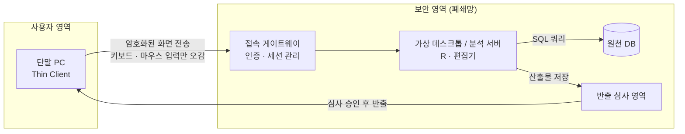
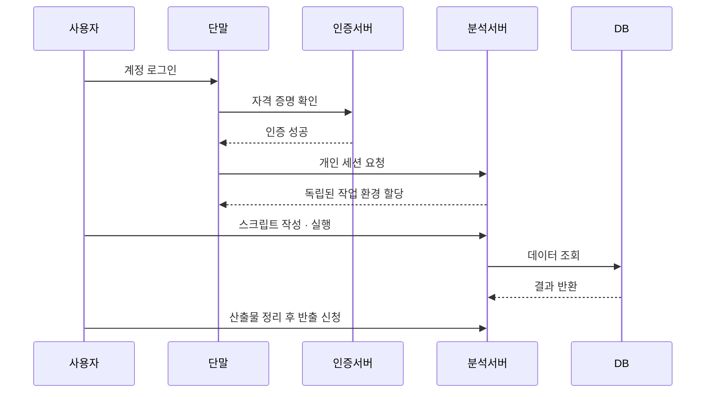
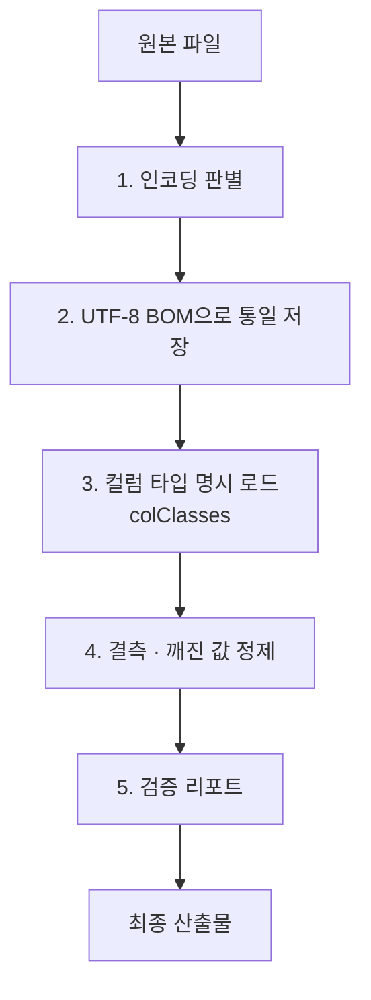

공공기관이나 금융권처럼 민감한 데이터를 다루는 곳에서는 분석 환경이 일반 PC와 크게 다릅니다. 인터넷이 없고, 패키지를 설치할 수 없고, 데이터는 지정된 서버 밖으로 나갈 수 없습니다. 이 글은 이런 망분리 환경이 어떤 구조로 동작하는지, 그리고 그 안에서 전처리를 어떻게 설계하면 좋은지 일반적인 관점에서 정리한 내용입니다.

## 망분리 분석 환경이란

망분리는 업무망과 인터넷망을 물리적 또는 논리적으로 분리해 외부 유출과 침입 경로를 차단하는 보안 방식입니다. 데이터 분석에서는 보통 다음 세 가지 원칙으로 나타납니다.

- 원본 데이터는 보안 영역 안의 서버에만 존재합니다.
- 사용자는 단말에서 서버에 접속해 화면만 보며 작업합니다.
- 분석 결과를 밖으로 가져가려면 반출 심사를 거칩니다.

## 전체 구조



핵심은 단말과 서버 사이에 **원본 데이터가 아닌 화면 픽셀과 입력 신호만** 오간다는 점입니다.

## 작업 흐름



## 핵심 개념

### VDI와 Thin Client

VDI(Virtual Desktop Infrastructure)는 데스크톱 환경을 서버에서 실행하고 사용자는 화면만 받아보는 방식입니다. 단말은 연산과 저장을 거의 하지 않는 Thin Client 역할을 합니다. RDP, PCoIP, ICA 같은 원격 화면 프로토콜이 이 통신을 담당하며, 일반적으로 암호화 채널 위에서 동작합니다.

이 구조 덕분에 단말을 분실하거나 교체해도 데이터가 남지 않고, 반출 통제 지점을 서버 쪽 한 곳으로 모을 수 있습니다.

### 중앙 인증과 세션 격리

다수의 사용자가 하나의 서버 자원을 나눠 쓰려면 인증과 격리가 필수입니다.

- **중앙 인증**: Active Directory나 LDAP 같은 디렉터리 서비스로 계정을 통합 관리합니다. 리눅스 서버에서는 PAM(Pluggable Authentication Modules)이 이 인증 요청을 연결하는 역할을 하는 경우가 많습니다.
- **프로세스 격리**: 로그인한 사용자마다 별도 프로세스와 작업 디렉터리를 할당받습니다. 운영체제 권한 체계 덕분에 다른 사용자의 메모리와 파일에는 접근할 수 없습니다.
- **자원 할당**: 가상화 호스트나 컨테이너 환경이 CPU와 메모리를 사용자별로 나눠 줍니다.

### 사용자 데이터 저장 방식

여러 단말 중 어느 것을 써도 같은 작업 환경이 보이는 경우가 있습니다. 이는 일반적으로 작업 파일이 단말이 아니라 중앙 스토리지나 서버에 저장되기 때문입니다. 단말은 이를 보여 주는 창일 뿐입니다.

## 분석가가 알아둘 제약

| 항목 | 일반 환경 | 망분리 환경 |
|---|---|---|
| 패키지 설치 | `pip`, `install.packages` 자유 | 대부분 불가, 기본 내장만 사용 |
| 외부 자료 참조 | 검색, 문서 즉시 확인 | 사전에 오프라인으로 준비 |
| 파일 이동 | 자유 | 승인된 경로와 절차만 허용 |
| 작업 단위 | 노트북, 단일 파일 위주 | 스크립트 분리와 재현성 중시 |

외부 도움을 받기 어렵기 때문에 **사용할 함수와 처리 규칙을 미리 설계해서 들어가는 것**이 효율을 크게 좌우합니다.

## Base R 전처리 파이프라인 설계

패키지 없이 Base R만으로도 현장 전처리는 충분히 가능합니다. 원천 파일이 깨끗하게 정제되어 있지 않은 경우가 많아, 다음 순서로 단계를 나누는 것이 안정적입니다.



### 1. 인코딩 판별과 통일

UTF-8, CP949, ANSI가 섞여 있을 수 있으므로 후보 인코딩을 순회하며 읽어 보고 한글이 정상적으로 복원되는 쪽을 채택합니다. 확정한 뒤에는 UTF-8 BOM으로 저장해 이후 단계의 변환 문제를 없앱니다.

```r
detect_encoding <- function(path, candidates = c("UTF-8", "CP949", "EUC-KR")) {
  for (enc in candidates) {
    lines <- tryCatch(
      readLines(path, n = 200, encoding = enc, warn = FALSE),
      error = function(e) NULL
    )
    if (is.null(lines)) next
    converted <- iconv(lines, from = enc, to = "UTF-8", sub = NA)
    if (!anyNA(converted)) return(enc)
  }
  NA_character_
}
```

### 2. 컬럼 타입 고정

타입 추론에 맡기지 않고 컬럼별 타입을 사전에 정의해 `colClasses`로 읽습니다. 사양서가 있다면 이를 그대로 코드화해 두면 재사용하기 좋습니다.

```r
col_spec <- c(id = "character", amount = "numeric", date = "character")
df <- read.csv(path, colClasses = col_spec, fileEncoding = "UTF-8-BOM")
```

### 3. 이상값 제거

- `NULL`, `NA`, 빈 문자열 같은 결측 표기를 하나의 규칙으로 통일합니다.
- 인코딩 오류로 생긴 치환 문자(`�`)나 제어 문자를 정규표현식으로 탐지해 제거합니다.
- 숫자형 컬럼에서 변환 불가 값은 `NA`로 바꾸고 건수를 기록합니다.

### 4. 단계별 스크립트 분리

한 파일에 모두 넣지 않고 단계별로 나눈 뒤 하나의 진입 스크립트에서 연결합니다.

```
pipeline/
├── 01_encoding.R
├── 02_types.R
├── 03_clean.R
├── 04_validate.R
└── run_pipeline.R
```

```r
# run_pipeline.R
steps <- c("01_encoding.R", "02_types.R", "03_clean.R", "04_validate.R")
for (s in steps) {
  message("실행: ", s)
  source(s, encoding = "UTF-8")
}
```

장시간 작업은 터미널에서 `Rscript run_pipeline.R`로 실행하면 대화형 세션과 분리해 돌릴 수 있습니다. 각 단계의 중간 산출물과 정제 건수 로그를 남기면 반출 심사나 재현 요청에도 대응하기 쉽습니다.

## 정리

- 망분리 환경은 단말에는 화면만, 서버에는 데이터와 연산을 두는 구조입니다.
- 보안 통제는 인증, 세션 격리, 반출 심사의 세 지점에서 이뤄집니다.
- 패키지 없이 작업해야 하므로 처리 규칙을 사전에 설계하고, 단계별 스크립트로 나눠 재현성을 확보하는 것이 중요합니다.
