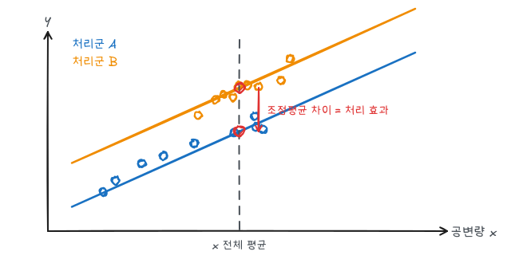

『생명과학연구를 위한 통계적 방법』(이재원·박미라·유한나)과 전북대학교 최혜미 교수님 강의를 바탕으로 정리했다.

공분산분석(ANCOVA)은 분산분석과 회귀분석을 결합한 방법이다. 반응변수는 연속형이고, 주요 설명변수는 처리군 같은 범주형 변수이며, 반응변수에 영향을 줄 수 있는 연속형 공변량을 함께 보정하고 싶을 때 사용한다. 분산분석은 [평균 비교](/posts/biostat-mean-comparison)와 [일원배치](/posts/doe-02-one-way)에서, 회귀는 [상관과 회귀](/posts/biostat-correlation-regression)에서 다뤘다. 이 글은 두 모형을 한 모형에 넣는다. 이 글의 SAS 출력은 직접 옮기지 않고 같은 자료를 R로 계산한 값(R로 확인한 값)으로 적는다.

## 1. 왜 공분산분석을 쓰는가

처리군 사이 평균을 비교할 때, 반응변수에 영향을 주는 연속형 변수가 함께 존재할 수 있다. 예를 들어 치료 후 혈압을 비교할 때 치료 전 혈압이 다르면, 치료 후 혈압 평균을 단순 비교하는 것만으로는 처리 효과를 보기 어렵다.

공분산분석의 목적은 다음과 같다.

- 처리 효과를 비교하되 공변량의 영향을 보정한다.
- 보정 후 처리군의 조정평균을 비교한다.
- 반응변수 변동 중 공변량으로 설명되는 부분을 제거해 분석의 정밀도를 높인다.

공변량은 처리의 결과가 아니라, 처리 이전에 측정되었거나 처리에 의해 영향을 받지 않는 변수여야 한다. 처리 이후에 생긴 변수를 공변량으로 넣으면 처리 효과의 일부를 잘못 제거할 수 있다.

## 2. ANOVA, 회귀, ANCOVA

분산분석은 연속형 반응변수와 범주형 설명변수의 관계를 다룬다.

회귀분석은 연속형 반응변수와 수치형 설명변수의 관계를 다룬다.

공분산분석은 이 둘을 함께 둔다.

| 방법 | 반응변수 | 설명변수 |
| --- | --- | --- |
| ANOVA | 연속형 | 범주형 |
| 회귀분석 | 연속형 | 수치형 |
| ANCOVA | 연속형 | 범주형 + 수치형 공변량 |

## 3. 기본 ANCOVA 모형

처리군이 $I$개이고 각 처리군 안에 관측값이 있다고 하자. 공변량을 $x_{ij}$, 반응변수를 $y_{ij}$라고 하면 기본 모형은 다음과 같다.

$$
y_{ij}
= \mu + \alpha_i + \beta(x_{ij}-\bar x_{\cdot\cdot}) + \epsilon_{ij}
$$

여기서 $\alpha_i$는 처리군 효과이고, $\beta$는 공변량의 회귀계수다. 오차항은 보통 서로 독립이고 평균 0, 분산 $\sigma^2$인 정규분포를 따른다고 가정한다.

같은 모형을 다음처럼 볼 수도 있다.

$$
y_{ij} = \alpha_{0i} + \beta x_{ij} + \epsilon_{ij}
$$

처리군마다 절편은 다르지만 기울기 $\beta$는 같다는 것이 기본 ANCOVA의 핵심이다.



### 조정평균

조정평균(least squares mean)은 모든 처리군의 공변량이 전체 평균 $\bar x_{\cdot\cdot}$이라고 했을 때의 예측 평균이다.

$$
\bar y_{i}^{\,adj} = \bar y_{i\cdot} - \hat\beta (\bar x_{i\cdot} - \bar x_{\cdot\cdot})
$$

공변량 평균이 전체 평균보다 큰 처리군은 그만큼 반응값을 깎고, 작은 처리군은 더해 준다. 그림에서 세로 점선 위치($\bar x_{\cdot\cdot}$)에서 각 처리군 직선의 높이가 조정평균이다. 두 처리군의 조정평균 차이는 두 평행선 사이의 세로 거리 $\alpha_1 - \alpha_2$와 같고, 이것이 공변량을 보정한 처리 효과다.

### 공분산분석이 정밀도를 높이는 이유

$\beta$를 통해 공변량이 설명하는 변동을 오차에서 빼므로 오차분산이 $\sigma^2(1 - \rho^2)$ 정도로 줄어든다. $\rho$는 공변량과 반응변수의 군내 상관이다. 무작위 배정한 실험에서도 공변량을 넣으면 처리 효과의 표준오차가 작아져 검정력이 올라간다.

처리 전 값 $x$와 처리 후 값 $y$가 있는 사전-사후 설계에서 변화량($y - x$)을 비교하는 분석은 ANCOVA에서 $\beta = 1$로 고정한 특수한 경우다. 세 분석의 차이는 13절에서 정리한다.

## 4. 핵심 가정

공분산분석에서는 다음 가정을 확인해야 한다.

- 독립성: 관측값은 서로 독립이다.
- 정규성: 각 처리군의 오차는 정규분포를 따른다.
- 등분산성: 처리군별 오차분산이 같다.
- 공변량과 반응변수의 선형관계: 공변량 효과가 선형으로 설명 가능하다.
- 평행기울기: 처리군별 공변량 기울기가 같다.
- 공변량은 처리에 의해 영향을 받지 않는다.

평행기울기 가정이 깨지면 처리 효과는 공변량 값에 따라 달라진다. 이때는 단순히 하나의 조정평균 차이로 처리 효과를 요약하기 어렵다.

## 5. 검정할 가설

기본 ANCOVA에서는 두 질문이 중요하다.

첫째, 공변량 효과가 있는가?

$$
H_{01}: \beta = 0
$$

이 가설을 기각하지 못하면 공변량을 넣을 필요가 크지 않을 수 있다.

둘째, 공변량을 보정한 뒤에도 처리 효과가 있는가?

$$
H_{02}: \alpha_1 = \alpha_2 = \cdots = \alpha_I
$$

이 가설을 기각하면 처리군의 조정평균이 모두 같지는 않다고 본다.

## 6. SAS 기본 문법

`PROC GLM`을 이용해 ANCOVA를 적합할 수 있다.

```sas
proc glm data=dataset;
  class trt;
  model y = trt x / solution;
  lsmeans trt / pdiff cl;
run;
quit;
```

여기서 `trt`는 처리군, `x`는 공변량, `y`는 반응변수다. `LSMEANS`는 공변량을 보정한 조정평균을 출력한다.

평행기울기 가정을 확인하려면 처리와 공변량의 상호작용을 넣는다.

```sas
proc glm data=dataset;
  class trt;
  model y = trt x trt*x;
run;
quit;
```

`trt*x`가 유의하면 처리군별 기울기가 다르다는 뜻이다.

## 7. Type I SS와 Type III SS

SAS `PROC GLM`에서는 여러 종류의 제곱합을 출력한다. 8절의 예제 5.1에서 두 제곱합이 얼마나 다른지 본다.

Type I SS는 모형에 변수가 들어가는 순서에 따라 달라지는 순차 제곱합이다. `model y = trt x;`와 `model y = x trt;`의 Type I SS는 달라질 수 있다.

Type III SS는 다른 효과들을 보정한 뒤 해당 효과가 추가로 설명하는 부분을 본다. 불균형 자료나 여러 효과가 있는 모형에서는 Type III SS가 해석에 자주 쓰인다.

ANCOVA에서 보통 관심 있는 질문은 "공변량을 보정한 뒤 처리 효과가 있는가"이므로 Type III SS의 `trt` 효과를 확인하는 경우가 많다.

## 8. 예제 5.1: 저혈당 치료법 비교

저혈당 환자 20명을 5개 치료법에 4명씩 무작위로 배정하고, 1달 후 혈당 수치($y$)를 측정했다. 1달 후 수치는 초기 혈당 수치($x$)의 영향을 받을 것으로 보고 초기값을 공변량으로 둔다.

```sas
data medicine;
  input trt x y @@;
  datalines;
1 27.2 32.6  1 22.0 36.6
1 33.0 37.7  1 26.8 31.0
2 28.6 33.8  2 26.8 31.7
2 26.5 30.7  2 26.8 30.4
3 28.6 35.2  3 22.4 29.1
3 23.2 28.9  3 24.4 30.2
4 29.3 35.0  4 21.8 27.0
4 30.3 36.4  4 24.3 30.5
5 20.4 24.6  5 19.6 23.4
5 25.1 30.3  5 18.1 21.8
;
run;

proc sgplot data=medicine;
  reg x=x y=y / group=trt;
run;

proc glm data=medicine;
  class trt;
  model y = trt x trt*x;                  /* 1단계: 기울기 동일성 검정 */
run;
quit;

proc glm data=medicine;
  class trt;
  model y = trt x / solution;             /* 2단계: 평행기울기 ANCOVA */
  lsmeans trt / stderr pdiff adjust=tukey;
run;
quit;
```

읽는 순서는 다음과 같다.

1. 1단계의 `trt*x` 행이 유의하지 않으면 처리 간 회귀계수 $\beta$가 같다는 가정을 받아들이고 2단계로 간다.
2. 2단계 Type III SS에서 `x` 행은 처리를 보정한 초기값 효과($H_0: \beta = 0$), `trt` 행은 초기값을 보정한 치료법 효과($H_0: \alpha_1 = \cdots = \alpha_5$)다.
3. `lsmeans`는 모든 환자의 초기값이 전체 평균이라고 했을 때의 치료법별 조정평균이다. `pdiff adjust=tukey`는 모든 쌍의 차이를 Tukey 방법으로 보정해 검정한다. 대조군 하나와만 비교한다면 `pdiff=control('1') adjust=dunnett`을 쓴다.
4. 5번 치료법은 초기값이 낮은 환자가 몰려 단순 평균이 낮게 나온다. 조정평균에서는 이 차이가 보정된다.

같은 자료를 R로 계산해 확인한다. 교호작용이 없는 모형에서는 SAS의 Type I이 `anova()`, Type III이 `drop1()`에 해당한다.

```r
medicine <- as.data.frame(matrix(c(
  1,27.2,32.6, 1,22.0,36.6, 1,33.0,37.7, 1,26.8,31.0,
  2,28.6,33.8, 2,26.8,31.7, 2,26.5,30.7, 2,26.8,30.4,
  3,28.6,35.2, 3,22.4,29.1, 3,23.2,28.9, 3,24.4,30.2,
  4,29.3,35.0, 4,21.8,27.0, 4,30.3,36.4, 4,24.3,30.5,
  5,20.4,24.6, 5,19.6,23.4, 5,25.1,30.3, 5,18.1,21.8),
  ncol = 3, byrow = TRUE))
names(medicine) <- c("trt", "x", "y")
medicine$trt <- factor(medicine$trt)

anova(lm(y ~ trt, medicine))              # 공변량 없음
anova(lm(y ~ trt * x, medicine))          # 1단계
fit <- lm(y ~ trt + x, medicine)          # 2단계
anova(fit)                                # Type I (trt 먼저)
drop1(fit, test = "F")                    # Type III
coef(fit)["x"]
predict(fit, data.frame(trt = factor(1:5), x = mean(medicine$x)))
```

R로 확인한 값은 다음과 같다.

| 확인할 것 | 값 |
|---|---|
| 1단계 `trt*x` | $F = 2.92$, $p = 0.077$ (평행기울기 가정을 기각하지 못함) |
| 2단계 `x` (Type III) | $F = 19.12$, $p = 0.0006$, $\hat\beta = 0.753$ |
| 2단계 `trt` (Type III) | $F = 1.77$, $p = 0.19$, 제곱합 34.19 |
| 2단계 `trt` (Type I) | $F = 10.25$, $p = 0.0004$, 제곱합 198.41 |
| 공변량 없는 일원분산분석 `trt` | $F = 4.64$, $p = 0.012$ |
| 오차 평균제곱 | 공변량 없음 10.68 → ANCOVA 4.84 |
| 조정평균 (치료 1~5) | 32.98, 30.21, 31.31, 31.35, 28.39 |
| 단순 평균 (치료 1~5) | 34.48, 31.65, 30.85, 32.23, 25.03 |

초기값을 보정하면 결론이 바뀐다. 공변량 없이는 치료법 사이에 차이가 있어 보이지만($p = 0.012$), 초기값을 보정한 Type III의 `trt`는 유의하지 않다($p = 0.19$). 5번 치료법의 단순 평균은 25.03으로 가장 낮았으나 초기 혈당이 낮은 환자가 몰렸기 때문이고(5번의 초기값 평균 20.8, 전체 평균 25.3), 조정평균은 28.39로 올라온다. Type I의 `trt`(198.41)는 `x`를 보정하기 전의 제곱합이라 공변량 없는 분산분석의 제곱합과 같고, Type III의 `trt`(34.19)가 보정 후의 제곱합이다. 공변량이 오차 평균제곱을 절반 이하로 줄여($10.68 \to 4.84$) 정밀도를 높였다. Tukey로 모든 쌍을 비교하면 가장 큰 차이인 1번과 5번($4.59$, 표준오차 1.91)도 수정 $p = 0.17$이다.

## 9. 예제 5.2: 공변량이 두 개인 경우

$$
y_{ij} = \beta_0 + \alpha_i + \beta_1 x_{1ij} + \beta_2 x_{2ij} + \epsilon_{ij}
$$

약물의 체내 배출 연구다. 약의 형태(`type`, 6가지)에 따라 배출되는 약물량($y$)이 다른지 보려 하는데, 배출량은 항신진대사 점수($x_1$)와 측정 시간($x_2$)의 영향도 받는다.

```sas
data elimination;
  do type = 1 to 6;
    input x1 x2 y @@;
    output;
  end;
  datalines;
37 61 11.3208 37 37 12.9151 45 53 18.8947
41 41 14.6739 57 41 8.6493 49 33 9.5238
49 49 7.6923 53 53 0.0017 53 45 8.0477
61 37 6.1441 49 65 21.7939 53 53 6.7358
53 45 4.2553 57 57 0.0017 49 49 11.0196
53 53 6.2762 53 45 13.2316 53 53 5.0676
57 57 5.6235 49 49 14.9893 53 53 13.7233
53 45 6.0669 53 53 8.1602 61 37 1.5523
45 45 6.9971 53 45 5.2308 57 57 8.256
49 49 14.5 53 53 20.7627 53 45 3.6115
53 53 11.3475 53 45 9.465 53 53 22.6103
61 37 0.002 49 65 20.5997 37 37 28.1828
;
run;

proc glm data=elimination;
  class type;
  model y = type x1 x2 / solution;
  lsmeans type / stderr pdiff;
run;
quit;
```

`do type = 1 to 6; input ... @@; output; end;`는 `@@`로 줄을 넘나들며 읽은 관측값 6개를 `type` 1~6에 차례로 배정한다. 한 줄에 관측값이 3개씩이므로 두 줄이 6개 형태를 한 번씩 이루고, 모두 36개 관측값(형태마다 6개)이다. 적합된 식은 형태마다 절편만 다르고 $x_1$, $x_2$의 기울기는 같다.

$$
\hat y_{ij} = \hat\beta_0 + \hat\alpha_i + \hat\beta_1 x_{1ij} + \hat\beta_2 x_{2ij}
$$

조정평균은 $x_1$, $x_2$를 모두 전체 평균에 두었을 때의 형태별 예측값이다.

```r
elim <- as.data.frame(matrix(c(
  37,61,11.3208, 37,37,12.9151, 45,53,18.8947, 41,41,14.6739, 57,41,8.6493, 49,33,9.5238,
  49,49,7.6923, 53,53,0.0017, 53,45,8.0477, 61,37,6.1441, 49,65,21.7939, 53,53,6.7358,
  53,45,4.2553, 57,57,0.0017, 49,49,11.0196, 53,53,6.2762, 53,45,13.2316, 53,53,5.0676,
  57,57,5.6235, 49,49,14.9893, 53,53,13.7233, 53,45,6.0669, 53,53,8.1602, 61,37,1.5523,
  45,45,6.9971, 53,45,5.2308, 57,57,8.256, 49,49,14.5, 53,53,20.7627, 53,45,3.6115,
  53,53,11.3475, 53,45,9.465, 53,53,22.6103, 61,37,0.002, 49,65,20.5997, 37,37,28.1828),
  ncol = 3, byrow = TRUE))
names(elim) <- c("x1", "x2", "y")
elim$type <- factor(rep(1:6, length.out = nrow(elim)))

anova(lm(y ~ type, elim))
fit2 <- lm(y ~ type + x1 + x2, elim)
drop1(fit2, test = "F")
coef(fit2)[c("x1", "x2")]
predict(fit2, data.frame(type = factor(1:6), x1 = mean(elim$x1), x2 = mean(elim$x2)))
```

R로 확인한 값은 다음과 같다. 공변량 없이 형태만으로 분산분석하면 $F = 1.79$, $p = 0.15$로 유의하지 않다. $x_1, x_2$를 넣으면 형태 효과가 $F = 4.01$, $p = 0.007$로 유의해진다. 항신진대사 점수 $x_1$의 계수는 $-0.720$($p < 0.0001$)이고 측정 시간 $x_2$는 $0.057$($p = 0.63$)로 유의하지 않다. 오차 평균제곱이 41.9에서 21.9로 줄었다. 조정평균(형태 1~6)은 6.09, 6.51, 13.90, 9.50, 16.04, 9.27이다. 공변량이 오차를 줄여 처리 효과가 드러나는 사례이고, 예제 5.1과 반대로 보정이 결론을 유의하게 만든다.

## 10. 기울기가 다른 ANCOVA

처리군마다 공변량 효과가 다를 수 있다. 이때는 다음 모형을 고려한다.

$$
y_{ij}
= \beta_0 + \alpha_i + \beta_i x_{ij} + \epsilon_{ij}
$$

이는 처리군과 공변량의 상호작용을 포함한 모형이다.

SAS에서는 다음처럼 쓴다.

```sas
proc glm data=oxygen;
  class trt;
  model y = trt x trt*x / solution;
run;
quit;
```

검정할 가설은 처리군별 기울기가 같은지 여부다.

$$
H_0: \beta_1 = \beta_2 = \cdots = \beta_I
$$

상호작용이 유의하지 않으면 평행기울기 모형으로 단순화할 수 있다. 상호작용이 유의하면 특정 공변량 값에서의 처리 효과를 따로 해석하거나, 공변량 범위별 예측값을 제시해야 한다.

## 11. 예제 5.3: 처리별 기울기 비교

흡연자를 대상으로 산소운반 능력을 개선하는 서로 다른 치료법 3개를 적용해 산소운반 능력($y$)을 조사했다. 산소운반 능력은 1인당 담배 소비량($x$)의 영향을 받으므로 이를 공변량으로 둔다.

```sas
data oxygen;
  input trt x y @@;
  datalines;
1 40 165 1 54 85  1 85 9   1 95 43  1 81 94
1 26 226 1 90 7   1 95 9   1 83 12  1 83 145
2 85 11  2 83 6   2 65 51  2 98 18  2 47 189
2 74 90  2 75 10  2 97 12  2 79 35  2 91 27
3 65 89  3 25 64  3 34 87  3 20 45  3 30 56
3 29 87  3 100 59 3 85 39  3 24 87  3 26 67
;
run;

proc glm data=oxygen;
  class trt;
  model y = trt x trt*x / solution;
  estimate 'slope: trt 1' x 1 trt*x 1 0 0;
  estimate 'slope: trt 2' x 1 trt*x 0 1 0;
  estimate 'slope: trt 3' x 1 trt*x 0 0 1;
run;
quit;
```

- `trt*x`의 Type III 검정이 처리별 기울기가 같은지($H_0: \beta_1 = \beta_2 = \beta_3$)에 대한 검정이다.
- `estimate 'slope: trt 1' x 1 trt*x 1 0 0;`은 공통 기울기 $\beta$에 1번 처리의 기울기 편차를 더한, 1번 처리의 기울기 $\beta + (\alpha\beta)_1$이다. 처리별로 담배 소비량이 1단위 늘 때 산소운반 능력이 얼마나 변하는지를 보여 준다.

치료법 1, 2에서는 담배 소비량이 많을수록 산소운반 능력이 크게 떨어지는 반면 치료법 3은 그 관계가 약해 보인다. 상호작용이 유의하면 "어느 치료법이 낫다"를 하나로 말할 수 없고, 담배 소비량 수준에 따라 처리 효과를 따로 제시해야 한다.

```sas
proc glm data=oxygen;
  class trt;
  model y = trt x trt*x;
  lsmeans trt / at x=30 pdiff;
  lsmeans trt / at x=60 pdiff;
  lsmeans trt / at x=90 pdiff;
run;
quit;
```

`lsmeans ... / at x=`는 지정한 공변량 값에서의 처리 평균과 차이를 계산한다. 자료 범위 밖의 값은 외삽이므로 쓰지 않는다.

R로 확인한다.

```r
oxygen <- as.data.frame(matrix(c(
  1,40,165, 1,54,85, 1,85,9, 1,95,43, 1,81,94, 1,26,226, 1,90,7, 1,95,9, 1,83,12, 1,83,145,
  2,85,11, 2,83,6, 2,65,51, 2,98,18, 2,47,189, 2,74,90, 2,75,10, 2,97,12, 2,79,35, 2,91,27,
  3,65,89, 3,25,64, 3,34,87, 3,20,45, 3,30,56, 3,29,87, 3,100,59, 3,85,39, 3,24,87, 3,26,67),
  ncol = 3, byrow = TRUE))
names(oxygen) <- c("trt", "x", "y")
oxygen$trt <- factor(oxygen$trt)

fit_int <- lm(y ~ trt * x, oxygen)
anova(fit_int)
sapply(1:3, function(i) coef(lm(y ~ x, oxygen[oxygen$trt == i, ]))["x"])
sapply(c(30, 60, 90), function(x0) predict(fit_int, data.frame(trt = factor(1:3), x = x0)))
tapply(oxygen$x, oxygen$trt, range)
anova(update(fit_int, . ~ . - trt), fit_int)
```

R로 확인한 값은 다음과 같다. 처리별 기울기가 같다는 가설은 $F = 10.35$, $p = 0.0006$로 기각된다. 처리별 기울기는 $-2.66$, $-3.02$, $-0.17$이다.

| 담배 소비량 $x$ | 치료 1 | 치료 2 | 치료 3 |
|---|---|---|---|
| 30 | 194.3 | 194.0 | 70.4 |
| 60 | 114.6 | 103.4 | 65.2 |
| 90 | 34.9 | 12.9 | 60.0 |

$x = 30$에서는 치료 1, 2가 치료 3보다 훨씬 높지만 $x = 90$에서는 치료 3이 가장 높다. 처리 순위가 공변량에 따라 뒤바뀌므로 하나의 조정평균 차이로 요약할 수 없다. 세 치료의 $x$ 범위는 각각 26~95, 47~98, 20~100이어서 30, 60, 90은 모두 범위 안이다. 또한 상호작용 모형의 Type III `trt` 검정은 $x = 0$에서의 처리 차이를 보는데($F = 14.27$) 자료 범위 밖의 값이라 해석하지 않는다.

분석 흐름을 정리하면 다음과 같다.

1. `trt*x` 상호작용으로 평행기울기 가정을 검정한다.
2. 유의하지 않으면 `model y = trt x`로 줄이고 Type III SS의 `trt`와 조정평균 차이를 본다.
3. 유의하면 처리별 기울기를 `estimate`로 보고하고, 의미 있는 공변량 값 몇 곳에서 처리 효과를 제시한다.

## 12. 해석할 때 주의할 점

공분산분석은 단순한 평균 비교보다 강력하지만, 해석할 때 더 많은 조건이 필요하다.

- 공변량은 처리 이전에 측정되었는가?
- 처리군 사이 공변량 분포가 지나치게 다르지 않은가?
- 공변량과 반응변수의 관계가 선형인가?
- 처리군별 회귀기울기가 같은가?
- 조정평균을 계산한 공변량 값이 실제 자료 범위 안에 있는가?

특히 처리군별 공변량 범위가 거의 겹치지 않으면 조정평균은 외삽에 가까워질 수 있다.

## 13. 비교

기저값(공변량)이 있는 사전-사후 설계에서 처리효과를 추정하는 방법은 세 가지가 흔히 쓰인다. 변화량 분석은 ANCOVA에서 $\beta = 1$로 고정한 특수한 경우다.

| 방법 | 모형 | 기저값의 사용 | 처리효과 추정량의 분산 |
|---|---|---|---|
| 사후값 ANOVA | $Y = \mu + \tau T + \varepsilon$ | 사용 안 함 | $\propto \sigma_Y^2$ |
| 변화량 분석 | $Y - X = \mu + \tau T + \varepsilon$ | 계수를 1로 고정 | $\propto \sigma_Y^2 + \sigma_X^2 - 2\rho\sigma_X\sigma_Y$ |
| ANCOVA | $Y = \mu + \tau T + \beta X + \varepsilon$ | 계수를 추정 | $\propto \sigma_Y^2(1 - \rho^2)$ |

무작위 배정이면 세 방법 모두 불편추정량이고 차이는 분산이다. 두 측정의 분산이 같다면 변화량 분석의 분산은 $2(1 - \rho)\sigma^2$에 비례해 $\rho < 0.5$이면 사후값 분석보다 커진다. ANCOVA의 분산 $(1 - \rho^2)\sigma^2$은 $\beta$를 추정하느라 잃는 자유도 1을 무시하면 두 방법보다 항상 작거나 같다. 기저값이 측정된 무작위 비교 연구에서 ANCOVA를 기본 분석으로 권하는 근거다. 기저값이 높은 사람이 다음 측정에서 평균 쪽으로 돌아오는 **평균으로의 회귀**도 $\beta$ 추정을 통해 자연스럽게 반영된다. 예제 5.1, 5.2에서 공변량이 오차 평균제곱을 줄이는 정도를 볼 수 있다.

## 요약

| 단계 | 확인할 것 | SAS |
|---|---|---|
| 그림 | 집단별 산점도와 회귀선 | `sgplot reg / group=` |
| 평행기울기 | `trt*x` 상호작용 | `glm model y = trt x trt*x` |
| 처리 효과 | 공변량 보정 후 `trt`의 Type III SS | `glm model y = trt x / ss3` |
| 효과 크기 | 조정평균과 차이의 신뢰구간 | `lsmeans trt / pdiff cl` |
| 기울기 다름 | 공변량 값별 처리 효과 | `lsmeans trt / at x=` |
| 주의 | 공변량은 처리 전 측정, 집단 간 공변량 범위가 겹칠 것 | |
