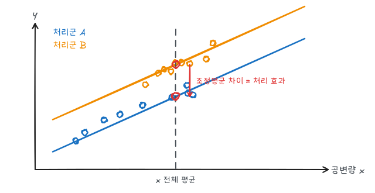

『생명과학연구를 위한 통계적 방법』(이재원·박미라·유한나)과 전북대학교 최혜미 교수님 강의를 바탕으로 정리했다.

공분산분석(ANCOVA)은 분산분석과 회귀분석을 결합한 방법이다. 반응변수는 연속형이고, 주요 설명변수는 처리군 같은 범주형 변수이며, 반응변수에 영향을 줄 수 있는 연속형 공변량을 함께 보정하고 싶을 때 사용한다.

## 1. 왜 공분산분석을 쓰는가

처리군 사이 평균을 비교할 때, 반응변수에 영향을 주는 연속형 변수가 함께 존재할 수 있다. 예를 들어 치료 후 혈압을 비교할 때 치료 전 혈압이 다르면, 치료 후 혈압 평균을 단순 비교하는 것만으로는 처리 효과를 보기 어렵다.

공분산분석의 목적은 다음과 같다.

- 처리 효과를 비교하되 공변량의 영향을 보정한다.
- 보정 후 처리군의 조정평균을 비교한다.
- 반응변수 변동 중 공변량으로 설명되는 부분을 제거해 분석의 정밀도를 높인다.

공변량은 처리의 결과가 아니라, 처리 이전에 측정되었거나 처리에 의해 영향을 받지 않는 변수여야 한다. 처리 이후에 생긴 변수를 공변량으로 넣으면 처리 효과의 일부를 잘못 제거할 수 있다.

## 2. ANOVA, 회귀, ANCOVA

분산분석은 연속형 반응변수와 범주형 설명변수의 관계를 다룬다.

회귀분석은 연속형 반응변수와 수치형 설명변수의 관계를 다룬다.

공분산분석은 이 둘을 함께 둔다.

| 방법 | 반응변수 | 설명변수 |
| --- | --- | --- |
| ANOVA | 연속형 | 범주형 |
| 회귀분석 | 연속형 | 수치형 |
| ANCOVA | 연속형 | 범주형 + 수치형 공변량 |

## 3. 기본 ANCOVA 모형

처리군이 $I$개이고 각 처리군 안에 관측값이 있다고 하자. 공변량을 $x_{ij}$, 반응변수를 $y_{ij}$라고 하면 기본 모형은 다음과 같다.

$$
y_{ij}
= \mu + \alpha_i + \beta(x_{ij}-\bar x_{\cdot\cdot}) + \epsilon_{ij}
$$

여기서 $\alpha_i$는 처리군 효과이고, $\beta$는 공변량의 회귀계수다. 오차항은 보통 서로 독립이고 평균 0, 분산 $\sigma^2$인 정규분포를 따른다고 가정한다.

같은 모형을 다음처럼 볼 수도 있다.

$$
y_{ij} = \alpha_{0i} + \beta x_{ij} + \epsilon_{ij}
$$

처리군마다 절편은 다르지만 기울기 $\beta$는 같다는 것이 기본 ANCOVA의 핵심이다.



### 조정평균

조정평균(least squares mean)은 모든 처리군의 공변량이 전체 평균 $\bar x_{\cdot\cdot}$이라고 했을 때의 예측 평균이다.

$$
\bar y_{i}^{\,adj} = \bar y_{i\cdot} - \hat\beta (\bar x_{i\cdot} - \bar x_{\cdot\cdot})
$$

공변량 평균이 전체 평균보다 큰 처리군은 그만큼 반응값을 깎고, 작은 처리군은 더해 준다. 그림에서 세로 점선 위치($\bar x_{\cdot\cdot}$)에서 각 처리군 직선의 높이가 조정평균이다. 두 처리군의 조정평균 차이는 두 평행선 사이의 세로 거리 $\alpha_1 - \alpha_2$와 같고, 이것이 공변량을 보정한 처리 효과다.

### 공분산분석이 정밀도를 높이는 이유

$\beta$를 통해 공변량이 설명하는 변동을 오차에서 빼므로 오차분산이 $\sigma^2(1 - \rho^2)$ 정도로 줄어든다. $\rho$는 공변량과 반응변수의 군내 상관이다. 무작위 배정한 실험에서도 공변량을 넣으면 처리 효과의 표준오차가 작아져 검정력이 올라간다.

### 사전-사후 설계: 변화량 분석과의 비교

치료 전 값 $x$와 치료 후 값 $y$가 있을 때 세 가지 분석이 가능하다.

| 분석 | 모형 | 암묵적 가정 |
|---|---|---|
| 사후 값 비교 | $y = \mu + \alpha_i$ | 기저값을 무시 |
| 변화량 비교 | $y - x = \mu + \alpha_i$ | $\beta = 1$ |
| ANCOVA | $y = \mu + \alpha_i + \beta x$ | $\beta$를 자료로 추정 |

변화량 분석은 ANCOVA에서 $\beta = 1$로 고정한 특수한 경우다. 무작위 배정 임상시험에서는 기저값을 공변량으로 넣는 ANCOVA가 가장 효율적이라는 것이 일반적인 권고다. 기저값이 높은 사람이 다음 측정에서 평균 쪽으로 돌아오는 **평균으로의 회귀**도 $\beta$ 추정을 통해 자연스럽게 반영된다.

## 4. 핵심 가정

공분산분석에서는 다음 가정을 확인해야 한다.

- 독립성: 관측값은 서로 독립이다.
- 정규성: 각 처리군의 오차는 정규분포를 따른다.
- 등분산성: 처리군별 오차분산이 같다.
- 공변량과 반응변수의 선형관계: 공변량 효과가 선형으로 설명 가능하다.
- 평행기울기: 처리군별 공변량 기울기가 같다.
- 공변량은 처리에 의해 영향을 받지 않는다.

평행기울기 가정이 깨지면 처리 효과는 공변량 값에 따라 달라진다. 이때는 단순히 하나의 조정평균 차이로 처리 효과를 요약하기 어렵다.

## 5. 검정할 가설

기본 ANCOVA에서는 두 질문이 중요하다.

첫째, 공변량 효과가 있는가?

$$
H_{01}: \beta = 0
$$

이 가설을 기각하지 못하면 공변량을 넣을 필요가 크지 않을 수 있다.

둘째, 공변량을 보정한 뒤에도 처리 효과가 있는가?

$$
H_{02}: \alpha_1 = \alpha_2 = \cdots = \alpha_I
$$

이 가설을 기각하면 처리군의 조정평균이 모두 같지는 않다고 본다.

## 6. SAS 기본 문법

`PROC GLM`을 이용해 ANCOVA를 적합할 수 있다.

```sas
proc glm data=dataset;
  class trt;
  model y = trt x / solution;
  lsmeans trt / pdiff cl;
run;
quit;
```

여기서 `trt`는 처리군, `x`는 공변량, `y`는 반응변수다. `LSMEANS`는 공변량을 보정한 조정평균을 출력한다.

평행기울기 가정을 확인하려면 처리와 공변량의 상호작용을 넣는다.

```sas
proc glm data=dataset;
  class trt;
  model y = trt x trt*x;
run;
quit;
```

`trt*x`가 유의하면 처리군별 기울기가 다르다는 뜻이다.

## 7. Type I SS와 Type III SS

SAS `PROC GLM`에서는 여러 종류의 제곱합을 출력한다.

Type I SS는 모형에 변수가 들어가는 순서에 따라 달라지는 순차 제곱합이다. `model y = trt x;`와 `model y = x trt;`의 Type I SS는 달라질 수 있다.

Type III SS는 다른 효과들을 보정한 뒤 해당 효과가 추가로 설명하는 부분을 본다. 불균형 자료나 여러 효과가 있는 모형에서는 Type III SS가 해석에 자주 쓰인다.

ANCOVA에서 보통 관심 있는 질문은 "공변량을 보정한 뒤 처리 효과가 있는가"이므로 Type III SS의 `trt` 효과를 확인하는 경우가 많다.

## 8. 예제: 키를 보정한 성별 체중 비교

SAS 내장 `sashelp.class`는 학생 19명의 성별(`Sex`), 키(`Height`, 인치), 체중(`Weight`, 파운드)이다. 남학생이 평균적으로 키가 크므로, 체중의 성별 차이를 단순 비교하면 키 차이까지 섞인다.

```sas
proc means data=sashelp.class mean std;
  class Sex;
  var Height Weight;
run;

proc sgplot data=sashelp.class;
  reg x=Height y=Weight / group=Sex;
run;

proc glm data=sashelp.class;
  class Sex;
  model Weight = Sex Height Sex*Height;     /* 1단계: 평행기울기 확인 */
run;
quit;

proc glm data=sashelp.class plots=ancovaplot;
  class Sex;
  model Weight = Sex Height / solution ss3;  /* 2단계: 평행기울기 ANCOVA */
  lsmeans Sex / pdiff cl stderr;
run;
quit;
```

읽는 순서는 다음과 같다.

1. 1단계의 `Sex*Height` 행이 유의하지 않으면 평행기울기 가정을 받아들이고 2단계로 간다.
2. 2단계 Type III SS 표에서 `Height` 행은 성별을 보정한 키 효과($H_0: \beta = 0$), `Sex` 행은 키를 보정한 성별 효과($H_0: \alpha_1 = \alpha_2$)다.
3. `lsmeans`의 조정평균과 그 차이, 신뢰구간으로 효과 크기를 보고한다.
4. `proc means`의 단순 평균 차이와 조정평균 차이를 비교한다. 단순 평균 차이의 상당 부분이 키 차이로 설명된다면 조정평균 차이는 작아진다.

`plots=ancovaplot`은 집단별 평행 회귀선을 그려 준다.

## 9. 공변량이 여러 개인 경우

$$
y_{ij} = \mu + \alpha_i + \beta_1 (x_{1ij} - \bar x_{1}) + \beta_2 (x_{2ij} - \bar x_{2}) + \epsilon_{ij}
$$

조정평균은 모든 공변량을 전체 평균에 두었을 때의 예측값이다. SAS 내장 `sashelp.bweight`는 미국 출생아 50,000명의 출생체중(`Weight`, g)과 산모 특성이다. 산모 흡연(`MomSmoke`)에 따른 출생체중 차이를 산모 나이와 임신 중 체중 증가로 보정한다.

```sas
proc glm data=sashelp.bweight;
  class MomSmoke;
  model Weight = MomSmoke MomAge MomWtGain / solution ss3;
  lsmeans MomSmoke / pdiff cl;
run;
quit;
```

`MomAge`, `MomWtGain`은 이 자료에서 이미 평균 중심화된 변수다. 표본이 매우 크면 작은 차이도 유의하게 나오므로, $p$값보다 조정평균 차이(g)의 크기로 임상적 의미를 판단한다.

## 10. 기울기가 다른 ANCOVA

처리군마다 공변량 효과가 다를 수 있다. 이때는 다음 모형을 고려한다.

$$
y_{ij}
= \beta_0 + \alpha_i + \beta_i x_{ij} + \epsilon_{ij}
$$

이는 처리군과 공변량의 상호작용을 포함한 모형이다.

SAS에서는 다음처럼 쓴다.

```sas
proc glm data=ex53;
  class trt;
  model y = trt x trt*x / solution;
run;
quit;
```

검정할 가설은 처리군별 기울기가 같은지 여부다.

$$
H_0: \beta_1 = \beta_2 = \cdots = \beta_I
$$

상호작용이 유의하지 않으면 평행기울기 모형으로 단순화할 수 있다. 상호작용이 유의하면 특정 공변량 값에서의 처리 효과를 따로 해석하거나, 공변량 범위별 예측값을 제시해야 한다.

## 11. 예제: 기울기가 다른 경우의 해석

상호작용이 유의하면 "처리 효과"가 공변량 값마다 다르다. 이때는 조정평균 하나로 요약하지 않고, 공변량의 여러 값에서 처리군 차이를 따로 제시한다.

```sas
proc glm data=sashelp.class;
  class Sex;
  model Weight = Sex Sex*Height / noint solution;   /* 집단별 절편과 기울기를 직접 추정 */
run;
quit;

proc glm data=sashelp.class;
  class Sex;
  model Weight = Sex Height Sex*Height;
  lsmeans Sex / at Height=55 pdiff cl;
  lsmeans Sex / at Height=60 pdiff cl;
  lsmeans Sex / at Height=65 pdiff cl;
run;
quit;
```

- 첫 모형은 `noint`와 `Sex*Height`로 집단별 절편과 기울기를 바로 출력한다.
- `lsmeans ... / at Height=`는 지정한 공변량 값에서의 집단 평균과 차이를 계산한다. 자료 범위 밖의 값은 외삽이므로 쓰지 않는다.

분석 흐름을 정리하면 다음과 같다.

1. `trt*x` 상호작용으로 평행기울기 가정을 검정한다.
2. 유의하지 않으면 `model y = trt x`로 줄이고 Type III SS의 `trt`와 조정평균 차이를 본다.
3. 유의하면 기울기가 다르다는 것 자체를 결과로 보고하고, 의미 있는 공변량 값 몇 곳에서 처리 효과를 제시한다.

## 12. 해석할 때 주의할 점

공분산분석은 단순한 평균 비교보다 강력하지만, 해석할 때 더 많은 조건이 필요하다.

- 공변량은 처리 이전에 측정되었는가?
- 처리군 사이 공변량 분포가 지나치게 다르지 않은가?
- 공변량과 반응변수의 관계가 선형인가?
- 처리군별 회귀기울기가 같은가?
- 조정평균을 계산한 공변량 값이 실제 자료 범위 안에 있는가?

특히 처리군별 공변량 범위가 거의 겹치지 않으면 조정평균은 외삽에 가까워질 수 있다.

## 요약

| 단계 | 확인할 것 | SAS |
|---|---|---|
| 그림 | 집단별 산점도와 회귀선 | `sgplot reg / group=` |
| 평행기울기 | `trt*x` 상호작용 | `glm model y = trt x trt*x` |
| 처리 효과 | 공변량 보정 후 `trt`의 Type III SS | `glm model y = trt x / ss3` |
| 효과 크기 | 조정평균과 차이의 신뢰구간 | `lsmeans trt / pdiff cl` |
| 기울기 다름 | 공변량 값별 처리 효과 | `lsmeans trt / at x=` |
| 주의 | 공변량은 처리 전 측정, 집단 간 공변량 범위가 겹칠 것 | |
