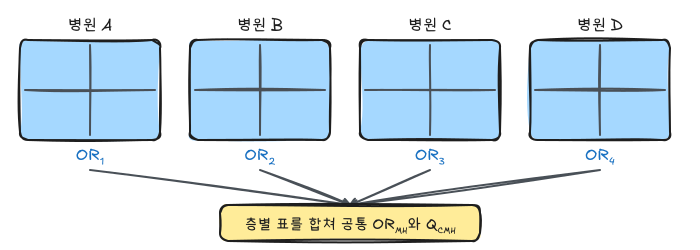
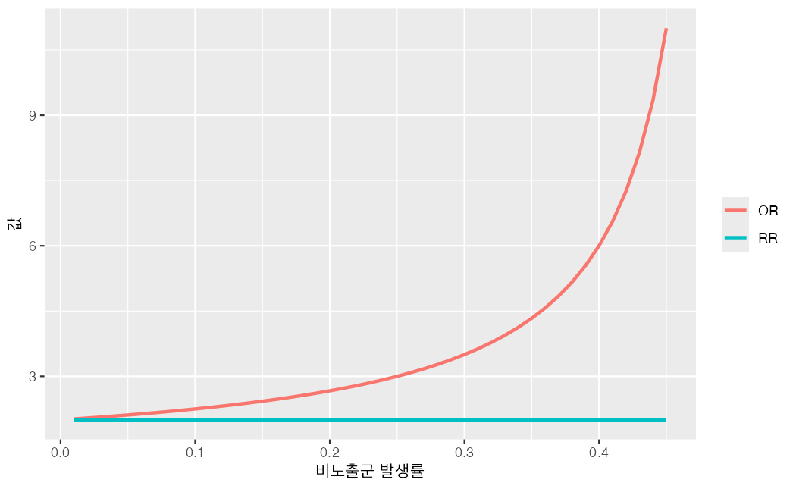

『생명과학연구를 위한 통계적 방법』(이재원·박미라·유한나)과 전북대학교 최혜미 교수님 강의를 바탕으로 정리했다.

분할표 분석은 두 범주형 변수 사이의 연관성을 보는 기본 방법이다. 생명과학 연구에서는 처리와 반응, 노출과 질병, 검사 결과와 실제 질병 상태를 표로 정리하는 경우가 많다. 검사 결과와 실제 질병 상태의 관계를 재는 민감도, 특이도, ROC와 카파는 [진단법 평가](/posts/biostat-diagnostic-test)에서 따로 다룬다. 연구설계별로 어떤 측도를 쓸 수 있는지는 [연구설계](/posts/biostat-study-design-clinical-trials)에 있다.

## 1. 분할표와 PROC FREQ

두 범주형 변수의 연관성은 $I \times J$ 분할표로 정리한다. 행 변수의 범주가 $I$개, 열 변수의 범주가 $J$개이면 각 조합의 도수를 표에 넣는다.

SAS에서는 `PROC FREQ`를 사용한다.

```sas
proc freq data=datasetname;
  weight count;
  tables var1*var2 / chisq measures;
run;
```

이미 분할표 형태로 정리된 자료라면 도수 변수에 `WEIGHT`를 지정한다. `CHISQ`는 카이제곱 검정을, `MEASURES`는 연관성 측도를 출력한다.

## 2. 2x2 분할표와 상대위험률

실험군과 대조군처럼 두 집단이 있고 결과가 발생/비발생 두 가지라면 2x2 분할표가 된다.

|  | 결과 있음 | 결과 없음 | 합계 |
| --- | ---: | ---: | ---: |
| 실험군 | $n_{11}$ | $n_{12}$ | $n_{1+}$ |
| 대조군 | $n_{21}$ | $n_{22}$ | $n_{2+}$ |

상대위험률은 대조군 위험률에 대한 실험군 위험률의 비다.

$$
RR =
\frac{n_{11}/n_{1+}}{n_{21}/n_{2+}}
$$

상대위험률은 실험연구나 코호트 연구처럼 각 집단의 위험률을 직접 추정할 수 있을 때 쓴다. 사례-대조 연구에서는 질병이 있는 사람과 없는 사람을 먼저 정해 뽑기 때문에 위험률을 직접 계산할 수 없다.

## 3. 예제 3.1: 아스피린과 심근경색

저용량 아스피린이 심근경색 위험을 줄이는지 보기 위해 22,071명의 남성을 무작위로 나누고 약 60개월 동안 관찰했다.

| 처리 | 심근경색 있음 | 심근경색 없음 | 합계 |
| --- | ---: | ---: | ---: |
| 아스피린 | 139 | 10,898 | 11,037 |
| 플라시보 | 239 | 10,795 | 11,034 |

아스피린군의 위험률은 다음과 같다.

$$
\frac{139}{11037} \approx 0.0126
$$

플라시보군의 위험률은 다음과 같다.

$$
\frac{239}{11034} \approx 0.0217
$$

따라서 상대위험률은 약 0.58이다.

$$
RR \approx 0.58
$$

아스피린군의 심근경색 위험이 플라시보군의 약 58% 수준이었다고 해석할 수 있다.

R로 확인한 값(SAS 출력이 아니다)은 다음과 같다. $RR = 0.581$(95% 구간 0.473~0.715), $OR = 0.576$(0.467~0.711)이고 카이제곱 통계량은 $\chi^2 = 26.9$($p = 2.1\times10^{-7}$), $G^2 = 27.3$이다. 심근경색이 드물어(약 1~2%) $OR$가 $RR$와 거의 같다. SAS의 `Relative Risk Estimates`는 열 1과 열 2 두 행으로 나오고 열이 알파벳순(no, yes)이므로, 심근경색의 위험비는 `Column 2` 행이다.

```sas
data ex31;
  input treat $ mi $ count;
  cards;
  aspirin yes 139
  aspirin no 10898
  placebo yes 239
  placebo no 10795
  ;
run;

proc freq data=ex31;
  weight count;
  tables treat*mi / chisq measures;
run;
```

## 4. 오즈비

오즈는 사건이 발생하지 않을 확률에 대한 사건 발생 확률의 비다.

$$
\text{odds} =
\frac{P(\text{event})}{1-P(\text{event})}
$$

2x2 분할표에서 오즈비는 다음과 같다.

$$
OR =
\frac{n_{11}n_{22}}{n_{12}n_{21}}
$$

오즈비가 1이면 두 변수 사이에 연관성이 없다고 본다. 1보다 크면 노출군에서 사건의 오즈가 더 크고, 1보다 작으면 더 작다.

## 5. 예제 3.2: 약물남용과 심장발작

심장발작 환자 214명과 그렇지 않은 사람 214명을 조사해 과거 약물남용 여부를 비교한 사례-대조 연구다.

| 약물남용 | 심장발작 있음 | 심장발작 없음 |
| --- | ---: | ---: |
| 있음 | 73 | 18 |
| 없음 | 141 | 196 |

오즈비는 다음과 같다.

$$
OR =
\frac{73 \times 196}{18 \times 141}
\approx 5.64
$$

약물을 남용한 집단에서 심장발작을 일으킨 오즈가 약물남용이 없는 집단보다 약 5.6배 높다고 해석한다.

로그 오즈비의 표준오차는 $\sqrt{1/73+1/18+1/141+1/196} = 0.285$이므로 95% 구간은 $\exp(\log 5.64 \pm 1.96 \times 0.285) = (3.22, 9.86)$이다(R로 확인한 값). 구간이 1을 포함하지 않으며 카이제곱 통계량도 $42.2$로 연관성이 뚜렷하다. 사례-대조 연구이므로 상대위험률이 아니라 오즈비만 해석한다.

```sas
data ex32;
  input drug mi $ count;
  cards;
  1 1 73
  1 2 18
  2 1 141
  2 2 196
  ;
run;

proc freq data=ex32;
  tables drug*mi / measures;
  weight count;
run;
```

## 6. 카이제곱 검정

카이제곱 검정은 관측도수와 기대도수가 얼마나 다른지 본다.

동질성 검정의 예는 다음과 같다.

$$
H_0: \text{아스피린군과 플라시보군의 심근경색 발병비율이 같다}
$$

독립성 검정의 예는 다음과 같다.

$$
H_0: \text{성별과 종교 유무는 서로 독립이다}
$$

동질성 검정과 독립성 검정은 표본추출 방식과 해석은 다르지만, 검정통계량의 형태는 같다.

$$
\chi^2 =
\sum_i \sum_j
\frac{(O_{ij}-E_{ij})^2}{E_{ij}}
$$

가능도비 검정통계량은 다음과 같다.

$$
G^2 =
2 \sum O_{ij} \log\left(\frac{O_{ij}}{E_{ij}}\right)
$$

두 통계량은 귀무가설 아래에서 근사적으로 카이제곱분포를 따른다.

기대도수가 너무 작으면 카이제곱 근사가 좋지 않다. 일반적으로 기대도수가 5 미만인 칸이 전체의 20%를 초과하면 카이제곱 검정 대신 Fisher 정확검정을 고려한다.

## 7. Fisher 정확검정

Fisher 정확검정은 표본 수가 작거나 기대도수가 작은 2x2 분할표에서 사용한다. 행 합과 열 합이 고정되어 있다고 보고 가능한 분할표들의 정확한 확률을 계산한다.

예제 3.4에서는 10명의 환자가 처리 a와 처리 b를 받고 반응 여부가 관찰되었다.

| 처리 | 반응 | 무반응 | 합계 |
| --- | ---: | ---: | ---: |
| a | 1 | 4 | 5 |
| b | 3 | 2 | 5 |
| 합계 | 4 | 6 | 10 |

가설은 다음과 같다.

$$
H_0: \text{처리와 반응 간 연관성이 없다}
$$

$$
H_1: \text{처리 b의 반응률이 처리 a보다 높다}
$$

처리 a에서 반응한 사람 수를 $Y$라고 하면, 행 합과 열 합이 고정된 조건에서 $Y$는 초기하분포를 따른다.

$$
Y \sim Hyper(10,5,4)
$$

관측값보다 더 극단적인 경우까지 더하면 단측 $p$값은 다음처럼 계산된다.

$$
P(Y \le 1) = P(Y=1) + P(Y=0) = 0.238 + 0.024 = 0.262
$$

SAS 코드는 다음과 같다.

```sas
data ex34;
  input treat $ resp $ count;
  cards;
  a yes 1
  a no 4
  b yes 3
  b no 2
  ;
run;

proc freq data=ex34 order=data;
  weight count;
  tables treat*resp / fisher;
run;
```

`fisher` 옵션은 단측(왼쪽·오른쪽)과 양측 $p$값을 모두 출력한다. SAS의 왼쪽·오른쪽은 1행 1열 칸의 도수가 작은 쪽·큰 쪽이라는 뜻이다. `order=data`로 열을 자료에 나온 순서(yes, no)로 두면 1행 1열이 처리 a의 반응 수 $Y$가 되므로, 위의 대립가설에 해당하는 왼쪽 단측 $p$값(0.262)을 본다. `order=data`가 없으면 열이 알파벳순(no, yes)이 되어 같은 값이 오른쪽 단측으로 나오고, 왼쪽 단측은 0.976이 된다. 양측 $p$값은 관측 표보다 확률이 같거나 작은 모든 표의 확률을 더한 값이다. `exact` 문을 쓰면 오즈비의 정확 신뢰구간도 얻을 수 있다.

```sas
proc freq data=ex34 order=data;
  weight count;
  tables treat*resp;
  exact fisher or;
run;
```

카이제곱 근사는 기대도수가 5 미만인 칸이 전체의 20%를 넘으면 부정확하다. 이 예제는 모든 칸의 기대도수가 2~3이라 Fisher 정확검정을 쓴다. R로 확인하면 양측 $p$값은 0.524이고, 같은 표에 카이제곱 근사를 쓰면 $p = 0.197$로 달라진다. 오즈비의 조건부 추정값은 0.203이고 정확 95% 구간은 (0.0026, 4.59)로 매우 넓다. 단측 대립가설에서도 $p = 0.262$여서 10명으로는 처리 b가 낫다는 증거를 얻기 어렵다.

## 8. McNemar 검정

McNemar 검정은 짝지은 범주형 자료에서 처리 전후 반응률이 같은지 비교한다. 수치형 변수에서의 짝지은 t-검정에 대응한다고 볼 수 있다.

2x2 짝지은 표에서 중요한 값은 불일치 쌍이다.

|  | 조건 2 예 | 조건 2 아니오 |
| --- | ---: | ---: |
| 조건 1 예 | $n_{11}$ | $n_{12}$ |
| 조건 1 아니오 | $n_{21}$ | $n_{22}$ |

검정통계량은 다음과 같다.

$$
Q_M =
\frac{(n_{12}-n_{21})^2}{n_{12}+n_{21}}
\sim \chi^2(1)
$$

예제 3.5는 결혼 전후 경제생활 만족도를 비교한다.

| 결혼 전 / 결혼 후 | 만족 | 불만족 | 합계 |
| --- | ---: | ---: | ---: |
| 만족 | 23 | 7 | 30 |
| 불만족 | 18 | 12 | 30 |
| 합계 | 41 | 19 | 60 |

불일치 쌍은 7과 18이다.

$$
Q_M =
\frac{(7-18)^2}{7+18}
= 4.84
$$

```sas
data ex35;
  input before $ after $ count;
  cards;
  satisfy satisfy 23
  satisfy unsatisfy 7
  unsatisfy satisfy 18
  unsatisfy unsatisfy 12
  ;
run;

proc freq data=ex35 order=data;
  weight count;
  tables before*after / agree;
  ods select McNemarsTest;
run;
```

자유도 1의 $\chi^2$ 분포에서 $Q_M = 4.84$의 $p$값은 0.028이다(R로 확인한 값, 연속성 보정이 없는 SAS 출력과 같다). 결혼 전에 만족했다가 불만족이 된 사람(7명)보다 불만족에서 만족이 된 사람(18명)이 많아, 결혼 후 만족하는 비율이 41/60 = 68%로 결혼 전 30/60 = 50%보다 높다. 일치한 쌍(23, 12)은 검정에 쓰이지 않는다. 일치도 자체는 [카파](/posts/biostat-diagnostic-test)로 따로 본다.

## 9. Cochran-Mantel-Haenszel 검정

Cochran-Mantel-Haenszel 검정은 세 개의 범주형 변수가 있을 때, 하나의 층화변수를 제어한 뒤 나머지 두 변수의 연관성을 검정한다.

예를 들어 여러 병원에서 같은 치료 연구를 했다면 병원 차이를 무시하고 전체를 합치기보다, 병원을 층으로 두고 치료와 반응의 연관성을 평가할 수 있다.

예제 3.6은 4개 병원에서 호흡기 곤란 환자를 기존 치료제와 새로운 치료제에 배정한 뒤 호전 여부를 본 자료다.

| 병원 | 치료제 | 호전 | 호전되지 않음 |
| --- | --- | ---: | ---: |
| A | 기존 | 9 | 5 |
| A | 새로운 | 11 | 6 |
| B | 기존 | 7 | 5 |
| B | 새로운 | 8 | 3 |
| C | 기존 | 4 | 6 |
| C | 새로운 | 7 | 5 |
| D | 기존 | 18 | 11 |
| D | 새로운 | 26 | 4 |



각 층(병원)의 2×2 표에서 $n_{11k}$의 관측값과 기대값의 차이를 모두 더해 하나의 검정통계량으로 만든다.

$$
Q_{CMH} = \frac{\left[\sum_k (n_{11k} - E(n_{11k}))\right]^2}{\sum_k Var(n_{11k})}, \qquad E(n_{11k}) = \frac{n_{1+k} n_{+1k}}{n_{++k}}
$$

층을 합쳐 하나의 표로 분석하면 층(병원)의 효과가 섞여 연관성의 방향이 뒤집힐 수도 있다(심슨의 역설). 공통 오즈비는 Mantel-Haenszel 추정량으로 구한다.

$$
\hat{OR}_{MH} = \frac{\sum_k n_{11k} n_{22k} / n_{++k}}{\sum_k n_{12k} n_{21k} / n_{++k}}
$$

SAS 코드는 다음과 같다.

```sas
data ex36;
  do hospital = 'A', 'B', 'C', 'D';
    do trt = 'old', 'new';
      do recovery = 'yes', 'no';
        input count @@;
        output;
      end;
    end;
  end;
  cards;
  9 5 11 6 7 5 8 3 4 6 7 5 18 11 26 4
  ;
run;

proc freq data=ex36;
  weight count;
  tables hospital*trt*recovery / cmh norow nocol;
run;
```

`tables 층*행*열` 순서로 쓴다. 출력에서 볼 것은 세 가지다.

- `Cochran-Mantel-Haenszel Statistics`의 `Nonzero Correlation` 행: 병원을 보정한 치료-호전 연관성 검정
- `Common Odds Ratio`의 Mantel-Haenszel 추정값과 신뢰구간: 보정된 공통 오즈비
- `Breslow-Day Test`: 병원별 오즈비가 같은지(동질성) 검정. 유의하면 병원마다 치료 효과가 달라 공통 오즈비 하나로 요약하기 어렵다

R로 확인한 값은 다음과 같다. SAS 출력이 아니라 같은 표를 `mantelhaen.test`와 직접 계산으로 구한 값이다.

| 항목 | 값 | 읽는 법 |
|---|---|---|
| CMH (`Nonzero Correlation`) | $Q_{CMH}=4.04$, $p=0.044$ | 병원을 보정해도 치료와 호전은 연관 |
| 공통 오즈비 (기존 대 새로운) | 0.466, 95% 구간 (0.221, 0.981) | 새로운 치료제의 호전 오즈가 기존의 $1/0.466 = 2.15$배 |
| Breslow-Day | 1.89, $df=3$, $p=0.595$ | 병원별 오즈비가 다르다는 증거 없음 |
| 병원별 오즈비 (새로운 대 기존) | A 1.02, B 1.90, C 2.10, D 3.97 | 모두 1 이상 |
| 병원을 합친 표 | 오즈비 (새로운 대 기존) 2.05, 구간 (0.99, 4.25) | 층을 무시해도 방향이 같다 |

병원별 표본이 작아 각 병원의 오즈비는 불안정하지만, 병원을 보정한 하나의 통계량은 5% 수준에서 유의하다. 이 자료는 합쳐도 방향이 같으므로 심슨의 역설은 나타나지 않는다. 그 예는 10절의 신장결석 자료에 있다.

## 10. 방법 간 비교

| 검정 | 자료 구조 | 귀무가설 | 근거 분포 | 쓰는 상황 |
|---|---|---|---|---|
| 카이제곱 | 독립 표본의 $r \times c$ 표 | 두 변수가 독립 | 점근적 $\chi^2$ | 기대도수가 충분할 때 |
| Fisher 정확검정 | 독립 표본의 $2 \times 2$ 표 | 독립 | 주변합 고정 시 초기하분포 | 기대도수가 작을 때 |
| McNemar | 짝지은 $2 \times 2$ 표 | 두 주변비율이 같음 | 불일치 쌍만 사용 | 전후 비교, 짝지은 사례-대조 |
| CMH | 층별 $2 \times 2$ 표 | 층을 보정한 공통 오즈비가 1 | 점근적 $\chi^2$ | 교란변수가 있을 때 |

| 측도 | 정의 | 추정 가능한 설계 | 성질 |
|---|---|---|---|
| 상대위험률 (RR) | $p_1 / p_0$ | 코호트, 임상시험 | 해석이 직관적 |
| 오즈비 (OR) | $\frac{p_1/(1-p_1)}{p_0/(1-p_0)}$ | 코호트, 임상시험, 사례-대조 | 로지스틱 회귀의 계수. 발생률이 낮으면 RR에 근사 |

기대도수가 작을 때 쓰는 Fisher 검정은 주변합을 고정한 이산 분포를 쓰므로, 실제 제1종 오류가 유의수준보다 꽤 작은 보수적인 검정이 되기 쉽다. Yates 연속성 보정도 같은 방향이다.

### 발생률에 따른 상대위험률과 오즈비

상대위험률을 2로 고정하고 비노출군의 발생률 $p_0$를 바꾸면서 오즈비를 계산한다.

```r
library(tidyverse)
tibble(p0 = seq(0.01, 0.45, by = 0.01)) |>
  mutate(RR = 2, OR = (2 * p0 / (1 - 2 * p0)) / (p0 / (1 - p0))) |>
  pivot_longer(c(RR, OR), names_to = "측도") |>
  ggplot(aes(p0, value, color = 측도)) +
  geom_line(linewidth = 1) +
  labs(x = "비노출군 발생률", y = "값", color = NULL)
```



비노출군 발생률이 1%이면 오즈비가 2.02로 상대위험률과 거의 같지만, 10%이면 2.25, 30%이면 3.5로 커진다. 드문 질병에서만 오즈비를 상대위험률처럼 읽을 수 있다. 사례-대조 연구에서 오즈비를 쓰는 것은 상대위험률을 근사해서가 아니라, 표집 비율과 무관하게 추정할 수 있기 때문이다.

### 층을 무시한 분석과 CMH 검정

신장결석 치료 성공 자료(Charig 등, 1986)는 결석 크기에 따라 두 치료가 배정된 비율이 달라 교란이 생기는 예로 널리 쓰인다.

```r
stone <- array(c(81, 6, 234, 36,      # 작은 결석: A 성공·실패, B 성공·실패
                 192, 71, 55, 25),    # 큰 결석
               dim = c(2, 2, 2),
               dimnames = list(결과 = c("성공", "실패"), 치료 = c("A", "B"), 크기 = c("작음", "큼")))
pooled <- apply(stone, c(1, 2), sum)
or <- function(t) (t[1, 1] * t[2, 2]) / (t[2, 1] * t[1, 2])
c(합친표_OR = or(pooled), 작은결석_OR = or(stone[, , 1]), 큰결석_OR = or(stone[, , 2]))
prop.table(pooled, 2)[1, ]
mantelhaen.test(stone)
```

결석 크기를 무시하고 합치면 B가 나아 보이지만(OR 0.75), 크기별로는 두 층 모두 A의 성공률이 높다(OR 2.08, 1.23). 어려운 큰 결석에 A가 주로 쓰여 크기가 교란변수로 작용한 심슨의 역설이다. CMH 검정은 층을 보정한 공통 오즈비(1.45)를 추정한다. 층별 오즈비가 꽤 다르므로 실제로는 Breslow-Day 검정으로 동질성을 먼저 확인한다.

## 요약

| 질문 | 자료 | 방법 | SAS `proc freq` |
|---|---|---|---|
| 두 범주형 변수의 연관성 | 독립 표본 | 카이제곱 | `tables a*b / chisq` |
| 칸 기대도수가 작음 | 독립 표본 | Fisher 정확검정 | `/ fisher`, `exact` |
| 위험의 비교 | 코호트·실험 | 상대위험률, 오즈비 | `/ measures` (`relrisk`) |
| 전후 비교 | 짝지은 표본 | McNemar | `/ agree` |
| 층 보정 | 층화 자료 | CMH, Breslow-Day | `tables s*a*b / cmh` |

검사의 정확도(민감도, 특이도, 예측도)와 ROC, 카파는 [진단법 평가](/posts/biostat-diagnostic-test)에서 이어진다.
