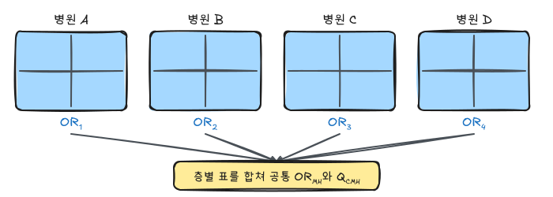

『생명과학연구를 위한 통계적 방법』(이재원·박미라·유한나)과 전북대학교 최혜미 교수님 강의를 바탕으로 정리했다.

분할표 분석은 두 범주형 변수 사이의 연관성을 보는 기본 방법이다. 생명과학 연구에서는 처리와 반응, 노출과 질병, 검사 결과와 실제 질병 상태를 표로 정리하는 경우가 많다.

## 1. 분할표와 PROC FREQ

두 범주형 변수의 연관성은 $I \times J$ 분할표로 정리한다. 행 변수의 범주가 $I$개, 열 변수의 범주가 $J$개이면 각 조합의 도수를 표에 넣는다.

SAS에서는 `PROC FREQ`를 사용한다.

```sas
proc freq data=datasetname;
  weight count;
  tables var1*var2 / chisq measures;
run;
```

이미 분할표 형태로 정리된 자료라면 도수 변수에 `WEIGHT`를 지정한다. `CHISQ`는 카이제곱 검정을, `MEASURES`는 연관성 측도를 출력한다.

## 2. 2x2 분할표와 상대위험률

실험군과 대조군처럼 두 집단이 있고 결과가 발생/비발생 두 가지라면 2x2 분할표가 된다.

|  | 결과 있음 | 결과 없음 | 합계 |
| --- | ---: | ---: | ---: |
| 실험군 | $n_{11}$ | $n_{12}$ | $n_{1+}$ |
| 대조군 | $n_{21}$ | $n_{22}$ | $n_{2+}$ |

상대위험률은 대조군 위험률에 대한 실험군 위험률의 비다.

$$
RR =
\frac{n_{11}/n_{1+}}{n_{21}/n_{2+}}
$$

상대위험률은 실험연구나 코호트 연구처럼 각 집단의 위험률을 직접 추정할 수 있을 때 쓴다. 사례-대조 연구에서는 질병이 있는 사람과 없는 사람을 먼저 정해 뽑기 때문에 위험률을 직접 계산할 수 없다.

## 3. 예제 3.1: 아스피린과 심근경색

저용량 아스피린이 심근경색 위험을 줄이는지 보기 위해 22,071명의 남성을 무작위로 나누고 약 60개월 동안 관찰했다.

| 처리 | 심근경색 있음 | 심근경색 없음 | 합계 |
| --- | ---: | ---: | ---: |
| 아스피린 | 139 | 10,898 | 11,037 |
| 플라시보 | 239 | 10,795 | 11,034 |

아스피린군의 위험률은 다음과 같다.

$$
\frac{139}{11037} \approx 0.0126
$$

플라시보군의 위험률은 다음과 같다.

$$
\frac{239}{11034} \approx 0.0217
$$

따라서 상대위험률은 약 0.58이다.

$$
RR \approx 0.58
$$

아스피린군의 심근경색 위험이 플라시보군의 약 58% 수준이었다고 해석할 수 있다.

```sas
data ex31;
  input treat $ mi $ count;
  cards;
  aspirin yes 139
  aspirin no 10898
  placebo yes 239
  placebo no 10795
  ;
run;

proc freq data=ex31;
  weight count;
  tables treat*mi / chisq measures;
run;
```

## 4. 오즈비

오즈는 사건이 발생하지 않을 확률에 대한 사건 발생 확률의 비다.

$$
\text{odds} =
\frac{P(\text{event})}{1-P(\text{event})}
$$

2x2 분할표에서 오즈비는 다음과 같다.

$$
OR =
\frac{n_{11}n_{22}}{n_{12}n_{21}}
$$

오즈비가 1이면 두 변수 사이에 연관성이 없다고 본다. 1보다 크면 노출군에서 사건의 오즈가 더 크고, 1보다 작으면 더 작다.

## 5. 예제 3.2: 약물남용과 심장발작

심장발작 환자 214명과 그렇지 않은 사람 214명을 조사해 과거 약물남용 여부를 비교한 사례-대조 연구다.

| 약물남용 | 심장발작 있음 | 심장발작 없음 |
| --- | ---: | ---: |
| 있음 | 73 | 18 |
| 없음 | 141 | 196 |

오즈비는 다음과 같다.

$$
OR =
\frac{73 \times 196}{18 \times 141}
\approx 5.64
$$

약물을 남용한 집단에서 심장발작을 일으킨 오즈가 약물남용이 없는 집단보다 약 5.6배 높다고 해석한다.

```sas
data ex32;
  input drug mi $ count;
  cards;
  1 1 73
  1 2 18
  2 1 141
  2 2 196
  ;
run;

proc freq data=ex32;
  tables drug*mi / measures;
  weight count;
run;
```

## 6. 카이제곱 검정

카이제곱 검정은 관측도수와 기대도수가 얼마나 다른지 본다.

동질성 검정의 예는 다음과 같다.

$$
H_0: \text{아스피린군과 플라시보군의 심근경색 발병비율이 같다}
$$

독립성 검정의 예는 다음과 같다.

$$
H_0: \text{성별과 종교 유무는 서로 독립이다}
$$

동질성 검정과 독립성 검정은 표본추출 방식과 해석은 다르지만, 검정통계량의 형태는 같다.

$$
\chi^2 =
\sum_i \sum_j
\frac{(O_{ij}-E_{ij})^2}{E_{ij}}
$$

가능도비 검정통계량은 다음과 같다.

$$
G^2 =
2 \sum O_{ij} \log\left(\frac{O_{ij}}{E_{ij}}\right)
$$

두 통계량은 귀무가설 아래에서 근사적으로 카이제곱분포를 따른다.

기대도수가 너무 작으면 카이제곱 근사가 좋지 않다. 일반적으로 기대도수가 5 미만인 칸이 전체의 20%를 초과하면 카이제곱 검정 대신 Fisher 정확검정을 고려한다.

## 7. Fisher 정확검정

Fisher 정확검정은 표본 수가 작거나 기대도수가 작은 2x2 분할표에서 사용한다. 행 합과 열 합이 고정되어 있다고 보고 가능한 분할표들의 정확한 확률을 계산한다.

예제 3.4에서는 10명의 환자가 처리 a와 처리 b를 받고 반응 여부가 관찰되었다.

| 처리 | 반응 | 무반응 | 합계 |
| --- | ---: | ---: | ---: |
| a | 1 | 4 | 5 |
| b | 3 | 2 | 5 |
| 합계 | 4 | 6 | 10 |

가설은 다음과 같다.

$$
H_0: \text{처리와 반응 간 연관성이 없다}
$$

$$
H_1: \text{처리 b의 반응률이 처리 a보다 높다}
$$

처리 a에서 반응한 사람 수를 $Y$라고 하면, 행 합과 열 합이 고정된 조건에서 $Y$는 초기하분포를 따른다.

$$
Y \sim Hyper(10,5,4)
$$

관측값보다 더 극단적인 경우까지 더하면 원본 예제의 단측 p-value는 다음처럼 계산된다.

$$
P(Y \le 1) = P(Y=1) + P(Y=0) = 0.238 + 0.024 = 0.262
$$

SAS 코드는 다음과 같다.

```sas
data ex34;
  input treat $ resp $ count;
  cards;
  a yes 1
  a no 4
  b yes 3
  b no 2
  ;
run;

proc freq data=ex34;
  weight count;
  tables treat*resp / fisher;
run;
```

`fisher` 옵션은 단측(왼쪽·오른쪽)과 양측 $p$값을 모두 출력한다. 위의 대립가설은 처리 a의 반응 수가 적은 쪽이므로 왼쪽 단측 $p$값(0.262)을 본다. 양측 $p$값은 관측 표보다 확률이 같거나 작은 모든 표의 확률을 더한 값이다. `exact` 문을 쓰면 오즈비의 정확 신뢰구간도 얻을 수 있다.

```sas
proc freq data=ex34;
  weight count;
  tables treat*resp;
  exact fisher or;
run;
```

카이제곱 근사는 기대도수가 5 미만인 칸이 전체의 20%를 넘으면 부정확하다. 이 예제는 모든 칸의 기대도수가 2~3이라 Fisher 정확검정을 쓴다.

## 8. McNemar 검정

McNemar 검정은 짝지은 범주형 자료에서 처리 전후 반응률이 같은지 비교한다. 수치형 변수에서의 짝지은 t-검정에 대응한다고 볼 수 있다.

2x2 짝지은 표에서 중요한 값은 불일치 쌍이다.

|  | 조건 2 예 | 조건 2 아니오 |
| --- | ---: | ---: |
| 조건 1 예 | $n_{11}$ | $n_{12}$ |
| 조건 1 아니오 | $n_{21}$ | $n_{22}$ |

검정통계량은 다음과 같다.

$$
Q_M =
\frac{(n_{12}-n_{21})^2}{n_{12}+n_{21}}
\sim \chi^2(1)
$$

예제 3.5는 결혼 전후 경제생활 만족도를 비교한다.

| 결혼 후 / 결혼 전 | 만족 | 불만족 | 합계 |
| --- | ---: | ---: | ---: |
| 만족 | 23 | 7 | 30 |
| 불만족 | 18 | 12 | 30 |
| 합계 | 41 | 19 | 60 |

불일치 쌍은 7과 18이다.

$$
Q_M =
\frac{(7-18)^2}{7+18}
= 4.84
$$

```sas
data ex35;
  input before $ after $ count;
  cards;
  satisfy satisfy 23
  satisfy unsatisfy 7
  unsatisfy satisfy 18
  unsatisfy unsatisfy 12
  ;
run;

proc freq data=ex35 order=data;
  weight count;
  tables before*after / agree;
  ods select McNemarsTest;
run;
```

## 9. Cochran-Mantel-Haenszel 검정

Cochran-Mantel-Haenszel 검정은 세 개의 범주형 변수가 있을 때, 하나의 층화변수를 제어한 뒤 나머지 두 변수의 연관성을 검정한다.

예를 들어 여러 병원에서 같은 치료 연구를 했다면 병원 차이를 무시하고 전체를 합치기보다, 병원을 층으로 두고 치료와 반응의 연관성을 평가할 수 있다.

예제 3.6은 4개 병원에서 호흡기 곤란 환자를 기존 치료제와 새로운 치료제에 배정한 뒤 호전 여부를 본 자료다.

| 병원 | 치료제 | 호전 | 호전되지 않음 |
| --- | --- | ---: | ---: |
| A | 기존 | 9 | 5 |
| A | 새로운 | 11 | 6 |
| B | 기존 | 7 | 5 |
| B | 새로운 | 8 | 3 |
| C | 기존 | 4 | 6 |
| C | 새로운 | 7 | 5 |
| D | 기존 | 18 | 11 |
| D | 새로운 | 26 | 4 |

SAS 코드는 다음과 같다.



각 층(병원)의 2×2 표에서 $n_{11k}$의 관측값과 기대값의 차이를 모두 더해 하나의 검정통계량으로 만든다.

$$
Q_{CMH} = \frac{\left[\sum_k (n_{11k} - E(n_{11k}))\right]^2}{\sum_k Var(n_{11k})}, \qquad E(n_{11k}) = \frac{n_{1+k} n_{+1k}}{n_{++k}}
$$

층을 합쳐 하나의 표로 분석하면 층(병원)의 효과가 섞여 연관성의 방향이 뒤집힐 수도 있다(심슨의 역설). 공통 오즈비는 Mantel-Haenszel 추정량으로 구한다.

$$
\hat{OR}_{MH} = \frac{\sum_k n_{11k} n_{22k} / n_{++k}}{\sum_k n_{12k} n_{21k} / n_{++k}}
$$

```sas
data ex36;
  do hospital = 'A', 'B', 'C', 'D';
    do trt = 'old', 'new';
      do recovery = 'yes', 'no';
        input count @@;
        output;
      end;
    end;
  end;
  cards;
  9 5 11 6 7 5 8 3 4 6 7 5 18 11 26 4
  ;
run;

proc freq data=ex36;
  weight count;
  tables hospital*trt*recovery / cmh norow nocol;
run;
```

`tables 층*행*열` 순서로 쓴다. 출력에서 볼 것은 세 가지다.

- `Cochran-Mantel-Haenszel Statistics`의 `Nonzero Correlation` 행: 병원을 보정한 치료-호전 연관성 검정
- `Common Odds Ratio`의 Mantel-Haenszel 추정값과 신뢰구간: 보정된 공통 오즈비
- `Breslow-Day Test`: 병원별 오즈비가 같은지(동질성) 검정. 유의하면 병원마다 치료 효과가 달라 공통 오즈비 하나로 요약하기 어렵다

## 10. 진단법의 평가

진단법은 실제 질병 상태와 검사 결과의 관계로 평가한다.

|  | 질병 있음 | 질병 없음 |
| --- | ---: | ---: |
| 검사 양성 | TP | FP |
| 검사 음성 | FN | TN |

민감도는 질병이 있는 사람이 검사에서 양성으로 제대로 판정되는 비율이다.

$$
\text{sensitivity} =
\frac{TP}{TP+FN}
$$

특이도는 질병이 없는 사람이 검사에서 음성으로 제대로 판정되는 비율이다.

$$
\text{specificity} =
\frac{TN}{FP+TN}
$$

양성예측도는 검사 양성인 사람 중 실제 질병이 있는 사람의 비율이다.

$$
PPV =
\frac{TP}{TP+FP}
$$

음성예측도는 검사 음성인 사람 중 실제 질병이 없는 사람의 비율이다.

$$
NPV =
\frac{TN}{FN+TN}
$$

쉽게 치료될 질병이거나 놓치면 안 되는 질병에서는 민감도가 높은 검사를 선호한다. 위음성률을 낮추는 것이 중요하기 때문이다. 반대로 심각하고 치료가 어렵거나 양성 판정의 부담이 큰 질병에서는 특이도가 높은 검사가 중요할 수 있다. 위양성률을 낮춰야 하기 때문이다.

## 11. 절단값과 ROC 곡선

검사 결과가 연속형 수치일 때는 어느 값을 기준으로 양성/음성을 나눌지 정해야 한다. 이 기준값을 절단값이라고 한다.

절단값이 바뀌면 민감도와 특이도가 함께 변한다. 보통 민감도를 높이면 특이도는 낮아지고, 특이도를 높이면 민감도는 낮아진다.

ROC 곡선은 여러 절단값에서의 다음 좌표를 그린 것이다.

$$
x = 1-\text{specificity}
$$

$$
y = \text{sensitivity}
$$

AUC는 ROC 곡선 아래 면적이다.

- AUC = 1: 완벽한 판별
- AUC = 0.5: 무작위 판별과 비슷
- AUC < 0.5: 판정 방향을 반대로 쓰는 것이 나을 수 있음

Youden index는 보통 다음 값을 최대화하는 절단값을 고르는 데 사용한다.

$$
J = \text{sensitivity} + \text{specificity} - 1
$$

민감도와 특이도를 퍼센트로 쓰면 $\text{sensitivity} + \text{specificity} - 100$이다.

## 12. 예제: 간 스캔 진단

간 질환이 의심되는 환자 344명에게 간 스캔을 시행하고, 병리 검사(부검·생검)를 기준(gold standard)으로 비교한 자료다(Altman & Bland, 1994).

| 간 스캔 | 병리 이상 | 병리 정상 | 합 |
|---|---:|---:|---:|
| 이상 | 231 | 32 | 263 |
| 정상 | 27 | 54 | 81 |
| 합 | 258 | 86 | 344 |

| 측도 | 계산 | 값 |
|---|---|---:|
| 민감도 | 231 / 258 | 0.895 |
| 특이도 | 54 / 86 | 0.628 |
| 양성예측도 | 231 / 263 | 0.878 |
| 음성예측도 | 54 / 81 | 0.667 |
| 유병률 (이 표본) | 258 / 344 | 0.750 |

```sas
data liver;
  input scan $ path $ count;
  datalines;
abnormal abnormal 231
abnormal normal    32
normal   abnormal  27
normal   normal    54
;
run;

proc freq data=liver order=data;
  weight count;
  tables path*scan / nopercent nocol;               /* 행 백분율 = 민감도, 특이도 */
  tables scan*path / nopercent norow;
  tables scan / binomial(level='abnormal');
run;
```

`path*scan` 표의 행 백분율에서 병리 이상 행의 `abnormal` 비율이 민감도, 병리 정상 행의 `normal` 비율이 특이도다. 각 비율의 신뢰구간이 필요하면 해당 행만 골라 `binomial` 옵션을 쓴다.

### 예측도는 유병률에 따라 바뀐다

민감도와 특이도는 검사 자체의 성질이지만, 예측도는 대상 집단의 유병률 $\pi$에 따라 달라진다. 베이즈 정리로 쓰면 다음과 같다.

$$
PPV = \frac{Se \cdot \pi}{Se \cdot \pi + (1 - Sp)(1 - \pi)}, \qquad
NPV = \frac{Sp (1 - \pi)}{Sp (1 - \pi) + (1 - Se)\pi}
$$

간 스캔을 유병률 10%인 일반 검진 집단에 쓰면 $PPV = \frac{0.895 \times 0.1}{0.895 \times 0.1 + 0.372 \times 0.9} \approx 0.21$로, 양성 판정의 약 80%가 위양성이다. 유병률이 낮은 집단의 선별검사에서 특이도가 중요한 이유다.

### 우도비

$$
LR^+ = \frac{Se}{1 - Sp}, \qquad LR^- = \frac{1 - Se}{Sp}
$$

검사 전 오즈에 우도비를 곱하면 검사 후 오즈가 된다. 간 스캔은 $LR^+ = 0.895 / 0.372 \approx 2.4$, $LR^- = 0.105 / 0.628 \approx 0.17$이다. 유병률과 무관하게 검사의 정보량을 비교할 수 있다.

## 13. ROC 곡선 실습

연속형 검사값이나 로지스틱 모형의 예측확률로 ROC 곡선을 그린다. SAS 내장 `sashelp.heart`(프레이밍햄 심장 연구 자료)에서 사망 여부를 콜레스테롤만으로 예측할 때와, 나이·혈압·흡연을 더했을 때를 비교한다.

```sas
data heart;
  set sashelp.heart;
  dead = (Status = 'Dead');
  if nmiss(Cholesterol, AgeAtStart, Systolic, Smoking) = 0;
run;

proc logistic data=heart plots(only)=roc;
  model dead(event='1') = Cholesterol AgeAtStart Systolic Smoking;
  roc 'Cholesterol only' Cholesterol;
  roccontrast reference('Cholesterol only') / estimate e;
run;
```

- `model` 문의 전체 모형 ROC와 `roc` 문으로 지정한 부분 모형의 ROC가 한 그림에 겹쳐 그려진다.
- `roccontrast`는 두 AUC의 차이를 검정한다(DeLong 방법).
- 연속형 검사값 하나의 절단값별 민감도·특이도 표가 필요하면 `model` 문에 `/ outroc=roc_out`을 주고, 저장된 `_SENSIT_`, `_1MSPEC_`로 Youden 지수 $J = Se + Sp - 1$이 최대인 절단값을 찾는다.

## 14. 일치도: 카파 통계량

두 평가자(또는 두 검사)가 같은 대상을 범주로 판정했을 때 얼마나 일치하는지 본다. 단순 일치율 $p_o$는 우연히 일치하는 부분까지 포함하므로, 우연 일치 $p_e$를 뺀 **Cohen의 카파**를 쓴다.

$$
\kappa = \frac{p_o - p_e}{1 - p_e}, \qquad p_e = \sum_i p_{i+} p_{+i}
$$

| $\kappa$ | 일치 정도 (Landis & Koch) |
|---|---|
| < 0.20 | 낮음 |
| 0.21 ~ 0.40 | 약간 |
| 0.41 ~ 0.60 | 보통 |
| 0.61 ~ 0.80 | 상당 |
| > 0.80 | 거의 완벽 |

순서형 범주(예: 경증·중등도·중증)는 불일치 정도에 가중치를 주는 **가중 카파**를 쓴다. 연속형 측정값의 일치도는 급내상관계수(ICC)나 Bland-Altman 그림으로 본다.

```sas
proc freq data=ex35 order=data;
  weight count;
  tables before*after / agree;
  test kappa;
run;
```

`agree` 옵션은 McNemar 검정(2×2) 또는 Bowker 대칭성 검정($k \times k$)과 함께 단순·가중 카파와 신뢰구간을 출력한다. McNemar 검정은 "두 판정의 양성률이 같은가", 카파는 "개별 대상에서 판정이 얼마나 일치하는가"를 보는 서로 다른 질문이다.

## 요약

| 질문 | 자료 | 방법 | SAS `proc freq` |
|---|---|---|---|
| 두 범주형 변수의 연관성 | 독립 표본 | 카이제곱 | `tables a*b / chisq` |
| 칸 기대도수가 작음 | 독립 표본 | Fisher 정확검정 | `/ fisher`, `exact` |
| 위험의 비교 | 코호트·실험 | 상대위험률, 오즈비 | `/ relrisk` |
| 전후 비교 | 짝지은 표본 | McNemar | `/ agree` |
| 층 보정 | 층화 자료 | CMH, Breslow-Day | `tables s*a*b / cmh` |
| 검사 정확도 | 기준 검사와 비교 | 민감도, 특이도, 예측도 | 행 백분율, `binomial` |
| 연속형 검사 | 예측값 | ROC, AUC | `proc logistic` + `roc` |
| 판정 일치 | 같은 대상 반복 판정 | 카파 | `/ agree` |
