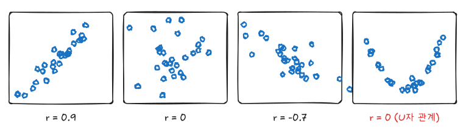

『생명과학연구를 위한 통계적 방법』(이재원·박미라·유한나)과 전북대학교 최혜미 교수님 강의를 바탕으로, 두 연속형 변수의 관계를 다루는 상관분석과 회귀분석을 정리했다. 로지스틱 회귀, 공분산분석, Cox 회귀는 모두 이 글의 선형회귀를 바탕으로 확장된다.

| | 상관분석 | 회귀분석 |
|---|---|---|
| 질문 | 두 변수가 함께 변하는 정도는? | $X$로 $Y$를 어떻게 설명·예측하는가? |
| 변수 역할 | 대칭 | $X$ 설명변수, $Y$ 반응변수 |
| 결과 | 상관계수 $r$ | 회귀식 $\hat y = b_0 + b_1 x$ |

## 1. 피어슨 상관계수

$$
r = \frac{\sum_i (x_i - \bar x)(y_i - \bar y)}{\sqrt{\sum_i (x_i - \bar x)^2 \sum_i (y_i - \bar y)^2}}, \qquad -1 \le r \le 1
$$



- $r$은 **선형** 관계의 강도다. $r = 0$이어도 U자 같은 강한 비선형 관계가 있을 수 있다.
- 이상값 하나에 크게 흔들린다.
- 상관은 인과가 아니다. 두 변수 모두와 관련된 제3의 변수가 있으면 상관이 생긴다.

$H_0: \rho = 0$은 다음 통계량으로 검정한다. 두 변수가 이변량 정규분포를 따른다고 가정한다.

$$
t = \frac{r \sqrt{n - 2}}{\sqrt{1 - r^2}} \sim t_{n-2}
$$

$\rho$의 신뢰구간은 $r$의 분포가 비대칭이라 Fisher 변환 $z = \frac{1}{2}\log\frac{1 + r}{1 - r}$으로 만든다. $z$는 근사적으로 $N(\frac{1}{2}\log\frac{1+\rho}{1-\rho}, \frac{1}{n - 3})$를 따른다.

## 2. 스피어만 순위상관과 켄달의 타우

정규성이 의심되거나 이상값이 있거나 순서형 자료라면 순위를 쓴다.

- **스피어만** $r_s$: 두 변수를 각각 순위로 바꾼 뒤 계산한 피어슨 상관. 단조 관계(한쪽이 커지면 다른 쪽도 커지는)의 강도다.
- **켄달** $\tau$: 모든 쌍 중 순서가 일치하는 쌍과 불일치하는 쌍의 비율 차이. 표본이 작고 동순위가 많을 때 쓴다.

```sas
proc corr data=sashelp.class pearson spearman kendall fisher plots=matrix(histogram);
  var Height Weight Age;
run;
```

`fisher` 옵션은 Fisher 변환 신뢰구간을, `plots=matrix`는 산점도 행렬을 출력한다.

### 편상관

$Z$의 영향을 제거한 $X$와 $Y$의 상관이다. 나이를 통제한 키와 체중의 상관처럼 교란을 제거할 때 쓴다.

```sas
proc corr data=sashelp.class;
  var Height Weight;
  partial Age;
run;
```

## 3. 단순선형회귀

$$
y_i = \beta_0 + \beta_1 x_i + \epsilon_i, \qquad \epsilon_i \overset{iid}{\sim} N(0, \sigma^2)
$$

최소제곱 추정량은 잔차제곱합 $\sum (y_i - b_0 - b_1 x_i)^2$을 최소화한다.

$$
b_1 = \frac{S_{xy}}{S_{xx}} = r \frac{s_y}{s_x}, \qquad b_0 = \bar y - b_1 \bar x
$$

$b_1 = r \, s_y / s_x$이므로 기울기와 상관계수는 부호가 같고, $H_0: \beta_1 = 0$ 검정과 $H_0: \rho = 0$ 검정의 $t$통계량은 같다.

### 분산분석표와 결정계수

$$
\underbrace{\sum (y_i - \bar y)^2}_{SST} = \underbrace{\sum (\hat y_i - \bar y)^2}_{SSR} + \underbrace{\sum (y_i - \hat y_i)^2}_{SSE}
$$

| 요인 | 자유도 | 제곱합 | 평균제곱 | $F$ |
|---|---|---|---|---|
| 회귀 | $p$ | SSR | MSR = SSR / $p$ | MSR / MSE |
| 오차 | $n - p - 1$ | SSE | MSE = SSE / $(n - p - 1)$ | |
| 합 | $n - 1$ | SST | | |

$R^2 = SSR / SST$는 $Y$의 변동 중 회귀가 설명한 비율이고, 단순회귀에서는 $r^2$과 같다. $\sqrt{MSE}$는 $\sigma$의 추정값(Root MSE)이다.

### 신뢰구간과 예측구간

$x_0$에서 평균 반응 $E(Y \mid x_0)$의 신뢰구간과 새 관측값 $Y_0$의 예측구간은 다음과 같다.

$$
\hat y_0 \pm t_{\alpha/2,\, n-2} \sqrt{MSE \left( \frac{1}{n} + \frac{(x_0 - \bar x)^2}{S_{xx}} \right)}
\qquad \text{vs.} \qquad
\hat y_0 \pm t_{\alpha/2,\, n-2} \sqrt{MSE \left( 1 + \frac{1}{n} + \frac{(x_0 - \bar x)^2}{S_{xx}} \right)}
$$

예측구간에는 개별 관측의 변동(1)이 더해져 항상 더 넓다. 둘 다 $x_0$가 $\bar x$에서 멀어질수록 넓어진다.

```sas
proc reg data=sashelp.class plots=(fitplot residuals diagnostics);
  model Weight = Height / clb clm cli;
run;
quit;
```

- `clb`: 회귀계수의 신뢰구간
- `clm`, `cli`: 관측값마다 평균 반응의 신뢰구간, 개별 값의 예측구간
- `plots=fitplot`: 회귀선과 신뢰띠·예측띠를 그린다.

## 4. 다중회귀

$$
y_i = \beta_0 + \beta_1 x_{i1} + \cdots + \beta_p x_{ip} + \epsilon_i
$$

$\beta_j$는 **다른 설명변수를 고정했을 때** $x_j$가 한 단위 늘 때 $Y$의 평균 변화다. 행렬로 쓰면 $\hat\beta = (X^T X)^{-1} X^T y$이다.

SAS 내장 `sashelp.heart`(프레이밍햄 심장 연구)에서 수축기 혈압을 나이, 체중, 콜레스테롤로 설명한다.

```sas
data heart;
  set sashelp.heart;
  male = (Sex = 'Male');
  if nmiss(Systolic, AgeAtStart, Weight, Cholesterol) = 0;
run;

proc reg data=heart plots(maxpoints=none)=diagnostics;
  model Systolic = AgeAtStart Weight Cholesterol male / stb vif clb;
  test Weight = Cholesterol = 0;
run;
quit;
```

- `stb`: 표준화 회귀계수. 단위가 다른 변수의 상대적 기여를 비교할 때 참고한다.
- `vif`: 분산팽창인자(아래 다중공선성 참고)
- `test`: 여러 계수가 동시에 0인지 부분 $F$검정
- `proc reg`는 `class` 문이 없어서 범주형 변수는 DATA 단계에서 가변수(`male`)로 만든다. 범주가 많으면 `proc glm`의 `class` 문을 쓰는 편이 편하다.

### 수정 결정계수와 변수 선택

$R^2$는 변수를 넣을수록 커지기만 하므로 비교에는 수정 $R^2$를 쓴다.

$$
R^2_{adj} = 1 - \frac{SSE / (n - p - 1)}{SST / (n - 1)}
$$

```sas
proc reg data=heart;
  model Systolic = AgeAtStart Weight Cholesterol male / selection=stepwise slentry=0.15 slstay=0.15;
  model Systolic = AgeAtStart Weight Cholesterol male / selection=cp adjrsq best=3;
run;
quit;
```

단계적 선택은 편리하지만 선택된 모형의 $p$값과 신뢰구간이 낙관적으로 나온다. 연구 가설에 필요한 변수(노출, 알려진 교란변수)는 선택 절차와 관계없이 넣고, 선택은 탐색적 결과로만 보고한다.

## 5. 회귀 진단

| 가정 | 위반 신호 | 확인 | 대응 |
|---|---|---|---|
| 선형성 | 잔차 대 적합값 그림의 곡선 패턴 | 잔차 그림, 부분 잔차 그림 | 다항항, 변환 |
| 등분산성 | 적합값이 커질수록 잔차 폭이 넓어짐 | 잔차 그림, `spec` 옵션 | $\log Y$ 변환, 가중회귀 |
| 정규성 | Q-Q 그림이 직선에서 벗어남 | `proc univariate normal` | 변환, 큰 표본이면 덜 중요 |
| 독립성 | 시간·순서에 따른 잔차 패턴 | Durbin-Watson (`dw`) | 반복측정 모형 |

### 이상점과 영향점

| 측도 | 보는 것 | 기준(경험적) |
|---|---|---|
| 스튜던트화 잔차 | $Y$ 방향으로 튀는 점 | 절댓값 2~3 초과 |
| 레버리지 $h_{ii}$ | $X$ 공간에서 멀리 떨어진 점 | $2(p+1)/n$ 초과 |
| Cook's D | 그 점을 빼면 회귀계수가 얼마나 바뀌는가 | $4/n$ 또는 1 초과 |
| DFFITS, DFBETAS | 적합값·개별 계수에 대한 영향 | $2\sqrt{(p+1)/n}$, $2/\sqrt n$ |

```sas
proc reg data=sashelp.class plots(label)=(cooksd rstudentbyleverage);
  id Name;
  model Weight = Height Age / influence r;
  output out=diag rstudent=rstud h=lev cookd=cd;
run;
quit;

proc print data=diag;
  where abs(rstud) > 2 or cd > 4/19;
  var Name Weight Height Age rstud lev cd;
run;
```

영향점은 자동으로 지우지 않는다. 입력 오류인지, 다른 모집단에서 온 것인지 확인하고, 포함·제외 두 경우의 결과를 함께 보고한다.

### 다중공선성

설명변수끼리 상관이 높으면 계수의 분산이 커져 부호가 뒤집히거나 개별 계수가 유의하지 않게 된다. 모형 전체의 예측력은 유지된다.

$$
VIF_j = \frac{1}{1 - R_j^2}
$$

$R_j^2$은 $x_j$를 나머지 설명변수로 회귀했을 때의 결정계수다. VIF가 10(엄격하게는 5)을 넘으면 공선성을 의심한다. 비슷한 변수 중 하나를 빼거나, 합쳐서 지표를 만들거나, 능형회귀를 쓴다.

## 요약

| 목적 | 방법 | SAS |
|---|---|---|
| 선형 연관 | 피어슨 $r$, Fisher 변환 CI | `proc corr pearson fisher` |
| 단조 연관, 이상값 | 스피어만, 켄달 | `proc corr spearman kendall` |
| 교란 통제한 상관 | 편상관 | `proc corr` + `partial` |
| 설명·예측 | 단순·다중 회귀 | `proc reg` |
| 범주형 설명변수 포함 | 일반선형모형 | `proc glm` + `class` |
| 가정 확인 | 잔차·Q-Q 그림 | `plots=diagnostics` |
| 영향점 | 스튜던트화 잔차, 레버리지, Cook's D | `/ influence`, `output` |
| 공선성 | VIF | `/ vif` |
