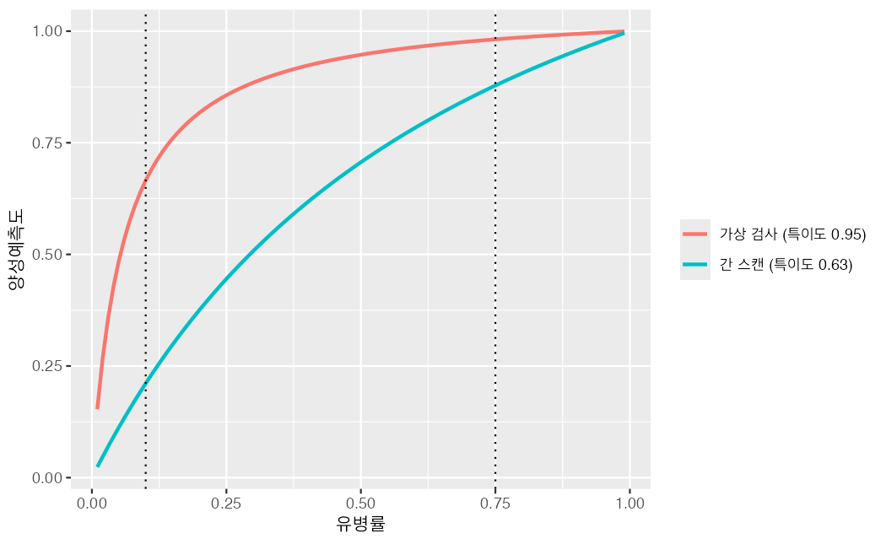
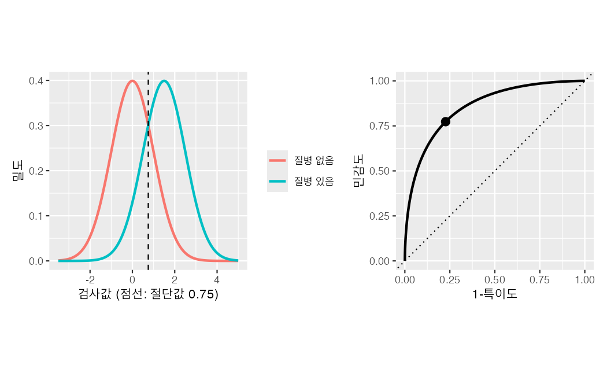

『생명과학연구를 위한 통계적 방법』(이재원·박미라·유한나)과 전북대학교 최혜미 교수님 강의를 바탕으로 정리했다.

[분할표 분석](/posts/biostat-contingency-diagnostic)이 두 변수의 연관성이 있는지를 검정했다면, 진단법 평가는 검사 결과가 실제 질병 상태를 얼마나 잘 맞히는지를 재는 일이다. 같은 $2 \times 2$ 표를 쓰지만 묻는 것이 다르다. 연관성의 유의성이 아니라 맞힌 비율이 관심이고, 어느 비율을 보느냐에 따라 유병률의 영향을 받는지가 갈린다. 기계학습의 분류 평가는 [ML 평가지표](/posts/ml-09-metrics)에서 같은 개념을 다른 이름으로 다룬다.

## 1. 진단법의 평가

진단법은 실제 질병 상태(기준 검사, gold standard)와 검사 결과의 관계로 평가한다.

|  | 질병 있음 | 질병 없음 |
| --- | ---: | ---: |
| 검사 양성 | TP | FP |
| 검사 음성 | FN | TN |

민감도는 질병이 있는 사람이 검사에서 양성으로 제대로 판정되는 비율이다.

$$
\text{sensitivity} =
\frac{TP}{TP+FN}
$$

특이도는 질병이 없는 사람이 검사에서 음성으로 제대로 판정되는 비율이다.

$$
\text{specificity} =
\frac{TN}{FP+TN}
$$

양성예측도는 검사 양성인 사람 중 실제 질병이 있는 사람의 비율이다.

$$
PPV =
\frac{TP}{TP+FP}
$$

음성예측도는 검사 음성인 사람 중 실제 질병이 없는 사람의 비율이다.

$$
NPV =
\frac{TN}{FN+TN}
$$

민감도와 특이도는 질병 유무별로(열 기준), 예측도는 검사 결과별로(행 기준) 나눈 비율이다. 쉽게 치료될 질병이거나 놓치면 안 되는 질병에서는 민감도가 높은 검사를 선호한다. 위음성률을 낮추는 것이 중요하기 때문이다. 반대로 심각하고 치료가 어렵거나 양성 판정의 부담이 큰 질병에서는 특이도가 높은 검사가 중요할 수 있다. 위양성률을 낮춰야 하기 때문이다.

## 2. 예제: 간 스캔 진단

간 질환이 의심되는 환자 344명에게 간 스캔을 시행하고, 병리 검사(부검·생검)를 기준으로 비교한 자료다(Altman & Bland, 1994).

| 간 스캔 | 병리 이상 | 병리 정상 | 합 |
|---|---:|---:|---:|
| 이상 | 231 | 32 | 263 |
| 정상 | 27 | 54 | 81 |
| 합 | 258 | 86 | 344 |

| 측도 | 계산 | 값 | 95% 정확 구간 |
|---|---|---:|---|
| 민감도 | 231 / 258 | 0.895 | (0.851, 0.930) |
| 특이도 | 54 / 86 | 0.628 | (0.517, 0.730) |
| 양성예측도 | 231 / 263 | 0.878 | (0.833, 0.915) |
| 음성예측도 | 54 / 81 | 0.667 | (0.553, 0.768) |
| 유병률 (이 표본) | 258 / 344 | 0.750 | |

구간은 R의 `binom.test`로 확인한 값이다. 간 스캔은 병리 이상을 놓치는 일은 적지만(민감도 0.895), 정상인의 3분의 1 이상을 이상으로 판정한다(특이도 0.628).

```sas
data liver;
  input scan $ path $ count;
  datalines;
abnormal abnormal 231
abnormal normal    32
normal   abnormal  27
normal   normal    54
;
run;

proc freq data=liver order=data;
  weight count;
  tables path*scan / nopercent nocol;               /* 행 백분율 = 민감도, 특이도 */
  tables scan*path / nopercent nocol;               /* 행 백분율 = 양성예측도, 음성예측도 */
run;

proc freq data=liver order=data;
  where path = 'abnormal';                          /* 민감도의 이항 신뢰구간 */
  weight count;
  tables scan / binomial(level='abnormal');
run;
```

`path*scan` 표의 행 백분율에서 병리 이상 행의 `abnormal` 비율이 민감도, 병리 정상 행의 `normal` 비율이 특이도고, `scan*path` 표의 행 백분율이 각각 양성예측도와 음성예측도다. 각 비율의 정확 신뢰구간이 필요하면 위 두 번째 `proc freq`처럼 해당 행만 `where`로 골라 `binomial` 옵션을 쓴다. 위 표의 값은 SAS 출력을 옮긴 것이 아니라 같은 자료를 R로 계산한 값이다.

## 3. 예측도는 유병률에 따라 바뀐다

민감도와 특이도는 검사 자체의 성질이지만, 예측도는 대상 집단의 유병률 $\pi$에 따라 달라진다. 베이즈 정리로 쓰면 다음과 같다.

$$
PPV = \frac{Se \cdot \pi}{Se \cdot \pi + (1 - Sp)(1 - \pi)}, \qquad
NPV = \frac{Sp (1 - \pi)}{Sp (1 - \pi) + (1 - Se)\pi}
$$

간 스캔을 유병률 10%인 일반 검진 집단에 쓰면 $PPV = \frac{0.895 \times 0.1}{0.895 \times 0.1 + 0.372 \times 0.9} \approx 0.21$로, 양성 판정의 약 80%가 위양성이다. 위 표의 양성예측도 0.878은 이 표본의 유병률이 0.75로 높아서 나온 값이다. 같은 검사라도 유병률이 낮은 집단의 선별검사에서는 양성예측도가 크게 떨어지므로 특이도가 중요하다.

유병률에 따른 양성예측도를 그려 보자. 간 스캔과 비교하기 위해 민감도는 같고 특이도만 0.95인 가상의 검사를 함께 그렸다.

```r
library(tidyverse)
se <- 231 / 258; sp <- 54 / 86
ppv <- function(pi, se, sp) se * pi / (se * pi + (1 - sp) * (1 - pi))
npv <- function(pi, se, sp) sp * (1 - pi) / (sp * (1 - pi) + (1 - se) * pi)
c(PPV_10 = ppv(0.1, se, sp), NPV_10 = npv(0.1, se, sp), PPV_75 = ppv(0.75, se, sp))
tibble(pi = seq(0.01, 0.99, by = 0.01)) |>
  mutate(`간 스캔 (특이도 0.63)` = ppv(pi, se, sp),
         `가상 검사 (특이도 0.95)` = ppv(pi, se, 0.95)) |>
  pivot_longer(-pi, names_to = "검사", values_to = "PPV") |>
  ggplot(aes(pi, PPV, color = 검사)) +
  geom_line(linewidth = 1) +
  geom_vline(xintercept = c(0.1, 0.75), linetype = 3) +
  labs(x = "유병률", y = "양성예측도", color = NULL)
```



점선은 일반 검진의 유병률 10%와 이 표본의 유병률 75%다. 유병률 10%에서 간 스캔의 양성예측도는 0.21이지만 특이도 0.95인 검사는 약 0.66이고, 75%에서는 0.88과 0.98로 차이가 줄어든다. 두 검사의 차이는 유병률이 낮을수록 벌어진다.

## 4. 우도비

$$
LR^+ = \frac{Se}{1 - Sp}, \qquad LR^- = \frac{1 - Se}{Sp}
$$

검사 전 오즈에 우도비를 곱하면 검사 후 오즈가 된다. 간 스캔은 $LR^+ = 0.895 / 0.372 \approx 2.4$, $LR^- = 0.105 / 0.628 \approx 0.17$이다. 양성이 나오면 병리 이상의 오즈가 2.4배로, 음성이 나오면 0.17배로 바뀐다. 유병률이 10%이면 검사 전 오즈는 $0.1/0.9 = 0.111$이고, 양성 후 오즈는 $0.111 \times 2.4 = 0.267$, 확률로는 $0.267/1.267 = 0.21$로 위의 $PPV$와 같다. 우도비는 유병률과 무관하게 검사의 정보량을 비교할 수 있고, 예측도는 이 우도비에 대상 집단의 검사 전 오즈를 반영한 값이다.

## 5. 절단값과 ROC 곡선

검사 결과가 연속형 수치일 때는 어느 값을 기준으로 양성/음성을 나눌지 정해야 한다. 이 기준값을 절단값이라고 한다.

절단값이 바뀌면 민감도와 특이도가 함께 변한다. 보통 민감도를 높이면 특이도는 낮아지고, 특이도를 높이면 민감도는 낮아진다.

ROC 곡선은 여러 절단값에서의 다음 좌표를 그린 것이다.

$$
x = 1-\text{specificity}
$$

$$
y = \text{sensitivity}
$$

AUC는 ROC 곡선 아래 면적이다. 무작위로 뽑은 질병 있는 사람의 검사값이 질병 없는 사람의 값보다 클 확률과 같다.

- AUC = 1: 완벽한 판별
- AUC = 0.5: 무작위 판별과 비슷
- AUC < 0.5: 판정 방향을 반대로 쓰는 것이 나을 수 있음

Youden index는 보통 다음 값을 최대화하는 절단값을 고르는 데 사용한다.

$$
J = \text{sensitivity} + \text{specificity} - 1
$$

민감도와 특이도를 퍼센트로 쓰면 $\text{sensitivity} + \text{specificity} - 100$이다.

절단값이 움직일 때 ROC 곡선 위의 점이 어떻게 움직이는지 보기 위해, 질병 없는 집단은 $N(0, 1)$, 질병 있는 집단은 $N(1.5, 1)$을 따르는 검사값을 생각한다. 모의실험이 아니라 이 분포에서 이론적으로 계산한 곡선이다.

```r
library(patchwork)
d <- 1.5; cut <- 0.75
dens <- tibble(x = seq(-3.5, 5, length.out = 400)) |>
  mutate(`질병 없음` = dnorm(x), `질병 있음` = dnorm(x, d)) |>
  pivot_longer(-x, names_to = "집단", values_to = "밀도")
p1 <- ggplot(dens, aes(x, 밀도, color = 집단)) +
  geom_line(linewidth = 1) +
  geom_vline(xintercept = cut, linetype = 2) +
  labs(x = "검사값 (점선: 절단값 0.75)", color = NULL)
roc <- tibble(c = seq(-4, 6, by = 0.01)) |>
  mutate(민감도 = 1 - pnorm(c, d), `1-특이도` = 1 - pnorm(c))
pt <- tibble(`1-특이도` = 1 - pnorm(cut), 민감도 = 1 - pnorm(cut, d))
p2 <- ggplot(roc, aes(`1-특이도`, 민감도)) +
  geom_line(linewidth = 1) +
  geom_abline(linetype = 3) +
  geom_point(data = pt, size = 3) +
  coord_equal()
c(AUC = pnorm(d / sqrt(2)), 민감도 = pt$민감도, 특이도 = 1 - pt$`1-특이도`,
  J = pt$민감도 - pt$`1-특이도`) |> round(3)
p1 + p2
```



절단값을 오른쪽으로 옮기면 양성으로 판정하는 영역이 줄어 두 집단의 오른쪽 꼬리 면적인 민감도와 $1-$특이도가 함께 작아지고, ROC 곡선 위의 점이 왼쪽 아래로 움직인다. 두 분포의 가운데인 0.75에서 민감도와 특이도가 모두 0.773으로 같고 Youden 지수가 $J = 0.547$로 최대가 된다. 이 분포의 AUC는 $\Phi(1.5/\sqrt 2) = 0.856$이다.

## 6. ROC 곡선 실습

연속형 검사값이나 로지스틱 모형의 예측확률로 ROC 곡선을 그린다. SAS 내장 `sashelp.heart`(프레이밍햄 심장 연구 자료)에서 사망 여부를 콜레스테롤만으로 예측할 때와, 나이·혈압·흡연을 더했을 때를 비교한다.

```sas
data heart;
  set sashelp.heart;
  dead = (Status = 'Dead');
  if nmiss(Cholesterol, AgeAtStart, Systolic, Smoking) = 0;
run;

proc logistic data=heart plots(only)=roc;
  model dead(event='1') = Cholesterol AgeAtStart Systolic Smoking;
  roc 'Cholesterol only' Cholesterol;
  roccontrast reference('Cholesterol only') / estimate e;
run;
```

- `model` 문의 전체 모형 ROC와 `roc` 문으로 지정한 부분 모형의 ROC가 한 그림에 겹쳐 그려진다.
- `roccontrast`는 두 AUC의 차이를 검정한다(DeLong 방법).
- 연속형 검사값 하나의 절단값별 민감도·특이도 표가 필요하면 `model` 문에 `/ outroc=roc_out`을 주고, 저장된 `_SENSIT_`, `_1MSPEC_`로 Youden 지수 $J = Se + Sp - 1$이 최대인 절단값을 찾는다.

`sashelp.heart`의 출력은 SAS에서 실행해야 확인할 수 있으므로 이 글에는 숫자를 싣지 않았다. 출력에서는 `ROC Association Statistics`의 AUC(`Area`)와 `ROC Contrast Test Results`의 $p$값을 본다. AUC 값 자체는 위의 이론 곡선처럼 해석한다.

## 7. 일치도: 카파 통계량

두 평가자(또는 두 검사)가 같은 대상을 범주로 판정했을 때 얼마나 일치하는지 본다. 단순 일치율 $p_o$는 우연히 일치하는 부분까지 포함하므로, 우연 일치 $p_e$를 뺀 **Cohen의 카파**를 쓴다.

$$
\kappa = \frac{p_o - p_e}{1 - p_e}, \qquad p_e = \sum_i p_{i+} p_{+i}
$$

| $\kappa$ | 일치 정도 (Landis & Koch) |
|---|---|
| $\kappa < 0.20$ | 낮음 |
| $0.20 \le \kappa < 0.40$ | 약간 |
| $0.40 \le \kappa < 0.60$ | 보통 |
| $0.60 \le \kappa < 0.80$ | 상당 |
| $\kappa \ge 0.80$ | 거의 완벽 |

순서형 범주(예: 경증·중등도·중증)는 불일치 정도에 가중치를 주는 **가중 카파**를 쓴다. 연속형 측정값의 일치도는 급내상관계수(ICC)나 Bland-Altman 그림으로 본다.

[분할표 글](/posts/biostat-contingency-diagnostic)의 결혼 전후 만족도 표(예제 3.5)로 계산해 보자. 결혼 전과 후의 판정이 같은 칸은 23과 12이므로

$$
p_o = \frac{23 + 12}{60} = 0.583, \qquad
p_e = \frac{30 \times 41 + 30 \times 19}{60^2} = 0.5, \qquad
\kappa = \frac{0.583 - 0.5}{1 - 0.5} = 0.167
$$

이다(R로 확인한 값). 일치율은 58%지만 절반은 우연히도 일치하는 몫이라, 우연을 뺀 카파는 0.17로 '낮음'에 해당한다.

```sas
proc freq data=ex35 order=data;
  weight count;
  tables before*after / agree;
  test kappa;
run;
```

`agree` 옵션은 McNemar 검정($2 \times 2$) 또는 Bowker 대칭성 검정($k \times k$)과 함께 단순·가중 카파와 신뢰구간을 출력한다. 같은 표에서 McNemar 검정은 $Q_M = 4.84$, $p = 0.028$로 만족도가 바뀌었다고 하지만, 카파는 개별 대상의 판정이 일치하는 정도가 낮다고 말한다. McNemar 검정은 "두 판정의 양성률이 같은가", 카파는 "개별 대상에서 판정이 얼마나 일치하는가"를 보는 서로 다른 질문이다.

## 8. 비교

| 구분 | 지표 | 기준 | 유병률 의존 | 쓰는 질문 |
|---|---|---|---|---|
| 검사의 고유 성질 | 민감도, 특이도, $LR^+$, $LR^-$ | 질병 유무별 | 받지 않음(고유 성질) | 이 검사가 질병을 가려내는가, 검사끼리 비교 |
| 집단에서의 값 | $PPV$, $NPV$ | 검사 결과별 | 받음 | 이 집단에서 양성이면 질병일 확률은 |
| 전체 요약 | ROC, AUC, Youden $J$ | 모든 절단값 | 받지 않음 | 절단값과 무관한 판별력, 절단값 선택 |
| 일치도 | 카파 | 두 판정 사이 | 받음(주변분포에 의존) | 두 평가자·검사의 판정이 일치하는가 |

진단 평가는 기준 검사가 있어 어느 쪽이 맞는지가 정해져 있고, 일치도는 서로 대등한 두 판정을 비교한다. 민감도와 특이도는 절단값을 움직이면 한쪽이 오르는 만큼 다른 쪽이 내려가므로, 어느 오류가 더 해로운지로 절단값을 정한다.

## 요약

| 질문 | 자료 | 방법 | SAS |
|---|---|---|---|
| 검사 정확도 | 기준 검사와 비교 | 민감도, 특이도, 예측도 | `proc freq` 행 백분율, `binomial` |
| 집단에 따른 양성의 의미 | 유병률 | 베이즈로 $PPV$, $NPV$, 우도비 | |
| 연속형 검사 | 예측값 | ROC, AUC, Youden $J$ | `proc logistic` + `roc` |
| 판정 일치 | 같은 대상 반복 판정 | 카파 | `/ agree` |
