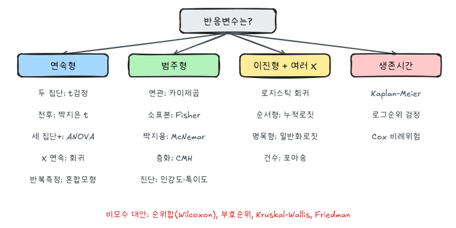

『생명과학연구를 위한 통계적 방법』(이재원·박미라·유한나)과 전북대학교 최혜미 교수님 강의를 바탕으로 정리했다.

가설검정은 표본 자료를 이용해 모수에 대한 주장이 자료와 얼마나 맞는지 판단하는 절차다. 생명과학 논문에서 자주 보는 표현인 "5% 유의수준에서 유의하다", "두 군의 차이가 통계적으로 유의하다", "p < 0.01" 같은 문장이 모두 가설검정의 결과다.

## 1. 가설검정의 기본 구조

가설검정에서는 보통 두 개의 가설을 둔다.

- 귀무가설 $H_0$: 기존의 주장, 차이가 없다는 주장, 효과가 없다는 주장
- 대립가설 $H_1$ 또는 $H_a$: 연구자가 보이고 싶은 주장, 차이가 있다는 주장, 효과가 있다는 주장

예를 들어 기존 치료의 효과율이 70%라고 알려져 있고, 새로운 치료가 더 높은 효과율을 보이는지 확인하고 싶다면 다음처럼 쓸 수 있다.

$$
H_0: p = 0.70
$$

$$
H_1: p > 0.70
$$

여기서 $p$는 모집단의 치료 성공률이다.

## 2. 귀무가설을 기준으로 판단한다

검정은 귀무가설이 맞다고 가정한 상태에서 시작한다. 그 가정 아래에서 지금 관측된 자료 또는 그보다 더 극단적인 자료가 나올 가능성이 얼마나 작은지 본다.

자료가 귀무가설 아래에서 보기 어려울 정도로 극단적이면 귀무가설을 기각한다. 반대로 자료가 충분히 극단적이지 않으면 귀무가설을 기각하지 못한다.

중요한 점은 "귀무가설을 기각하지 못했다"가 "귀무가설이 참임을 증명했다"는 뜻은 아니라는 것이다. 자료가 부족하거나 표본 수가 작아서 차이를 발견하지 못했을 수도 있다.

## 3. 제1종 오류와 제2종 오류

가설검정에는 두 가지 오류가 있다.

| 실제 상태 | 검정 결론 | 오류 |
| --- | --- | --- |
| $H_0$가 참 | $H_0$ 기각 | 제1종 오류 |
| $H_1$이 참 | $H_0$ 기각하지 못함 | 제2종 오류 |

제1종 오류는 실제로는 효과가 없는데 효과가 있다고 판단하는 오류다. 이 오류의 확률을 $\alpha$로 표시한다.

제2종 오류는 실제로는 효과가 있는데 효과가 없다고 판단하는 오류다. 이 오류의 확률을 $\beta$로 표시한다.

검정력은 $1-\beta$다. 실제 효과가 있을 때 귀무가설을 기각할 확률이다.

$$
\text{power} = 1 - \beta
$$

유의수준 $\alpha$를 작게 잡으면 제1종 오류를 줄일 수 있지만, 같은 표본 크기에서는 제2종 오류가 커질 수 있다. 표본 수를 늘리면 두 오류를 함께 줄일 수 있지만 비용과 현실성이 문제가 된다.

## 4. 유의수준과 p-value

유의수준은 연구자가 허용하는 제1종 오류 확률의 상한이다. 보통 $\alpha = 0.05$를 많이 쓴다.

p-value는 귀무가설이 참이라고 가정했을 때, 관측된 검정통계량만큼 또는 그보다 더 극단적인 결과가 나올 확률이다.

따라서 판단 규칙은 다음과 같다.

$$
p\text{-value} < \alpha \Rightarrow H_0 \text{ 기각}
$$

$$
p\text{-value} \ge \alpha \Rightarrow H_0 \text{ 기각하지 못함}
$$

p-value가 작을수록 귀무가설과 관측자료가 잘 맞지 않는다는 뜻이다. 하지만 p-value는 효과의 크기나 임상적 중요성을 직접 말해주지 않는다. 표본 수가 매우 크면 아주 작은 차이도 통계적으로 유의할 수 있다.

## 5. 단측검정과 양측검정

대립가설의 방향이 한쪽이면 단측검정이다.

$$
H_0: \mu = \mu_0
$$

$$
H_1: \mu > \mu_0
$$

또는

$$
H_1: \mu < \mu_0
$$

대립가설이 양쪽 방향이면 양측검정이다.

$$
H_1: \mu \ne \mu_0
$$

방향이 연구설계 단계에서 명확하지 않다면 양측검정을 쓰는 것이 일반적이다. 자료를 본 뒤 유리한 방향으로 단측검정을 고르는 것은 적절하지 않다.

## 6. 예제: 평균이 10보다 큰가

원본 강의자료에는 다음 형태의 예제가 나온다.

어떤 측정값의 모집단 평균이 10보다 크다고 할 수 있는지 확인하고자 한다. 표본 수는 56명이고, 표본평균은 10.7, 표본표준편차는 4.6이다. 유의수준은 0.05다.

가설은 다음과 같다.

$$
H_0: \mu = 10
$$

$$
H_1: \mu > 10
$$

표본 수가 충분히 크다고 보고 표본표준편차를 이용해 근사하면 검정통계량은 다음과 같다.

$$
Z \approx
\frac{\bar X - \mu_0}{s / \sqrt n}
= \frac{10.7 - 10}{4.6 / \sqrt{56}}
= 1.139
$$

오른쪽 단측검정에서 5% 유의수준의 기각역은 다음과 같다.

$$
Z > z_{0.05} = 1.645
$$

관측된 검정통계량 1.139는 기각역에 들어가지 않는다. $p$값은 $P(Z > 1.139) \approx 0.127$로 0.05보다 크다. 모분산을 모르므로 엄밀하게는 자유도 55인 $t$분포를 써야 하고, 그때 $p \approx 0.130$으로 결론은 같다. 따라서 5% 유의수준에서는 평균이 10보다 크다고 결론 내릴 충분한 근거가 없다.

원자료가 있으면 SAS에서는 `PROC TTEST`로 한 번에 계산한다. `h0=`이 귀무가설 값, `sides=u`가 오른쪽 단측검정이다.

```sas
proc ttest data=sample h0=10 sides=u alpha=0.05;
  var x;
run;
```

## 7. 신뢰구간과 검정의 관계

양측 유의수준 $\alpha$ 검정에서 $H_0: \mu = \mu_0$를 기각하지 못하는 것과, $\mu_0$가 $100(1-\alpha)\%$ 신뢰구간 안에 있는 것은 같은 말이다.

$$
\bar X \pm t_{\alpha/2,\, n-1} \frac{s}{\sqrt n} \ni \mu_0 \iff \left| \frac{\bar X - \mu_0}{s / \sqrt n} \right| \le t_{\alpha/2,\, n-1}
$$

신뢰구간은 "유의한가"뿐 아니라 효과의 크기와 추정의 정밀도까지 보여 준다. 그래서 많은 학술지는 $p$값과 함께 신뢰구간을 보고하도록 요구한다.

### 통계적 유의성과 임상적 의미

$p$값은 효과의 크기가 아니다. 표본이 매우 크면 임상적으로 무의미한 차이도 $p < 0.001$이 되고, 표본이 작으면 중요한 차이도 유의하지 않을 수 있다. 결과는 다음 세 가지를 함께 본다.

- 효과 크기: 평균 차이, 위험비, 오즈비 등
- 정밀도: 신뢰구간의 폭
- 임상적으로 의미 있는 최소 차이와의 비교

"유의하지 않다"는 "차이가 없다"는 증거가 아니다. 차이가 없음을 보이려면 동등성 검정(equivalence test)처럼 처음부터 그 목적으로 설계된 검정이 필요하다. 검정력이 낮은 연구의 유의하지 않은 결과는 아무것도 말해 주지 않는다. 필요한 표본 수는 [표본크기와 검정력](/posts/biostat-sample-size) 글에서 다룬다.

## 8. 가능도비 검정, Wald 검정, 점수 검정

귀무가설이 허용하는 모수공간을 $\Omega_0$, 전체 모수공간을 $\Omega$라 하자. 가능도비 통계량은 다음과 같다.

$$
\Lambda = \frac{\max_{\theta \in \Omega_0} L(\theta)}{\max_{\theta \in \Omega} L(\theta)}, \qquad 0 \le \Lambda \le 1
$$

$H_0$가 자료를 잘 설명하면 $\Lambda$가 1에 가깝다. 큰 표본에서 다음 근사가 성립한다(Wilks 정리).

$$
G^2 = -2 \log \Lambda \;\dot\sim\; \chi^2_d, \qquad d = \dim \Omega - \dim \Omega_0
$$

같은 가설을 검정하는 큰 표본 검정이 세 가지 있다.

| 검정 | 통계량 | 필요한 적합 |
|---|---|---|
| 가능도비 | $-2(\ell(\hat\theta_0) - \ell(\hat\theta))$ | 두 모형 모두 |
| Wald | $(\hat\theta - \theta_0)^2 / \widehat{Var}(\hat\theta)$ | 전체 모형만 |
| 점수(score) | $U(\theta_0)^2 / I(\theta_0)$ | 귀무 모형만 |

### 예: 이항 비율

50명 중 32명이 반응했을 때 $H_0: p = 0.5$를 검정한다. $\hat p = 0.64$다.

$$
G^2 = 2\left[ 32 \log \frac{0.64}{0.5} + 18 \log \frac{0.36}{0.5} \right] \approx 3.97 \quad (p \approx 0.046)
$$

$$
W = \frac{(0.64 - 0.5)^2}{0.64 \times 0.36 / 50} \approx 4.25, \qquad
S = \frac{(0.64 - 0.5)^2}{0.5 \times 0.5 / 50} = 3.92
$$

세 값 모두 $\chi^2_1$의 5% 기각값 3.84를 넘는다. Wald 검정은 분산을 $\hat p$로, 점수 검정은 $p_0$로 계산한다는 차이만 있다. 점수 검정은 우리가 흔히 쓰는 비율의 $z$검정을 제곱한 것과 같다. 표본이 크면 세 검정은 거의 같아지고, 작으면 가능도비 검정이 가장 안정적이다.

```sas
data resp;
  input y $ count;
  datalines;
yes 32
no  18
;
run;

proc freq data=resp order=data;
  weight count;
  tables y / binomial(p=0.5 level='yes') alpha=0.05;
  exact binomial;
run;
```

`binomial` 옵션은 점수 검정 기반의 $z$검정과 신뢰구간을, `exact binomial`은 이항분포의 정확 $p$값을 준다.

### 축소모형 대 전체모형

회귀모형에서 변수 묶음이 필요한지 볼 때 가장 자주 쓰는 것이 가능도비 검정이다. 두 모형의 $-2\log L$ 차이가 $\chi^2_d$를 따른다.

```sas
proc logistic data=sashelp.heart;
  class Smoking_Status (ref='Non-smoker') / param=ref;
  model Status(event='Dead') = AgeAtStart Systolic Smoking_Status;
run;
```

출력의 `Model Fit Statistics`에서 `-2 Log L` 값을 축소모형(예: `Smoking_Status`를 뺀 모형)과 비교하면, 그 차이가 흡연 상태 전체(자유도 = 범주 수 - 1)에 대한 가능도비 검정통계량이다. `Type 3 Analysis of Effects` 표는 같은 질문에 대한 Wald 검정이다.

## 9. 자료형과 분석 방법

생명과학 자료는 크게 질적 자료와 양적 자료로 나눌 수 있다.

질적 자료는 범주형 자료다.

- 명목형 자료: 범주 사이에 순서가 없다. 예: 남/여, 성공/실패, 흡연/비흡연, ABO 혈액형
- 순서형 자료: 범주 사이에 순서가 있다. 예: 증상 정도, 만족도, 중증도 등급

양적 자료는 수치형 자료다.

- 이산형 자료: 개수처럼 정수로 세는 값. 예: 발생 횟수, 방문 횟수
- 연속형 자료: 키, 몸무게, 혈압, 검사 수치처럼 연속적으로 측정되는 값

생존시간 자료는 사건이 발생할 때까지의 시간이다. 연구 종료나 추적 탈락 때문에 사건 발생 시간을 끝까지 관찰하지 못한 중도절단 자료가 함께 생기는 경우가 많다.

분석 방법을 고를 때는 반응변수와 설명변수의 자료형을 먼저 본다.

| 반응변수 | 설명변수 | 대표 분석 |
| --- | --- | --- |
| 연속형 | 두 집단 | 독립표본 t-검정, 윌콕슨 순위합 검정 |
| 연속형 | 같은 대상자의 전후 | 짝지은 t-검정, 윌콕슨 부호순위 검정 |
| 연속형 | 세 집단 이상 | ANOVA, Kruskal-Wallis 검정 |
| 범주형 | 범주형 | 분할표 분석, 카이제곱 검정 |
| 이진형 | 여러 설명변수 | 로지스틱 회귀 |
| 생존시간 | 집단 또는 공변량 | Kaplan-Meier, 로그순위 검정, Cox 회귀 |



## 요약

| 개념 | 핵심 |
|---|---|
| 가설 | 연구자가 보이고 싶은 것을 $H_1$에, 기준이 되는 상태를 $H_0$에 둔다 |
| 오류 | 제1종 $\alpha$(없는 효과를 있다고), 제2종 $\beta$(있는 효과를 놓침), 검정력 $1 - \beta$ |
| $p$값 | $H_0$가 참일 때 관측값 이상으로 극단적인 결과가 나올 확률 |
| 단측·양측 | 방향은 자료를 보기 전에 정한다 |
| 신뢰구간 | 검정과 동치, 효과 크기와 정밀도까지 보여 준다 |
| 큰 표본 검정 | 가능도비, Wald, 점수 검정 |
