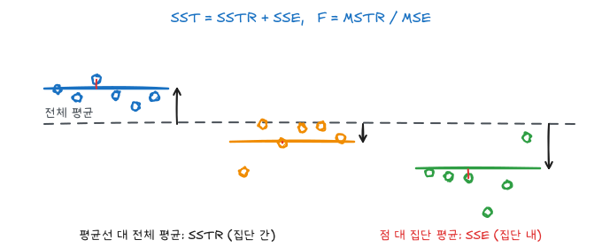

『생명과학연구를 위한 통계적 방법』(이재원·박미라·유한나)과 전북대학교 최혜미 교수님 강의를 바탕으로 정리했다.

평균 비교는 반응변수가 연속형이고 설명변수가 범주형일 때 가장 먼저 고려하는 분석이다. 집단이 두 개인지, 세 개 이상인지, 독립표본인지 짝지은 표본인지에 따라 분석 방법이 달라진다.

## 1. 평균 비교의 기본 지도

| 상황 | 모수적 방법 | 비모수적 방법 | SAS |
| --- | --- | --- | --- |
| 독립된 두 집단 | 독립표본 t-검정 | Wilcoxon rank sum test | `PROC TTEST`, `PROC NPAR1WAY` |
| 같은 대상자의 전후 비교 | 짝지은 t-검정 | Wilcoxon signed rank test | `PROC TTEST PAIRED`, `PROC UNIVARIATE` |
| 독립된 세 집단 이상 | 일원분산분석 | Kruskal-Wallis test | `PROC ANOVA`, `PROC GLM`, `PROC NPAR1WAY` |
| 두 요인 실험 | 이원분산분석 | Friedman test 등 | `PROC ANOVA`, `PROC GLM`, `PROC FREQ` |

모수적 방법은 보통 정규성, 독립성, 등분산성 같은 가정을 둔다. 표본 수가 작거나 정규성이 의심되면 비모수 방법을 함께 고려한다.

## 2. 독립된 두 집단의 평균 비교

두 독립 집단의 관측값을 다음처럼 둔다.

$$
Y_{11},\ldots,Y_{1n} \sim N(\mu_1,\sigma_1^2)
$$

$$
Y_{21},\ldots,Y_{2m} \sim N(\mu_2,\sigma_2^2)
$$

관심 가설은 보통 다음과 같다.

$$
H_0: \mu_1 = \mu_2
$$

$$
H_1: \mu_1 \ne \mu_2
$$

또는 연구 질문에 따라 한쪽 방향의 대립가설을 쓸 수 있다.

모분산을 모르는 경우에는 먼저 등분산성을 확인한다. 두 집단 분산이 같다고 볼 수 있으면 pooled variance를 이용한 t-검정을 쓰고, 같다고 보기 어렵다면 Welch t-검정을 쓴다.

등분산 가정 아래의 pooled variance는 다음과 같다.

$$
S_p^2 =
\frac{(n_1-1)S_1^2 + (n_2-1)S_2^2}{n_1+n_2-2}
$$

검정통계량은 다음과 같다.

$$
t =
\frac{\bar Y_1 - \bar Y_2 - \delta_0}
{S_p \sqrt{1/n_1 + 1/n_2}}
$$

## 3. 예제 2-1: 혈청 칼슘량 비교

건강한 사람 5명과 부갑상선 기능 항진증 환자 12명에 대해 혈청 칼슘량을 비교한다.

- 건강한 사람: $n_1=5$, $\bar x_1=12.9$, $\sigma_1^2=0.69$
- 환자군: $n_2=12$, $\bar x_2=9.9$, $\sigma_2^2=0.175$

모분산이 알려져 있다고 보면 평균 차이에 대한 Z 검정을 사용할 수 있다.

$$
H_0: \mu_1 = \mu_2
$$

$$
H_1: \mu_1 > \mu_2
$$

검정통계량은 다음과 같다.

$$
Z =
\frac{12.9 - 9.9}
{\sqrt{0.69/5 + 0.175/12}}
\approx 7.68
$$

이 값은 매우 크므로 건강한 사람의 평균 혈중 칼슘량이 환자군보다 높다는 강한 근거가 된다. 실제 분석에서는 원자료, 단위, 모분산이 정말 알려져 있는지 확인해야 한다.

## 4. 예제 2-2: 흡연자와 비흡연자의 폐 파괴지수

폐기종이 뚜렷하게 발전하기 전의 흡연자와 비흡연자를 비교한다. 높은 폐 파괴지수는 폐 손상이 크다는 뜻이다.

```sas
data test;
  input group x @@;
  cards;
  1 16.6 1 13.9 1 11.3 1 26.5 1 17.4 1 15.3
  1 15.8 1 12.3 1 18.6 1 12.0 1 24.1 1 16.5
  1 21.8 1 16.3 1 23.4 1 18.8 2 18.1 2 6.0
  2 10.8 2 11.0 2 7.7 2 17.9 2 8.5 2 13.0
  2 18.9
  ;
run;
```

여기서 `group=1`은 흡연자, `group=2`는 비흡연자로 볼 수 있다.

가설은 다음과 같다.

$$
H_0: \mu_{\text{smoker}} = \mu_{\text{non-smoker}}
$$

$$
H_1: \mu_{\text{smoker}} \ne \mu_{\text{non-smoker}}
$$

SAS에서는 다음처럼 분석한다.

```sas
proc ttest data=test;
  class group;
  var x;
run;
```

표본 수가 작으므로 그룹별 정규성도 확인한다.

```sas
proc sort data=test;
  by group;
run;

proc univariate data=test normal plot;
  var x;
  by group;
run;
```

정규성을 만족하기 어렵다면 Wilcoxon rank sum test 또는 Mann-Whitney U test를 사용한다.

```sas
proc npar1way data=test wilcoxon;
  class group;
  var x;
run;
```

## 5. Mann-Whitney U test

Wilcoxon rank sum test는 두 독립 집단의 위치 차이를 비교하는 비모수 검정이다. 모든 관측값을 합쳐 순위를 매기고, 각 집단의 순위합을 비교한다.

집단 1의 표본 수를 $n_1$, 집단 2의 표본 수를 $n_2$, 집단 1의 순위합을 $R_1$이라고 하면 U 통계량은 다음처럼 쓸 수 있다.

$$
U_1 = n_1 n_2 + \frac{n_1(n_1+1)}{2} - R_1
$$

원본 슬라이드의 순위합 예에서는 $n_1=7$, $n_2=6$, $R_1=50.5$, $R_2=40.5$일 때 다음처럼 계산한다.

$$
U_1 = 7 \times 6 + \frac{7 \times 8}{2} - 50.5 = 19.5
$$

$$
U_2 = 7 \times 6 + \frac{6 \times 7}{2} - 40.5 = 22.5
$$

표본 수가 충분히 크면 U 통계량을 정규근사로 검정할 수 있다.

## 6. 짝지은 표본의 평균 비교

같은 대상자에서 처리 전후를 비교하면 두 관측값은 독립이 아니다. 이때는 각 대상자의 차이값을 만든다.

$$
D_i = \text{after}_i - \text{before}_i
$$

차이값이 서로 독립이고 정규분포를 따른다고 가정하면 다음 검정을 한다.

$$
H_0: \mu_D = \delta_0
$$

$$
H_1: \mu_D \ne \delta_0
$$

검정통계량은 다음과 같다.

$$
t =
\frac{\bar D - \delta_0}{S_D/\sqrt n}
$$

## 7. 예제 2-3: 혈압강하제 전후 비교

환자 15명에게 새로운 혈압강하제를 12주 동안 투입하고, 복용 전후 혈압을 비교한다. 원본 자료에서는 `d=time2-time1`로 차이를 정의한다.

```sas
data blood;
  input id time1 time2 @@;
  d = time2 - time1;
  cards;
  1 90 72 2 56 55 3 49 56 4 64 57
  5 65 62 6 88 79 7 62 55 8 91 72
  9 74 73 10 93 74 11 55 58 12 71 59
  13 54 58 14 64 71 15 54 61
  ;
run;
```

약이 혈압을 낮추는지 보려면 다음처럼 방향을 둔다.

$$
H_0: \mu_D = 0
$$

$$
H_1: \mu_D < 0
$$

SAS에서는 차이값에 대한 t-검정 또는 `PAIRED` 문을 쓴다.

```sas
proc means data=blood mean stderr t prt;
  var d;
run;

proc ttest data=blood;
  paired time2*time1;
run;
```

차이값의 정규성을 확인한다.

```sas
proc univariate data=blood normal plot;
  var d;
run;
```

정규성이 어렵다면 부호검정 또는 Wilcoxon signed rank test를 사용한다.

```sas
proc univariate data=blood mu0=0;
  var d;
run;
```

## 8. 일원분산분석

세 집단 이상 평균을 비교할 때는 일원분산분석을 사용한다. 요인이 하나이고, 그 요인의 수준이 $k$개라고 하자.

모형은 다음과 같다.

$$
y_{ij} = \mu_i + \epsilon_{ij}
$$

$$
\epsilon_{ij} \sim N(0,\sigma^2)
$$

가설은 다음과 같다.

$$
H_0: \mu_1 = \mu_2 = \cdots = \mu_k
$$

$$
H_1: \text{모든 평균이 같지는 않다}
$$

총제곱합은 처리제곱합과 오차제곱합으로 분해된다.

$$
SST = SSTR + SSE
$$

검정통계량은 다음과 같다.

$$
F =
\frac{SSTR/(k-1)}{SSE/(n-k)}
= \frac{MSTR}{MSE}
$$

귀무가설 아래에서 $F(k-1,n-k)$ 분포를 따른다.

## 9. 예제 2-4: 혈청 항원 농도 비교

자폐아, 정상아, 지진아 세 집단의 혈청 항원 농도에 차이가 있는지 확인한다.

```sas
data blood;
  input group $ y @@;
  cards;
  1 755 1 365 1 820 1 900 1 170 1 300 1 325 1 385
  1 380 1 215 1 400 1 343 1 415 1 345 1 410 1 460
  1 225 1 440 1 400 1 .   1 435 1 450 1 360 2 165
  2 390 2 290 2 435 2 235 2 345 2 320 2 330 2 205
  2 375 2 345 2 305 2 220 2 270 2 355 2 360 2 335
  2 305 2 325 2 245 2 285 2 370 2 345 2 345 2 230
  2 370 2 285 2 315 2 195 2 270 2 305 2 375 2 220
  3 380 3 510 3 315 3 565 3 715 3 380 3 390 3 245
  3 155 3 335 3 295 3 200 3 105 3 105 3 245
  ;
run;
```

자폐아 집단의 값 하나는 원자료에서 판독이 불확실해 결측(`.`)으로 두었다. SAS는 결측이 있는 관측값을 분석에서 자동으로 뺀다.



ANOVA와 등분산성 검정은 다음처럼 수행한다.

```sas
proc anova data=blood;
  class group;
  model y = group;
  means group / hovtest=levene welch;
run;
```

정규성이 만족되지 않으면 Kruskal-Wallis 검정을 고려한다.

```sas
proc npar1way data=blood wilcoxon;
  class group;
  var y;
run;
```

## 10. 다중비교

ANOVA에서 귀무가설을 기각하면 "모든 평균이 같지는 않다"는 결론만 얻는다. 어느 집단끼리 다른지는 사후검정으로 본다. 집단이 $k$개면 쌍별 비교가 $\binom{k}{2}$개라서, 각각을 $\alpha = 0.05$로 검정하면 전체적으로 하나 이상 잘못 기각할 확률(실험별 오류율)이 크게 늘어난다. $k = 5$면 비교가 10개이고, 독립이라면 $1 - 0.95^{10} \approx 0.40$이다.

| 방법 | 비교 대상 | 실험별 오류 통제 | 특징 |
|---|---|---|---|
| LSD | 모든 쌍 | 안 함 | 쌍별 $t$검정. $F$검정이 유의할 때만 쓰는 것이 관례(보호된 LSD) |
| Bonferroni | 미리 정한 $m$개 비교 | 함 | 각 비교를 $\alpha/m$으로. 비교 수가 적을 때 |
| Tukey (HSD) | 모든 쌍 | 함 | 스튜던트화 범위분포 이용. 모든 쌍 비교의 표준 |
| Dunnett | 각 처리 대 대조군 | 함 | 대조군 비교만 관심일 때 가장 강력 |
| Scheffé | 모든 대비(contrast) | 함 | 가장 보수적. 사후에 만든 복잡한 대비까지 보호 |
| Duncan, SNK | 모든 쌍 | 약함 | 단계적 방법. 실험별 오류를 제대로 통제하지 못해 요즘은 권장하지 않는다 |

Tukey 방법은 표본 크기가 같을 때 두 평균의 차이가 다음보다 크면 유의하다고 본다.

$$
HSD = q_{\alpha}(k, n - k) \sqrt{\frac{MSE}{n_i}}
$$

$q_\alpha$는 스튜던트화 범위분포의 분위수다. 표본 크기가 다르면 Tukey-Kramer 수정($n_i$ 대신 조화평균)을 쓴다.

```sas
proc glm data=blood plots=diagnostics;
  class group;
  model y = group;
  means group / hovtest=levene welch;
  lsmeans group / adjust=tukey pdiff cl lines;
  lsmeans group / adjust=dunnett pdiff=control('2');
run;
quit;
```

- 불균형 자료는 `PROC ANOVA`보다 `PROC GLM`을 쓴다. `PROC ANOVA`는 균형 자료용이다.
- `lsmeans ... / adjust=tukey`는 수정된 $p$값과 동시 신뢰구간을, `lines`는 차이가 없는 집단끼리 같은 글자로 묶은 표를 출력한다.
- `pdiff=control('2')`는 정상아 집단을 대조군으로 둔 Dunnett 비교다.
- `plots=diagnostics`는 잔차 그림, 정규 Q-Q 그림을 그린다. 등분산 검정이 유의하면 `welch` 옵션의 Welch ANOVA 결과를 본다.

### 계획된 대비

자료를 보기 전에 정한 특정 비교(예: "정상아 대 나머지 두 집단")는 대비로 직접 검정한다. 대비 $L = \sum c_i \mu_i$ ($\sum c_i = 0$)의 검정이다.

```sas
proc glm data=blood;
  class group;
  model y = group;
  contrast 'normal vs others' group -1 2 -1;
  estimate 'normal vs others' group -0.5 1 -0.5;
run;
quit;
```

`contrast`는 $F$검정을, `estimate`는 대비의 추정값과 표준오차를 준다. 계수 순서는 `class` 변수 수준의 정렬 순서(1, 2, 3)를 따른다.

## 11. 이원분산분석

두 개의 요인이 연속형 반응변수에 미치는 영향을 보려면 이원분산분석을 쓴다. 요인 $A$의 수준 수를 $I$, 요인 $B$의 수준 수를 $J$라고 하자.

모형은 다음과 같다.

$$
y_{ijk} =
\mu + \alpha_i + \beta_j + (\alpha\beta)_{ij} + \epsilon_{ijk}
$$

여기서 $\alpha_i$는 요인 $A$의 주효과, $\beta_j$는 요인 $B$의 주효과, $(\alpha\beta)_{ij}$는 교호작용이다.

교호작용은 한 요인의 효과가 다른 요인의 수준에 따라 달라지는 현상이다. 이원분산분석에서는 보통 먼저 교호작용을 확인하고, 교호작용이 유의하지 않을 때 주효과를 해석한다.

검정 가설은 다음 세 가지가 핵심이다.

$$
H_0: \alpha_1=\cdots=\alpha_I=0
$$

$$
H_0: \beta_1=\cdots=\beta_J=0
$$

$$
H_0: (\alpha\beta)_{ij}=0 \quad \text{for all } i,j
$$

## 12. 예제 2-5: 호르몬 처리와 성별에 따른 혈액 칼슘

세 종류의 호르몬 처리와 성별에 따라 혈액 칼슘 값에 차이가 있는지 확인한다.

```sas
data calcium;
  do gender = 'male', 'female';
    do trt = 'trt1', 'trt2', 'trt3';
      do rep = 1, 2, 3, 4, 5;
        input calcium @@;
        output;
      end;
    end;
  end;
  cards;
  16.87 16.18 17.12 16.83 17.19
  19.07 18.77 17.63 16.99 18.04
  32.45 28.71 34.65 28.79 24.46
  15.86 14.92 15.63 15.24 14.80
  17.20 17.64 17.89 16.78 16.72
  30.54 32.41 28.97 28.46 29.65
  ;
run;
```

분석은 다음과 같다.

```sas
proc anova data=calcium;
  class gender trt;
  model calcium = gender trt gender*trt;
  means trt / tukey;
run;
```

그림으로도 교호작용을 확인한다.

```sas
proc sgplot data=calcium;
  vbox calcium / category=trt group=gender;
run;

proc sort data=calcium;
  by gender trt;
run;

proc means data=calcium noprint;
  var calcium;
  by gender trt;
  output out=calciummean mean=mcalcium;
run;

proc sgplot data=calciummean;
  scatter x=trt y=mcalcium / group=gender;
  series x=trt y=mcalcium / group=gender;
run;
```

### 교호작용의 해석

평균 그림에서 성별 선이 평행하면 교호작용이 없고, 벌어지거나 교차하면 교호작용이 있다. 교호작용이 유의하면 "호르몬 처리 효과"를 하나로 말할 수 없으므로 성별마다 처리 효과를 따로 본다.

```sas
proc glm data=calcium;
  class gender trt;
  model calcium = gender|trt;
  lsmeans gender*trt / slice=gender adjust=tukey pdiff;
run;
quit;
```

`gender|trt`는 `gender trt gender*trt`의 줄임이다. `slice=gender`는 성별마다 처리 효과의 $F$검정(단순 주효과)을 수행한다.

## 13. Friedman 검정

Friedman 검정은 랜덤화 블록 실험에서 나온 자료의 비모수적 이원분산분석에 해당한다. 한 요인은 모수인자, 다른 요인은 블록인자일 때 사용한다.

예를 들어 벼 품종에 따른 수확량을 비교할 때 토양 차이를 줄이기 위해 농지를 여러 블록으로 나누고, 각 블록 안에서 품종을 배정할 수 있다.

원본의 예제 자료는 다음과 같다.

```sas
data soy;
  input variety $ region yield @@;
  cards;
  A 1 45 A 2 49 A 3 38 B 1 48 B 2 45 B 3 39
  C 1 43 C 2 42 C 3 35 D 1 41 D 2 39 D 3 36
  E 1 44 E 2 41 E 3 40
  ;
run;

proc freq data=soy;
  tables region*variety*yield / cmh2 scores=rank noprint;
run;
```

SAS 출력에서는 `"Row Mean Scores Differ"` 행의 p-value를 확인한다.

Friedman 검정통계량은 블록마다 처리에 순위 $1, \dots, k$를 매긴 뒤, 처리별 순위합 $R_j$로 계산한다($b$ = 블록 수).

$$
Q = \frac{12}{b k (k + 1)} \sum_{j=1}^{k} R_j^2 - 3 b (k + 1) \;\dot\sim\; \chi^2_{k-1}
$$

## 요약

| 상황 | 모수 | 비모수 | SAS |
|---|---|---|---|
| 독립 두 집단 | $t$검정 (등분산/Welch) | Wilcoxon 순위합 | `ttest`, `npar1way wilcoxon` |
| 짝지은 두 측정 | 짝지은 $t$검정 | Wilcoxon 부호순위 | `ttest paired`, `univariate` |
| 독립 세 집단 이상 | 일원분산분석 | Kruskal-Wallis | `glm`, `npar1way wilcoxon` |
| 블록 설계 | 이원분산분석(블록) | Friedman | `glm`, `freq cmh2 scores=rank` |
| 두 요인 | 이원분산분석, 교호작용 | | `glm model y = a|b` |
| 사후 비교 | Tukey, Dunnett, Bonferroni | | `lsmeans / adjust=` |
| 가정 확인 | 정규성(Shapiro-Wilk), 등분산(Levene) | | `univariate normal`, `means / hovtest` |
