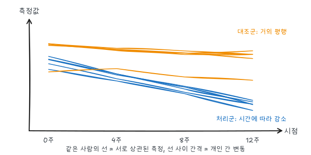

『생명과학연구를 위한 통계적 방법』(이재원·박미라·유한나)과 전북대학교 최혜미 교수님 강의를 바탕으로, 같은 대상을 여러 번 측정한 자료의 분석을 정리했다. 짝지은 $t$검정(측정 2회)의 일반화다.

## 1. 왜 따로 다루는가

같은 사람의 측정값끼리는 상관이 있다. 혈압이 높은 사람은 다음 측정에서도 높다. 이 상관을 무시하고 모든 측정을 독립으로 보면 다음 문제가 생긴다.

- 개체 간 비교(군 효과)의 표준오차를 과소추정해 거짓 양성이 늘어난다.
- 개체 내 비교(시간 효과)는 상관을 이용하면 더 정밀하게 추정할 수 있는데, 그 이점을 버린다.



| 효과 | 비교 | 예 |
|---|---|---|
| 개체 간(between) | 서로 다른 사람끼리 | 처리군 대 대조군 |
| 개체 내(within) | 같은 사람의 시점끼리 | 시간에 따른 변화 |
| 교호작용 | 시간에 따른 변화가 군마다 다른가 | 처리 효과가 시간이 갈수록 커지는가 |

임상시험에서 관심 있는 것은 보통 **군 × 시간 교호작용**이다. 기저값은 비슷한데 시간이 갈수록 군 간 차이가 벌어지는지를 본다.

## 2. 자료 형식

| 형식 | 구조 | 쓰는 절차 |
|---|---|---|
| 넓은 형식 | 한 사람이 한 행, 시점이 열 (`y1 y2 y3 y4`) | `proc glm` + `repeated` |
| 긴 형식 | 한 측정이 한 행 (`id time y`) | `proc mixed`, `proc genmod` |

아래는 설명용 예시 자료다. 처리군(A)과 대조군(P) 각 6명의 염증 지표를 0, 4, 8, 12주에 측정했다.

```sas
data wide;
  input id trt $ y0 y4 y8 y12;
  datalines;
1 A 52 47 41 38
2 A 48 45 40 35
3 A 55 49 46 40
4 A 50 44 39 37
5 A 47 43 38 33
6 A 53 48 42 39
7 P 51 50 48 47
8 P 49 48 47 45
9 P 54 52 51 50
10 P 46 46 44 43
11 P 50 49 46 46
12 P 52 51 50 48
;
run;

data long;
  set wide;
  array yy{4} y0 y4 y8 y12;
  array wk{4} _temporary_ (0 4 8 12);
  do j = 1 to 4;
    week = wk{j};
    y = yy{j};
    output;
  end;
  keep id trt week y;
run;
```

`array`와 `do` 반복으로 넓은 형식을 긴 형식으로 바꾼다. `proc transpose`로도 할 수 있다.

```sas
proc sgplot data=long;
  series x=week y=y / group=id grouplc=trt lineattrs=(pattern=solid) name='s';
  keylegend 's' / type=linecolor;
run;
```

개인별 궤적(스파게티 그림)을 먼저 그려 개인 간 변동, 시간 추세의 모양, 이상한 개체를 확인한다.

## 3. 반복측정 분산분석

군 $i$의 $k$번째 사람을 시점 $j$에 잰 값을 다음처럼 둔다.

$$
y_{ijk} = \mu + \tau_i + \pi_{k(i)} + \beta_j + (\tau\beta)_{ij} + e_{ijk}, \qquad \pi_{k(i)} \sim N(0, \sigma_\pi^2), \quad e_{ijk} \sim N(0, \sigma^2)
$$

$\tau_i$는 군 효과, $\pi_{k(i)}$는 군 안에 속한 사람의 임의효과, $\beta_j$는 시점 효과다. 사람이 1차 단위, 시점이 2차 단위인 [분할법](/posts/doe-09-nested-split-plot)과 같은 구조다. 그래서 군 효과는 사람 간 변동 $MS_{\pi(\tau)}$로, 시점과 군 × 시점은 사람 안의 오차 $MS_E$로 검정한다.

| 요인 | 자유도 ($a$군, 군마다 $n$명, $t$시점) | $E(MS)$ | F 분모 |
|---|---|---|---|
| 군 $\tau$ | $a - 1$ | $\sigma^2 + t\sigma_\pi^2 + nt\,Q(\tau)$ | $MS_{\pi(\tau)}$ |
| 사람(군) $\pi$ | $a(n - 1)$ | $\sigma^2 + t\sigma_\pi^2$ | |
| 시점 $\beta$ | $t - 1$ | $\sigma^2 + an\,Q(\beta)$ | $MS_E$ |
| 군 × 시점 | $(a - 1)(t - 1)$ | $\sigma^2 + n\,Q(\tau\beta)$ | $MS_E$ |
| 오차 | $a(n - 1)(t - 1)$ | $\sigma^2$ | |

```sas
proc glm data=wide;
  class trt;
  model y0 y4 y8 y12 = trt / nouni;
  repeated week 4 (0 4 8 12) polynomial / printe summary;
run;
quit;
```

- `repeated week 4 (0 4 8 12)`: 4개 시점, 간격은 0·4·8·12주
- 출력의 개체 간 검정(`Between Subjects`)이 `trt` 주효과, 개체 내 검정(`Within Subject`)이 `week`과 `week*trt`다.
- `polynomial`: 시간 효과를 1차·2차·3차 추세로 분해한 대비를 함께 출력한다.

### 구형성 가정

일변량 반복측정 분산분석은 시점 간 차이의 분산이 모두 같다는 **구형성**을 가정한다.

$$
Var(y_j - y_k) = \sigma_j^2 + \sigma_k^2 - 2\sigma_{jk} = \text{상수} \qquad (\text{모든 } j \ne k)
$$

위 모형처럼 모든 시점 쌍의 상관이 같으면(복합대칭) 구형성이 성립한다. `printe`가 출력하는 Mauchly 검정이 유의하면 가정이 깨진 것이다. 이때는 F검정의 두 자유도에 $\hat\epsilon$을 곱해 $p$값을 보수적으로 고친다.

$$
\epsilon = \frac{\left(\sum_{m=1}^{t-1} \lambda_m\right)^2}{(t - 1)\sum_{m=1}^{t-1} \lambda_m^2}, \qquad \frac{1}{t - 1} \le \epsilon \le 1
$$

$\lambda_m$은 정규직교 대비로 변환한 시점 공분산행렬의 고유값이다. 구형성이 성립하면 고유값이 모두 같아 $\epsilon = 1$이다. 이 값을 표본에서 추정한 것이 Greenhouse-Geisser $\hat\epsilon$(보수적)이고, 소표본 편향을 줄인 것이 Huynh-Feldt $\tilde\epsilon$이다. 같은 출력의 다변량(MANOVA) 검정(Wilks' Lambda 등)은 구형성을 가정하지 않는다.

예시 자료를 R로 확인한 값은 다음과 같다.

| 층 | 요인 | 자유도 | 평균제곱 | F | $p$ |
|---|---|---|---|---|---|
| 개체 간 | 군 | 1 | 270.75 | 10.48 | 0.009 |
| | 사람(군) | 10 | 25.84 | | |
| 개체 내 | 시점 | 3 | 178.39 | 384.6 | < 0.001 |
| | 군 × 시점 | 3 | 55.81 | 120.3 | < 0.001 |
| | 오차 | 30 | 0.46 | | |

Mauchly 검정은 $W = 0.466$, $p = 0.25$로 구형성을 기각하지 않는다. $\hat\epsilon_{GG} = 0.71$, $\tilde\epsilon_{HF} = 0.91$로 자유도를 줄여도 군 × 시점의 $p$값은 0.001보다 훨씬 작다. 처리군의 감소 속도가 대조군과 다르다. 군 효과의 분모(25.84)가 개체 내 오차(0.46)의 50배가 넘는다. 사람 간 차이가 측정 간 변동보다 훨씬 크다는 뜻이고, 이 때문에 개체 내 비교인 시점 효과가 정밀하게 추정된다.

반복측정 분산분석의 한계는 다음과 같다.

- 한 시점이라도 결측이면 그 사람 전체가 빠진다.
- 측정 시점이 모두 같아야 한다.
- 상관 구조를 구형성 하나로만 본다.

## 4. 선형혼합모형

긴 형식 자료에 직접 공분산 구조를 지정해 이 한계를 해결한다. 사람 $i$의 측정 벡터 $\mathbf y_i$에 대해 일반형은 다음과 같다.

$$
\mathbf y_i = \mathbf X_i\boldsymbol\beta + \mathbf Z_i\mathbf b_i + \boldsymbol\epsilon_i, \qquad \mathbf b_i \sim N(\mathbf 0, \mathbf G), \quad \boldsymbol\epsilon_i \sim N(\mathbf 0, \mathbf R_i)
$$

$$
Var(\mathbf y_i) = \mathbf Z_i\mathbf G\mathbf Z_i^\top + \mathbf R_i
$$

$\mathbf X_i\boldsymbol\beta$는 고정효과(군, 시점, 교호작용), $\mathbf Z_i\mathbf b_i$는 사람마다 다른 임의효과다. 상관을 만드는 방법이 두 가지다. `repeated` 문은 $\mathbf R_i$의 구조를 직접 정하고(아래 표), `random` 문은 $\mathbf Z_i\mathbf G\mathbf Z_i^\top$으로 상관을 만든다. 임의절편 하나만 두면 $Var(\mathbf y_i) = \sigma_b^2\mathbf J + \sigma^2\mathbf I$가 되어 복합대칭과 같다.

### 공분산 구조 고르기

| 구조 | SAS `type=` | $\mathbf R_i$의 $(j, k)$ 원소 | 모수 수 (4시점) |
|---|---|---|---:|
| 복합대칭 | `cs` | $\sigma^2 + \sigma_1$ ($j = k$), $\sigma_1$ ($j \ne k$): 모든 시점 쌍의 상관이 같다 | 2 |
| 1차 자기회귀 | `ar(1)` | $\sigma^2\rho^{\lvert j-k \rvert}$: 시점 간격에 따라 상관이 감소 | 2 |
| 비구조 | `un` | $\sigma_{jk}$: 제약 없음 | 10 |
| 이질 AR(1) | `arh(1)` | $\sigma_j\sigma_k\rho^{\lvert j-k \rvert}$: AR(1) + 시점마다 다른 분산 | 5 |

```sas
proc mixed data=long method=reml;
  class id trt week;
  model y = trt week trt*week / solution ddfm=kr;
  repeated week / subject=id type=un r rcorr;
  lsmeans trt*week / slice=week diff cl;
run;
```

- `repeated week / subject=id type=un`: 같은 `id` 안의 오차가 비구조 공분산을 갖는다.
- `r`, `rcorr`: 추정된 공분산·상관행렬을 출력한다.
- `ddfm=kr`: Kenward-Roger 자유도 보정. 표본이 작을 때 권장된다.
- `lsmeans trt*week / slice=week`: 시점마다 군 차이를 검정한다.

`type=`을 바꿔 가며 적합하고 `Fit Statistics`의 AIC·BIC가 작은 구조를 고른다. 공분산 구조 비교는 같은 고정효과에서 REML로, 고정효과 비교는 ML(`method=ml`)로 한다.

예시 자료를 R(`nlme::gls`, REML)로 확인한 값은 다음과 같다.

| 구조 | AIC | BIC |
|---|---|---|
| 복합대칭 | 157.3 | **174.2** |
| AR(1) | 169.4 | 186.3 |
| 비구조 | **155.8** | 186.2 |

AIC는 비구조를 고르지만 차이가 1.5뿐이고, 모수가 8개 더 많아 BIC는 복합대칭을 고른다. 12명뿐인 자료에서는 간결한 복합대칭이 무난하다. 복합대칭에서 추정한 시점 간 상관은 0.93이고, 군 × 시점의 F값은 120.3으로 위의 반복측정 분산분석과 같다. 복합대칭은 구형성을 만족하는 구조이므로 두 분석이 일치한다. AR(1)이 가장 나쁜 것은 이 자료의 상관이 시점 간격에 따라 줄지 않기 때문이다.

### 임의효과 모형

사람마다 출발점(절편)과 변화 속도(기울기)가 다르다고 보고, 이를 임의효과로 둔다.

$$
y_{ij} = (\beta_0 + b_{0i}) + (\beta_1 + b_{1i}) \text{week}_{ij} + \beta_2 \text{trt}_i + \beta_3 \text{trt}_i \cdot \text{week}_{ij} + \epsilon_{ij}, \qquad (b_{0i}, b_{1i}) \sim N(0, G)
$$

```sas
proc mixed data=long method=reml;
  class id trt;
  model y = trt week trt*week / solution ddfm=kr;
  random intercept week / subject=id type=un g gcorr;
run;
```

여기서 `week`은 `class`에 넣지 않은 연속형 시간이다. `trt*week` 계수가 두 군의 **기울기 차이**, 즉 주당 변화 속도의 차이다. 측정 시점이 사람마다 달라도 그대로 쓸 수 있다.

R(`nlme::lme`)로 확인하면 대조군의 기울기는 주당 $-0.33$, 처리군은 그보다 주당 $0.83$ 더 빨리 줄어든다(95% 구간 $-0.93$ ~ $-0.74$). 기저값(절편)의 군 차이는 0.25로 유의하지 않다. 임의절편의 표준편차는 2.64, 임의기울기의 표준편차는 0.02다. 이 자료에서는 사람마다 출발점은 다르지만 감소 속도는 군 안에서 거의 같다.

### 결측과 혼합모형

혼합모형은 결측이 있는 사람의 나머지 측정도 모두 쓴다. 결측이 관측된 정보만으로 설명되는(MAR) 경우 추정이 타당하다. 탈락이 결과 자체와 관련되는(MNAR) 경우는 민감도 분석이 필요하다. 마지막 관측값으로 채우는 LOCF는 편향을 만들 수 있어 요즘은 권장되지 않는다.

## 5. 이진·건수 반복측정: GEE

결과가 0/1이나 건수이면 일반화추정방정식(GEE)을 쓴다. 아래 코드는 시점마다 개선 여부(`resp`: 1/0)를 기록한 긴 형식 자료 `long_bin`을 가정한다. 상관 구조를 "작업 상관"으로 지정하되, 표본이 충분하면 그 구조가 틀려도 로버스트 표준오차 덕분에 추론이 타당하다.

```sas
proc genmod data=long_bin descending;
  class id trt week;
  model resp = trt week trt*week / dist=binomial link=logit;
  repeated subject=id / type=exch corrw;
run;
```

GEE는 분포 전체 대신 평균 구조 $g(\mu_{ij}) = \mathbf x_{ij}^\top\boldsymbol\beta$와 작업상관행렬 $\mathbf R(\alpha)$만 정하고 다음 추정방정식을 푼다.

$$
\sum_{i=1}^{n} \mathbf D_i^\top \mathbf V_i^{-1}(\mathbf y_i - \boldsymbol\mu_i) = \mathbf 0, \qquad
\mathbf D_i = \frac{\partial\boldsymbol\mu_i}{\partial\boldsymbol\beta^\top}, \quad
\mathbf V_i = \mathbf A_i^{1/2}\mathbf R(\alpha)\mathbf A_i^{1/2}
$$

$\mathbf A_i$는 분산함수(로지스틱이면 $\mu(1 - \mu)$)를 대각에 놓은 행렬이다. 분산은 샌드위치 추정량 $\hat{\mathbf M}^{-1}\left[\sum_i \mathbf D_i^\top\mathbf V_i^{-1}\hat{\mathbf e}_i\hat{\mathbf e}_i^\top\mathbf V_i^{-1}\mathbf D_i\right]\hat{\mathbf M}^{-1}$($\hat{\mathbf M} = \sum_i \mathbf D_i^\top\mathbf V_i^{-1}\mathbf D_i$)으로 구한다. 가운데의 실제 잔차 곱이 작업상관이 틀린 부분을 메워 준다.

GEE의 계수는 **모집단 평균**(주변) 효과(전체 집단에서 처리군이 평균적으로 몇 배인가)로 해석한다. 개인별 효과를 원하면 `proc glimmix`의 임의효과 로지스틱 모형을 쓴다. 이 **조건부** 효과는 "같은 사람이라면 몇 배인가"다. 선형모형에서는 두 효과가 같지만, 로짓처럼 비선형 연결함수에서는 주변 효과가 조건부 효과보다 0 쪽으로 줄어든다. 임의절편의 분산이 $\sigma_b^2$이면 근사적으로 $\beta_{\text{주변}} \approx \beta_{\text{조건부}}/\sqrt{1 + 0.346\sigma_b^2}$이다. 두 모형의 오즈비가 다르게 나오는 것은 오류가 아니라 질문이 다르기 때문이다.

## 6. 방법 간 비교

| 방법 | 개체 내 상관 | 결측 처리 | 추론 대상 | 결측에 대한 가정 |
|---|---|---|---|---|
| 일반 회귀 (상관 무시) | 무시 | 관측된 값만 사용 | 집단 평균 | MCAR이어도 표준오차가 틀림 |
| 반복측정 ANOVA | 구형성 가정 | 결측 개체 전체 제외 | 집단 평균 | MCAR |
| 선형혼합모형 | 임의효과로 모형화 | 관측된 값 모두 사용 | 개체별·집단 평균 | MAR (가능도 기반) |
| GEE | 작업상관행렬 | 관측된 값 모두 사용 | 집단 평균 (주변 모형) | MCAR (가중치 없을 때) |

차이가 가장 크게 나는 것은 탈락이 있을 때다. 탈락이 이전 측정값에 따라 정해지는 MAR이면, 관측된 값만으로 일반 회귀를 하거나 완전사례만 분석하면 처리효과가 편향된다. 선형혼합모형은 가능도에 기반해 탈락 전 측정값의 정보를 쓰므로 MAR에서는 편향이 거의 없다. 탈락이 관측되지 않은 값 자체에 의존하는 MNAR이면 혼합모형도 편향되므로 민감도 분석을 한다.

## 요약

| 상황 | 방법 | SAS |
|---|---|---|
| 측정 2회 | 짝지은 $t$검정 | `ttest paired` |
| 균형 자료, 결측 없음 | 반복측정 분산분석 (구형성 확인) | `glm` + `repeated` |
| 결측·불균형, 연속형 | 선형혼합모형 (공분산 구조 선택) | `mixed` + `repeated` |
| 개인별 출발점·기울기 | 임의절편·임의기울기 모형 | `mixed` + `random` |
| 이진·건수 반응 | GEE (모집단 평균) | `genmod` + `repeated` |
| 이진·건수, 개인별 효과 | 일반화선형혼합모형 | `glimmix` |
