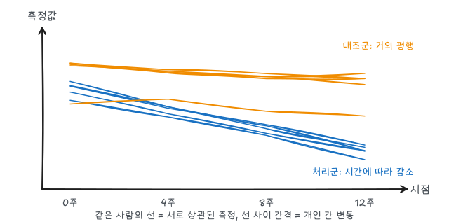

『생명과학연구를 위한 통계적 방법』(이재원·박미라·유한나)과 전북대학교 최혜미 교수님 강의를 바탕으로, 같은 대상을 여러 번 측정한 자료의 분석을 정리했다. 짝지은 $t$검정(측정 2회)의 일반화다.

## 1. 왜 따로 다루는가

같은 사람의 측정값끼리는 상관이 있다. 혈압이 높은 사람은 다음 측정에서도 높다. 이 상관을 무시하고 모든 측정을 독립으로 보면 다음 문제가 생긴다.

- 개체 간 비교(군 효과)의 표준오차를 과소추정해 거짓 양성이 늘어난다.
- 개체 내 비교(시간 효과)는 상관을 이용하면 더 정밀하게 추정할 수 있는데, 그 이점을 버린다.



| 효과 | 비교 | 예 |
|---|---|---|
| 개체 간(between) | 서로 다른 사람끼리 | 처리군 대 대조군 |
| 개체 내(within) | 같은 사람의 시점끼리 | 시간에 따른 변화 |
| 교호작용 | 시간에 따른 변화가 군마다 다른가 | 처리 효과가 시간이 갈수록 커지는가 |

임상시험에서 관심 있는 것은 보통 **군 × 시간 교호작용**이다. 기저값은 비슷한데 시간이 갈수록 군 간 차이가 벌어지는지를 본다.

## 2. 자료 형식

| 형식 | 구조 | 쓰는 절차 |
|---|---|---|
| 넓은 형식 | 한 사람이 한 행, 시점이 열 (`y1 y2 y3 y4`) | `proc glm` + `repeated` |
| 긴 형식 | 한 측정이 한 행 (`id time y`) | `proc mixed`, `proc genmod` |

아래는 설명용 예시 자료다. 처리군(A)과 대조군(P) 각 6명의 염증 지표를 0, 4, 8, 12주에 측정했다.

```sas
data wide;
  input id trt $ y0 y4 y8 y12;
  datalines;
1 A 52 47 41 38
2 A 48 45 40 35
3 A 55 49 46 40
4 A 50 44 39 37
5 A 47 43 38 33
6 A 53 48 42 39
7 P 51 50 48 47
8 P 49 48 47 45
9 P 54 52 51 50
10 P 46 46 44 43
11 P 50 49 46 46
12 P 52 51 50 48
;
run;

data long;
  set wide;
  array yy{4} y0 y4 y8 y12;
  array wk{4} _temporary_ (0 4 8 12);
  do j = 1 to 4;
    week = wk{j};
    y = yy{j};
    output;
  end;
  keep id trt week y;
run;
```

`array`와 `do` 반복으로 넓은 형식을 긴 형식으로 바꾼다. `proc transpose`로도 할 수 있다.

```sas
proc sgplot data=long;
  series x=week y=y / group=id grouplc=trt lineattrs=(pattern=solid) name='s';
  keylegend 's' / type=linecolor;
run;
```

개인별 궤적(스파게티 그림)을 먼저 그려 개인 간 변동, 시간 추세의 모양, 이상한 개체를 확인한다.

## 3. 반복측정 분산분석

```sas
proc glm data=wide;
  class trt;
  model y0 y4 y8 y12 = trt / nouni;
  repeated week 4 (0 4 8 12) polynomial / printe summary;
run;
quit;
```

- `repeated week 4 (0 4 8 12)`: 4개 시점, 간격은 0·4·8·12주
- 출력의 개체 간 검정(`Between Subjects`)이 `trt` 주효과, 개체 내 검정(`Within Subject`)이 `week`과 `week*trt`다.
- `polynomial`: 시간 효과를 1차·2차·3차 추세로 분해한 대비를 함께 출력한다.

### 구형성 가정

일변량 반복측정 분산분석은 시점 간 차이의 분산이 모두 같다는 **구형성**을 가정한다. `printe`가 출력하는 Mauchly 검정이 유의하면 가정이 깨진 것이다. 이때는 출력의 Greenhouse-Geisser(보수적) 또는 Huynh-Feldt 수정 $p$값을 보거나, 같은 출력의 다변량(MANOVA) 검정(Wilks' Lambda 등)을 쓴다.

반복측정 분산분석의 한계는 다음과 같다.

- 한 시점이라도 결측이면 그 사람 전체가 빠진다.
- 측정 시점이 모두 같아야 한다.
- 상관 구조를 구형성 하나로만 본다.

## 4. 선형혼합모형

긴 형식 자료에 직접 공분산 구조를 지정해 이 한계를 해결한다.

$$
y_{ij} = \beta_0 + \beta_1 \text{trt}_i + \beta_2 \text{week}_j + \beta_3 (\text{trt} \times \text{week})_{ij} + \epsilon_{ij}, \qquad \text{Cov}(\epsilon_{i}) = \Sigma
$$

### 공분산 구조 고르기

| 구조 | SAS `type=` | 가정 | 모수 수 (4시점) |
|---|---|---|---:|
| 복합대칭 | `cs` | 모든 시점 쌍의 상관이 같다 (구형성과 비슷) | 2 |
| 1차 자기회귀 | `ar(1)` | 상관이 시점 간격에 따라 $\rho^{\lvert j-k \rvert}$로 감소 | 2 |
| 비구조 | `un` | 제약 없음 | 10 |
| 이질 AR(1) | `arh(1)` | AR(1) + 시점마다 다른 분산 | 5 |

```sas
proc mixed data=long method=reml;
  class id trt week;
  model y = trt week trt*week / solution ddfm=kr;
  repeated week / subject=id type=un r rcorr;
  lsmeans trt*week / slice=week diff cl;
run;
```

- `repeated week / subject=id type=un`: 같은 `id` 안의 오차가 비구조 공분산을 갖는다.
- `r`, `rcorr`: 추정된 공분산·상관행렬을 출력한다.
- `ddfm=kr`: Kenward-Roger 자유도 보정. 표본이 작을 때 권장된다.
- `lsmeans trt*week / slice=week`: 시점마다 군 차이를 검정한다.

`type=`을 바꿔 가며 적합하고 `Fit Statistics`의 AIC·BIC가 작은 구조를 고른다. 공분산 구조 비교는 같은 고정효과에서 REML로, 고정효과 비교는 ML(`method=ml`)로 한다.

### 임의효과 모형

사람마다 출발점(절편)과 변화 속도(기울기)가 다르다고 보고, 이를 임의효과로 둔다.

$$
y_{ij} = (\beta_0 + b_{0i}) + (\beta_1 + b_{1i}) \text{week}_{ij} + \beta_2 \text{trt}_i + \beta_3 \text{trt}_i \cdot \text{week}_{ij} + \epsilon_{ij}, \qquad (b_{0i}, b_{1i}) \sim N(0, G)
$$

```sas
proc mixed data=long method=reml;
  class id trt;
  model y = trt week trt*week / solution ddfm=kr;
  random intercept week / subject=id type=un g gcorr;
run;
```

여기서 `week`은 `class`에 넣지 않은 연속형 시간이다. `trt*week` 계수가 두 군의 **기울기 차이**, 즉 주당 변화 속도의 차이다. 측정 시점이 사람마다 달라도 그대로 쓸 수 있다.

### 결측과 혼합모형

혼합모형은 결측이 있는 사람의 나머지 측정도 모두 쓴다. 결측이 관측된 정보만으로 설명되는(MAR) 경우 추정이 타당하다. 탈락이 결과 자체와 관련되는(MNAR) 경우는 민감도 분석이 필요하다. 마지막 관측값으로 채우는 LOCF는 편향을 만들 수 있어 요즘은 권장되지 않는다.

## 5. 이진·건수 반복측정: GEE

결과가 0/1이나 건수이면 일반화추정방정식(GEE)을 쓴다. 아래 코드는 시점마다 개선 여부(`resp`: 1/0)를 기록한 긴 형식 자료 `long_bin`을 가정한다. 상관 구조를 "작업 상관"으로 지정하되, 표본이 충분하면 그 구조가 틀려도 로버스트 표준오차 덕분에 추론이 타당하다.

```sas
proc genmod data=long_bin descending;
  class id trt week;
  model resp = trt week trt*week / dist=binomial link=logit;
  repeated subject=id / type=exch corrw;
run;
```

GEE의 계수는 **모집단 평균** 효과(전체 집단에서 처리군이 평균적으로 몇 배인가)로 해석한다. 개인별 효과를 원하면 `proc glimmix`의 임의효과 로지스틱 모형을 쓴다.

## 요약

| 상황 | 방법 | SAS |
|---|---|---|
| 측정 2회 | 짝지은 $t$검정 | `ttest paired` |
| 균형 자료, 결측 없음 | 반복측정 분산분석 (구형성 확인) | `glm` + `repeated` |
| 결측·불균형, 연속형 | 선형혼합모형 (공분산 구조 선택) | `mixed` + `repeated` |
| 개인별 출발점·기울기 | 임의절편·임의기울기 모형 | `mixed` + `random` |
| 이진·건수 반응 | GEE (모집단 평균) | `genmod` + `repeated` |
| 이진·건수, 개인별 효과 | 일반화선형혼합모형 | `glimmix` |
