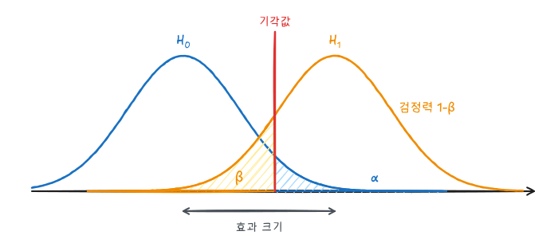

『생명과학연구를 위한 통계적 방법』(이재원·박미라·유한나)과 전북대학교 최혜미 교수님 강의를 바탕으로, 연구 계획 단계에서 표본크기를 정하는 방법을 정리했다. 임상시험 계획서와 연구비 신청서에는 표본크기 산출 근거가 반드시 들어간다.

## 1. 검정력을 정하는 네 요소



| 요소 | 기호 | 커지면 필요한 $n$ |
|---|---|---|
| 유의수준 | $\alpha$ (보통 0.05 양측) | 줄어든다 |
| 검정력 | $1 - \beta$ (보통 0.8 또는 0.9) | 늘어난다 |
| 효과 크기 | $\Delta$ (검출하려는 최소 차이) | 크게 줄어든다 ($\propto 1/\Delta^2$) |
| 변동 | $\sigma$ | 늘어난다 ($\propto \sigma^2$) |

넷 중 셋을 정하면 나머지 하나가 정해진다. 효과 크기 $\Delta$는 "임상적으로 의미 있는 최소 차이"로, 통계가 아니라 연구 분야의 지식으로 정한다. $\sigma$는 선행 연구나 예비 연구에서 가져온다. 효과 크기를 반으로 줄이면 표본은 4배가 필요하다.

## 2. 두 독립 평균의 비교

$H_0: \mu_1 = \mu_2$를 양측 유의수준 $\alpha$, 검정력 $1 - \beta$로 검정할 때, 군당 표본크기는 정규근사로 다음과 같다.

$$
n = \frac{2 (z_{1-\alpha/2} + z_{1-\beta})^2 \sigma^2}{\Delta^2}
$$

$z_{0.975} = 1.96$, $z_{0.8} = 0.84$다.

**예.** 새 혈압약이 수축기 혈압을 위약보다 5mmHg 더 낮추는지 보려 한다. 표준편차는 10mmHg로 알려져 있다.

$$
n = \frac{2 (1.96 + 0.84)^2 \times 10^2}{5^2} \approx 62.8 \;\Rightarrow\; \text{군당 63명}
$$

$t$분포를 쓰는 `PROC POWER`는 군당 64명을 준다. 효과 크기를 표준화한 $d = \Delta / \sigma = 0.5$(중간 효과)에서 군당 64명은 많이 쓰이는 기준값이다.

```sas
proc power;
  twosamplemeans test=diff
    meandiff = 5
    stddev   = 10
    alpha    = 0.05
    power    = 0.8 0.9
    npergroup = .;
run;
```

구하려는 값을 `.`으로 둔다. 여러 값을 나열하면 조합마다 결과를 표로 준다. 검정력 0.9이면 군당 약 86명이 필요하다.

### 군 크기가 다를 때와 탈락률

배정 비율이 $1:k$이면 전체 표본이 늘어난다. `groupweights=(1 2)`처럼 지정한다. 탈락률 $r$이 예상되면 계산값을 $1 - r$로 나눈다. 탈락률 10%면 $63 / 0.9 = 70$명을 모집한다.

## 3. 짝지은 자료

같은 사람의 전후 차이 $D$의 표준편차를 $\sigma_D$라 하면 다음과 같다.

$$
n = \frac{(z_{1-\alpha/2} + z_{1-\beta})^2 \sigma_D^2}{\Delta^2}
$$

차이의 표준편차가 8, 검출할 평균 차이가 5면 정규근사로 약 21명이다. 전후 측정의 상관 $\rho$가 클수록 $\sigma_D^2 = 2\sigma^2(1 - \rho)$가 작아져 독립 두 군 설계보다 훨씬 적은 인원으로 충분하다.

```sas
proc power;
  pairedmeans test=diff
    meandiff = 5
    stddev   = 10
    corr     = 0.68
    npairs   = .
    power    = 0.8;
run;
```

`stddev`와 `corr`를 주면 차이의 표준편차를 계산한다($\sqrt{2 \times 100 \times 0.32} = 8$).

## 4. 두 비율의 비교

$$
n = \frac{\left[ z_{1-\alpha/2} \sqrt{2 \bar p (1 - \bar p)} + z_{1-\beta} \sqrt{p_1 (1 - p_1) + p_2 (1 - p_2)} \right]^2}{(p_1 - p_2)^2}, \qquad \bar p = \frac{p_1 + p_2}{2}
$$

**예.** 기존 치료의 재발률 30%를 20%로 낮추는지 보려면 군당 약 294명이 필요하다. 비율의 차이가 작고 기준 비율이 0.5에 가까울수록 표본이 많이 든다.

```sas
proc power;
  twosamplefreq test=pchi
    groupproportions = (0.3 0.2)
    alpha = 0.05
    power = 0.8
    npergroup = .;
run;
```

## 5. 생존분석

로그순위 검정의 검정력은 대상자 수가 아니라 **사건 수**로 정해진다(Schoenfeld 공식, 1:1 배정).

$$
d = \frac{4 (z_{1-\alpha/2} + z_{1-\beta})^2}{(\log HR)^2}
$$

위험비 0.7을 검정력 80%로 검출하려면 사건이 약 247건 필요하다. 필요한 대상자 수는 사건 수를 "추적 기간 동안 사건이 일어날 확률"로 나눠 구한다. 그래서 등록 기간, 추적 기간, 기준군 생존율을 함께 가정해야 한다.

```sas
proc power;
  twosamplesurvival test=logrank
    hazardratio   = 0.7
    refsurvival   = exponential
    refsurvexphazard = 0.1
    accrualtime   = 2
    followuptime  = 3
    power         = 0.8
    npergroup     = .;
run;
```

- `refsurvexphazard`: 대조군의 연간 위험률(지수분포 가정)
- `accrualtime`, `followuptime`: 등록 기간(년)과 마지막 등록 후 추적 기간(년)

## 6. 여러 군과 비열등성

**일원분산분석**은 군별 평균과 공통 표준편차를 준다.

```sas
proc power;
  onewayanova test=overall
    groupmeans = 50 | 55 | 58
    stddev     = 10
    power      = 0.8
    npergroup  = .;
run;
```

**비열등성 시험**은 "신약이 대조약보다 $\delta$ 이상 나쁘지 않다"를 보인다. 단측 검정이고, 허용 한계 $\delta$가 작을수록 표본이 많이 든다.

```sas
proc power;
  twosamplemeans test=diff
    nullmeandiff = -3          /* 비열등성 한계: -3 */
    meandiff     = 0           /* 실제로는 차이가 없다고 가정 */
    stddev       = 10
    sides        = U
    alpha        = 0.025
    power        = 0.8
    npergroup    = .;
run;
```

## 7. 검정력 곡선과 사후 검정력

```sas
proc power plotonly;
  twosamplemeans test=diff
    meandiff = 3 to 8 by 1
    stddev   = 10
    power    = 0.8
    npergroup = .;
  plot x=effect;
run;
```

효과 크기에 따라 필요한 표본이 어떻게 바뀌는지 그림으로 보여 주면 연구진과 현실적인 목표를 정하기 쉽다.

연구가 끝난 뒤 관측된 효과로 계산한 **사후 검정력**은 $p$값과 일대일로 대응하는 값일 뿐 새로운 정보가 없다. 유의하지 않은 결과를 해석할 때는 사후 검정력 대신 효과 크기의 신뢰구간을 보고한다.

## 요약

| 설계 | 공식의 핵심 | SAS `proc power` |
|---|---|---|
| 두 독립 평균 | $2(z_{\alpha/2} + z_\beta)^2 \sigma^2 / \Delta^2$ | `twosamplemeans` |
| 짝지은 평균 | $(z_{\alpha/2} + z_\beta)^2 \sigma_D^2 / \Delta^2$ | `pairedmeans` |
| 두 비율 | 비율의 분산 사용 | `twosamplefreq` |
| 생존 | 사건 수 $4(z_{\alpha/2} + z_\beta)^2 / (\log HR)^2$ | `twosamplesurvival` |
| 세 군 이상 | 군 평균의 분산 | `onewayanova` |
| 공통 | 탈락률 $r$이면 $n / (1 - r)$ | |
