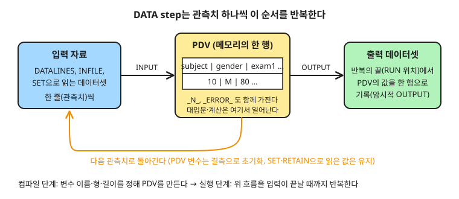

SAS는 생명과학, 보건의학, 임상시험 자료 분석에서 오래 사용되어 온 통계 분석 시스템이다. 전북대학교 최혜미 교수님 생명과학통계 강의의 SAS 실습 흐름을 따라 SAS 프로그램의 기본 구조와 자주 쓰는 절차를 정리했다. 이 시리즈의 주 분석 코드는 SAS로 작성하며, 일부 글에서는 개념 확인이나 비교를 위해 R 코드를 함께 실었다. SAS가 설치되어 있지 않으면 무료 웹 환경인 SAS OnDemand for Academics에서 그대로 실행할 수 있다.

이 글에 적은 숫자 출력은 SAS 출력 화면이 아니라 **같은 자료를 R로 계산한 확인값**이다. SAS 실행 결과로 바꾸기 전까지는 이렇게 표시한다. `sashelp` 자료는 SAS 안에만 있어 R로 확인하지 못했고, 해당 절에는 출력 표에서 무엇을 읽는지만 적었다. 예제 자료는 `mower`(잔디깎이 소유 여부, 24가구)와 `bweight`(출생 체중, 50,000명)이다.

## 1. SAS 프로그램의 큰 구조

SAS 프로그램은 크게 `DATA step`과 `PROC step`으로 나뉜다.

- `DATA step`: 데이터셋을 만들거나 수정한다.
- `PROC step`: 만들어진 데이터셋으로 통계분석, 출력, 그래프 등을 만든다.

모든 명령문은 세미콜론으로 끝난다. SAS는 대소문자를 구별하지 않는다. 주석은 `/* ... */` 또는 `* ... ;` 형식으로 쓴다.

```sas
/* 기본적인 프로그램 구조 */
DATA data_name;
  INPUT variable1 variable2 $ @@;
  CARDS;
  data1 data2 data3 data4
  data5 data6 data7 data8
  ;
RUN;

PROC procedure_name OPTION;
  VAR variable1;
  BY variable2;
  OUTPUT OUT=data_name_1 keywords;
RUN;
```

`BY` 문을 쓰려면 보통 먼저 `PROC SORT`로 정렬해야 한다. 이미 정렬되어 있지 않은 변수로 `BY` 분석을 하면 오류가 난다.

DATA step가 한 번 실행되는 동안 일어나는 일을 알면 뒤의 `SET`, `MERGE`, 결측값 동작이 쉬워진다. 먼저 **컴파일 단계**에서 변수의 이름, 형, 길이를 정해 메모리에 한 행짜리 작업 공간인 PDV(Program Data Vector)를 만든다. 이어지는 **실행 단계**에서 입력 자료를 한 관측치씩 읽어 PDV에 채우고, 대입문과 조건문을 실행한 뒤, 반복의 끝에서 PDV의 값을 출력 데이터셋에 한 행으로 쓴다. 이 반복은 입력이 끝날 때까지 계속된다. 반복이 시작될 때 PDV의 변수는 결측으로 초기화되지만 `SET`이나 `MERGE`로 읽은 변수와 `RETAIN`으로 지정한 변수는 값을 유지한다.



PDV의 `_N_`은 DATA step가 실행된 반복 횟수이고 `_ERROR_`는 오류 표시이다. 둘은 출력 데이터셋에 저장되지 않는다.

## 2. 직접 데이터 입력하기

`DATA`, `INPUT`, `DATALINES` 또는 `CARDS`를 이용하면 코드 안에 작은 데이터를 직접 넣을 수 있다.

```sas
title "Example: getting started with SAS";

data grade;
  input subject gender$ exam1 exam2 hwgrade$;
  datalines;
  10 M 80 84 A
  7 . 85 89 A
  4 F 90 . B
  20 M 82 85 B
  25 F 94 94 A
  14 F 88 84 C
  ;
run;

proc print data=grade;
  var subject gender;
run;
```

`gender$`, `hwgrade$`처럼 변수명 뒤에 `$`를 붙이면 문자형 변수로 읽는다. 결측값은 `.`으로 표시하며 숫자형과 문자형 모두 쓸 수 있다.

**출력 해석** (R로 확인한 값)

| 출력 | 볼 값 | 해석 |
|---|---|---|
| `PROC PRINT` 본문 | `Obs`, `subject`, `gender` 6행 | `subject`는 10, 7, 4, 20, 25, 14, `gender`는 M, (빈칸), F, M, F, F이다. 둘째 관측치의 `.`은 결측이라 빈칸으로 나온다. `exam1`, `exam2`, `hwgrade`는 `var`에 없어 나오지 않는다 |

## 3. 파일에서 데이터 가져오기

SAS 데이터셋은 에디터에서 직접 입력할 수도 있고, `txt`, `csv`, `xlsx`, `sas7bdat` 같은 외부 파일을 읽어 만들 수도 있다. 강의자료에서는 메뉴에서 `Import Data`를 선택해 `mower.xlsx`를 `mower`라는 데이터셋으로 읽는 예를 든다.

외부 파일을 읽을 때 확인할 점은 다음과 같다.

- 첫 행이 변수명인지
- 문자형과 숫자형이 올바르게 인식되었는지
- 결측값이 어떻게 표시되어 있는지
- 작업 디렉터리가 의도한 폴더인지

메뉴 대신 코드로 읽으면 재실행이 쉽다.

```sas
proc import datafile="/home/user/data/mower.xlsx" out=mower dbms=xlsx replace;
  sheet="Sheet1";
  getnames=yes;
run;

proc import datafile="/home/user/data/bweight.csv" out=bweight dbms=csv replace;
  getnames=yes;
  guessingrows=max;
run;
```

- `dbms=`: 파일 형식(`xlsx`, `csv`, `tab`, `dlm`)
- `replace`: 같은 이름의 데이터셋이 있으면 덮어쓴다.
- `getnames=yes`: 첫 행을 변수명으로 쓴다.
- `guessingrows=max`: CSV의 모든 행을 보고 변수 형식과 길이를 정한다. 기본값(20행)만 보면 뒤쪽의 긴 문자열이 잘리거나 문자형 숫자를 잘못 읽을 수 있다.

형식을 직접 통제하려면 DATA 단계의 `infile`을 쓴다.

```sas
data bweight;
  infile "/home/user/data/bweight.csv" dsd firstobs=2 truncover;
  input Weight Black Married Boy MomAge MomSmoke CigsPerDay MomWtGain Visit MomEdLevel;
run;
```

`dsd`는 쉼표 구분과 따옴표 처리를, `firstobs=2`는 첫 행(변수명)을 건너뛰는 것을, `truncover`는 줄이 짧을 때 다음 줄로 넘어가지 않고 남은 변수를 결측으로 두는 것을 뜻한다.

**출력 해석** (R로 확인한 값). 로그의 `NOTE`에서 읽은 관측치 수와 변수 수를 먼저 확인한다.

| 자료 | 관측치 × 변수 | 확인할 것 |
|---|---|---|
| `mower` | 24 × 3 | `income`, `lotsize`는 숫자형, `ridingmower`는 문자형(`yes` 12가구, `no` 12가구) |
| `bweight` | 50,000 × 10 | 10개 변수가 모두 숫자형이고 결측이 없다 |

## 4. 임시 라이브러리와 영구 라이브러리

SAS에서 라이브러리는 데이터셋이 저장되는 위치다.

기본 라이브러리인 `WORK`는 임시 저장소다. SAS를 종료하면 사라진다. 계속 남는 데이터셋을 만들려면 `LIBNAME`으로 폴더를 라이브러리에 연결한다.

```sas
libname sclass 'C:\Users\USER\Desktop\SAS_class\data';

data sclass.x;
  input x1-x3;
  datalines;
  1 1 12.4
  1 2 11.3
  1 3 1.4
  2 1 2.1
  2 2 19.4
  2 3 10.0
  ;
run;

proc print data=sclass.x;
run;
```

`data x;`라고 쓰면 보통 `work.x`가 만들어진다. `data sclass.x;`라고 쓰면 `sclass` 라이브러리에 영구 데이터셋이 만들어진다. `PROC PRINT`는 입력한 6행(`x1`, `x2`, `x3`)을 그대로 보여 준다.

`libname`은 세션마다 다시 실행해야 연결된다. 폴더의 파일은 남아 있어도 연결문이 없으면 `sclass.x`를 찾지 못한다.

## 5. 데이터셋 나누기와 합치기

조건을 이용해 데이터셋을 나눌 수 있다.

```sas
data mow_y;
  set mower;
  if ridingmower = "yes";
run;

data mow_n;
  set mower;
  if ridingmower ne "yes";
run;
```

`if 조건;`만 쓰는 문장(subsetting IF)은 조건이 거짓인 관측치를 PDV에서 버린다. 이 자료에서 `mow_y`와 `mow_n`은 각각 12개 관측치를 갖는다(R로 확인한 값).

하나의 `DATA step`에서 여러 데이터셋으로 동시에 나눌 수도 있다. 이때 `mow_y1`, `mow_n1`도 12개씩이다.

```sas
data mow_y1 mow_n1;
  set mower;
  if ridingmower = "yes" then output mow_y1;
  else output mow_n1;
run;
```

같은 구조의 데이터셋을 세로로 붙일 때는 `SET`을 사용한다.

```sas
data mow_yn;
  set mow_y mow_n;
  label ridingmower = "Do they have a riding mower?";
run;
```

공통 키를 기준으로 가로로 붙일 때는 `MERGE`와 `BY`를 사용한다. 이때 각 데이터셋은 `BY` 변수로 정렬되어 있어야 한다.

```sas
data mow_inc;
  set mower(keep=income ridingmower);
  id = _n_;
run;

data mow_lot;
  set mower(keep=lotsize ridingmower);
  id = _n_;
run;

data mow_inclot;
  merge mow_inc mow_lot;
  by id;
run;
```

`mow_inclot`은 `id` 하나당 한 행씩 24행이 되고 변수는 `income`, `ridingmower`, `id`, `lotsize` 네 개이다. 두 데이터셋에 같이 들어 있는 `ridingmower`는 나중에 읽는 쪽(`mow_lot`)의 값으로 덮어쓰인다. 이 예에서는 두 값이 같아 결과가 같지만, 공통 변수의 값이 다르면 의도하지 않은 덮어쓰기가 생기므로 `BY` 변수 외의 공통 변수는 `keep=`이나 `rename=`으로 정리한다.

`BY` 없이 `merge`만 쓰면 관측치 순서대로 일대일로 붙고, 두 데이터셋의 길이가 다르면 짧은 쪽이 결측으로 채워진다. 키로 맞추려면 반드시 `by`를 쓴다.

## 6. 데이터 구조 확인과 기본 출력

데이터를 읽은 뒤에는 먼저 변수 구조와 일부 관측치를 확인한다.

```sas
proc contents data=mower;
run;

proc print data=mower(obs=10);
run;
```

`PROC CONTENTS`는 변수명, 변수형, 길이, 포맷 같은 구조를 보여준다. `PROC PRINT`는 실제 관측치를 출력한다.

**출력 해석** (R로 확인한 값)

| 출력 | 볼 값 | `mower`에서 |
|---|---|---|
| `PROC CONTENTS`의 속성 표 | 관측치 수, 변수 수 | 24, 3 |
| `PROC CONTENTS`의 변수 표 | 변수 이름, 형 | `income`, `lotsize` 숫자 / `ridingmower` 문자 |
| `PROC PRINT` | 앞 10개 관측치 | 앞 10행은 모두 `ridingmower = yes` (자료가 `yes` 12행, `no` 12행 순으로 정렬되어 있다) |

## 7. 포맷 지정

`PROC FORMAT`을 이용하면 숫자나 문자 값을 보기 쉬운 범주로 표시할 수 있다.

```sas
proc format;
  value incgrp
    low-40 = "Low"
    40<-80 = "Middle"
    80<-high = "High";

  value $yngrp
    "yes" = "Y"
    "no" = "N";
run;

proc print data=mower;
  format income incgrp. ridingmower $yngrp.;
run;
```

**출력 해석** (R로 확인한 값). `PROC PRINT`의 `income` 열은 숫자 대신 `Low`, `Middle`, `High`로 나온다.

| 범주 | 규칙 | 가구 수 |
|---|---|---|
| `Low` | 40 이하 | 1 |
| `Middle` | 40 초과 80 이하 | 15 |
| `High` | 80 초과 | 8 |

포맷은 **표시만 바꾸고 저장된 값은 그대로** 둔다. `income`은 여전히 숫자이므로 `PROC MEANS`는 원래 값으로 계산한다.

포맷을 데이터셋에 붙여 저장할 수도 있다.

```sas
data mower_f;
  set mower;
  format income incgrp. ridingmower $yngrp.;
run;
```

## 8. 기본 통계량과 빈도표

수치형 변수는 `PROC MEANS`, 범주형 변수는 `PROC FREQ`로 먼저 요약한다.

```sas
proc means data=mower_f;
  var income;
run;

proc freq data=mower_f;
  table income ridingmower income*ridingmower;
run;
```

**출력 해석** (R로 확인한 값). `PROC MEANS`는 `var`만 주면 `N`, `Mean`, `Std Dev`, `Minimum`, `Maximum`을 출력한다.

| 출력 | 볼 값 | `mower`에서 |
|---|---|---|
| `PROC MEANS` (`income`) | N, 평균, 표준편차, 최솟값, 최댓값 | 24, 68.44, 19.79, 33.0, 110.1 |
| `PROC FREQ` (`ridingmower`) | 포맷된 빈도, 백분율 | `N` 12가구(50%), `Y` 12가구(50%) |
| `PROC FREQ` (`income*ridingmower`) | 포맷된 소득 구간별 교차 빈도 | `Low`: N 1, Y 0 / `Middle`: N 10, Y 5 / `High`: N 1, Y 7 |

소득 구간별로 보면 `Middle`에서는 소유하지 않은 가구가, `High`에서는 소유한 가구가 많다. 24가구의 기술통계일 뿐이므로 두 변수의 연관성에 대한 판단은 [분할표 분석](/posts/biostat-contingency-diagnostic)의 검정으로 따로 한다.

`PROC SORT`는 정렬된 데이터셋을 새 이름으로 저장할 때 자주 쓴다.

```sas
proc sort data=mower out=mower_s;
  by income;
run;
```

## 9. 결과 저장과 ODS

`ODS`를 이용하면 결과를 PDF, HTML, RTF 등으로 저장할 수 있다.

```sas
ods pdf file='mower_mean.pdf';

proc means data=mower;
  var income lotsize;
run;

ods pdf close;
```

특정 출력표를 데이터셋으로 저장할 수도 있다.

```sas
proc univariate data=mower;
  var income lotsize;
  ods output BasicMeasures=dmeas;
run;

proc contents data=dmeas;
run;
```

`BasicMeasures` 표는 위치 측도(`LocMeasure`, `LocValue`: Mean, Median, Mode)와 산포 측도(`VarMeasure`, `VarValue`)를 변수별로 한 행씩 담는다. 위치 측도의 값은 다음과 같다(R로 확인한 값).

| 변수 | Mean | Median |
|---|---|---|
| `income` | 68.4375 | 64.8 |
| `lotsize` | 18.95 | 19.0 |

저장된 출력표는 `PROC REPORT`로 원하는 형태로 정리할 수 있다.

```sas
proc report data=dmeas nowindows headline;
  title '기초 통계량';
  column VarName LocMeasure LocValue;
  define VarName / width=8 "변수/이름" center;
  define LocMeasure / width=6 center;
  define LocValue / format=comma5.2 right;
run;
```

`VarName`에 7글자인 `lotsize`가 들어가므로 LISTING 출력에서 줄바꿈되지 않도록 `width=8` 이상으로 지정한다(`width=6`이면 `lotsize`가 두 줄로 나뉜다).

## 10. SASHELP 예제

SAS에는 연습용 데이터셋이 들어 있다. `sashelp.class`는 작은 학생 자료라서 기초 요약 연습에 적합하다.

```sas
proc contents data=sashelp.class position;
run;

title 'Frequency count of sex';
proc freq data=sashelp.class;
  tables sex;
run;

proc freq data=sashelp.class;
  tables sex / nocum;
run;

proc means data=sashelp.class maxdec=2 fw=10;
  var age height;
run;

proc means data=sashelp.class maxdec=2 fw=10 sum range median;
  var age height;
run;
```

집단별 요약은 `CLASS` 또는 정렬 후 `BY`로 할 수 있다.

```sas
proc means data=sashelp.class maxdec=2 fw=10;
  var age height;
  class sex;
run;

proc sort data=sashelp.class out=class2;
  by sex;
run;

proc means data=class2 noprint;
  var age height;
  by sex;
  output out=clsummary
    mean=MeanAge MeanHeight
    median=MedianAge MedianHeight;
run;

proc print data=clsummary;
  title 'Class Statistics';
run;
```

정규성 확인은 `PROC UNIVARIATE`로 시작할 수 있다.

```sas
proc univariate data=sashelp.class normal plot;
  var height;
run;
```

`sashelp.class`는 SAS 안에만 있어 R로 확인한 값을 싣지 않는다. 대신 각 절차가 어떤 출력 표를 만들고 무엇을 읽는지를 정리한다. SAS에서 실행한 뒤 아래 표의 항목을 찾아 읽는다.

| 절차 | 출력 표(ODS 이름) | 읽을 값 |
|---|---|---|
| `PROC FREQ` | `OneWayFreqs` | `Frequency`, `Percent`(`nocum`이면 누적 열이 빠진다) |
| `PROC MEANS` + `class` | `Summary` | 집단마다 한 행. `N Obs`, `N`, 평균, 표준편차, 최솟값, 최댓값 |
| `PROC MEANS` + `by` | `Summary` | 집단마다 따로 만들어지는 표. 정렬된 자료가 필요하다 |
| `PROC UNIVARIATE` | `Moments`, `BasicMeasures`, `TestsForNormality` | 평균과 왜도, 중앙값, `normal` 옵션의 정규성 검정 p값(`Shapiro-Wilk` 등) |

`class`는 정렬 없이 집단별 요약을 한 표로 보여 주고, `by`는 `proc sort` 후에 집단마다 표를 따로 만든다. 요약 데이터셋이 필요하면 위의 `output out=` 문장을 쓴다. 정규성 검정은 표본이 작으면 검정력이 낮아 p값만으로 판단하지 않고 `plot` 옵션의 줄기-잎 그림과 정규 확률 그림을 함께 본다. 평균 비교 전에 정규성을 어떻게 다루는지는 [평균 비교](/posts/biostat-mean-comparison)에 있다.

## 11. SGPLOT 예제

`sashelp.cars`는 그래프 예제에 자주 쓰인다. 그래프 출력은 SAS에서 실행해 확인한다. 박스플롯은 상자가 1사분위수, 중앙값, 3사분위수를, 다이아몬드가 평균을 나타내고 수염 밖의 점은 이상치 후보이다. `category=`는 범주마다 상자를 따로 놓고, `group=`만 쓰면 하나의 위치에 색으로 구분한 상자를 나란히 놓으며, 둘을 함께 쓰면 범주마다 집단별 상자가 나란히 놓인다.

```sas
proc contents data=sashelp.cars;
run;

proc sgplot data=sashelp.cars;
  title "Box Plot: Category = Origin";
  vbox Horsepower / category=Origin;
run;

proc sgplot data=sashelp.cars;
  title "Box Plot: Group = Origin";
  vbox Horsepower / group=Origin;
run;

proc sgplot data=sashelp.cars;
  title "Box Plot: Category = Cylinders, Linear Scale";
  vbox Horsepower / category=Cylinders;
  xaxis type=linear;
run;

proc sgplot data=sashelp.cars;
  where Type in ('SUV' 'Truck' 'Sedan');
  title "Box Plot: Category = Origin, Group = Type";
  vbox Horsepower / category=Origin group=Type;
run;
```

산점도는 다음처럼 그린다.

```sas
proc sgplot data=sashelp.cars;
  title "Vehicles: All Origins";
  scatter x=Wheelbase y=Weight / markerattrs=(symbol=CircleFilled);
run;

proc sgplot data=sashelp.cars;
  title "Vehicles: All Origins";
  scatter x=Wheelbase y=Weight / markerattrs=(symbol=CircleFilled) group=Origin;
run;

proc sgplot data=sashelp.cars;
  title "Vehicles: Origin=USA only";
  where Origin = "USA";
  scatter x=Wheelbase y=Weight / markerattrs=(symbol=CircleFilled);
run;
```

## 12. 연습 과제

연습 과제는 `bweight.csv`를 읽어 데이터셋을 만들고, 수치형 변수 2개와 범주형 변수 2개를 선택해 표와 그래프로 요약하는 것이다.

`bweight` 자료는 1997년 출생 체중 데이터로 설명되어 있다. 주요 변수는 다음과 같다.

| 변수 | 설명 |
| --- | --- |
| `Weight` | 신생아 체중 |
| `Black` | 흑인 어머니 여부 |
| `Married` | 기혼 어머니 여부 |
| `Boy` | 남아 여부 |
| `MomAge` | 어머니 나이 |
| `MomSmoke` | 흡연 어머니 여부 |
| `CigsPerDay` | 하루 흡연량 |
| `MomWtGain` | 임신기간 체중 증가량 |
| `Visit` | 산전 진료 방문 범주(코드 0~3) |
| `MomEdLevel` | 어머니 교육수준(코드 0~3) |

`Visit`과 `MomEdLevel`은 예/아니오가 아니라 0~3의 범주 코드이다. 코드가 뜻하는 바는 `sashelp.bweight`의 SAS 도움말에서 확인한다.

이 자료는 SAS에 `sashelp.bweight`로 내장되어 있어 파일 없이 바로 연습할 수 있다. 분석 흐름은 다음처럼 잡는다.

```sas
data bweight;
  set sashelp.bweight;
run;

proc contents data=bweight varnum;
run;

proc means data=bweight n nmiss mean std min median max maxdec=1;
  var Weight MomAge MomWtGain;
run;

proc freq data=bweight;
  tables Black Married MomSmoke Boy / nocum;
  tables MomSmoke*Boy / chisq;
run;

proc sgplot data=bweight;
  histogram Weight / binwidth=100;
  density Weight / type=normal;
run;

proc sgplot data=bweight;
  vbox Weight / category=MomSmoke;
run;

proc means data=bweight mean std;
  class MomSmoke Married;
  var Weight;
run;
```

- `proc contents ... varnum`: 변수를 데이터셋에 들어 있는 순서대로 보여 준다.
- `nmiss`: 결측 수. 분석 전에 반드시 확인한다.
- `histogram` + `density type=normal`: 분포와 정규분포 곡선을 겹쳐 그린다.
- `class` 문이 있는 `proc means`: 집단 조합별 요약통계량. 정렬(`proc sort`) 없이 집단별 요약을 낼 수 있어 `by`보다 편하다.

`MomAge`와 `MomWtGain`은 이 자료에서 이미 중심화되어 있어 음수 값이 있다. 원래 단위로 해석하려면 SAS 도움말의 중심화 기준값을 더해 준다.

**출력 해석** (R로 확인한 값, `maxdec=1`로 소수 첫째 자리)

| 출력 | 볼 값 | `bweight`에서 |
|---|---|---|
| `PROC MEANS` (`Weight`) | N, NMiss, 평균, 표준편차, 최솟값, 중앙값, 최댓값 | 50000, 0, 3370.8, 566.4, 240.0, 3402.0, 6350.0 |
| `PROC MEANS` (`MomAge`) | 같은 순서 | 50000, 0, 0.4, 5.7, -9.0, 0.0, 18.0 |
| `PROC MEANS` (`MomWtGain`) | 같은 순서 | 50000, 0, 0.7, 12.9, -30.0, 0.0, 68.0 |
| `PROC FREQ` (한 변수씩) | 1(예)의 빈도와 백분율 | `Black` 8142(16.28%), `Married` 35631(71.26%), `MomSmoke` 6533(13.07%), `Boy` 25792(51.58%) |
| `PROC FREQ` (`MomSmoke*Boy`, `chisq`) | `Chi-Square`의 값, 자유도, p값 | 0.159, 1, 0.690 |

`Weight`의 평균(3370.8)과 중앙값(3402.0)이 비슷하다. 최솟값 240g은 다른 값에서 크게 떨어진 값이라 이상치 후보이므로 히스토그램에서 왼쪽 꼬리를 본다. 흡연 여부와 아기 성별의 교차표에서는 p = 0.690이라 연관성의 근거가 없다.

`class MomSmoke Married`를 준 `PROC MEANS`는 네 조합의 `Weight`를 다음처럼 요약한다.

| `MomSmoke` | `Married` | N | 평균 | 표준편차 |
|---|---|---|---|---|
| 0 | 0 | 11149 | 3266.8 | 574.4 |
| 1 | 0 | 3220 | 3122.5 | 580.9 |
| 0 | 1 | 32318 | 3449.1 | 544.5 |
| 1 | 1 | 3313 | 3198.1 | 570.3 |

기혼 여부를 고정하면 흡연한 어머니의 아기가 평균적으로 가볍다(미혼 144.2g, 기혼 250.9g 차이). 이는 표본 평균의 차이이고, 원인을 말하려면 [연구설계](/posts/biostat-study-design-clinical-trials)의 교란 문제를 고려한 비교가 필요하다.

## 비교

헷갈리기 쉬운 쌍을 한곳에 모았다.

**DATA step와 PROC step**

| | DATA step | PROC step |
|---|---|---|
| 하는 일 | 데이터셋을 만들고 고친다 | 만들어진 데이터셋을 분석·출력한다 |
| 시작 | `data 이름;` | `proc 절차 data=이름;` |
| 출력 | 데이터셋 (화면에 안 나온다) | 결과 표와 그래프 |
| 반복 | 관측치마다 자동으로 반복(PDV) | 절차가 데이터 전체를 한 번 처리 |

**자료를 읽는 방법**

| 방법 | 쓸 때 | 주의 |
|---|---|---|
| `datalines` + `input` | 작은 자료를 코드 안에 직접 쓸 때 | 문자형은 `$`. 결측은 `.` |
| `proc import` | 형식이 단순한 `csv`, `xlsx` | 변수 형식을 추측하므로 `guessingrows=max`. 재실행은 쉽다 |
| `infile` + `input` | 형식을 직접 통제할 때 | `dsd`, `firstobs`, `truncover`를 직접 지정 |

**세로 결합과 가로 결합**

| | `set a b;` | `merge a b; by key;` |
|---|---|---|
| 방향 | 관측치를 이어 붙인다(세로) | 키가 같은 관측치를 옆으로 붙인다(가로) |
| 전제 | 변수 구조가 같거나 겹침 | 두 데이터셋이 `key`로 정렬되어 있어야 한다 |
| 공통 변수 | 한 변수로 합쳐진다 | 나중 데이터셋의 값이 앞을 덮어쓴다 |
| 결과 행 수 | 두 데이터셋 행의 합 | 키의 가짓수(일대일일 때) |

**임시와 영구 라이브러리**

| | `work` | `libname`으로 연결한 폴더 |
|---|---|---|
| 지정 | `data x;` (접두어 생략) | `data sclass.x;` |
| 수명 | SAS를 종료하면 사라진다 | 파일로 남는다 |
| 재사용 | 같은 세션 안에서만 | `libname`을 다시 실행하면 읽을 수 있다 |

**SAS와 R의 대응**

| 작업 | SAS | R |
|---|---|---|
| 직접 입력 | `data; input; datalines;` | `data.frame()`, `tribble()` |
| 파일 읽기 | `proc import`, `infile` | `read_csv()`, `read_excel()` |
| 세로·가로 결합 | `set`, `merge ... by` | `bind_rows()`, `full_join()` |
| 구조 확인 | `proc contents`, `proc print (obs=)` | `str()`, `glimpse()`, `head()` |
| 범주화 | `proc format` | `cut()`, `factor(labels=)` |
| 요약 | `proc means`, `proc freq`, `proc univariate` | `summary()`, `table()`, `summarise()` |
| 그래프 | `proc sgplot`, `proc sgpanel` | `ggplot2` |
| 결과 저장 | `ods output`, `ods pdf/rtf` | 결과 객체, `broom::tidy()` |

습관이 다른 점도 있다. SAS는 대소문자를 구별하지 않고 R은 구별한다. 결측은 SAS가 `.`, R이 `NA`이다. SAS의 `by` 처리는 정렬이 필요하고 R의 `group_by()`는 필요 없다. SAS는 절차가 결과를 화면에 바로 내고, R은 결과를 객체에 담은 뒤 꺼내 쓴다.

## 정리

- DATA step는 PDV 한 행을 관측치마다 채워 출력하고, PROC step는 완성된 데이터셋을 분석한다.
- 읽은 직후에는 `proc contents`로 형과 관측치 수를, `nmiss`로 결측을 확인한다.
- `libname`은 세션마다 다시 실행하고, `merge`는 `by` 변수로 정렬한 뒤에 쓴다.
- `proc format`은 표시만 바꾸며 값은 그대로다.
- `class`는 정렬 없이 집단별 요약을, `by`는 정렬 후 집단별 표를 만든다.
