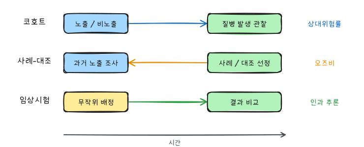

생명과학 연구에서는 분석 방법을 고르기 전에 먼저 연구설계를 구분해야 한다. 같은 분할표나 평균 비교처럼 보여도, 자료가 임상시험에서 나온 것인지, 코호트 연구에서 나온 것인지, 사례-대조 연구에서 나온 것인지에 따라 해석할 수 있는 값이 달라진다.

『생명과학연구를 위한 통계적 방법』(이재원·박미라·유한나)과 전북대학교 최혜미 교수님 강의를 바탕으로 연구설계와 임상시험 부분을 정리했다.

## 1. 연구설계를 보는 기준

연구설계는 보통 다음 축으로 구분한다.

- 실험연구인지 관찰연구인지
- 단면연구인지 종적연구인지
- 전향연구인지 후향연구인지
- 사람에게 중재를 배정하는 임상시험인지

실험연구는 연구자가 처리나 중재를 배정한다. 관찰연구는 연구자가 중재를 배정하지 않고 이미 존재하는 노출, 질병, 생활습관, 진료기록 등을 관찰한다.

단면연구는 특정 시점의 상태를 한 번 측정한다. 종적연구는 같은 연구대상자를 시간에 따라 반복해서 관찰한다. 전향연구는 현재부터 미래로 따라가며 사건 발생을 관찰하고, 후향연구는 이미 발생한 사건이나 과거 기록을 거슬러 조사한다.

## 2. 단면연구

단면연구는 특정 시점에서 연구대상자의 질병 상태, 노출 상태, 생활습관, 검사 결과 등을 측정하는 연구다. 설문조사, 인구조사, 특정 지역의 HIV 유병률 조사 같은 자료가 대표적이다.

단면연구의 장점은 빠르고 비교적 비용이 적게 든다는 점이다. 유병률처럼 어느 시점의 상태를 요약하는 데 적합하다.

하지만 시간 순서를 분명하게 알기 어렵다. 예를 들어 운동 부족과 비만이 함께 관찰되었다고 해도, 운동 부족이 비만의 원인인지, 비만 때문에 운동량이 줄었는지 단면자료만으로는 확정하기 어렵다.

## 3. 종적연구

종적연구는 같은 대상자를 시간의 흐름에 따라 관찰한다. 사건이 언제 발생했는지, 검사 수치가 어떻게 변했는지, 치료 후 반응이 얼마나 지속되었는지를 볼 수 있다.

전향 종적연구에서는 연구 시작 시점에 대상자를 정하고, 이후에 사건 발생을 추적한다. 후향 종적연구에서는 이미 존재하는 의무기록이나 과거 자료를 이용해 과거의 노출과 이후 결과를 조사한다.

종적연구에서는 추적 실패가 중요하다. 연구대상자가 중간에 탈락하면 해당 시점까지의 정보는 남지만 이후 사건 발생 여부는 알 수 없다. 생존분석에서는 이런 자료를 중도절단 자료로 다룬다.

## 4. 코호트 연구

코호트 연구는 특정 노출 또는 위험요인을 가진 집단과 그렇지 않은 집단을 시간에 따라 추적해 질병 발생 여부를 비교한다.

예를 들어 흡연자 집단과 비흡연자 집단을 오랜 기간 추적해 폐암 발생률을 비교하는 연구를 생각할 수 있다. 이때 흡연은 위험요인이고, 폐암 발생은 결과변수다.

코호트 연구의 장점은 다음과 같다.

- 시간 순서를 비교적 명확하게 볼 수 있다.
- 질병 발생률이나 위험도를 직접 추정할 수 있다.
- 하나의 노출에서 여러 결과를 함께 볼 수 있다.
- 사례-대조 연구보다 회상편향을 줄일 수 있다.

단점도 크다.

- 비용과 시간이 많이 든다.
- 희귀질병은 매우 큰 표본이 필요하다.
- 추적기간이 길어지면 추적 실패가 늘어난다.
- 시간이 지나면서 측정 방식이나 진단 기준이 달라질 수 있다.

코호트는 고정 코호트와 역동적 코호트로 나눌 수 있다. 고정 코호트는 대상자가 빠져나가도 새 대상자로 대체하지 않는다. 역동적 코호트는 일정 기준을 만족하는 새 대상자가 코호트에 들어올 수 있다.

## 5. 사례-대조 연구

사례-대조 연구는 먼저 질병이 있는 사례군과 질병이 없는 대조군을 정한 뒤, 과거에 어떤 위험요인에 노출되었는지를 비교한다.

희귀질병 연구에 특히 유용하다. 무작위로 대규모 인구를 뽑아 따라가면 희귀질병 환자가 거의 나오지 않을 수 있지만, 사례-대조 연구에서는 질병 환자를 먼저 확보하고 출발할 수 있다.

다만 사례-대조 연구에서는 유병률이나 발생률을 직접 추정하기 어렵다. 또한 연구자가 중재를 배정하지 않았으므로 직접적인 인과관계를 주장할 때는 조심해야 한다. 이 설계에서는 상대위험률보다 오즈비가 주된 연관성 측도다.

사례군은 발생 건과 유병 건으로 나눠 생각할 수 있다.

- 발생 건: 선택 시점 이전에는 질병이 없었고, 선택 시점에 새롭게 질병으로 진단된 환자
- 유병 건: 선택 시점 이전에 이미 질병으로 진단되어 있던 환자

## 6. 실험연구

실험연구는 연구자가 처리나 중재를 연구대상자에게 배정한다. 관찰연구보다 인과효과를 평가하기에 유리하지만, 윤리적 제약과 현실적 제약이 크다.

중재를 배정할 때 중요한 원칙은 다음과 같다.

- 대조군을 둔다.
- 무작위 배정을 통해 비교 가능한 집단을 만든다.
- 가능한 경우 눈가림과 배정 은폐를 적용한다.
- 분석 대상과 분석 원칙을 연구계획서에 미리 정한다.

무작위 배정은 알려진 교란요인뿐 아니라 알려지지 않은 교란요인까지 집단 사이에 균형 있게 배분하려는 장치다. 층화무작위화는 중요한 변수의 수준별로 먼저 층을 나누고, 각 층 안에서 무작위 배정하는 방법이다.

## 7. 임상시험

임상시험은 사람을 대상으로 새로운 치료법, 약물, 시술, 검사법 등이 임상적 결과에 미치는 효과를 평가하는 실험연구다.

임상시험 단계는 보통 다음처럼 정리한다.

- 제1상시험: 전임상시험 이후 사람에서 안전성, 용량, 약동학 등을 탐색한다.
- 제2상시험: 비교적 소규모 환자군에서 안전성과 유효성을 평가한다.
- 제3상시험: 더 큰 규모에서 새로운 처리의 효과를 표준치료나 대조군과 비교한다.
- 제4상시험: 시판 후 장기 위험성, 실제 사용 환경에서의 효과, 드문 부작용 등을 평가한다.

임상시험 설계에서 자주 나오는 용어는 다음과 같다.

- 대조군: 양성대조군 또는 음성대조군
- 종료점: 일차종료점, 이차종료점, 중간분석
- 처리할당: 무작위임상시험, 층화무작위화
- 눈가림과 은폐: 연구자나 대상자가 배정 정보를 알지 못하게 하거나, 배정 과정 자체를 예측할 수 없게 하는 절차
- 연구계획서: 연구 목적, 대상자 기준, 처리, 종료점, 분석 방법을 미리 적은 문서
- ITT: 배정된 대로 분석하는 intention-to-treat 원칙

## 8. 분석 방법과 연결하기

연구설계는 이후 분석 방법과 바로 연결된다.

- 두 독립 집단의 연속형 반응변수 비교: 독립표본 t-검정 또는 윌콕슨 순위합 검정
- 같은 대상자의 전후 연속형 반응변수 비교: 짝지은 t-검정 또는 윌콕슨 부호순위 검정
- 두 범주형 변수의 연관성: 카이제곱 검정, 피셔의 정확검정, 오즈비, 상대위험률
- 질병 여부 같은 이진 반응변수: 로지스틱 회귀
- 치료 후 사건 발생까지의 시간: 생존분석, Kaplan-Meier 추정, 로그순위 검정, Cox 회귀

## 9. 무작위 배정과 눈가림

무작위 배정은 알려진 교란 변수와 **알려지지 않은** 교란 변수를 평균적으로 두 군에 고르게 나눈다. 관찰연구와 실험연구를 가르는 가장 중요한 장치다.

| 방법 | 방식 | 장점 / 주의 |
|---|---|---|
| 단순 무작위 | 동전 던지기처럼 매번 독립 배정 | 소표본에서 군 크기가 불균형할 수 있다 |
| 블록 무작위 | 4명, 6명 단위 블록 안에서 균형 맞춤 | 군 크기 균형. 블록 크기를 알면 다음 배정을 예측할 수 있어 크기를 섞는다 |
| 층화 무작위 | 성별·병기 등 층마다 블록 무작위 | 중요한 예후 인자의 균형 보장 |
| 최소화법 | 이미 배정된 사람들의 불균형이 최소가 되도록 배정 | 층이 많을 때 유용 |

```sas
proc plan seed=20260520;
  factors block=10 ordered unit=4 random;
  output out=rand_list;
run;

data rand_list;
  set rand_list;
  length trt $ 1;
  trt = ifc(unit <= 2, 'A', 'B');   /* 블록마다 A 2명, B 2명 */
  subject + 1;
run;

proc print data=rand_list(obs=8) noobs;
run;
```

`proc plan`의 `unit=4 random`은 블록마다 1~4를 무작위 순서로 늘어놓는다. 1, 2를 A, 3, 4를 B로 바꾸면 크기 4인 블록 10개에서 A와 B가 2명씩 무작위 순서로 배정된 표가 된다. 실제 임상시험에서는 배정표를 연구자가 볼 수 없게 은폐(allocation concealment)한다.

**눈가림**은 배정 사실을 아는 데서 생기는 편향을 막는다.

| 수준 | 모르는 사람 |
|---|---|
| 단일 눈가림 | 피험자 |
| 이중 눈가림 | 피험자, 연구자(평가자) |
| 삼중 눈가림 | 피험자, 연구자, 자료 분석자 |

## 10. 분석 집단과 설계 유형

| 분석 집단 | 정의 | 성격 |
|---|---|---|
| ITT | 무작위 배정된 모든 피험자를 배정된 군으로 분석 | 무작위화의 이점을 보존, 보수적. 우월성 시험의 주 분석 |
| mITT | ITT에서 한 번도 투약받지 않은 사람 등을 제외 | 실무에서 흔한 절충 |
| PP | 계획서를 지킨 사람만 분석 | 효과를 과대평가할 수 있다. 비열등성 시험에서는 ITT와 함께 본다 |

| 설계 | 구조 | 쓰임 |
|---|---|---|
| 평행 설계 | 피험자마다 한 처리 | 가장 일반적 |
| 교차 설계 | 같은 피험자가 순서를 바꿔 두 처리를 모두 받음 | 만성 안정 질환. 이월 효과를 막는 휴약기 필요 |
| 요인 설계 | 두 처리를 동시에 2×2로 배정 | 두 처리 효과를 한 시험에서 평가 |
| 군집 무작위 | 병원·마을 단위로 배정 | 개인 배정이 불가능할 때, 군집 내 상관 보정 필요 |

시험의 목적에 따라 가설도 달라진다.

- **우월성**: 신약이 대조약보다 낫다($H_1: \mu_T - \mu_C > 0$).
- **비열등성**: 신약이 대조약보다 허용 한계 $\Delta$ 이상 나쁘지 않다($H_1: \mu_T - \mu_C > -\Delta$).
- **동등성**: 차이가 $\pm\Delta$ 안에 있다.

## 11. 연구윤리와 승인 절차

사람을 대상으로 하는 연구는 시작 전에 기관생명윤리위원회(IRB)의 심의를 받는다. 의약품 임상시험은 추가로 식품의약품안전처의 임상시험계획 승인을 받아야 한다. 피험자에게는 연구 목적, 위험과 이익, 언제든 철회할 권리를 설명하고 서면 동의를 받는다. 이런 원칙은 헬싱키 선언과 의약품 임상시험 관리기준(GCP)에 정리되어 있다.

## 요약



| 설계 | 시간 방향 | 효과 측도 | 장점 | 약점 |
|---|---|---|---|---|
| 단면연구 | 한 시점 | 유병률, 유병 오즈비 | 빠르고 저렴 | 선후관계 불명 |
| 코호트 | 노출 → 결과 (전향·후향) | 발생률, 상대위험률 | 시간 순서 명확, 여러 결과 | 비용, 희귀질환에 부적합 |
| 사례-대조 | 결과 → 노출 (후향) | 오즈비 | 희귀질환에 효율적 | 회상 편향, 대조군 선정 |
| 무작위 임상시험 | 배정 → 결과 | 위험차, 상대위험률, 위험비 | 교란 통제, 인과 추론 | 비용, 윤리적 제약, 일반화 |
