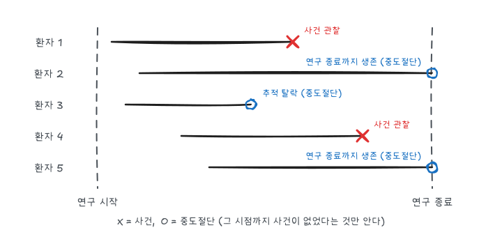
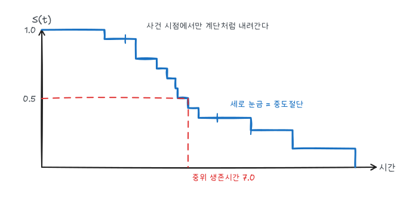

『생명과학연구를 위한 통계적 방법』(이재원·박미라·유한나)과 전북대학교 최혜미 교수님 강의를 바탕으로 정리했다. 생존분석은 관심 사건이 일어날 때까지의 시간을 분석한다. 사건은 사망뿐 아니라 재발, 관해 종료, 감염, 부작용 발생처럼 연구에서 정의한 무엇이든 될 수 있다.

## 생존시간과 중도절단

생존시간 $T$는 기준 시점(진단, 무작위 배정, 수술 등)부터 사건까지의 시간이다. 생존자료가 일반 연속형 자료와 다른 이유는 **중도절단** 때문이다.



| 유형 | 상황 | 아는 것 |
|---|---|---|
| 오른쪽 중도절단 | 연구 종료까지 사건 없음, 추적 탈락, 다른 원인 사망 | $T > C$ |
| 왼쪽 중도절단 | 관찰 시작 전에 이미 사건 발생 | $T < C$ |
| 구간 중도절단 | 정기 검진 사이에 사건 발생 | $L < T \le R$ |

생명과학 자료는 대부분 오른쪽 중도절단이다. 관찰값은 시간과 사건 여부의 쌍이다.

$$
X_i = \min(T_i, C_i), \qquad \delta_i = I(T_i \le C_i)
$$

$\delta_i = 1$이면 사건 관찰, $0$이면 중도절단이다. 중도절단된 관측값을 버리거나 사건으로 취급하면 생존을 과소추정한다. 생존분석의 표준 방법은 **비정보적 중도절단**, 즉 중도절단 여부가 사건 위험과 무관하다는 가정을 둔다. 부작용 때문에 탈락한 환자가 많다면 이 가정이 깨진다.

## 생존함수와 위험함수

$$
S(t) = P(T > t) = 1 - F(t)
$$

$$
h(t) = \lim_{\Delta t \to 0} \frac{P(t \le T < t + \Delta t \mid T \ge t)}{\Delta t} = \frac{f(t)}{S(t)}
$$

$h(t)$는 $t$까지 사건이 없던 사람이 바로 다음 순간 사건을 겪을 순간 위험률이다. 누적위험함수 $H(t) = \int_0^t h(u)\,du$를 쓰면 다음 관계가 성립한다.

$$
S(t) = \exp\{-H(t)\}, \qquad H(t) = -\log S(t)
$$

| 위험함수 모양 | 예 |
|---|---|
| 일정 (지수분포) | 우발적 사고 |
| 증가 | 노화, 진행성 질환 |
| 감소 | 수술 직후 위험이 높다가 안정 |
| 욕조형 | 신생아기와 노년기에 높은 사망 위험 |

생존시간은 오른쪽으로 치우치고 중도절단이 있어 평균 대신 **중위 생존시간**($\hat S(t) = 0.5$가 되는 첫 시점)과 **$t$년 생존율**을 보고한다.

## 생명표 방법

자료가 구간별로 집계되어 있거나 표본이 클 때 쓴다. 구간 $(t_{i-1}, t_i]$마다 다음을 둔다.

- $n_i$: 구간 시작 시 위험집단 수, $d_i$: 사건 수, $c_i$: 중도절단 수
- 유효 표본 수 $n_i' = n_i - c_i / 2$ (중도절단이 구간 중간에 고르게 일어난다고 가정)

$$
\hat q_i = \frac{d_i}{n_i'}, \qquad \hat p_i = 1 - \hat q_i, \qquad \hat S(t_i) = \prod_{j=1}^{i} \hat p_j
$$

```sas
proc lifetest data=angina method=life intervals=(0 to 15 by 1) plots=(survival hazard);
  time years*status(0);
  freq count;
run;
```

`method=life`가 생명표 방법이다. 집계 자료라면 각 행이 구간·사건 여부·인원수이므로 `freq`로 인원수를 준다. 출력에서 구간별 조건부 사망확률, 생존함수, 위험함수 추정값을 볼 수 있다.

## Kaplan-Meier 추정

사건이 실제로 일어난 시점마다 생존확률을 갱신하는 곱한계(product-limit) 추정량이다. 사건 시점 $t_{(1)} < t_{(2)} < \cdots$에서 $n_i$를 직전 위험집단 수, $d_i$를 사건 수라 하면 다음과 같다.

$$
\hat S(t) = \prod_{t_{(i)} \le t} \left( 1 - \frac{d_i}{n_i} \right)
$$

분산은 Greenwood 공식으로 추정한다.

$$
\widehat{Var}\big(\hat S(t)\big) = \hat S(t)^2 \sum_{t_{(i)} \le t} \frac{d_i}{n_i (n_i - d_i)}
$$

중도절단된 사람은 그 시점에 생존확률을 떨어뜨리지 않고, 다음 사건 시점의 위험집단에서만 빠진다. 그래서 Kaplan-Meier 곡선은 사건 시점에서만 내려가는 계단 함수다.

### 손으로 계산하기: 백혈병 관해 자료

Freireich 등(1963)의 급성 백혈병 임상시험은 생존분석 교재에서 가장 많이 쓰이는 자료다. 6-MP 투여군 21명의 관해 유지 기간(주)은 다음과 같다. `+`는 중도절단이다.

> 6, 6, 6, 6+, 7, 9+, 10, 10+, 11+, 13, 16, 17+, 19+, 20+, 22, 23, 25+, 32+, 32+, 34+, 35+

| $t_{(i)}$ | $n_i$ | $d_i$ | $1 - d_i/n_i$ | $\hat S(t)$ |
|---:|---:|---:|---:|---:|
| 6 | 21 | 3 | 18/21 | 0.857 |
| 7 | 17 | 1 | 16/17 | 0.807 |
| 10 | 15 | 1 | 14/15 | 0.753 |
| 13 | 12 | 1 | 11/12 | 0.690 |
| 16 | 11 | 1 | 10/11 | 0.627 |
| 22 | 7 | 1 | 6/7 | 0.538 |
| 23 | 6 | 1 | 5/6 | 0.448 |

6주 시점에 사건 3명과 중도절단 1명(6+)이 있다. 같은 시점이면 사건이 먼저 일어난 것으로 보므로 $n = 21$에서 3명이 사건이고, 7주 위험집단은 $21 - 3 - 1 = 17$명이다. 23주에서 처음으로 $\hat S(t) < 0.5$가 되므로 중위 관해기간은 23주다.



```sas
data leuk;
  input group $ weeks status @@;   /* status: 1 = 재발, 0 = 중도절단 */
  datalines;
6MP 6 1  6MP 6 1  6MP 6 1  6MP 6 0  6MP 7 1  6MP 9 0  6MP 10 1
6MP 10 0 6MP 11 0 6MP 13 1 6MP 16 1 6MP 17 0 6MP 19 0 6MP 20 0
6MP 22 1 6MP 23 1 6MP 25 0 6MP 32 0 6MP 32 0 6MP 34 0 6MP 35 0
PBO 1 1  PBO 1 1  PBO 2 1  PBO 2 1  PBO 3 1  PBO 4 1  PBO 4 1
PBO 5 1  PBO 5 1  PBO 8 1  PBO 8 1  PBO 8 1  PBO 8 1  PBO 11 1
PBO 11 1 PBO 12 1 PBO 12 1 PBO 15 1 PBO 17 1 PBO 22 1 PBO 23 1
;
run;

proc lifetest data=leuk plots=survival(atrisk cl) outsurv=km_out;
  time weeks*status(0);
  strata group / test=(logrank wilcoxon);
run;
```

- `time weeks*status(0)`: 괄호 안 값(0)이 중도절단을 뜻한다.
- `strata`: 집단별 곡선과 집단 비교 검정을 함께 출력한다.
- `plots=survival(atrisk cl)`: 곡선 아래 위험집단 수와 신뢰띠를 그린다.
- `outsurv=`: 시점별 $\hat S(t)$와 신뢰한계를 데이터셋으로 저장한다.

출력의 `Quartile Estimates` 표에 중위 생존시간과 신뢰구간이 나온다. 위약군은 21명 모두 재발했고 중위 관해기간이 8주다.

## 두 생존곡선의 비교

$$
H_0: S_1(t) = S_2(t) \;\; \text{for all } t, \qquad H_1: S_1(t) \ne S_2(t) \;\; \text{for some } t
$$

### 로그순위 검정

각 사건 시점 $t_{(i)}$에서 다음 2×2 표를 만든다.

| 집단 | 사건 | 사건 없음 | 위험집단 |
|---|---:|---:|---:|
| 1 | $d_{1i}$ | $n_{1i} - d_{1i}$ | $n_{1i}$ |
| 2 | $d_{2i}$ | $n_{2i} - d_{2i}$ | $n_{2i}$ |
| 합 | $d_i$ | $n_i - d_i$ | $n_i$ |

$H_0$에서 주변합이 고정되면 $d_{1i}$는 초기하분포를 따른다.

$$
E_{1i} = \frac{n_{1i} d_i}{n_i}, \qquad V_{1i} = \frac{n_{1i} n_{2i} d_i (n_i - d_i)}{n_i^2 (n_i - 1)}
$$

$$
\chi^2_{LR} = \frac{\left[ \sum_i (d_{1i} - E_{1i}) \right]^2}{\sum_i V_{1i}} \sim \chi^2(1)
$$

사건 시점별 2×2 표를 층으로 보고 합치는 것이므로 [분할표 글](/posts/biostat-contingency-diagnostic)의 CMH 검정과 같은 구조다. 백혈병 자료의 로그순위 통계량은 약 16.8($p < 0.001$)로, 6-MP군의 관해 유지가 유의하게 길다.

### 가중 검정

$\sum_i w_i (d_{1i} - E_{1i})$ 꼴로 가중치를 주면 다른 검정이 된다.

| 검정 | 가중치 $w_i$ | 민감한 차이 |
|---|---|---|
| 로그순위 | 1 | 후기 차이, 비례위험일 때 가장 강력 |
| Gehan(일반화 Wilcoxon) | $n_i$ | 초기 차이 |
| Tarone-Ware | $\sqrt{n_i}$ | 중간 |
| Peto-Peto | $\hat S(t_{(i)})$ | 초기 차이, 중도절단 패턴에 덜 민감 |

생존곡선이 **교차**하면 차이가 서로 상쇄되어 어느 검정도 차이를 잘 잡지 못한다. 곡선을 먼저 그려 보고 검정을 고른다. 셋 이상의 집단은 자유도 $K - 1$인 카이제곱 검정으로 확장되고, `strata` 문에 `/ adjust=bonferroni` 같은 옵션으로 쌍별 비교를 보정할 수 있다.

### SASHELP.BMT로 세 집단 비교

SAS에 내장된 `sashelp.bmt`는 골수이식 환자 137명의 질병군(`Group`: ALL, AML-Low Risk, AML-High Risk), 무병 생존시간(`T`, 일), 사건 여부(`Status`)다.

```sas
proc lifetest data=sashelp.bmt plots=survival(atrisk=0 to 2500 by 500);
  time T*Status(0);
  strata Group / test=logrank adjust=sidak;
run;
```

## Cox 비례위험모형

여러 공변량을 함께 보려면 회귀모형이 필요하다. Cox 모형은 위험함수를 다음처럼 둔다.

$$
h(t \mid x) = h_0(t) \exp(\beta_1 x_1 + \cdots + \beta_k x_k)
$$

기준위험함수 $h_0(t)$의 모양은 정하지 않는다(준모수적 모형). 두 사람의 위험비는 다음과 같다.

$$
\frac{h(t \mid x_i)}{h(t \mid x_j)} = \exp\{\beta^T (x_i - x_j)\}
$$

시간 $t$가 없다. **위험비가 시간에 따라 일정하다**는 것이 비례위험 가정이다.

### 부분가능도

$h_0(t)$를 모른 채로 $\beta$를 추정하기 위해, 각 사건 시점에서 "위험집단 $R(t_{(i)})$ 중 실제로 사건을 겪은 사람이 $i$일 조건부 확률"만 곱한다.

$$
L(\beta) = \prod_{i:\, \delta_i = 1} \frac{\exp(\beta^T x_i)}{\sum_{j \in R(t_{(i)})} \exp(\beta^T x_j)}
$$

$h_0(t_{(i)})$가 분자와 분모에서 약분되어 사라진다. 같은 시점에 사건이 여럿이면 Breslow(SAS 기본), Efron, exact 근사를 쓴다(`model ... / ties=efron`).

### 해석

| 값 | 의미 |
|---|---|
| $\hat\beta_j$ | 로그 위험비 |
| $e^{\hat\beta_j}$ | $x_j$ 한 단위 증가 시 위험비 (다른 공변량 고정) |
| $e^{\hat\beta_j} > 1$ | 위험 증가 (생존 불리) |
| $e^{\hat\beta_j} < 1$ | 위험 감소 (생존 유리) |

위험비 0.5는 "생존시간이 두 배"가 아니라 "어느 시점에서든 순간 위험이 절반"이라는 뜻이다.

```sas
proc phreg data=sashelp.bmt;
  class Group (ref='ALL') / param=ref;
  model T*Status(0) = Group / ties=efron risklimits;
  hazardratio 'Group' Group / diff=ref;
run;
```

- `class ... (ref=)`: 기준 범주를 정한다. `param=ref`는 기준 범주 대비 가변수다.
- `risklimits`: 위험비와 95% 신뢰구간을 출력한다.
- 전체 모형 검정은 `Testing Global Null Hypothesis` 표의 가능도비, 점수, Wald 검정 세 가지로 나온다. 공변량이 범주 하나뿐이고 동점을 Breslow 방식으로 처리하면 점수 검정은 로그순위 검정과 같다.

### 여러 공변량: 폐암 임상시험 구조

교재 예제의 폐암 임상시험(Veterans Administration 자료와 같은 구조)은 다음 변수를 쓴다.

| 변수 | 내용 |
|---|---|
| `time`, `censor` | 생존일수, 중도절단 여부 |
| `trt` | 표준 치료 / 시험 치료 |
| `x1` | 진단 시 수행능력 점수 (0~100) |
| `x2` | 나이 |
| `x3` | 진단부터 연구 시작까지 개월 수 |
| `type` | 종양 유형 (squamous, small, adeno, large) |

```sas
proc phreg data=lung;
  class trt (ref='standard') type (ref='squamous') / param=ref;
  model time*censor(0) = trt x1 x2 x3 type / ties=efron risklimits selection=backward slstay=0.1;
run;
```

`selection=backward`는 후진 제거로 변수를 고른다. 이런 자료에서는 보통 수행능력 점수가 가장 강한 예후 인자로 나오고, 치료 효과는 다른 공변량을 보정한 뒤의 위험비로 해석한다.

## 비례위험 가정 확인

가정이 깨지면 $e^{\hat\beta}$는 시간에 따라 변하는 위험비의 평균 같은 값이 되어 해석이 어렵다.

| 방법 | 보는 것 | SAS |
|---|---|---|
| log-log 그림 | 집단별 $\log\{-\log \hat S(t)\}$ 대 $\log t$가 평행한가 | `proc lifetest plots=(lls)` |
| 시간 상호작용 | $x \cdot \log t$ 항이 유의한가 | `phreg`의 프로그래밍 문 |
| Schoenfeld 잔차 | 잔차가 시간에 따라 추세를 보이는가 | `output out= ressch=` |
| 누적 잔차 | 관측 누적 잔차가 모의 경로 안에 있는가 | `assess ph / resample` |

$\log\{-\log S(t \mid x)\} = \log\{-\log S_0(t)\} + \beta^T x$이므로, 비례위험이면 집단별 곡선은 세로로 $\beta$만큼 평행 이동한 모양이다.

```sas
proc lifetest data=sashelp.bmt plots=(lls) notable;
  time T*Status(0);
  strata Group;
run;

proc phreg data=sashelp.bmt;
  class Group (ref='ALL') / param=ref;
  model T*Status(0) = Group AML_hi_t;
  AML_hi_t = (Group = 'AML-High Risk') * log(T);   /* 시간과의 상호작용 */
run;

proc phreg data=sashelp.bmt;
  class Group (ref='ALL') / param=ref;
  model T*Status(0) = Group;
  assess ph / resample seed=1;
run;
```

`model` 문 뒤의 대입문은 시간에 따라 값이 바뀌는 **시간의존 공변량**을 만든다. 이 항의 계수가 유의하면 그 집단의 위험비가 시간에 따라 변한다는 뜻이다.

가정이 깨졌을 때의 대응은 다음과 같다.

- **층화 Cox 모형**: 가정을 위반한 변수로 층을 나눠 층마다 다른 $h_0(t)$를 허용한다(`strata` 문). 그 변수의 효과는 추정하지 않는다.
- **시간의존 계수**: 위처럼 $x \cdot g(t)$ 항을 넣어 시간에 따라 변하는 위험비를 직접 모델링한다.
- **구간별 분석**: 예를 들어 1년 전후로 나눠 따로 위험비를 보고한다.

## 예측 생존함수

$$
S(t \mid x) = S_0(t)^{\exp(\beta^T x)}
$$

```sas
data covs;
  length Group $ 15;
  input Group $ 1-15;
  datalines;
ALL
AML-Low Risk
AML-High Risk
;
run;

proc phreg data=sashelp.bmt plots(overlay)=survival;
  class Group (ref='ALL') / param=ref;
  model T*Status(0) = Group;
  baseline covariates=covs out=pred survival=s lower=lo upper=hi;
run;
```

`baseline` 문은 `covariates=`에 준 공변량 조합마다 예측 생존곡선을 계산해 저장하고 그린다.

## 요약

| 목적 | 방법 | SAS |
|---|---|---|
| 집계 자료의 생존함수 | 생명표 | `lifetest method=life` |
| 개별 자료의 생존함수 | Kaplan-Meier, Greenwood 분산 | `lifetest` |
| 집단 비교 | 로그순위, Wilcoxon 계열 | `lifetest` + `strata / test=` |
| 공변량 보정 | Cox 비례위험모형 | `phreg` |
| 가정 확인 | log-log 그림, 시간 상호작용, `assess ph` | `lifetest plots=lls`, `phreg` |
| 가정 위반 대응 | 층화 Cox, 시간의존 공변량 | `phreg` + `strata`, 프로그래밍 문 |
