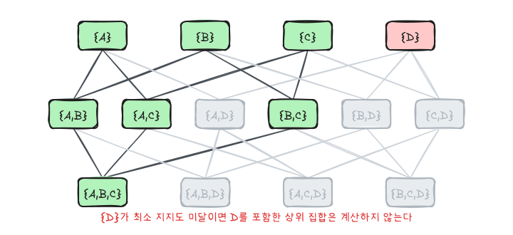
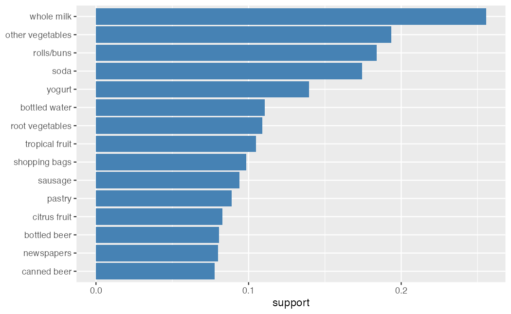
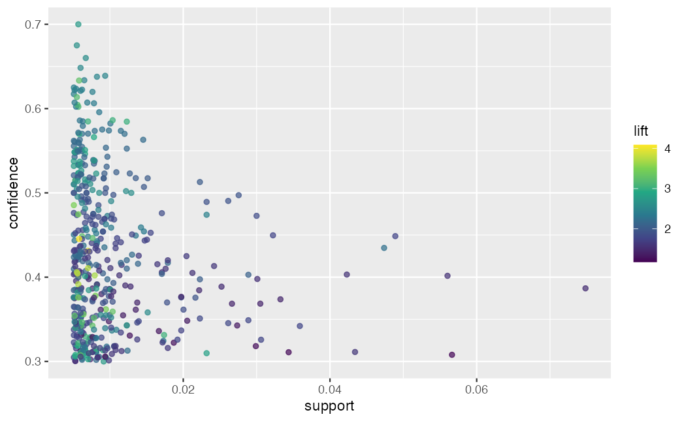

이영미 교수님 데이터마이닝 강의의 연관규칙 부분을 정리했다. 연관규칙 분석은 거래 데이터에서 함께 자주 나타나는 항목의 조합을 찾는 비지도학습 방법이다. 대표적인 예가 장바구니 분석이다.

## 규칙의 형태

$$
X \Rightarrow Y, \qquad X \cap Y = \varnothing
$$

$X$는 선행항(조건), $Y$는 후행항(결과)이며 둘 다 항목의 집합이다. `{소주, 콜라} => {맥주}`는 "소주와 콜라를 산 거래에는 맥주도 들어 있는 경향이 있다"는 뜻이다. 인과관계가 아니라 **함께 나타나는 경향**이다.

## 세 가지 측도

전체 거래 수를 $N$, 항목집합 $A$를 모두 포함한 거래 수를 $n(A)$라 하자.

### 지지도

$$
supp(X \Rightarrow Y) = \frac{n(X \cup Y)}{N} = P(X \text{와 } Y \text{를 모두 포함})
$$

$X \cup Y$는 **항목집합의 합집합**이고, 그 항목집합을 모두 포함하는 거래의 비율이다. 확률 사건으로 쓰면 "$X$를 포함하는 사건"과 "$Y$를 포함하는 사건"의 교집합이다. 표기가 헷갈리기 쉬운 부분이다. 지지도는 규칙이 얼마나 자주 나타나는지를 나타내며, 너무 낮으면 우연일 가능성이 크다.

### 신뢰도

$$
conf(X \Rightarrow Y) = \frac{supp(X \cup Y)}{supp(X)} = P(Y \mid X)
$$

$X$가 있는 거래 중 $Y$도 있는 비율이다. 방향이 있어서 $conf(X \Rightarrow Y)$와 $conf(Y \Rightarrow X)$는 일반적으로 다르다.

### 향상도

$$
lift(X \Rightarrow Y) = \frac{conf(X \Rightarrow Y)}{supp(Y)} = \frac{P(Y \mid X)}{P(Y)}
$$

| 향상도 | 해석 |
|---|---|
| $> 1$ | $X$가 있으면 $Y$가 더 자주 나타난다 (양의 연관) |
| $= 1$ | 독립 |
| $< 1$ | $X$가 있으면 $Y$가 덜 나타난다 (음의 연관) |

향상도는 $X$와 $Y$에 대해 대칭이다. 신뢰도만 보면 안 되는 이유가 여기에 있다. $Y$가 원래 아주 흔한 항목(예: 우유)이면 $P(Y \mid X)$가 높게 나와도 $X$와는 상관이 없을 수 있다. 향상도는 $Y$의 기본 빈도로 나눠 이 효과를 걷어 낸다.

## Apriori 알고리즘

항목이 $k$개면 가능한 항목집합은 $2^k - 1$개다. 전부 세는 것은 불가능하므로 다음 성질을 이용한다.

> 어떤 항목집합이 빈발하지 않으면, 그것을 포함하는 모든 상위 집합도 빈발하지 않다.

$\{A, D\}$를 포함하는 거래는 $\{D\}$를 포함하는 거래의 일부이므로 $supp(\{A, D\}) \le supp(\{D\})$이다. 따라서 $\{D\}$가 최소 지지도에 못 미치면 $D$가 들어간 집합은 셀 필요가 없다.



1. 크기 1인 항목집합의 지지도를 세고, 최소 지지도 이상인 것만 남긴다.
2. 남은 집합으로 크기 $k+1$인 후보를 만들되, 부분집합 중 하나라도 탈락했으면 후보에서 뺀다.
3. 후보의 지지도를 세고 최소 지지도 미달을 버린다. 후보가 없을 때까지 반복한다.
4. 남은 빈발 항목집합을 $X$와 $Y$로 나눠 최소 신뢰도 이상인 규칙을 만든다.

최소 지지도와 신뢰도를 너무 낮추면 규칙이 폭발적으로 많아지고, 너무 높이면 흔한 항목끼리의 뻔한 규칙만 남는다.

## 장바구니 예제

```r
library(tidyverse)
library(arules)

shopping <- list(
  c("soju", "coke", "beer"),
  c("soju", "coke", "wine"),
  c("soju", "juice"),
  c("coke", "beer"),
  c("soju", "coke", "beer", "wine"),
  c("juice")
)
trans <- transactions(shopping)
inspect(trans)
itemFrequency(trans)
```

`transactions()`는 리스트를 거래 데이터 객체로 바꾼다. 내부적으로는 거래 × 항목의 0/1 희소 행렬이다. `itemFrequency`로 각 항목의 지지도를 확인한다.

```r
rules <- apriori(trans, parameter = list(supp = 0.3, conf = 0.6, minlen = 2))
inspect(sort(rules, by = "lift"))
```

`minlen = 2`는 선행항이 비어 있는 규칙(`{} => {beer}`)을 빼기 위한 것이다. 예를 들어 `{beer} => {coke}`는 다음과 같이 계산된다.

| 측도 | 계산 | 값 |
|---|---|---|
| 지지도 | beer와 coke를 모두 포함한 거래 3 / 6 | 0.50 |
| 신뢰도 | 3 / beer 포함 거래 3 | 1.00 |
| 향상도 | 1.00 / coke 지지도 (4 / 6) | 1.50 |

손으로 계산한 값과 `inspect` 결과를 비교해 보면 정의를 확인할 수 있다.

## Groceries 데이터

`arules`에 들어 있는 `Groceries`는 한 식료품점의 한 달 거래 9,835건, 항목 169개다.

```r
data(Groceries)
summary(Groceries)

tibble(item = itemLabels(Groceries), support = itemFrequency(Groceries)) |>
  slice_max(support, n = 15) |>
  ggplot(aes(support, fct_reorder(item, support))) +
  geom_col(fill = "steelblue") +
  labs(y = NULL)
```



`whole milk`가 약 26%의 거래에 들어 있다. 이런 항목은 어떤 $X$와도 신뢰도가 높게 나오기 쉽다.

```r
g_rules <- apriori(Groceries,
                   parameter = list(supp = 0.005, conf = 0.3, minlen = 2),
                   control = list(verbose = FALSE))
length(g_rules)

top_conf <- head(sort(g_rules, by = "confidence"), 5)
top_lift <- head(sort(g_rules, by = "lift"), 5)
inspect(top_conf)
inspect(top_lift)
```

신뢰도 순으로 보면 후행항에 `whole milk`, `other vegetables` 같은 흔한 항목이 몰린다. 향상도 순으로 보면 채소·과일류처럼 덜 흔한 품목끼리의 조합이 올라온다. 두 결과의 후행항을 비교해 보면 신뢰도만으로 규칙을 고를 때의 문제가 드러난다.

```r
as(g_rules, "data.frame") |>
  as_tibble() |>
  ggplot(aes(support, confidence, color = lift)) +
  geom_point(alpha = 0.7) +
  scale_color_viridis_c()
```



규칙마다 세 측도를 한 번에 보는 그림이다. 오른쪽 위(지지도·신뢰도 모두 높음)에 있어도 향상도가 낮으면 흔한 항목 때문에 생긴 규칙일 수 있다.

### 특정 항목에 대한 규칙만 보기

```r
milk_rules <- subset(g_rules, rhs %in% "whole milk" & lift > 2)
inspect(head(sort(milk_rules, by = "lift"), 5))
```

`subset`으로 선행항(`lhs`)이나 후행항(`rhs`)에 특정 항목이 있는 규칙만 고를 수 있다.

## 해석할 때 주의할 점

- 규칙은 함께 나타나는 경향이지 인과가 아니다.
- 지지도, 신뢰도, 향상도를 함께 본다. 하나만 보면 흔한 항목의 착시에 빠진다.
- 최소 지지도와 신뢰도는 규칙 수를 보면서 조정한다.
- 거래 수가 적은 조합의 높은 향상도는 우연일 수 있다.

## 요약

| 측도 | 식 | 의미 |
|---|---|---|
| 지지도 | $n(X \cup Y) / N$ | 얼마나 자주 나타나는가 |
| 신뢰도 | $P(Y \mid X)$ | $X$가 있을 때 $Y$가 있을 확률 |
| 향상도 | $P(Y \mid X) / P(Y)$ | 독립일 때보다 몇 배 자주 나타나는가 |
| Apriori | 빈발하지 않은 집합의 상위 집합은 제외 | 탐색 공간을 줄인다 |
