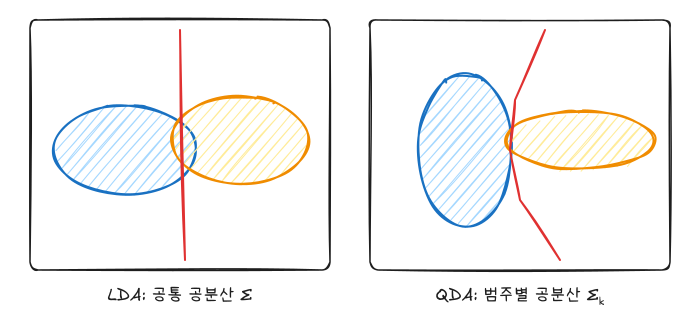
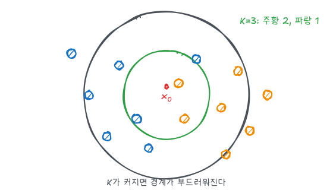
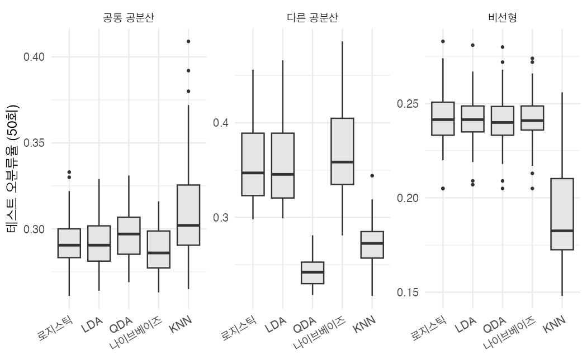
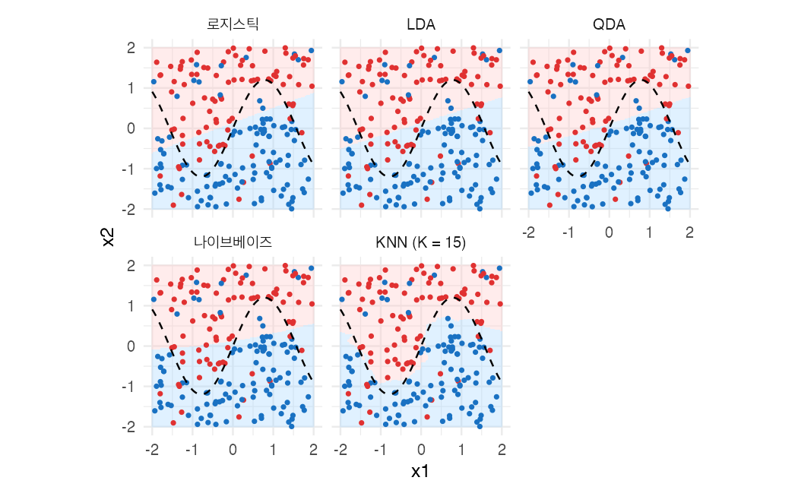
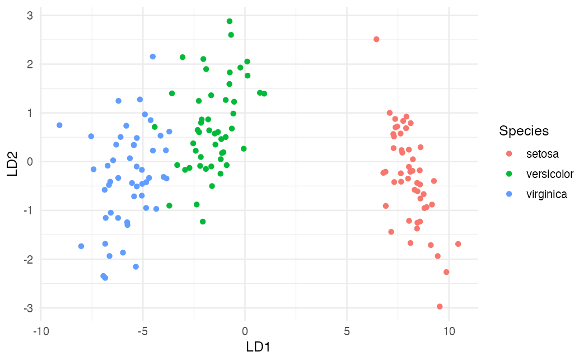
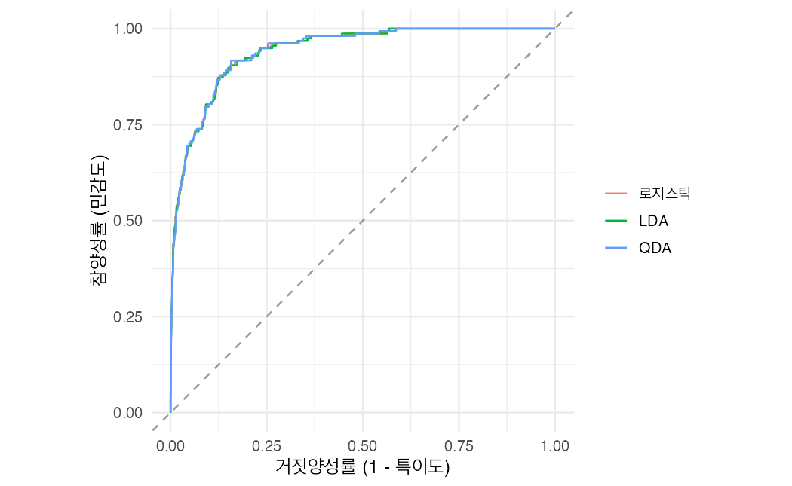

ISLR 2·4장과 이영미 교수님 데이터마이닝 강의의 분류 부분을 정리했다.

## 개요

분류의 목표는 사후확률 $P(Y = k \mid X = x)$가 가장 큰 범주를 고르는 것이다. 이 규칙을 **베이즈 분류기**라 하며, 테스트 오분류율을 최소화한다. 실제로는 사후확률을 모르므로 자료로 근사해야 하고, 분류 방법은 이를 근사하는 방식에 따라 세 부류로 나뉜다.

| 접근 | 모형화 대상 | 방법 |
|---|---|---|
| 판별적(discriminative) | $P(Y \mid X)$를 직접 | 로지스틱 회귀 |
| 생성적(generative) | 범주별 $X$의 분포 $f_k(x)$를 모형화한 뒤 베이즈 정리로 뒤집음 | LDA, QDA, 나이브 베이즈 |
| 비모수적 | 분포 가정 없이 주변 관측값으로 국소 추정 | KNN |

생성적 방법들은 $f_k(x)$에 두는 가정의 강도가 다르다. 가정이 강할수록 추정할 모수가 적어 분산이 작고, 가정이 틀리면 편향이 커진다.

| | 로지스틱 | LDA | QDA | 나이브 베이즈 | KNN |
|---|---|---|---|---|---|
| 핵심 가정 | 로그 오즈가 $x$의 선형식 | 정규분포, 공통 공분산 | 정규분포, 범주별 공분산 | 범주 내 변수 독립 | 없음 |
| 결정경계 | 선형 | 선형 | 이차 | 가정한 주변분포에 따름 | 임의의 형태 |
| 유연성 | 낮음 | 낮음 | 중간 | 중간 | $K$로 조절 |

## 1. 베이즈 분류기

$\pi_k = P(Y = k)$를 사전확률, $f_k(x)$를 범주 $k$에서 $X$의 밀도라 하면 베이즈 정리에 의해

$$
p_k(x) = P(Y = k \mid X = x) = \frac{\pi_k f_k(x)}{\sum_{l=1}^{K}\pi_l f_l(x)}
$$

이다. 분모는 모든 $k$에 공통이므로 $\pi_k f_k(x)$가 가장 큰 범주를 고르면 된다. $\pi_k$는 표본 비율로 쉽게 추정되므로, 생성적 방법의 차이는 결국 $f_k(x)$를 어떻게 추정하느냐에 있다.

## 2. 로지스틱 회귀

[로지스틱 회귀](/posts/dm-logistic-regression)는 $f_k$를 거치지 않고 사후확률의 로그 오즈를 선형식으로 둔다.

$$
\log\frac{p(x)}{1 - p(x)} = \beta_0 + \beta^Tx
$$

모수는 조건부 가능도를 최대화해 추정한다. $X$의 분포에 대해 아무 가정도 하지 않으므로 정규성이 깨져도 영향을 덜 받는다. 대신 범주가 완전히 분리되면 가능도가 발산해 계수 추정이 불안정해진다.

## 3. 선형판별분석 (LDA)

LDA는 범주별 분포를 공분산이 같은 다변량 정규분포로 가정한다.

$$
X \mid Y = k \sim N(\mu_k, \Sigma)
$$

$\log(\pi_k f_k(x))$에서 $k$와 무관한 항을 지우면 판별함수

$$
\delta_k(x) = x^T\Sigma^{-1}\mu_k - \frac12\mu_k^T\Sigma^{-1}\mu_k + \log\pi_k
$$

가 남는다. $x$의 1차식이므로 두 범주의 경계 $\delta_k(x) = \delta_l(x)$는 초평면이다. 모수는 $\hat\pi_k = n_k/n$, 범주별 표본평균 $\hat\mu_k$, 범주별 편차를 합친 공통 표본공분산 $\hat\Sigma$으로 추정한다.

두 범주 LDA의 로그 오즈도 $x$의 1차식이므로 로지스틱 회귀와 모형의 형태가 같다. 차이는 추정 방식이다. LDA는 $X$의 정규성을 이용한 결합 가능도로 추정하므로, 정규 가정이 대략 맞으면 로지스틱 회귀보다 효율적이고 범주가 잘 분리되어도 안정적이다. 범주가 3개 이상인 경우에도 그대로 확장된다.

LDA는 분류기이면서 차원축소 방법이기도 하다. 범주 간 분산 대비 범주 내 분산의 비를 최대화하는 방향(판별축)으로 자료를 투영하며, 범주가 $K$개면 판별축은 최대 $K - 1$개다.

## 4. 이차판별분석 (QDA)

QDA는 LDA에서 공분산이 범주마다 다르다고 가정을 완화한 것이다.

$$
X \mid Y = k \sim N(\mu_k, \Sigma_k)
$$

이 경우 판별함수에 $-\frac12 x^T\Sigma_k^{-1}x$ 항이 범주마다 다르게 남아 결정경계가 이차곡면이 된다.



완화의 대가는 모수의 수다. 공분산 모수가 LDA는 $p(p + 1)/2$개, QDA는 $K\cdot p(p + 1)/2$개다. $p = 10$, $K = 3$이면 55개 대 165개다. 범주별 공분산이 실제로 다르면 QDA의 편향이 작지만, $n$이 작으면 이 많은 모수를 추정하는 데서 오는 분산이 편향 감소 효과를 넘어선다.

## 5. 나이브 베이즈

나이브 베이즈는 정규분포를 가정하는 대신 **범주 안에서 설명 변수들이 서로 독립**이라고 가정한다.

$$
f_k(x) = f_{k1}(x_1)\times f_{k2}(x_2)\times\cdots\times f_{kp}(x_p)
$$

$p$차원 결합밀도 대신 1차원 밀도 $p$개만 추정하면 되므로, 각 $f_{kj}$를 정규분포, 커널 밀도, 범주형 비율 등 자유롭게 고를 수 있다. 독립 가정은 대부분 틀리지만, 변수 간 상관을 추정하지 않아 분산이 크게 줄어든다. 따라서 $p$가 $n$에 비해 큰 상황(문서 분류 등)에서 유용하다. 각 $f_{kj}$를 정규분포로 두면 공분산행렬이 대각행렬인 QDA와 같다.

## 6. K-최근접 이웃 (KNN)

KNN은 $x_0$에서 가장 가까운 학습 관측값 $K$개의 집합 $N_0$로 사후확률을 직접 추정한다.

$$
\hat P(Y = k \mid X = x_0) = \frac1K\sum_{i \in N_0}I(y_i = k)
$$



분포 가정이 없으므로 결정경계의 형태에 제약이 없다. 유연성은 $K$가 정한다. $K = 1$이면 학습 오차가 0이지만 경계가 매우 불규칙하고(분산 큼), $K$가 커지면 경계가 부드러워지다가 지나치면 국소 구조를 놓친다(편향 큼). 거리 기반이므로 단위가 다른 변수는 표준화해야 하며, $p$가 크면 가까운 이웃도 실제로는 멀리 떨어져 있게 되어 성능이 급격히 떨어진다(차원의 저주).

## 7. 방법 간 비교

| 구분 | 로지스틱 | LDA | QDA | 나이브 베이즈 | KNN |
|---|---|---|---|---|---|
| 모형화 대상 | $P(Y\mid X)$ | $f_k(x)$ | $f_k(x)$ | $f_k(x)$ | $P(Y\mid X)$ 국소 추정 |
| $X$의 분포 가정 | 없음 | 정규, $\Sigma$ 공통 | 정규, $\Sigma_k$ | 범주 내 독립 | 없음 |
| 추정 방법 | 조건부 최대가능도 | 표본평균·합동공분산 | 표본평균·범주별 공분산 | 변수별 1차원 밀도 | 없음 (학습 자료 저장) |
| 결정경계 | 선형 | 선형 | 이차 | 다양 | 임의 |
| 모수 수 ($p$ 증가 시) | $O(p)$ | $O(p^2)$ | $O(Kp^2)$ | $O(Kp)$ | — |
| 편향 / 분산 | 높음 / 낮음 | 높음 / 낮음 | 중간 / 중간 | 가정에 따라 | $K$로 조절 |
| 해석 | 오즈비 | 판별축 | 어려움 | 변수별 분포 | 어려움 |

## 8. 모의실험에 의한 비교

어느 방법이 우수한지는 실제 결정경계가 어떤 형태인지에 달려 있다. 이를 확인하기 위해 결정경계의 형태가 다른 세 시나리오에서 자료를 생성하고, 학습 자료 100개, 테스트 자료 1,000개로 테스트 오분류율을 50번 반복해 비교한다.

| 시나리오 | 생성 방식 | 참 결정경계 |
|---|---|---|
| 공통 공분산 | 두 범주 모두 상관 0.5인 이변량 정규분포, 평균만 다름 | 선형 |
| 다른 공분산 | 범주별 상관이 +0.7과 −0.7 | 이차 |
| 비선형 | $x_2 = 1.2\sin(2x_1)$ 위·아래로 구분, 라벨 10%에 잡음 | 곡선 |

```r
library(tidyverse)
theme_set(theme_minimal(base_size = 12))
library(MASS)
library(class)
library(e1071)

gen <- function(n, scen) {
  y <- rbinom(n, 1, 0.5)
  if (scen == "공통 공분산") {
    S <- matrix(c(1, 0.5, 0.5, 1), 2)
    X <- t(sapply(y, \(k) mvrnorm(1, c(k, k), S)))
  } else if (scen == "다른 공분산") {
    S0 <- matrix(c(1, 0.7, 0.7, 1), 2); S1 <- matrix(c(1, -0.7, -0.7, 1), 2)
    X <- t(sapply(y, \(k) mvrnorm(1, c(k, k) * 0.5, if (k == 1) S1 else S0)))
  } else {
    X <- matrix(runif(2 * n, -2, 2), n)
    y <- as.integer(X[, 2] > 1.2 * sin(2 * X[, 1]))
    flip <- runif(n) < 0.1
    y[flip] <- 1 - y[flip]
  }
  tibble(x1 = X[, 1], x2 = X[, 2], y = factor(y))
}

fit_all <- function(tr, te) {
  err <- function(pred) mean(pred != te$y)
  p_log <- predict(glm(y ~ x1 + x2, data = tr, family = binomial), te, type = "response")
  ks <- seq(1, 31, 2)
  k_best <- ks[which.max(map_dbl(ks, \(k) mean(knn.cv(tr[, 1:2], tr$y, k = k) == tr$y)))]
  c(로지스틱 = err(factor(as.integer(p_log > 0.5))),
    LDA = err(predict(lda(y ~ x1 + x2, data = tr), te)$class),
    QDA = err(predict(qda(y ~ x1 + x2, data = tr), te)$class),
    나이브베이즈 = err(predict(naiveBayes(y ~ x1 + x2, data = tr), te)),
    KNN = err(knn(tr[, 1:2], te[, 1:2], tr$y, k = k_best)))
}

set.seed(42)
scens <- c("공통 공분산", "다른 공분산", "비선형")
sim <- map_dfr(scens, \(s) map_dfr(1:50, \(r) {
  as_tibble_row(fit_all(gen(100, s), gen(1000, s))) |> mutate(시나리오 = s)
}))

sim_long <- sim |>
  pivot_longer(-시나리오, names_to = "방법", values_to = "오분류율") |>
  mutate(방법 = fct_inorder(방법), 시나리오 = factor(시나리오, scens))

sim_long |> group_by(시나리오, 방법) |>
  summarise(평균 = round(mean(오분류율), 3), .groups = "drop") |>
  pivot_wider(names_from = 방법, values_from = 평균)

ggplot(sim_long, aes(방법, 오분류율)) +
  geom_boxplot(fill = "grey90", outlier.size = 0.8) +
  facet_wrap(~시나리오, scales = "free_y") +
  labs(x = NULL, y = "테스트 오분류율 (50회)") +
  theme(axis.text.x = element_text(angle = 30, hjust = 1))
```



| 시나리오 | 로지스틱 | LDA | QDA | 나이브 베이즈 | KNN |
|---|---|---|---|---|---|
| 공통 공분산 | 0.292 | 0.292 | 0.297 | **0.287** | 0.313 |
| 다른 공분산 | 0.358 | 0.358 | **0.243** | 0.367 | 0.272 |
| 비선형 | 0.242 | 0.241 | 0.241 | 0.242 | **0.189** |

결정경계가 선형인 첫 시나리오에서는 선형 경계를 가정하는 로지스틱 회귀와 LDA가 같은 성능을 내고, 더 유연한 QDA와 KNN은 오히려 오차가 크다. 참 경계가 선형이므로 추가 유연성은 편향을 줄이지 못하고 분산만 늘린다. 나이브 베이즈가 근소하게 가장 낮은 것은 두 변수의 상관(0.5)을 무시하는 편향보다 모수를 적게 추정하는 이득이 이 표본 크기($n = 100$)에서 조금 더 컸기 때문이다.

범주별 상관의 부호가 다른 둘째 시나리오에서는 경계가 이차이므로 QDA가 0.243으로 가장 낮고, 선형 방법들은 0.36 수준에 머문다. 나이브 베이즈는 변수 간 상관을 무시하므로 범주를 구분하는 핵심 정보(상관의 부호)를 활용하지 못해 선형 방법보다도 나쁘다. KNN은 경계의 형태를 가정하지 않으므로 선형 방법보다 훨씬 낫지만, 이차 경계를 정확히 가정한 QDA에는 미치지 못한다.

경계가 사인 곡선인 셋째 시나리오에서는 어떤 모수적 방법도 경계의 형태를 담지 못해 모두 0.24 근처에 머물고, KNN만 0.189로 크게 낮다.

### 결정경계의 형태

비선형 시나리오의 한 표본에서 각 방법이 만든 결정경계를 그려 보면 차이가 직접 드러난다.

```r
set.seed(7)
tr <- gen(200, "비선형")
grid <- expand_grid(x1 = seq(-2, 2, length.out = 150), x2 = seq(-2, 2, length.out = 150))
k_best <- 15

bound <- bind_rows(
  grid |> mutate(방법 = "로지스틱",
    pred = as.integer(predict(glm(y ~ x1 + x2, data = tr, family = binomial), grid, type = "response") > 0.5)),
  grid |> mutate(방법 = "LDA", pred = as.integer(as.character(predict(lda(y ~ x1 + x2, data = tr), grid)$class))),
  grid |> mutate(방법 = "QDA", pred = as.integer(as.character(predict(qda(y ~ x1 + x2, data = tr), grid)$class))),
  grid |> mutate(방법 = "나이브베이즈", pred = as.integer(as.character(predict(naiveBayes(y ~ x1 + x2, data = tr), grid)))),
  grid |> mutate(방법 = "KNN (K = 15)", pred = as.integer(as.character(knn(tr[, 1:2], grid, tr$y, k = k_best))))
) |> mutate(방법 = fct_inorder(방법))

ggplot(bound, aes(x1, x2)) +
  geom_raster(aes(fill = factor(pred)), alpha = 0.35) +
  geom_point(data = tr, aes(color = y), size = 0.9) +
  stat_function(fun = \(x) 1.2 * sin(2 * x), linetype = "dashed") +
  facet_wrap(~방법, nrow = 2) +
  coord_equal() +
  scale_fill_manual(values = c("0" = "#a5d8ff", "1" = "#ffc9c9"), guide = "none") +
  scale_color_manual(values = c("0" = "#1971c2", "1" = "#e03131"), guide = "none") +
  labs(x = "x1", y = "x2")
```

 

로지스틱 회귀와 LDA는 같은 형태의 직선 경계를 만들고, QDA와 나이브 베이즈의 경계도 이 자료에서는 거의 직선에 가깝다. 정규분포 가정 아래에서는 사인 곡선의 굴곡을 표현할 방법이 없기 때문이다. KNN의 경계만 점선(참 경계)을 따라 휘어진다.

## 9. 실제 자료에서의 비교

### iris: 판별축과 분류 정확도

```r
set.seed(1234)
train_id <- sample(nrow(iris), 0.7 * nrow(iris))
train <- iris[train_id, ]
test  <- iris[-train_id, ]

lda_fit <- lda(Species ~ ., data = train)
lda_fit

x_train <- scale(train[, 1:4])
x_test  <- scale(test[, 1:4], center = attr(x_train, "scaled:center"),
                 scale = attr(x_train, "scaled:scale"))
cv_acc <- map_dbl(seq(1, 31, 2), \(k) mean(knn.cv(x_train, train$Species, k = k) == train$Species))
best_k <- seq(1, 31, 2)[which.max(cv_acc)]

acc <- function(pred) mean(pred == test$Species)
c(LDA = acc(predict(lda_fit, test)$class),
  QDA = acc(predict(qda(Species ~ ., data = train), test)$class),
  나이브베이즈 = acc(predict(naiveBayes(Species ~ ., data = train), test)),
  KNN = acc(knn(x_train, x_test, train$Species, k = best_k)))
```

| 방법 | 테스트 정확도 |
|---|---|
| LDA | 1.000 |
| QDA | 1.000 |
| 나이브 베이즈 | 0.933 |
| KNN (LOOCV로 $K$ 선택, 표준화) | 0.933 |

iris는 품종별로 꽃잎 측정값이 정규분포에 가깝게 뭉쳐 있어 정규 가정을 쓰는 LDA와 QDA가 테스트 자료를 모두 맞혔다. 나이브 베이즈는 꽃잎 길이와 너비의 강한 상관을 무시하므로 versicolor와 virginica의 경계에서 오분류가 생긴다. KNN은 테스트 자료를 학습 자료의 평균·표준편차로 표준화해야 하며, 테스트 자료 자체로 표준화하면 테스트 정보가 학습에 섞인다.

```r
as_tibble(predict(lda_fit, iris)$x) |>
  mutate(Species = iris$Species) |>
  ggplot(aes(LD1, LD2, color = Species)) +
  geom_point()
```



`lda_fit`의 `Proportion of trace`에서 LD1이 범주 간 분산의 99.3%를 설명한다. 실제로 LD1 한 축만으로 세 품종이 거의 분리된다.

### Default: ROC 곡선과 AUC

이진 분류기는 예측확률에 기준값을 적용해 범주를 정한다. 기준값을 0에서 1까지 움직이며 **참양성률(민감도)** 과 **거짓양성률(1 − 특이도)** 을 그린 것이 ROC 곡선이다. 곡선 아래 면적(AUC)은 기준값에 의존하지 않는 성능 요약이며, 무작위로 뽑은 양성 관측값의 점수가 무작위로 뽑은 음성 관측값의 점수보다 클 확률과 같다.

```r
library(ISLR2)

set.seed(1)
d_idx <- sample(nrow(Default), 5000)
d_train <- Default[d_idx, ]
d_test  <- Default[-d_idx, ]
y_test <- d_test$default == "Yes"

scores <- list(
  로지스틱 = predict(glm(default ~ ., data = d_train, family = binomial), d_test, type = "response"),
  LDA = predict(lda(default ~ ., data = d_train), d_test)$posterior[, "Yes"],
  QDA = predict(qda(default ~ ., data = d_train), d_test)$posterior[, "Yes"]
)

roc_df <- function(score, name) {
  cuts <- sort(unique(c(0, score, 1)), decreasing = TRUE)
  tibble(cut = cuts,
         tpr = map_dbl(cuts, \(c) mean(score[y_test] >= c)),
         fpr = map_dbl(cuts, \(c) mean(score[!y_test] >= c)),
         model = name)
}
auc <- function(score) mean(outer(score[y_test], score[!y_test], ">") +
                              0.5 * outer(score[y_test], score[!y_test], "=="))
map_dbl(scores, auc)

imap_dfr(scores, roc_df) |>
  ggplot(aes(fpr, tpr, color = model)) +
  geom_path() +
  geom_abline(linetype = "dashed", color = "grey60") +
  coord_equal() +
  labs(x = "거짓양성률 (1 - 특이도)", y = "참양성률 (민감도)", color = NULL)
```



AUC는 로지스틱 회귀 0.942, LDA 0.942, QDA 0.942로 사실상 같다. 이 자료에서는 연체 여부가 거의 `balance` 하나로 결정되고 그 효과가 단조적이므로, 방법에 따른 경계의 차이가 순위 기반 지표에 거의 영향을 주지 않는다. 연체 비율이 3%대로 불균형하므로 정확도보다 ROC·AUC나 민감도로 평가하는 것이 의미 있다.

## 10. 결과의 해석

| 관찰된 결과 | 원인 |
|---|---|
| 참 경계가 선형이면 로지스틱·LDA가 가장 좋고 QDA·KNN은 오히려 나쁨 | 불필요한 유연성은 편향을 줄이지 못하고 분산만 늘림 |
| 참 경계가 이차이면 QDA가 가장 좋음 | 범주별 공분산을 따로 추정해 이차 경계를 정확히 표현 |
| 범주별 상관의 부호가 다르면 나이브 베이즈가 가장 나쁨 | 변수 간 상관을 무시하므로 범주를 구분하는 정보를 버림 |
| 참 경계가 복잡하면 KNN만 좋음 | 분포 가정이 없어 경계의 형태에 제약이 없음 |
| 로지스틱과 LDA의 결과가 거의 같음 | 두 범주에서 같은 선형 로그 오즈 모형을 다른 방식으로 추정할 뿐 |
| iris에서 LDA·QDA가 가장 정확함 | 품종별 측정값이 정규분포에 가깝게 뭉쳐 있어 정규 가정이 맞음 |
| Default의 AUC가 방법에 관계없이 같음 | 반응이 사실상 한 변수의 단조함수로 결정됨 |

결국 우열을 정하는 것은 방법 자체가 아니라 **방법이 가정하는 경계와 실제 경계의 일치 정도**, 그리고 그 가정을 추정하는 데 필요한 모수의 수와 표본 크기의 관계다.

## 11. 방법의 선택

| 상황 | 적합한 방법 |
|---|---|
| 계수의 해석(오즈비)이 필요함 | 로지스틱 회귀 |
| $n$이 작고 정규 가정이 대략 성립함, 범주가 3개 이상 | LDA |
| 범주별 산포 구조가 다르고 $n$이 충분함 | QDA |
| $p$가 $n$에 비해 큼, 범주형 변수가 많음 | 나이브 베이즈 |
| 결정경계가 복잡하고 $p$가 작음 | KNN |
| 범주가 완전히 분리됨 | LDA (로지스틱은 계수가 발산) |
| 클래스가 불균형함 | 정확도 대신 ROC·AUC, 민감도로 평가하고 기준값을 조정 |

## 정리

| | 로지스틱 | LDA | QDA | 나이브 베이즈 | KNN |
|---|---|---|---|---|---|
| 접근 | 판별적 | 생성적 | 생성적 | 생성적 | 비모수적 |
| 가정 | 선형 로그 오즈 | 정규, 공통 $\Sigma$ | 정규, $\Sigma_k$ | 범주 내 독립 | 없음 |
| 경계 | 선형 | 선형 | 이차 | 다양 | 임의 |
| 유리한 상황 | 선형 경계, 해석 | 선형 경계, 작은 $n$ | 이차 경계 | 큰 $p$ | 복잡한 경계, 작은 $p$ |
