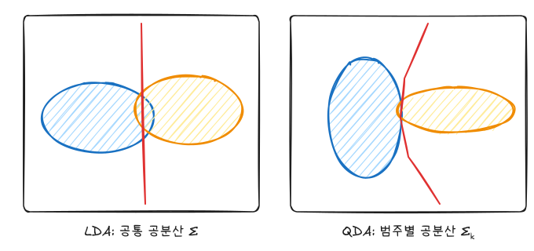
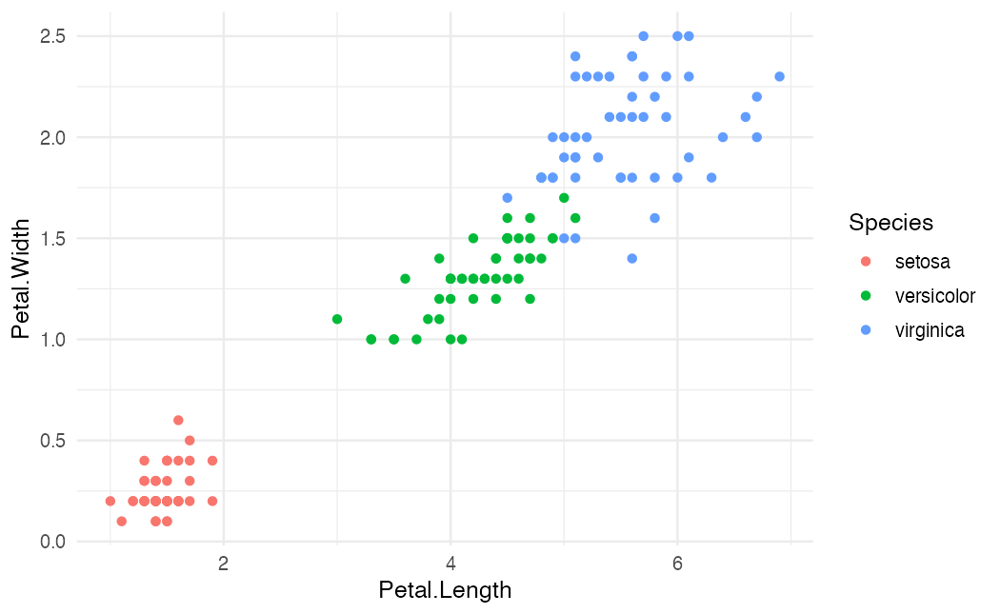
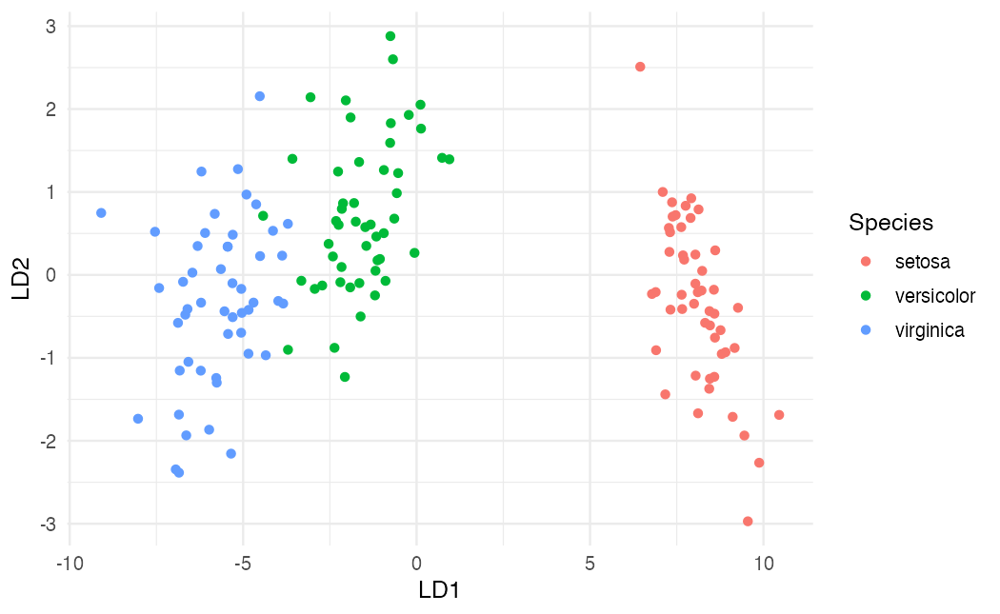
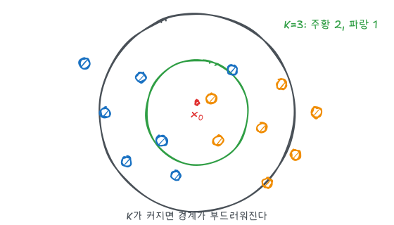
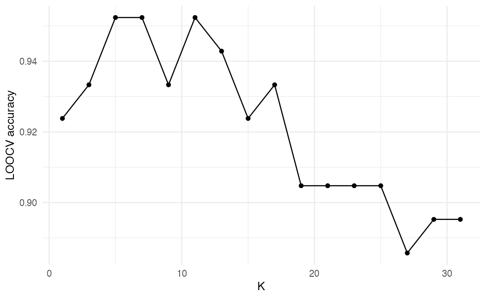
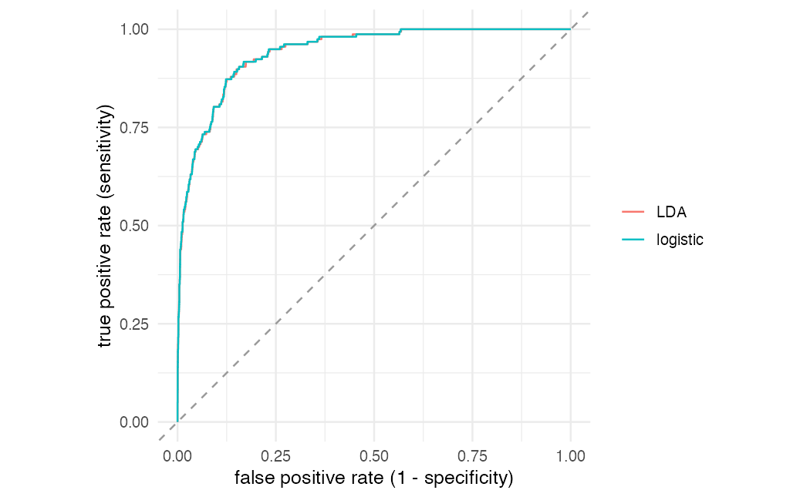

ISLR 2·4장과 이영미 교수님 데이터마이닝 강의의 분류 부분을 정리했다. 로지스틱 회귀가 $P(Y = k \mid X)$를 직접 모델링한다면, 판별분석은 범주별 $X$의 분포를 모델링한 뒤 베이즈 정리로 뒤집는다. KNN은 분포 가정 없이 가까운 관측값으로 추정한다.

## 베이즈 분류기

테스트 오분류율을 최소화하는 규칙은 사후확률이 가장 큰 범주를 고르는 것이다.

$$
\hat y = \arg\max_k P(Y = k \mid X = x)
$$

$\pi_k = P(Y = k)$를 사전확률, $f_k(x)$를 범주 $k$에서 $X$의 밀도라 하면 베이즈 정리로 다음과 같다.

$$
p_k(x) = P(Y = k \mid X = x) = \frac{\pi_k f_k(x)}{\sum_{l=1}^{K} \pi_l f_l(x)}
$$

분모는 모든 $k$에 공통이므로 $\pi_k f_k(x)$가 가장 큰 범주를 고르면 된다. $\pi_k$는 표본 비율로 쉽게 추정되므로, 문제는 $f_k(x)$를 어떻게 추정하느냐다.

## LDA와 QDA

$f_k$를 다변량 정규분포로 둔다.

| | LDA | QDA |
|---|---|---|
| 가정 | $X \mid Y = k \sim N(\mu_k, \Sigma)$ | $X \mid Y = k \sim N(\mu_k, \Sigma_k)$ |
| 공분산 | 모든 범주 공통 | 범주마다 다름 |
| 결정경계 | 선형 | 이차 |
| 공분산 모수 수 | $p(p+1)/2$ | $K \cdot p(p+1)/2$ |
| 성향 | 편향 큼, 분산 작음 | 편향 작음, 분산 큼 |



### LDA 판별함수

$\log(\pi_k f_k(x))$에서 $k$와 무관한 항을 지우면 다음 판별함수가 남는다.

$$
\delta_k(x) = x^T \Sigma^{-1} \mu_k - \frac{1}{2} \mu_k^T \Sigma^{-1} \mu_k + \log \pi_k
$$

$x$에 대해 1차식이므로 두 범주의 경계 $\delta_k(x) = \delta_l(x)$는 초평면이다. QDA에서는 $\Sigma_k$가 범주마다 달라 $-\frac{1}{2} x^T \Sigma_k^{-1} x$ 항이 지워지지 않고, 경계가 이차곡면이 된다.

추정은 $\hat\pi_k = n_k / n$, $\hat\mu_k$ = 범주별 표본평균, $\hat\Sigma$ = 범주별 편차를 합친 공통 표본공분산으로 한다.

### 로지스틱 회귀와 비교

두 범주 LDA의 로그 오즈도 $x$의 1차식이라 형태는 로지스틱 회귀와 같다. 차이는 추정 방법이다.

- 범주가 잘 분리되면 로지스틱 회귀의 가능도가 발산해 계수가 불안정해진다. LDA는 그렇지 않다.
- $n$이 작고 정규 가정이 대략 맞으면 LDA가 더 안정적이다.
- 정규 가정이 크게 틀리면 로지스틱 회귀가 낫다.
- 범주가 3개 이상일 때 LDA는 그대로 확장된다.

## iris 실습

```r
library(tidyverse)
theme_set(theme_minimal(base_size = 12))
library(MASS)
library(class)

iris |>
  ggplot(aes(Petal.Length, Petal.Width, color = Species)) +
  geom_point() +
  labs(x = "Petal.Length", y = "Petal.Width")
```



`MASS`는 `dplyr::select`를 가리므로 이 글에서는 `select`를 쓰지 않는다. 꽃잎 두 변수만으로도 세 품종이 꽤 잘 나뉜다.

```r
set.seed(1234)
train_id <- sample(nrow(iris), 0.7 * nrow(iris))
train <- iris[train_id, ]
test  <- iris[-train_id, ]

lda_fit <- lda(Species ~ ., data = train)
qda_fit <- qda(Species ~ ., data = train)
lda_fit

acc <- function(fit) mean(predict(fit, test)$class == test$Species)
c(LDA = acc(lda_fit), QDA = acc(qda_fit))
```

`lda_fit` 출력의 `Coefficients of linear discriminants`는 $\Sigma^{-1}$ 방향으로 정한 판별축(LD1, LD2)의 계수다. 범주가 $K$개면 판별축은 최대 $K-1$개다.

```r
proj <- predict(lda_fit, iris)$x
as_tibble(proj) |>
  mutate(Species = iris$Species) |>
  ggplot(aes(LD1, LD2, color = Species)) +
  geom_point()
```



LD1 한 축만으로도 세 품종이 거의 분리된다. LDA는 이렇게 범주 간 분리를 최대화하는 저차원 투영으로도 쓸 수 있다.

## KNN

$x_0$에서 가장 가까운 학습 관측값 $K$개의 집합을 $N_0$라 할 때, 조건부 확률을 이웃의 범주 비율로 추정한다.

$$
\hat P(Y = k \mid X = x_0) = \frac{1}{K} \sum_{i \in N_0} I(y_i = k)
$$



- $K = 1$이면 학습 오차는 0이지만 경계가 매우 울퉁불퉁하다(분산 큼).
- $K$가 커지면 경계가 부드러워지고, 너무 크면 국소 구조를 놓친다(편향 큼).
- 거리 기반이므로 단위가 다른 변수는 표준화해야 한다.
- $p$가 크면 "가까운 이웃"이 사실상 멀어져 성능이 급격히 떨어진다(차원의 저주).

### K 선택

`knn.cv()`는 학습 데이터에서 한 개씩 빼고 나머지로 예측하는 LOOCV를 수행한다.

```r
x_train <- scale(train[, 1:4])
x_test  <- scale(test[, 1:4],
                 center = attr(x_train, "scaled:center"),
                 scale  = attr(x_train, "scaled:scale"))

cv_acc <- tibble(k = seq(1, 31, 2)) |>
  mutate(acc = map_dbl(k, \(k) mean(knn.cv(x_train, train$Species, k = k) == train$Species)))

ggplot(cv_acc, aes(k, acc)) +
  geom_line() + geom_point() +
  labs(x = "K", y = "LOOCV accuracy")
```



테스트 데이터는 **학습 데이터의 평균과 표준편차로** 표준화한다. 테스트 데이터 자체로 표준화하면 테스트 정보를 학습에 쓰는 셈이 된다.

```r
best_k <- cv_acc$k[which.max(cv_acc$acc)]
pred <- knn(x_train, x_test, cl = train$Species, k = best_k)

table(predicted = pred, actual = test$Species)
mean(pred == test$Species)
```

정확도가 같은 $K$가 여럿이면 `which.max`는 가장 작은 $K$를 고른다. 비슷하다면 더 큰 $K$(더 단순한 경계)를 고르는 것도 방법이다.

## 나이브 베이즈

베이즈 분류기의 $f_k(x)$를 추정하는 또 다른 방법이다. **범주 안에서 설명 변수들이 서로 독립**이라고 가정한다.

$$
f_k(x) = f_{k1}(x_1) \times f_{k2}(x_2) \times \cdots \times f_{kp}(x_p)
$$

$p$차원 결합밀도 대신 1차원 밀도 $p$개만 추정하면 된다. 각 $f_{kj}$는 연속형이면 정규분포나 커널 밀도로, 범주형이면 범주별 비율로 추정한다. 독립 가정은 대부분 틀리지만, 추정할 모수가 크게 줄어 분산이 작아지므로 $n$이 $p$에 비해 작을 때 의외로 잘 작동한다. 정규분포를 쓰는 나이브 베이즈는 공분산행렬이 대각행렬인 QDA와 같다.

```r
library(e1071)

nb_fit <- naiveBayes(Species ~ ., data = train)
nb_fit$tables$Petal.Length
mean(predict(nb_fit, test) == test$Species)
```

`tables`에는 범주별로 각 변수의 평균(첫 열)과 표준편차(둘째 열)가 들어 있다.

## ROC 곡선과 AUC

이진 분류기는 예측확률에 기준값을 적용해 범주를 정한다. 기준값을 0에서 1까지 움직이며 **참양성률(민감도)** 과 **거짓양성률(1 - 특이도)** 을 그린 것이 ROC 곡선이다. 곡선 아래 면적(AUC)은 기준값과 무관한 성능 요약이며, "무작위로 뽑은 양성 관측값의 점수가 무작위로 뽑은 음성 관측값의 점수보다 클 확률"과 같다.

`ISLR2::Default`에서 로지스틱 회귀와 LDA를 비교한다.

```r
library(ISLR2)

set.seed(1)
d_idx <- sample(nrow(Default), 5000)
d_train <- Default[d_idx, ]
d_test  <- Default[-d_idx, ]
y_test <- d_test$default == "Yes"

scores <- list(
  logistic = predict(glm(default ~ ., data = d_train, family = binomial), d_test, type = "response"),
  LDA      = predict(lda(default ~ ., data = d_train), d_test)$posterior[, "Yes"]
)

roc_df <- function(score, name) {
  cuts <- sort(unique(c(0, score, 1)), decreasing = TRUE)
  tibble(cut = cuts,
         tpr = map_dbl(cuts, \(c) mean(score[y_test] >= c)),
         fpr = map_dbl(cuts, \(c) mean(score[!y_test] >= c)),
         model = name)
}
auc <- function(score) mean(outer(score[y_test], score[!y_test], ">") + 0.5 * outer(score[y_test], score[!y_test], "=="))

map_dbl(scores, auc)

imap_dfr(scores, roc_df) |>
  ggplot(aes(fpr, tpr, color = model)) +
  geom_path() +
  geom_abline(linetype = "dashed", color = "grey60") +
  coord_equal() +
  labs(x = "false positive rate (1 - specificity)", y = "true positive rate (sensitivity)", color = NULL)
```



`auc()`는 양성·음성 점수의 모든 쌍을 비교해 위의 확률 해석을 그대로 계산한다(동점은 0.5). 두 모형의 AUC가 약 0.94로 거의 같다. 대각선은 무작위 분류기(AUC = 0.5)다. 연체 비율이 3%대로 불균형하므로 정확도보다 ROC/AUC나 민감도를 보는 것이 의미 있다.

## 방법 비교

| 방법 | 경계 | 가정 | 잘 맞는 상황 |
|---|---|---|---|
| 로지스틱 | 선형 | $P(Y \mid X)$의 로짓이 선형 | 이진, 해석 필요 |
| LDA | 선형 | 정규, 공통 공분산 | $n$ 작음, 다범주 |
| QDA | 이차 | 정규, 범주별 공분산 | $n$ 큼, 범주별 퍼짐이 다름 |
| 나이브 베이즈 | 비선형 가능 | 범주 내 변수 독립 | $p$가 크고 $n$이 작음 |
| KNN | 비모수 | 없음 (거리) | 경계가 복잡, $p$ 작음 |
