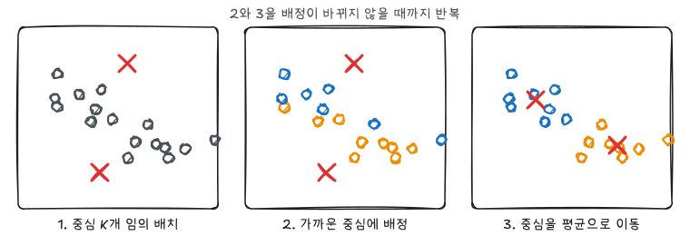
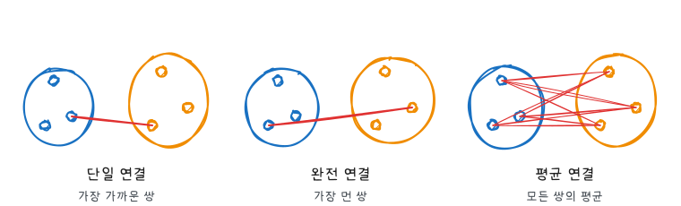
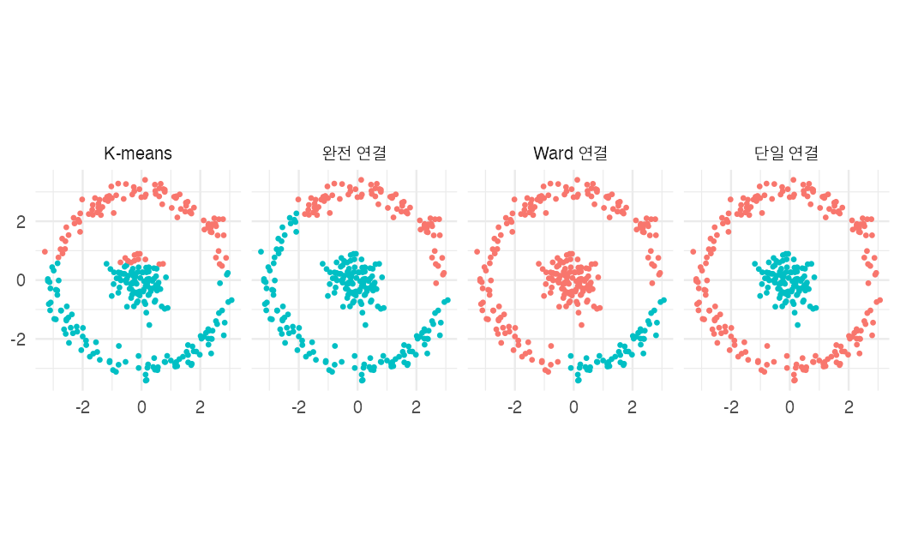
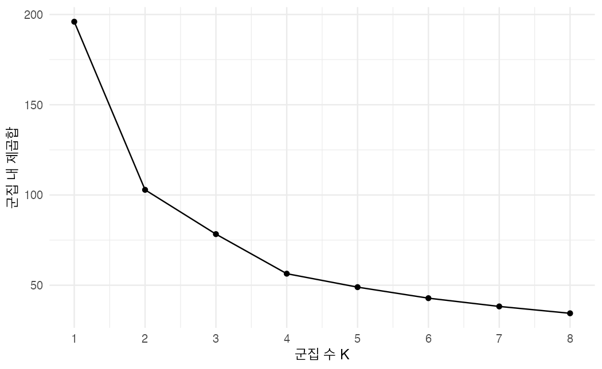
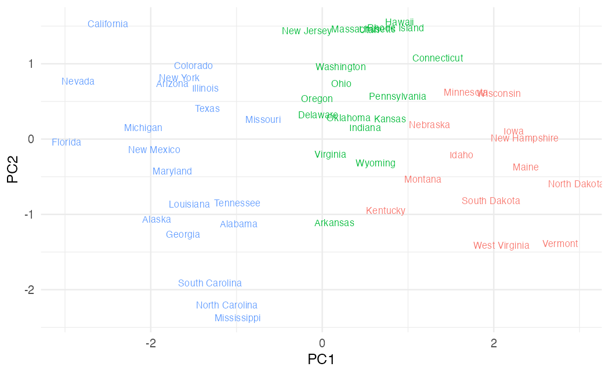
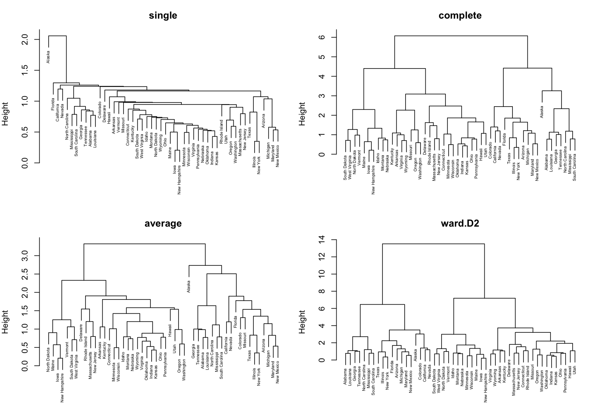
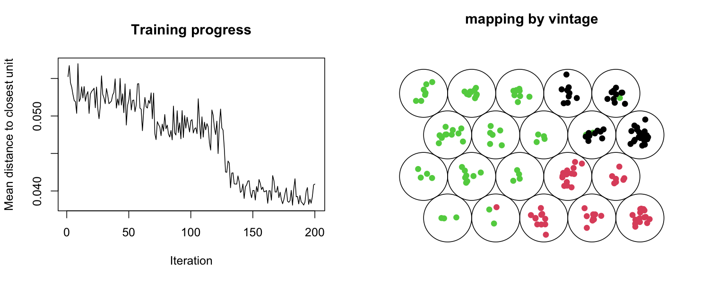
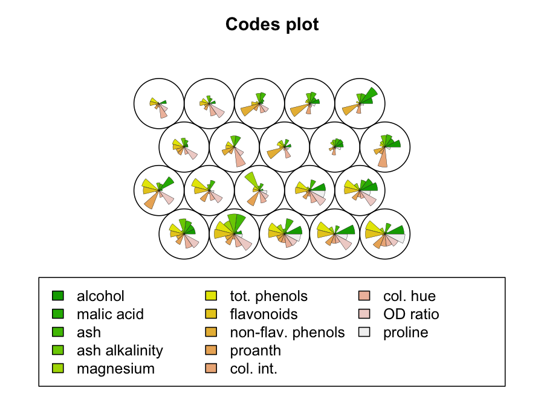

ISLR 12장과 이영미 교수님 데이터마이닝 강의의 군집분석 부분을 정리했다.

## 개요

군집분석은 반응 변수 없이 서로 비슷한 관측값끼리 묶는 비지도학습이다. 정답이 없으므로 "비슷하다"를 어떻게 정의하는지(거리), 몇 개로 묶는지(군집 수), 어떤 모양의 군집을 허용하는지가 결과를 좌우한다. 세 방법은 이 질문들에 다르게 답한다.

| | K-means | 계층적 군집 | SOM |
|---|---|---|---|
| 접근 | 분할: 목적함수 최소화 | 병합: 가까운 군집부터 차례로 합침 | 격자 위 노드로 자료를 근사 |
| 군집 수 | 미리 $K$를 정함 | 덴드로그램을 잘라 사후에 정함 | 격자 크기를 정하고 노드를 다시 묶음 |
| 군집의 형태 | 둥글고 크기가 비슷함 | 연결 방법에 따라 다름 | 노드 단위로 유연 |
| 결과의 결정성 | 초기값에 따라 다름 | 결정적 | 초기값·학습 순서에 따라 다름 |
| 추가 산출물 | 군집 중심 | 전체 병합 구조 | 군집 간 위치 관계 (2차원 지도) |

## 1. 거리와 표준화

| 거리 | 식 | 특징 |
|---|---|---|
| 유클리드 | $\sqrt{\sum_j(x_j - y_j)^2}$ | 가장 일반적 |
| 맨해튼 | $\sum_j\lvert x_j - y_j\rvert$ | 이상값의 영향이 작음 |
| 상관 기반 | $1 - \text{cor}(x, y)$ | 크기보다 변화의 패턴이 비슷한지를 봄 |

거리는 변수의 단위에 크게 좌우된다. 수백 단위의 변수와 0~1 사이의 비율을 함께 쓰면 큰 단위의 변수만으로 군집이 정해지므로, 단위가 다른 변수는 표준화한 뒤 거리를 계산한다. 세 방법 모두에 공통으로 적용되는 결정이다.

## 2. K-means

군집 수 $K$를 정하고, 군집 내 제곱합의 총합을 최소화하도록 관측값을 $C_1, \dots, C_K$로 나눈다.

$$
\min_{C_1, \dots, C_K}\sum_{k=1}^{K}\sum_{i \in C_k}\lVert x_i - \bar x_k\rVert^2
$$

가능한 분할을 모두 비교할 수 없으므로 다음 알고리즘으로 근사한다.



1. 중심 $K$개를 임의로 정한다.
2. 각 관측값을 가장 가까운 중심의 군집에 배정한다.
3. 각 군집의 평균으로 중심을 옮긴다.
4. 배정이 바뀌지 않을 때까지 2~3을 반복한다.

각 단계에서 목적함수가 감소하므로 알고리즘은 반드시 수렴하지만, 전역 최솟값이 아니라 **국소 최솟값**에서 멈출 수 있다. 그래서 초기값을 바꿔 여러 번 실행하고(`nstart`) 목적함수가 가장 작은 결과를 쓴다.

목적함수가 중심까지의 제곱거리이므로 K-means는 각 군집을 중심 주위의 둥근 덩어리로 본다. 길게 늘어지거나 휘어진 군집, 크기가 매우 다른 군집은 잘 찾지 못한다.

## 3. 계층적 군집

$K$를 미리 정하지 않는다. 각 관측값을 하나의 군집으로 시작해 가장 가까운 두 군집을 합치는 과정을 하나가 될 때까지 반복한다(병합형). 이 과정을 나무 모양으로 그린 것이 **덴드로그램**이며, 원하는 높이에서 자르면 군집이 정해진다. 한 번의 계산으로 모든 $K$에 대한 결과를 얻는다.

관측값 사이의 거리는 정해져 있지만 **군집 사이의 거리**는 따로 정의해야 한다. 이것이 연결 방법이며, 계층적 군집의 결과는 연결 방법에 크게 좌우된다.



| 연결 | 군집 간 거리 | 만들어지는 군집 |
|---|---|---|
| 단일 | 가장 가까운 쌍 | 길게 이어지는 군집, 사슬 효과 |
| 완전 | 가장 먼 쌍 | 크기가 비슷하고 둥근 군집 |
| 평균 | 모든 쌍 거리의 평균 | 단일과 완전의 중간 |
| Ward | 합쳤을 때 군집 내 제곱합의 증가량 | K-means와 비슷한 둥근 군집 |

Ward 연결은 K-means와 같은 목적함수(군집 내 제곱합)를 탐욕적으로 줄여 나가는 방법이다. 단일 연결은 두 군집의 가장 가까운 점만 보므로 둥글지 않은 군집도 이어서 찾을 수 있지만, 잡음 점 하나가 다리를 놓으면 서로 다른 군집이 합쳐진다.

덴드로그램에서 해석할 것은 **두 군집이 합쳐지는 높이**다. 가로로 가까이 놓인 잎이라도 높은 곳에서 합쳐졌다면 비슷하지 않다. 또한 계층적 군집은 군집들이 포개진 계층 구조를 가정하므로, 자료가 그런 구조가 아니면(예: 성별로 나누는 것과 국적으로 나누는 것이 교차하는 경우) 어떤 높이에서 잘라도 좋은 군집이 나오지 않을 수 있다.

## 4. 자기조직화지도 (SOM)

SOM은 2차원 격자 위의 노드마다 입력과 같은 차원의 가중치 벡터 $w_j$를 두고, 비슷한 관측값이 격자에서 가까운 노드에 놓이도록 학습한다. 관측값 $x$를 하나 넣을 때마다

1. 가장 가까운 노드(BMU)를 찾는다: $c = \arg\min_j\lVert x - w_j\rVert^2$
2. BMU와 격자에서 그 이웃인 노드들의 가중치를 $x$ 쪽으로 당긴다.

$$
w_j \leftarrow w_j + \alpha(t)\,h_{cj}(t)\,(x - w_j)
$$

$\alpha(t)$는 학습률, $h_{cj}(t)$는 BMU $c$와 노드 $j$의 격자 거리가 멀수록 작아지는 이웃 함수이며 둘 다 반복할수록 줄어든다.

이웃 함수를 0으로 두면(BMU만 갱신) SOM은 온라인 K-means와 같다. 이웃까지 함께 움직이는 것이 SOM의 핵심이며, 이 때문에 격자에서 가까운 노드는 비슷한 가중치를 갖게 된다. 즉 K-means가 군집의 중심만 남긴다면, SOM은 **군집들 사이의 위치 관계**를 2차원 지도로 보존한다. 군집분석과 차원축소를 함께 하는 셈이다.

### 손으로 계산하는 SOM (강의 예제)

입력벡터 4개를 출력 노드 2개로 군집화한다. 이웃 없이 BMU만 갱신하는 가장 단순한 형태다.

- 입력벡터: $x_1 = (1,0,0,1)$, $x_2 = (0,0,1,1)$, $x_3 = (0,1,0,1)$, $x_4 = (0,0,1,0)$
- 초기 가중벡터: $w_1 = (0.5, 0.3, 0.6, 0.2)$, $w_2 = (0.1, 0.7, 0.8, 0.2)$
- 학습률: $\alpha(1) = 0.6$, 입력 4개를 한 번 다 돌 때마다 $\alpha(t + 1) = 0.4\,\alpha(t)$
- 갱신: $w_c^{new} = w_c + \alpha(t)(x - w_c)$

| 입력 | $D_1 = \lVert x - w_1\rVert^2$ | $D_2 = \lVert x - w_2\rVert^2$ | BMU | 갱신된 가중벡터 |
|---|---:|---:|:---:|---|
| $x_1 = (1,0,0,1)$ | 1.34 | 2.58 | 1 | $w_1 = (0.8, 0.12, 0.24, 0.68)$ |
| $x_2 = (0,0,1,1)$ | 1.3344 | 1.18 | 2 | $w_2 = (0.04, 0.28, 0.92, 0.68)$ |
| $x_3 = (0,1,0,1)$ | 1.5744 | 1.4688 | 2 | $w_2 = (0.016, 0.712, 0.368, 0.872)$ |
| $x_4 = (0,0,1,0)$ | 1.6944 | 1.6670 | 2 | $w_2 = (0.0064, 0.2848, 0.7472, 0.3488)$ |

첫 번째 줄을 풀어 쓰면

$$
D_1 = (1 - 0.5)^2 + (0 - 0.3)^2 + (0 - 0.6)^2 + (1 - 0.2)^2 = 1.34, \qquad
w_1^{new} = \begin{pmatrix}0.5\\0.3\\0.6\\0.2\end{pmatrix} + 0.6\begin{pmatrix}0.5\\-0.3\\-0.6\\0.8\end{pmatrix} = \begin{pmatrix}0.8\\0.12\\0.24\\0.68\end{pmatrix}
$$

이다. 한 바퀴가 끝나면 $\alpha(2) = 0.24$로 줄이고 다시 $x_1$부터 반복한다. 학습률이 빠르게 줄어 몇 바퀴 만에 가중벡터가 안정되고, $x_1$은 노드 1에, $x_2, x_3, x_4$는 노드 2에 배정된다.

## 5. 방법 간 비교

| 구분 | K-means | 계층적 (완전·Ward) | 계층적 (단일) | SOM |
|---|---|---|---|---|
| 최적화 대상 | 군집 내 제곱합 | 연결 기준에 따른 탐욕적 병합 | 최근접 거리에 따른 병합 | 양자화 오차 + 이웃 보존 |
| 군집 수 | 사전 지정 | 사후 선택 | 사후 선택 | 격자 크기 + 사후 묶음 |
| 군집 형태 | 볼록, 둥근 형태 | 볼록, 둥근 형태 | 임의 형태 (사슬) | 노드 단위로 유연 |
| 이상값·잡음 | 중심을 끌어당김 | 비교적 강건 | 매우 민감 (다리 효과) | 비교적 강건 |
| 결정성 | 초기값 의존 | 결정적 | 결정적 | 초기값·순서 의존 |
| 계산량 | $O(nKp)$ 반복 | $O(n^2)$ 메모리 | $O(n^2)$ 메모리 | $O(n \times$ 노드 수$)$ 반복 |
| 큰 자료 | 적합 | 어려움 | 어려움 | 적합 |

## 6. 자료를 이용한 비교

```r
library(tidyverse)
theme_set(theme_minimal(base_size = 12))
library(kohonen)

# 군집 결과와 참 범주의 일치도 (수정 랜드 지수)
ari <- function(a, b) {
  tab <- table(a, b); n <- sum(tab)
  sum_c <- sum(choose(tab, 2))
  sa <- sum(choose(rowSums(tab), 2)); sb <- sum(choose(colSums(tab), 2))
  expected <- sa * sb / choose(n, 2)
  (sum_c - expected) / ((sa + sb) / 2 - expected)
}
```

수정 랜드 지수(ARI)는 두 분할이 같은 쌍을 같은 군집으로 묶는 정도를 우연에 의한 일치를 보정해 잰 값이다. 1이면 완전히 일치하고, 0이면 무작위 수준이다. 군집 번호가 임의로 붙어도 영향을 받지 않는다.

### 군집의 모양: 동심원 자료

K-means와 연결 방법들이 가정하는 군집의 모양이 다르다는 것을, 바깥 고리와 안쪽 덩어리로 이루어진 모의자료로 확인한다.

```r
set.seed(3)
theta <- runif(300, 0, 2 * pi)
rings <- bind_rows(
  tibble(x1 = 3 * cos(theta[1:200]) + rnorm(200, sd = 0.2),
         x2 = 3 * sin(theta[1:200]) + rnorm(200, sd = 0.2), 참 = "바깥"),
  tibble(x1 = rnorm(100, sd = 0.5), x2 = rnorm(100, sd = 0.5), 참 = "안쪽")
)
dr <- dist(rings[, 1:2])

shape_res <- tibble(
  `K-means` = kmeans(rings[, 1:2], 2, nstart = 25)$cluster,
  `완전 연결` = cutree(hclust(dr, "complete"), 2),
  `Ward 연결` = cutree(hclust(dr, "ward.D2"), 2),
  `단일 연결` = cutree(hclust(dr, "single"), 2)
)
map_dbl(shape_res, \(cl) ari(cl, rings$참))

shape_res |>
  bind_cols(rings) |>
  pivot_longer(1:4, names_to = "방법", values_to = "군집") |>
  mutate(방법 = fct_inorder(방법)) |>
  ggplot(aes(x1, x2, color = factor(군집))) +
  geom_point(size = 0.8, show.legend = FALSE) +
  facet_wrap(~방법, nrow = 1) +
  coord_equal() +
  labs(x = NULL, y = NULL)
```



| 방법 | ARI |
|---|---|
| K-means | 0.04 |
| 완전 연결 | 0.03 |
| Ward 연결 | −0.05 |
| 단일 연결 | **1.00** |

K-means, 완전 연결, Ward 연결은 모두 원을 반으로 가르듯 나누어 참 구조와 거의 일치하지 않는다(ARI ≈ 0). 세 방법 모두 군집을 중심 주위의 둥근 덩어리로 보기 때문이다. 바깥 고리는 중심이 원점에 있는 넓게 퍼진 집합이므로, 군집 내 제곱합을 줄이는 기준으로는 고리 전체를 하나로 묶는 것보다 안쪽 덩어리와 고리의 일부를 합치는 쪽이 유리하다. 단일 연결은 가장 가까운 점끼리 이어 나가므로 고리를 따라 사슬처럼 연결해 두 군집을 정확히 찾는다(ARI = 1).

### 초기값에 따른 K-means의 변동

```r
x_us <- scale(USArrests)
km_obj <- map_dbl(1:100, \(s) { set.seed(s); kmeans(x_us, 4, nstart = 1)$tot.withinss })
summary(km_obj)
mean(abs(km_obj - min(km_obj)) < 1e-6)
```

표준화한 `USArrests`에 $K = 4$, `nstart = 1`로 K-means를 100번 실행하면 군집 내 제곱합이 56.4에서 78.0까지 나온다. 최솟값 56.4에 도달한 비율은 67%이고, 나머지 33%는 국소 최솟값에 갇힌다. `nstart`를 충분히 크게 하지 않으면 같은 자료에서도 실행할 때마다 다른 군집이 나올 수 있다. 계층적 군집은 같은 거리와 연결 방법에 대해 항상 같은 결과를 준다.

### USArrests: K-means와 계층적 군집의 결과 비교

R 내장 자료 `USArrests`는 미국 50개 주의 인구 10만 명당 살인·폭행·강간 체포 건수와 도시 인구 비율이다. `Assault`는 수백 단위, 나머지는 수십 단위라 표준화한다.

```r
set.seed(1)
wss <- map_dbl(1:8, \(k) kmeans(x_us, centers = k, nstart = 25)$tot.withinss)

tibble(k = 1:8, wss) |>
  ggplot(aes(k, wss)) +
  geom_line() + geom_point() +
  scale_x_continuous(breaks = 1:8) +
  labs(x = "군집 수 K", y = "군집 내 제곱합")
```



군집 내 제곱합은 $K$가 커지면 항상 줄어든다. 감소폭이 급격히 작아지는 지점(팔꿈치)을 $K$의 후보로 보는데, 여기서는 $K = 2$에서 가장 크게 꺾이고 $K = 4$ 이후로 완만해진다. 해석을 위해 $K = 3$을 쓴다.

```r
set.seed(1)
km <- kmeans(x_us, centers = 3, nstart = 25)
aggregate(USArrests, by = list(cluster = km$cluster), FUN = mean)

pc <- prcomp(x_us)
as_tibble(pc$x[, 1:2]) |>
  mutate(state = rownames(x_us), cluster = factor(km$cluster)) |>
  ggplot(aes(PC1, PC2, color = cluster, label = state)) +
  geom_text(size = 2.8, show.legend = FALSE)
```



| 군집 | 살인 | 폭행 | 도시 인구 | 강간 | 성격 |
|---|---|---|---|---|---|
| 1 | 3.6 | 78.5 | 52.1 | 12.2 | 범죄 적음, 농촌 |
| 2 | 5.8 | 141.9 | 72.5 | 18.8 | 범죄 중간, 도시 |
| 3 | 12.2 | 255.3 | 68.4 | 29.2 | 범죄 많음 |

```r base w=10 h=7
d_us <- dist(x_us)
par(mfrow = c(2, 2), mar = c(1, 4, 3, 1))
for (m in c("single", "complete", "average", "ward.D2")) {
  plot(hclust(d_us, method = m), main = m, xlab = "", sub = "", cex = 0.5)
}
```



단일 연결은 주가 하나씩 차례로 붙는 사슬 모양이고, 완전 연결과 Ward는 크기가 비슷한 군집을 만든다. `ward.D2`는 제곱하지 않은 거리를 받아 내부에서 제곱한다.

```r
hc_cl <- purrr::map(c(single = "single", complete = "complete", average = "average", ward = "ward.D2"),
             \(m) cutree(hclust(d_us, m), 3))
purrr::map(hc_cl, table)
map_dbl(hc_cl, \(cl) ari(cl, km$cluster))
table(kmeans = km$cluster, complete = hc_cl$complete)
```

| 연결 | 군집 크기 | K-means와의 ARI |
|---|---|---|
| 단일 | 48, 1, 1 | −0.01 |
| 완전 | 8, 11, 31 | 0.39 |
| 평균 | 19, 1, 30 | 0.61 |
| Ward | 19, 19, 12 | **0.88** |

같은 거리 행렬에서도 연결 방법에 따라 군집이 크게 다르다. 단일 연결은 48개 주를 한 군집으로 묶고 고립된 주 두 개만 따로 떼어 내며, 평균 연결도 하나짜리 군집을 만든다. 완전 연결은 K-means의 군집 1·2(범죄가 적거나 중간인 주)를 하나로 합치고 범죄가 많은 군집을 둘로 나눈다. 같은 목적함수를 탐욕적으로 줄이는 Ward 연결이 K-means와 가장 비슷하다(ARI 0.88).

### wines: 참 범주와의 일치도

`kohonen` 패키지의 `wines`는 이탈리아 와인 177종의 화학 성분 13개이고, `vintages`는 품종(3종)이다. 품종 정보를 쓰지 않고 군집화한 뒤 품종과 얼마나 일치하는지 ARI로 비교한다.

```r
data(wines)
wines_sc <- scale(wines)
dw <- dist(wines_sc)

set.seed(7)
wine_som <- som(wines_sc, grid = somgrid(5, 4, topo = "hexagonal"), rlen = 200)
som_cl <- cutree(hclust(dist(getCodes(wine_som)), "ward.D2"), 3)[wine_som$unit.classif]

set.seed(1)
wine_res <- c(
  `K-means` = ari(kmeans(wines_sc, 3, nstart = 25)$cluster, vintages),
  `단일 연결` = ari(cutree(hclust(dw, "single"), 3), vintages),
  `완전 연결` = ari(cutree(hclust(dw, "complete"), 3), vintages),
  `평균 연결` = ari(cutree(hclust(dw, "average"), 3), vintages),
  `Ward 연결` = ari(cutree(hclust(dw, "ward.D2"), 3), vintages),
  `SOM + Ward` = ari(som_cl, vintages)
)
round(wine_res, 3)
```

| 방법 | ARI (품종과의 일치도) |
|---|---|
| K-means | **0.897** |
| Ward 연결 | 0.788 |
| SOM + Ward | 0.739 |
| 완전 연결 | 0.550 |
| 평균 연결 | −0.006 |
| 단일 연결 | −0.007 |

품종별 화학 성분이 각각의 중심 주위에 뭉쳐 있는 자료이므로, 둥근 군집을 가정하는 K-means와 Ward 연결이 품종을 가장 잘 복원한다. 단일 연결과 평균 연결은 ARI가 0에 가까운데, 결과를 보면 대부분의 관측값이 한 군집에 들어가고 나머지 두 군집은 이상값 몇 개로 이루어진다. 13차원에서 품종 사이를 잇는 점들이 사슬 효과를 일으켜 큰 군집 하나로 합쳐지기 때문이다. 동심원 자료에서 단일 연결이 유일하게 성공했던 것과 정반대의 결과로, 군집 방법의 우열은 자료의 군집 형태에 따라 뒤바뀐다. SOM은 20개 노드로 자료를 요약한 뒤 묶었으므로 K-means보다 다소 낮지만, 아래와 같이 품종 사이의 위치 관계까지 보여 준다.

```r base w=10 h=4
par(mfrow = c(1, 2))
plot(wine_som, type = "changes")
plot(wine_som, type = "mapping", col = as.integer(vintages), pch = 19,
     main = "mapping by vintage")
```



왼쪽은 반복에 따라 관측값과 BMU 사이의 평균 거리가 줄어드는 과정이다. 오른쪽에서 품종 정보는 학습에 쓰지 않았는데도 같은 품종이 격자의 같은 구역에 모인다.

```r base w=6 h=4.5
plot(wine_som, type = "codes")
```



노드마다 13개 성분의 가중치를 부채꼴로 보여 준다. 격자의 구역별로 어떤 성분이 높은지 읽을 수 있는데, 이것이 K-means의 군집 중심만으로는 얻을 수 없는 정보다.

## 7. 결과의 해석

| 관찰된 결과 | 원인 |
|---|---|
| 동심원 자료에서 단일 연결만 성공 | 최근접 거리로 이어 붙이므로 볼록하지 않은 군집도 찾음 |
| 동심원 자료에서 K-means·완전·Ward 연결이 실패 | 군집을 중심 주위의 둥근 덩어리로 가정 |
| wines에서 K-means·Ward 연결이 가장 우수 | 품종별 자료가 중심 주위에 뭉친 둥근 군집 |
| wines에서 단일·평균 연결이 거의 무작위 수준 | 고차원에서 사슬 효과로 대부분의 관측값이 한 군집으로 합쳐짐 |
| K-means가 실행마다 다른 결과를 줌 | 알고리즘이 국소 최솟값에서 멈춤 |
| SOM이 품종 정보 없이 품종별 구역을 형성 | 이웃 갱신으로 비슷한 관측값이 격자의 가까운 노드에 모임 |
| 연결 방법에 따라 덴드로그램의 모양이 크게 다름 | 군집 간 거리의 정의가 병합 순서를 결정 |

어느 방법이 우수한지는 정해져 있지 않고 **자료의 군집이 어떤 모양인가**에 달려 있다. 군집분석은 정답이 없는 탐색적 분석이므로, 여러 방법의 결과를 비교하고 공통으로 나타나는 구조를 신뢰하는 것이 안전하다.

## 8. 방법의 선택

| 상황 | 적합한 방법 |
|---|---|
| 자료가 크고 군집이 둥근 덩어리라고 볼 수 있음 | K-means (`nstart`를 충분히) |
| 군집 수를 모르며 병합 구조 자체를 보고 싶음 | 계층적 군집 (완전·Ward·평균 연결) |
| 군집이 길게 이어지거나 휘어 있음 | 단일 연결 (잡음이 적을 때) |
| 군집 간 관계를 지도처럼 시각화하고 싶음 | SOM |
| 결과의 재현성이 중요함 | 계층적 군집, 또는 K-means의 시드 고정과 큰 `nstart` |
| 어느 경우든 | 표준화 여부와 거리를 먼저 정하고, 여러 방법의 결과를 비교 |

## 정리

| | K-means | 계층적 군집 | SOM |
|---|---|---|---|
| 정해야 할 것 | $K$, `nstart` | 거리, 연결 방법, 자를 높이 | 격자 크기, 학습률, 반복 수 |
| 군집 형태 | 둥근 덩어리 | 연결 방법에 따름 | 노드 단위로 유연 |
| 결정성 | 초기값 의존 | 결정적 | 초기값 의존 |
| 고유한 산출물 | 군집 중심 | 덴드로그램 | 2차원 지도 |
