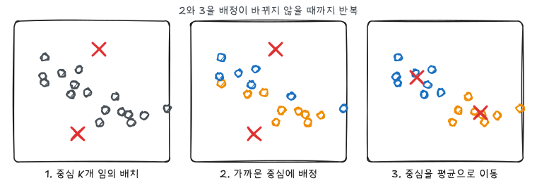
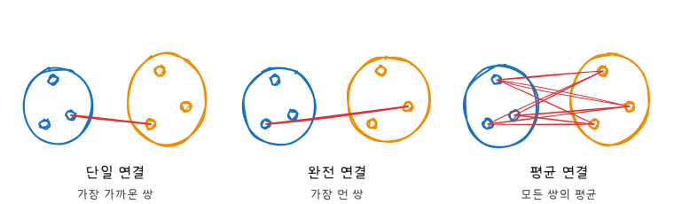
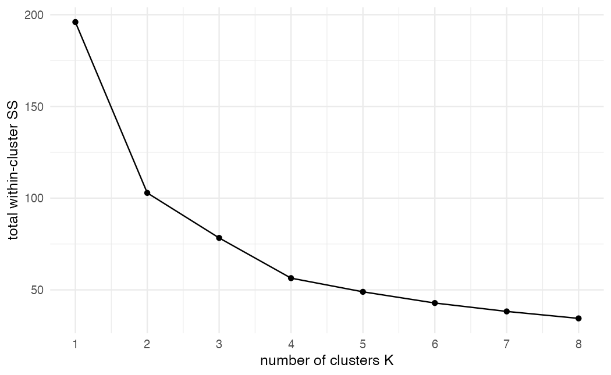
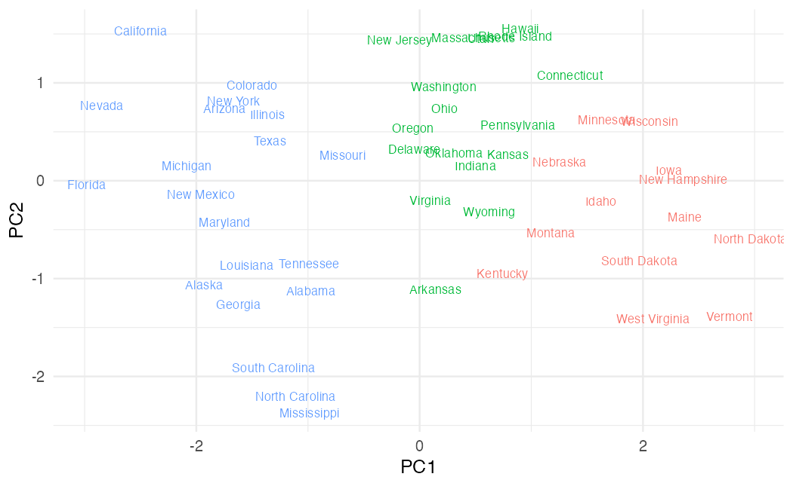
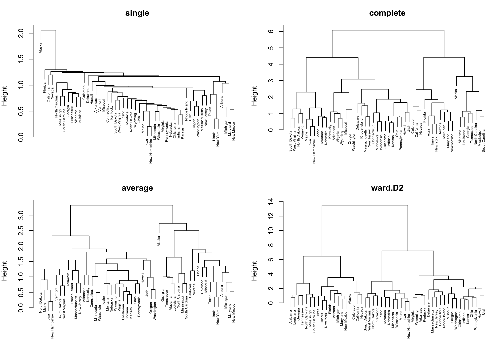
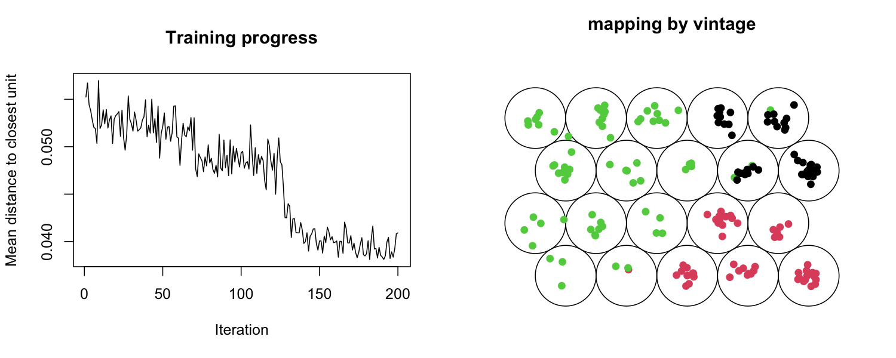
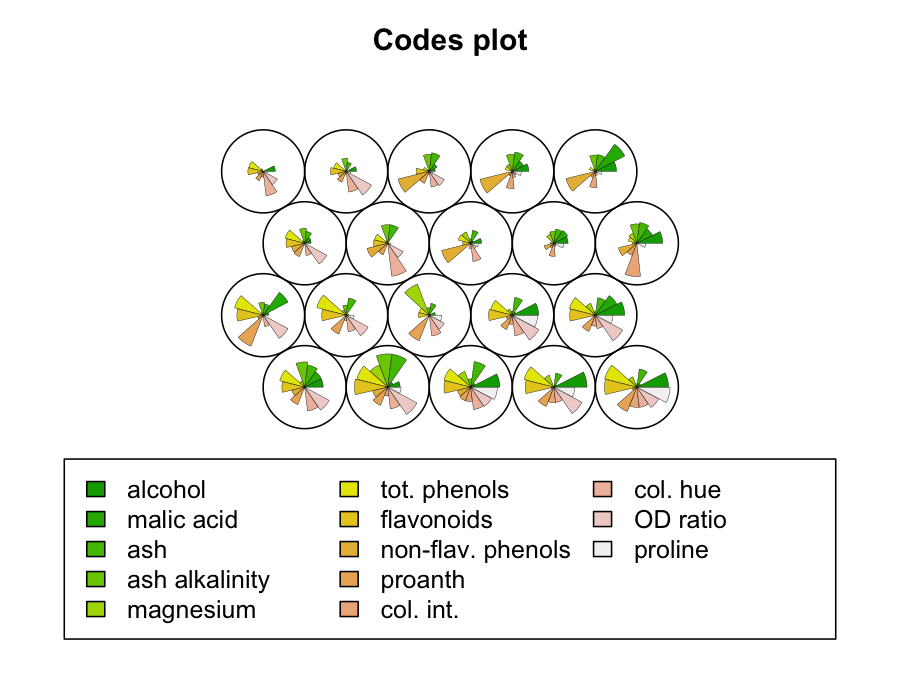

ISLR 12장과 이영미 교수님 데이터마이닝 강의의 군집분석 부분을 정리했다. 군집분석은 반응 변수 없이 서로 비슷한 관측값끼리 묶는 비지도학습이다. 정답이 없으므로 "비슷하다"를 어떻게 정의하느냐(거리), 몇 개로 묶느냐(군집 수)가 결과를 좌우한다.

## 거리와 표준화

| 거리 | 식 | 특징 |
|---|---|---|
| 유클리드 | $\sqrt{\sum_j (x_j - y_j)^2}$ | 가장 일반적 |
| 맨해튼 | $\sum_j \lvert x_j - y_j \rvert$ | 이상값 영향이 작다 |
| 상관 기반 | $1 - \text{cor}(x, y)$ | 크기보다 패턴(모양)이 비슷한지 |

거리는 변수 단위에 크게 좌우된다. 범죄 건수(수백)와 비율(0~1)을 그대로 쓰면 범죄 건수만으로 군집이 정해진다. 단위가 다른 변수는 보통 표준화한 뒤 거리를 계산한다.

## K-means

군집 수 $K$를 정하고, 군집 내 변동의 합을 최소화하도록 관측값을 $C_1, \dots, C_K$에 나눈다.

$$
\min_{C_1, \dots, C_K} \sum_{k=1}^{K} \sum_{i \in C_k} \lVert x_i - \bar x_k \rVert^2
$$

모든 분할을 비교할 수는 없으므로 다음 알고리즘으로 근사한다.



1. 중심 $K$개를 임의로 정한다(또는 각 관측값을 임의의 군집에 배정한다).
2. 각 관측값을 가장 가까운 중심의 군집에 배정한다.
3. 각 군집의 평균으로 중심을 옮긴다.
4. 배정이 바뀌지 않을 때까지 2~3을 반복한다.

각 단계에서 목적함수가 줄어들기만 하므로 알고리즘은 반드시 멈춘다. 하지만 전역 최솟값이 아니라 **국소 최솟값**에서 멈출 수 있어 초기값을 바꿔 여러 번 돌리고(`nstart`) 목적함수가 가장 작은 결과를 쓴다.

## 계층적 군집

$K$를 미리 정하지 않는다. 각 관측값을 하나의 군집으로 시작해, 가장 가까운 두 군집을 합치는 일을 하나가 될 때까지 반복한다(병합형). 그 과정을 나무 모양으로 그린 것이 **덴드로그램**이고, 원하는 높이에서 자르면 군집이 정해진다.

관측값 사이의 거리는 정해져 있지만 **군집 사이의 거리**는 정의해야 한다. 이것이 연결 방법이다.



| 연결 | 군집 간 거리 | 특징 |
|---|---|---|
| 단일 | 가장 가까운 쌍 | 길게 이어지는 군집, 사슬 효과 |
| 완전 | 가장 먼 쌍 | 크기가 비슷하고 둥근 군집 |
| 평균 | 모든 쌍 거리의 평균 | 단일과 완전의 중간 |
| Ward | 합쳤을 때 군집 내 제곱합 증가량 | K-means와 비슷한 둥근 군집 |

덴드로그램에서 해석할 것은 **두 군집이 합쳐지는 높이**다. 가로 방향으로 가까이 놓인 잎이라도 높은 곳에서 합쳐졌다면 비슷하지 않다.

## USArrests 실습

R 내장 데이터 `USArrests`는 미국 50개 주의 인구 10만 명당 살인·폭행·강간 체포 건수와 도시 인구 비율이다.

```r
library(tidyverse)
theme_set(theme_minimal(base_size = 12))

summary(USArrests)
x <- scale(USArrests)
```

`Assault`는 수백 단위, 나머지는 수십 단위라 표준화한다.

### K-means와 K 선택

```r
set.seed(1)
wss <- map_dbl(1:8, \(k) kmeans(x, centers = k, nstart = 25)$tot.withinss)

tibble(k = 1:8, wss) |>
  ggplot(aes(k, wss)) +
  geom_line() + geom_point() +
  scale_x_continuous(breaks = 1:8) +
  labs(x = "number of clusters K", y = "total within-cluster SS")
```



$K$가 커지면 군집 내 제곱합은 항상 줄어든다. 감소폭이 급격히 작아지는 지점(팔꿈치)을 $K$의 후보로 본다. 여기서는 3~4 정도다. 실루엣 계수나 갭 통계량 같은 기준도 있지만, 결국 해석 가능한 군집인지가 중요하다.

```r
set.seed(1)
km <- kmeans(x, centers = 3, nstart = 25)

pc <- prcomp(x)
as_tibble(pc$x[, 1:2]) |>
  mutate(state = rownames(x), cluster = factor(km$cluster)) |>
  ggplot(aes(PC1, PC2, color = cluster, label = state)) +
  geom_text(size = 2.8, show.legend = FALSE) +
  labs(x = "PC1", y = "PC2")
```



4차원 자료를 주성분 두 개로 투영해 그렸다. 군집 중심을 원래 단위로 보면 군집의 성격이 드러난다.

```r
aggregate(USArrests, by = list(cluster = km$cluster), FUN = mean)
```

### 계층적 군집

```r base w=10 h=7
d <- dist(x)
par(mfrow = c(2, 2), mar = c(1, 4, 3, 1))
for (m in c("single", "complete", "average", "ward.D2")) {
  plot(hclust(d, method = m), main = m, xlab = "", sub = "", cex = 0.5)
}
```



`ward.D2`는 제곱하지 않은 거리를 받아 내부에서 제곱한다. (`ward.D`에 제곱 거리를 넣으면 병합 순서는 같고 높이만 제곱 척도가 된다.) 단일 연결은 한 주씩 차례로 붙는 사슬 모양이 되고, 완전 연결과 Ward는 크기가 비슷한 군집을 만든다.

```r
hc <- hclust(d, method = "complete")
hc_cl <- cutree(hc, k = 3)

table(kmeans = km$cluster, hclust = hc_cl)
```

두 방법의 군집 번호는 임의로 붙으므로 번호가 같은지가 아니라 표가 한 칸에 몰리는지를 본다.

## 자기조직화지도(SOM)

SOM은 2차원 격자 위의 노드마다 입력과 같은 차원의 가중치 벡터 $w_j$를 두고, 비슷한 관측값이 가까운 노드에 놓이도록 학습한다. 군집분석과 차원축소를 함께 하는 셈이다.

관측값 $x$ 하나를 넣을 때마다 다음을 반복한다.

1. 가장 가까운 노드(BMU, best matching unit)를 찾는다.

$$
c = \arg\min_j \lVert x - w_j \rVert^2
$$

2. BMU와 격자에서 그 이웃 노드들의 가중치를 $x$ 쪽으로 당긴다.

$$
w_j \leftarrow w_j + \alpha(t)\, h_{cj}(t)\, (x - w_j)
$$

$\alpha(t)$는 학습률, $h_{cj}(t)$는 BMU $c$와 노드 $j$의 격자 거리가 멀수록 작아지는 이웃 함수다. 둘 다 반복할수록 줄인다. 강의 예제에서는 $\alpha(t+1) = 0.4\,\alpha(t)$처럼 매 단계 일정 비율로 줄였다. 이웃까지 함께 움직이기 때문에 격자에서 가까운 노드는 비슷한 가중치를 갖게 된다. K-means와 달리 군집들 사이의 위치 관계까지 보존한다.

### kohonen 실습

`kohonen` 패키지의 `wines`는 이탈리아 와인 177종의 화학 성분 13개이고, `vintages`는 품종이다.

```r
library(kohonen)
data(wines)

wines_sc <- scale(wines)
set.seed(7)
wine_som <- som(wines_sc, grid = somgrid(5, 4, topo = "hexagonal"), rlen = 200)
```

```r base w=10 h=4
par(mfrow = c(1, 2))
plot(wine_som, type = "changes")
plot(wine_som, type = "mapping", col = as.integer(vintages), pch = 19,
     main = "mapping by vintage")
```



왼쪽은 반복에 따라 관측값과 BMU 사이 평균 거리가 줄어드는 모습이다. 오른쪽에서 품종 정보는 학습에 쓰지 않았는데도 같은 품종이 격자의 같은 구역에 모인다.

```r base w=6 h=4.5
plot(wine_som, type = "codes")
```



노드마다 13개 성분의 가중치를 부채꼴로 보여 준다. 구역별로 어떤 성분이 높은지 읽을 수 있다. 노드 가중치를 다시 계층적 군집으로 묶으면 SOM 기반 군집이 된다.

## 요약

| 방법 | 정해야 할 것 | 특징 |
|---|---|---|
| K-means | $K$, 초기값(`nstart`) | 빠름, 둥근 군집, 국소 최적 |
| 계층적 | 거리, 연결 방법, 자를 높이 | 덴드로그램 하나로 모든 $K$를 봄 |
| SOM | 격자 크기, 학습률, 반복 수 | 군집 간 위치 관계를 2차원 격자에 보존 |
| 공통 | 표준화 여부 | 결과는 탐색적, 해석 가능성으로 판단 |
