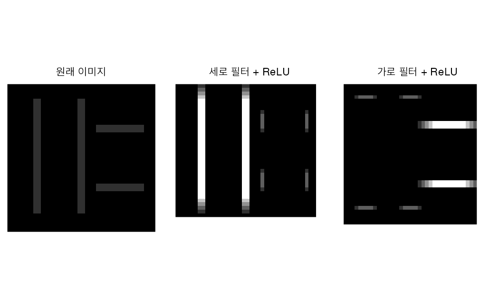
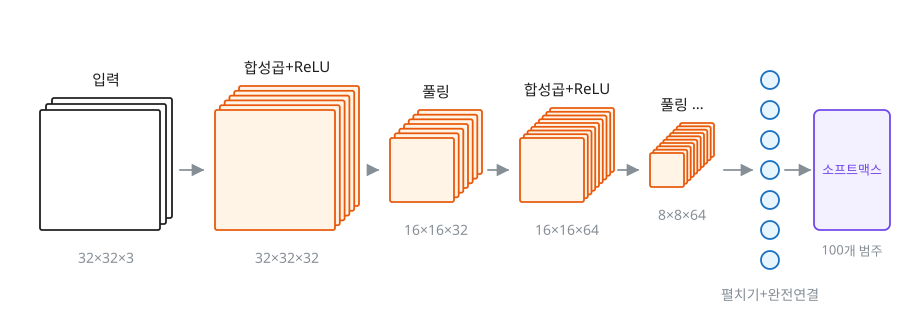
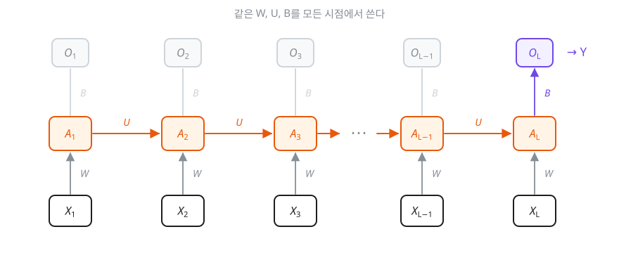

ISLR 10.3~10.6을 바탕으로 정리했다. [신경망](/posts/dm-neural-network)의 다층 신경망은 입력을 순서 없는 숫자 묶음으로 본다. 그런데 이미지는 가까운 픽셀끼리, 문장과 시계열은 가까운 시점끼리 관련이 깊다. 이런 **구조**를 모형에 넣은 것이 이미지의 합성곱신경망(CNN)과 순서열의 순환신경망(RNN)이다. 둘 다 같은 가중치를 여러 위치에서 다시 쓴다는 점이 핵심이다.

## 합성곱신경망

CNN은 이미지에서 작은 국소 특징(모서리, 색 덩어리)을 먼저 찾고, 그것을 조합해 더 큰 특징(눈, 귀)을 만들어 분류한다. 이를 위해 **합성곱 층**과 **풀링 층** 두 종류의 은닉층을 쓴다.

### 합성곱 층

합성곱 필터는 작은 가중치 행렬이다. 필터를 이미지의 모든 같은 크기 부분행렬에 겹쳐 놓고, 대응하는 원소끼리 곱해 더한다. $\ell_1 \times \ell_2$ 필터라면

$$
\text{출력}_{ij} = \sum_{u=1}^{\ell_1} \sum_{v=1}^{\ell_2} \text{필터}_{uv} \cdot \text{입력}_{i+u-1,\, j+v-1}
$$

이다. ISLR의 예처럼 $4 \times 3$ 이미지에 $2 \times 2$ 필터를 적용하면 결과는 $3 \times 2$다.

$$
\begin{bmatrix} a & b & c \\ d & e & f \\ g & h & i \\ j & k & l \end{bmatrix} * \begin{bmatrix} \alpha & \beta \\ \gamma & \delta \end{bmatrix}
= \begin{bmatrix} a\alpha + b\beta + d\gamma + e\delta & b\alpha + c\beta + e\gamma + f\delta \\ d\alpha + e\beta + g\gamma + h\delta & e\alpha + f\beta + h\gamma + i\delta \\ g\alpha + h\beta + j\gamma + k\delta & h\alpha + i\beta + k\gamma + l\delta \end{bmatrix}
$$

부분행렬이 필터와 닮았으면 큰 값이, 아니면 작은 값이 나온다. 그래서 합성곱 결과는 원래 이미지에서 **필터와 닮은 곳을 강조한 지도**다. 출력이 입력보다 작아지는데, 크기를 유지하려면 가장자리에 0을 덧대는 패딩(padding)을 쓴다.

```r
library(tidyverse)
library(ISLR2)
theme_set(theme_minimal(base_size = 12))

conv2d <- function(img, filt) {
  l1 <- nrow(filt); l2 <- ncol(filt)
  out <- matrix(0, nrow(img) - l1 + 1, ncol(img) - l2 + 1)
  for (i in seq_len(nrow(out))) for (j in seq_len(ncol(out)))
    out[i, j] <- sum(filt * img[i:(i + l1 - 1), j:(j + l2 - 1)])
  out
}
img <- matrix(1:12, 4, 3, byrow = TRUE)    # a=1, b=2, ..., l=12
filt <- matrix(c(1, 0, 0, -1), 2, 2, byrow = TRUE)
conv2d(img, filt)
```

필터 $\begin{bmatrix} 1 & 0 \\ 0 & -1 \end{bmatrix}$이면 왼쪽 위 원소는 $a - e = 1 - 5 = -4$다. 이 이미지는 오른쪽 아래로 갈수록 값이 일정하게 4씩 커지므로 모든 칸이 $-4$다.

CNN에서는 필터를 사람이 정하지 않고 **학습한다.** 필터의 가중치가 입력층에서 은닉층으로 가는 가중치이고, 출력 이미지의 픽셀 하나가 은닉 단위 하나다. 일반 신경망과 다른 점은 두 가지다. 각 은닉 단위는 작은 국소 영역에만 연결되고(나머지 가중치는 0), 같은 필터의 가중치를 이미지의 모든 위치에서 다시 쓴다(가중치 공유). 그래서 모수가 훨씬 적다.

손으로 만든 두 필터로 효과를 본다. 세로선과 가로선이 섞인 이미지에 세로 줄무늬 필터와 가로 줄무늬 필터를 적용한다.

```r
img <- matrix(0, 40, 40)
img[5:35, c(8, 9, 20, 21)] <- 1     # 세로선
img[c(12, 13, 28, 29), 25:37] <- 1  # 가로선
v_filt <- matrix(c(-1, 2, -1), 5, 3, byrow = TRUE)   # 가운데 열이 밝으면 큰 값
h_filt <- t(v_filt)

to_df <- function(m, name) {
  tibble(row = as.vector(row(m)), col = as.vector(col(m)), value = as.vector(m), panel = name)
}
bind_rows(to_df(img, "원래 이미지"),
          to_df(pmax(conv2d(img, v_filt), 0), "세로 필터 + ReLU"),
          to_df(pmax(conv2d(img, h_filt), 0), "가로 필터 + ReLU")) |>
  mutate(panel = fct_inorder(panel)) |>
  ggplot(aes(col, -row, fill = value)) +
  geom_raster() +
  facet_wrap(~panel) +
  scale_fill_gradient(low = "black", high = "white", guide = "none") +
  coord_equal() +
  theme_void() +
  theme(strip.text = element_text(size = 11))
```



세로 필터를 거치면 세로선만, 가로 필터를 거치면 가로선만 밝게 남는다. 음수를 0으로 바꾸는 ReLU를 합성곱 뒤에 붙이는 것이 보통이다.

컬러 이미지는 빨강, 초록, 파랑 세 **채널**의 2차원 행렬(예: $32 \times 32$ 행렬)로 된 3차원 배열(특징 지도)이다. 필터도 채널마다 가중치(예: $3 \times 3$ 가중치)를 따로 가지며, 세 채널의 합성곱 결과를 더해 2차원 지도 하나를 만든다. 필터를 $K$개 쓰면 $K$개의 지도가 나오고, 이것이 다음 층의 $K$채널 입력이 된다.

### 풀링 층

풀링은 이미지를 요약해 줄인다. **최대 풀링**은 겹치지 않는 $2 \times 2$ 블록마다 최댓값 하나만 남긴다. 가로세로가 절반이 되고, 블록 안 어디에 큰 값이 있든 결과가 같으므로 위치가 조금 바뀌어도 둔감해진다.

```r
max_pool <- function(m) {
  out <- matrix(0, nrow(m) / 2, ncol(m) / 2)
  for (i in seq_len(nrow(out))) for (j in seq_len(ncol(out)))
    out[i, j] <- max(m[(2 * i - 1):(2 * i), (2 * j - 1):(2 * j)])
  out
}
max_pool(matrix(c(1, 2, 5, 3,
                  3, 0, 1, 2,
                  2, 1, 3, 4,
                  1, 1, 2, 0), 4, 4, byrow = TRUE))
```

ISLR의 예와 같이 $\begin{bmatrix} 3 & 5 \\ 2 & 4 \end{bmatrix}$가 나온다.

### 구조, 데이터 증강, 사전학습 모형

CNN은 (합성곱 → ReLU → 풀링)을 여러 번 반복한다. 풀링으로 가로세로가 줄어드는 만큼 다음 합성곱 층의 필터 수를 늘려 채널을 키운다. 지도가 몇 픽셀까지 줄면 펼쳐서(flatten) 일반 신경망 층에 넣고, 마지막에 소프트맥스로 분류한다. ISLR 실습의 CIFAR100 CNN(32×32 컬러, 100개 범주)은 $3 \times 3$ 필터 수를 32 → 64 → 128 → 256으로 늘리고, 풀링 네 번으로 크기를 32 → 16 → 8 → 4 → 2로 줄인 뒤, 은닉 단위 512개 층과 소프트맥스 100개로 분류한다.



- **데이터 증강**: 훈련 이미지를 확대, 이동, 기울임, 작은 회전, 좌우 반전으로 조금씩 바꾼 복제본을 만든다. 사람이 보기에 같은 범주인 이미지 구름을 각 원본 주위에 만드는 셈이라 [능선 규제](/posts/dm-regularization)와 비슷한 효과가 있다. 미니배치를 뽑을 때마다 즉석에서 만들므로 저장할 필요가 없다.
- **사전학습 모형**: ImageNet 같은 거대한 자료로 학습한 CNN(예: resnet50)의 합성곱 층은 일반적인 시각 특징을 담고 있다. 이 층들을 고정하고(weight freezing) 마지막 몇 층만 새 자료로 학습하면 적은 자료로도 좋은 분류기를 만든다.

## 문서 분류

문서를 예측변수로 바꾸는 가장 간단한 방법은 **단어 주머니**(bag-of-words)다. 사전의 단어 $M$개마다 그 단어가 문서에 있으면 1, 없으면 0인 길이 $M$짜리 이진 벡터를 만든다. 단어의 순서는 버린다.

```r
docs <- c("this film was brilliant", "worst film ever", "brilliant acting brilliant story")
vocab <- sort(unique(unlist(strsplit(docs, " "))))
bow <- t(sapply(strsplit(docs, " "), \(w) as.integer(vocab %in% w)))
dimnames(bow) <- list(paste0("doc", 1:3), vocab)
bow
```

세 번째 문서에 `brilliant`가 두 번 있어도 1이다(횟수를 세는 변형도 있다). 사전이 커지면 대부분이 0인 **희소 행렬**이 된다. ISLR의 IMDb 영화평 예는 가장 흔한 단어 10,000개로 훈련 영화평 25,000개를 표현했고, 0이 아닌 값은 1.3%뿐이다.

반응은 긍정/부정 이진이므로 두 방법을 비교할 수 있다(ISLR 10.4 수치 인용).

| 방법 | 조율 | 시험 정확도 |
|---|---|---|
| Lasso 로지스틱 회귀 (`glmnet`) | $\lambda$ | 약 88% |
| 은닉층 2개(16개씩) 신경망 | 에폭 수 | 약 88% |

희소한 단어 주머니에서는 Lasso가 신경망만큼 맞았다.

## 순환신경망

문서, 시계열, 음성처럼 입력이 순서열 $X = \{X_1, X_2, \dots, X_L\}$인 자료에 쓴다. RNN은 순서열을 앞에서부터 하나씩 읽으며 **은닉 상태** $A_\ell$을 갱신한다. $A_\ell$은 현재 입력 $X_\ell$과 직전 은닉 상태 $A_{\ell-1}$로 만든다.

$$
A_{\ell k} = g\left(w_{k0} + \sum_{j=1}^{p} w_{kj} X_{\ell j} + \sum_{s=1}^{K} u_{ks} A_{\ell-1,s}\right), \qquad
O_\ell = \beta_0 + \sum_{k=1}^{K} \beta_k A_{\ell k}
$$

- $\mathbf W$($K \times (p+1)$): 입력 → 은닉, $\mathbf U$($K \times K$): 은닉 → 은닉, $\mathbf B$($K + 1$): 은닉 → 출력.
- 같은 $\mathbf W, \mathbf U, \mathbf B$를 모든 위치 $\ell$에서 쓴다. 합성곱 필터를 모든 위치에 쓰는 것과 같은 가중치 공유다.
- $A_\ell$은 지금까지 본 것의 요약이다. 반응이 하나면 마지막 출력 $O_L$만 쓰고, 손실은 $(Y - O_L)^2$이다.



### 문서의 순서열 모형

단어를 원-핫 벡터(길이 10,000)로 넣으면 너무 크다. 대신 각 단어를 길이 $m$(수십~수백)의 실수 벡터로 바꾸는 **임베딩**을 쓴다. 임베딩 행렬 $\mathbf E$($m \times 10{,}000$)는 학습하거나, word2vec이나 GloVe처럼 큰 말뭉치로 미리 만든 것을 고정해 쓴다. 의미가 비슷한 단어는 임베딩 공간에서 가깝다.

ISLR은 각 영화평의 마지막 $L = 500$단어를 임베딩($m = 32$)한 뒤 은닉 단위 32개의 RNN에 넣었다. 시험 정확도는 76%로 단어 주머니보다 나빴고, 은닉 상태를 먼 과거와 가까운 과거 두 갈래로 유지하는 **LSTM**으로 바꾸자 87%가 됐다(ISLR 10.5.1 수치 인용). 단순한 RNN은 순서열이 길면 앞쪽의 신호가 끝까지 전달되지 못한다.

### 시계열 예측

NYSE 자료는 1962년 12월부터 1986년 12월까지 6,051 거래일의 세 시계열이다. 로그 거래량 $v_t$, 다우존스 수익률 $r_t$, 로그 변동성 $z_t$. 목표는 과거로 오늘의 거래량을 예측하는 것이다. 1980년 이전을 훈련, 이후를 시험으로 쓴다.

시계열은 관측이 서로 독립이 아니다. 가까운 날의 값끼리 닮는 **자기상관**이 있고, 반응 $v_t$의 과거 값이 그대로 예측변수가 된다. 하나의 긴 시계열을 길이 $L$의 짧은 조각 여러 개로 잘라 $(X, Y)$ 쌍을 만든다.

$$
X = \left\{ \begin{pmatrix} v_{t-L} \\ r_{t-L} \\ z_{t-L} \end{pmatrix}, \dots, \begin{pmatrix} v_{t-1} \\ r_{t-1} \\ z_{t-1} \end{pmatrix} \right\}, \qquad Y = v_t
$$

같은 조각을 RNN처럼 순서대로 읽지 않고 $3L$개의 예측변수로 펼쳐 선형회귀하면 **자기회귀**(AR) 모형이다. 반응만 쓰면

$$
\hat v_t = \hat\beta_0 + \hat\beta_1 v_{t-1} + \hat\beta_2 v_{t-2} + \cdots + \hat\beta_L v_{t-L}
$$

이고, $r$과 $z$의 시차도 넣으면 열이 $3L + 1$개다. ISLR 실습(Lab 10.9.6)을 그대로 재현하기 위해 전체 기간을 `scale()`로 표준화하고 $L = 5$로 만든다(실제 예측에서는 시험 구간의 정보가 섞이지 않도록 훈련 구간 `istrain`의 평균과 표준편차만으로 훈련·시험 자료를 함께 표준화해야 한다).

```r
# ISLR Lab 10.9.6 재현을 위해 전체 행렬에 scale() 적용 (엄격한 누수 방지 시 istrain 기준 통계량만 사용)
xdata <- scale(as.matrix(NYSE[, c("DJ_return", "log_volume", "log_volatility")]))
istrain <- NYSE$train
lagm <- function(x, k) rbind(matrix(NA, k, ncol(x)), x[1:(nrow(x) - k), , drop = FALSE])

arframe <- data.frame(log_volume = xdata[, "log_volume"],
                      L1 = lagm(xdata, 1), L2 = lagm(xdata, 2), L3 = lagm(xdata, 3),
                      L4 = lagm(xdata, 4), L5 = lagm(xdata, 5))
arframe <- arframe[-(1:5), ]; istrain <- istrain[-(1:5)]
c(pairs = nrow(arframe), train = sum(istrain), test = sum(!istrain))
```

시험 자료의 $R^2 = 1 - \text{MSE} / \widehat{\mathrm{Var}}(v_t)$로 비교한다. 기준선은 "어제 거래량으로 오늘을 예측"이다.

```r
y_test <- arframe$log_volume[!istrain]
V0 <- var(y_test)
r2 <- function(pred) 1 - mean((pred - y_test)^2) / V0

r2_naive <- r2(arframe$L1.log_volume[!istrain])   # 어제의 로그 거래량
arfit <- lm(log_volume ~ ., data = arframe[istrain, ])
r2_ar <- r2(predict(arfit, arframe[!istrain, ]))

arframed <- data.frame(day = NYSE[-(1:5), "day_of_week"], arframe)
arfitd <- lm(log_volume ~ ., data = arframed[istrain, ])
r2_ard <- r2(predict(arfitd, arframed[!istrain, ]))
c(naive = r2_naive, AR5 = r2_ar, AR5_day = r2_ard)
```

RNN은 같은 조각을 $5 \times 3$ 순서열로 받아 은닉 단위 12개로 읽는다. ISLR 실습의 설정(드롭아웃 0.1, RMSprop, 배치 64, 200 에폭)을 `torch`로 따랐다. 다만 `torch`의 `nn_rnn`에는 은닉 상태 사이의 드롭아웃(keras의 `recurrent_dropout`)이 없어 입력 쪽 드롭아웃만 넣었다.

```r
library(torch)
library(luz)

# (관측, 시점 5, 변수 3) 배열. 시점 1이 가장 먼 과거
xrnn <- array(0, c(nrow(arframe), 5, 3))
vars <- c("DJ_return", "log_volume", "log_volatility")
for (l in 1:5) xrnn[, 6 - l, ] <- as.matrix(arframe[, paste0("L", l, ".", vars)])

rnn_mod <- nn_module(
  initialize = function() {
    self$dropout <- nn_dropout(0.1)
    self$rnn <- nn_rnn(input_size = 3, hidden_size = 12, batch_first = TRUE)
    self$output <- nn_linear(12, 1)
  },
  forward = function(x) {
    out <- self$rnn(self$dropout(x))[[1]]     # (관측, 시점, 12)
    self$output(out[, 5, ])                   # 마지막 시점의 은닉 상태 A_L
  }
)
torch_manual_seed(1); set.seed(1)
rnn_fit <- rnn_mod |>
  setup(loss = nn_mse_loss(), optimizer = optim_rmsprop) |>
  fit(data = list(xrnn[istrain, , ], matrix(arframe$log_volume[istrain], ncol = 1)),
      epochs = 200, dataloader_options = list(batch_size = 64),
      accelerator = accelerator(cpu = TRUE), verbose = FALSE)
r2_rnn <- r2(as.numeric(predict(rnn_fit, xrnn[!istrain, , ], accelerator = accelerator(cpu = TRUE))))
c(RNN = r2_rnn, n_param = 12 * (1 + 3 + 12) + 13)
```

| 모형 | 모수 수 | 시험 $R^2$ (이 글) | 시험 $R^2$ (ISLR) |
|---|---|---|---|
| 어제 값 그대로 | 0 | 0.18 | 0.18 |
| AR(5), 세 변수 | 16 | 0.41 | 0.41 |
| AR(5) + 요일 | 20 | 0.46 | 0.46 |
| RNN, 은닉 12개 | 205 | 0.38 | 0.42 |

선형 AR(5)가 기준선 0.18을 크게 넘었고, 요일을 넣으면 0.46까지 오른다(월요일과 금요일에 거래량이 많다). 이 글의 RNN은 시드 하나로 학습해 0.38로, ISLR의 0.42보다 낮고 AR(5)보다도 낮았다. 은닉 상태 사이의 드롭아웃이 빠진 점과 시드에 따른 차이가 이유일 수 있다. 모수가 13배인 RNN이 16개 모수의 AR을 넘지 못했다는 점은 ISLR과 같다.

RNN의 모수 205개는 $\mathbf W$ $12 \times (1 + 3)$, $\mathbf U$ $12 \times 12$, $\mathbf B$ 13개를 더한 것이다. `torch`의 `nn_rnn`은 입력과 은닉 쪽에 절편을 따로 두어 실제로는 12개가 더 많지만 같은 모형이다.

> **주의** 시험 기간의 예측에 시험 기간의 과거 값을 입력으로 쓴다. 부정행위처럼 보이지만, 항상 예측 시점 이전의 값만 쓰므로 정당하다.

AR 모형에 은닉층을 붙여 펼친 시차를 일반 신경망에 넣는 **비선형 AR**도 가능하다. ISLR에서는 0.42, 요일을 넣으면 0.47이었다.

## 언제 딥러닝을 쓰는가

ISLR 10.6은 [신경망](/posts/dm-neural-network)의 Hitters 자료로 이 질문을 던진다. 선형회귀(모수 20개), Lasso(변수 12개), 신경망(은닉 단위 64개, 모수 1,409개)의 시험 MAE가 254.7, 252.3, 257.4로 비슷했다(ISLR 표 10.2). 앞 글의 은닉 단위 50개(모수 1,101개) 모형을 쓴 이 블로그의 분할에서는 선형회귀 254.7, Lasso 253.1, 신경망 278.9~282.8로 신경망이 오히려 나빴다. 신경망을 더 조율하면 따라잡을 수 있겠지만, 선형모형은 손쉽게 이 성능을 냈고 결과를 설명하기도 쉽다.

그래서 **오컴의 면도날**을 따른다. 여러 방법의 성능이 비슷하면 가장 단순한 것을 고른다. 딥러닝은 다음 조건에서 빛난다.

- 훈련 자료가 아주 많다(MNIST 60,000장, CIFAR 50,000장).
- 입력에 공간이나 순서 구조가 있다(이미지, 문장, 음성, 시계열).
- 해석보다 예측 정확도가 중요하다.
- 신호 대 잡음비가 높다. 잡음이 큰 자료에서는 유연한 모형이 잡음까지 맞추기 쉽다.

## 비교

| | 다층 신경망 | CNN | RNN |
|---|---|---|---|
| 입력 | 순서 없는 숫자 벡터 | 이미지 (공간 구조) | 순서열 (시간·순서 구조) |
| 핵심 연산 | 선형결합 + 활성화 | 합성곱, 풀링 | 은닉 상태의 반복 갱신 |
| 가중치 공유 | 없음 | 같은 필터를 모든 위치에 | 같은 $\mathbf W, \mathbf U$를 모든 시점에 |
| 예 | Hitters, MNIST (펼친 픽셀) | CIFAR100 | IMDb, NYSE |

| | 단어 주머니 | 순서열 모형 (RNN, LSTM) |
|---|---|---|
| 순서 정보 | 버린다 | 쓴다 |
| 표현 | 희소 이진 벡터 (길이 = 사전 크기) | 임베딩 벡터의 순서열 |
| IMDb 정확도 (ISLR) | 약 88% (Lasso, 신경망) | RNN 76%, LSTM 87% |

| | AR($L$) | RNN |
|---|---|---|
| 입력 | 같은 $L$개 시차 | 같은 $L$개 시차 |
| 처리 | $L \times p$개를 펼쳐 한 번에 선형결합 | 왼쪽부터 같은 가중치로 차례로 읽음 |
| 비선형 | 없음 | 은닉 상태의 활성화 |
| NYSE 모수 수 | 16 | 205 |

## 정리

- 합성곱: 필터를 모든 부분행렬에 곱해 더한다. 필터와 닮은 곳이 강조되고, 필터의 가중치를 학습한다.
- 풀링: $2 \times 2$ 블록의 최댓값으로 크기를 절반으로. 위치 변화에 둔감해진다.
- RNN: $A_\ell = g(\mathbf W X_\ell + \mathbf U A_{\ell-1})$, 출력 $O_L$. 모든 시점이 같은 가중치를 쓴다.
- AR은 RNN의 입력을 펼쳐 선형회귀한 것이다. NYSE에서는 둘의 성능이 비슷했다.
- 단순한 모형이 비슷하게 맞으면 단순한 모형을 고른다. 딥러닝은 자료가 많고 구조가 있을 때 쓴다.

## 참고자료

- James, G., Witten, D., Hastie, T., Tibshirani, R. (2023). *An Introduction to Statistical Learning with Applications in R*, 2nd ed., 10.3~10.6, 10.9.6.
