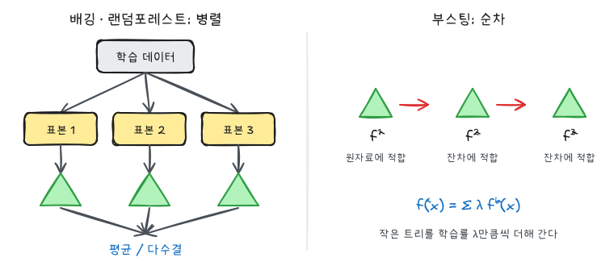
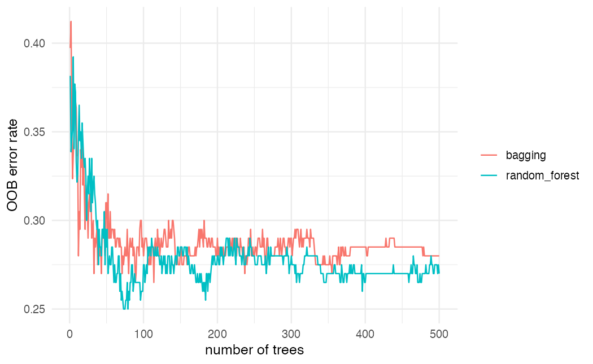
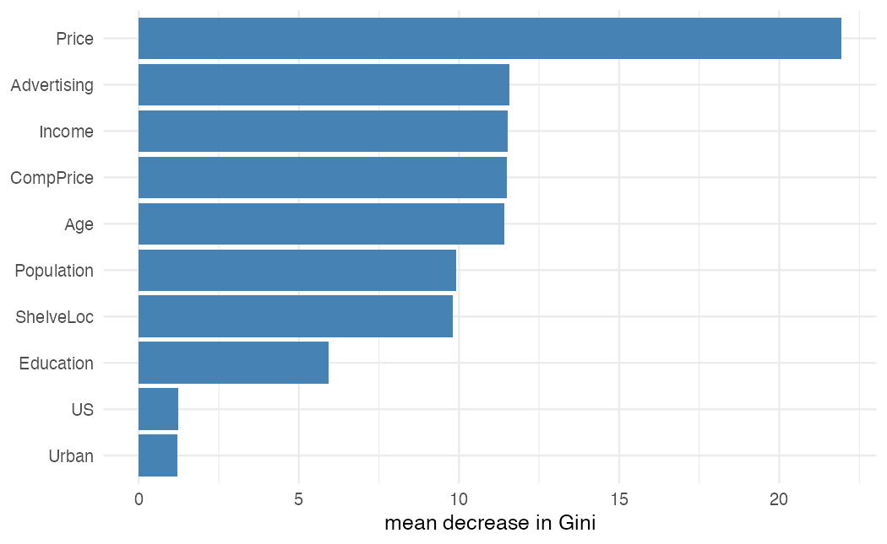
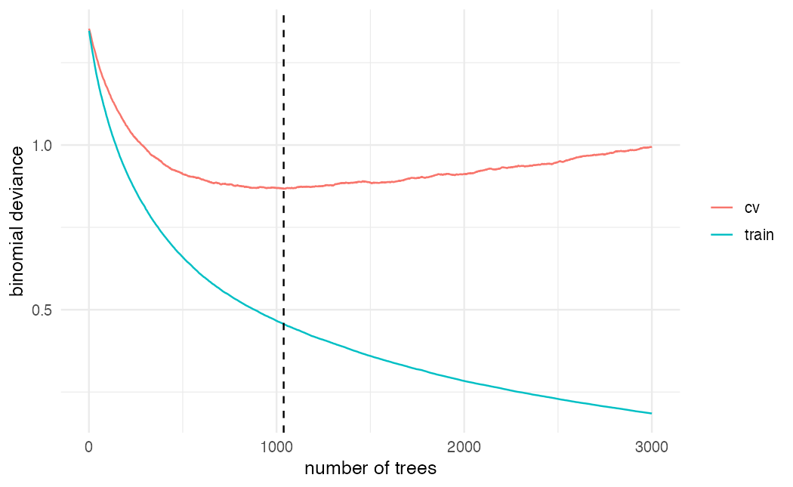

ISLR 5·8장과 이영미 교수님 데이터마이닝 강의의 앙상블 부분을 정리했다. 단일 나무는 해석하기 쉽지만 분산이 크다. 앙상블은 나무를 여러 개 만들어 결합해 분산(또는 편향)을 줄인다.



## 부트스트랩

원자료 $n$개에서 **복원추출로** $n$개를 뽑아 새 표본을 만든다. 같은 관측값이 여러 번 뽑히기도 하고 한 번도 안 뽑히기도 한다. 한 관측값이 한 번도 뽑히지 않을 확률은 다음과 같다.

$$
\left(1 - \frac{1}{n}\right)^n \to e^{-1} \approx 0.368
$$

즉 부트스트랩 표본 하나에는 원자료의 약 63.2%가 들어가고, 약 36.8%는 빠진다. 이렇게 빠진 관측값을 **OOB(out-of-bag)** 관측값이라 한다.

## 배깅

분산이 $\sigma^2$인 독립 관측값 $B$개의 평균은 분산이 $\sigma^2 / B$다. 배깅은 이 원리를 모델에 적용한다. 부트스트랩 표본 $B$개로 나무를 각각 깊게 키우고 결과를 합친다.

$$
\hat f_{bag}(x) = \frac{1}{B} \sum_{b=1}^{B} \hat f^{*b}(x)
$$

분류에서는 평균 대신 다수결 투표를 한다. 나무 하나하나는 가지치기하지 않아 편향은 작고 분산이 크지만, 평균을 내면서 분산이 줄어든다.

### OOB 오차

각 관측값은 약 $B/3$개 나무에서 OOB다. 그 나무들만으로 예측한 결과를 모으면 별도의 검증 데이터 없이 테스트 오차를 추정할 수 있다. $B$가 충분히 크면 OOB 오차는 LOOCV 오차와 거의 같다.

## 랜덤포레스트

배깅한 나무들은 서로 닮는다. 강한 설명 변수가 하나 있으면 거의 모든 나무가 그 변수로 첫 분할을 하기 때문이다. 상관된 값을 평균내면 분산이 덜 줄어든다. 상관계수가 $\rho$인 $B$개 값의 평균의 분산은 다음과 같다.

$$
\rho \sigma^2 + \frac{1 - \rho}{B} \sigma^2
$$

$B$를 늘려도 첫 항 $\rho\sigma^2$는 남는다. 랜덤포레스트는 **분할할 때마다 설명 변수 $p$개 중 $m$개만 무작위로 후보로 둔다**. 그러면 강한 변수가 후보에 없는 분할이 생겨 나무 간 상관 $\rho$가 낮아진다.

- 보통 분류는 $m \approx \sqrt p$, 회귀는 $m \approx p/3$
- $m = p$이면 배깅과 같다
- 설명 변수끼리 상관이 클수록 작은 $m$이 유리하다

## 부스팅

부스팅은 나무를 **순차적으로** 만든다. 각 나무는 이전까지의 모델이 설명하지 못한 부분(잔차)에 적합한다. 회귀의 경우는 다음과 같다.

1. $\hat f(x) = 0$, 잔차 $r_i = y_i$로 시작한다.
2. $b = 1, \dots, B$에 대해 반복한다.
   - 잔차 $r$에 분할 $d$번짜리 작은 나무 $\hat f^b$를 적합한다.
   - $\hat f(x) \leftarrow \hat f(x) + \lambda \hat f^b(x)$
   - $r_i \leftarrow r_i - \lambda \hat f^b(x_i)$
3. 최종 모델은 $\hat f(x) = \sum_{b=1}^{B} \lambda \hat f^b(x)$다.

| 조율 모수 | 의미 | 주의 |
|---|---|---|
| $B$ (`n.trees`) | 나무 수 | 배깅과 달리 너무 크면 과적합한다. 교차검증으로 정한다 |
| $\lambda$ (`shrinkage`) | 학습률 | 0.01, 0.001 등. 작을수록 많은 $B$가 필요하다 |
| $d$ (`interaction.depth`) | 나무 하나의 분할 수 | $d = 1$이면 가법 모형. $d$가 상호작용 차수를 제한한다 |

## Carseats 실습

`ISLR2::Carseats`는 매장 400곳의 카시트 판매량이다. 판매량(`Sales`, 천 개)이 8보다 크면 `High = "Yes"`로 두고 분류한다.

```r
library(tidyverse)
theme_set(theme_minimal(base_size = 12))
library(ISLR2)
library(rpart)
library(randomForest)
library(gbm)

carseats <- Carseats |>
  mutate(High = factor(if_else(Sales > 8, "Yes", "No"))) |>
  dplyr::select(-Sales)

set.seed(2)
idx <- sample(nrow(carseats), 200)
train <- carseats[idx, ]
test  <- carseats[-idx, ]
p <- ncol(carseats) - 1

acc <- function(pred) mean(pred == test$High)
```

### 단일 나무, 배깅, 랜덤포레스트

```r
tree_fit <- rpart(High ~ ., data = train, method = "class")
bag_fit  <- randomForest(High ~ ., data = train, mtry = p, ntree = 500)
rf_fit   <- randomForest(High ~ ., data = train, mtry = floor(sqrt(p)),
                         ntree = 500, importance = TRUE)

c(tree   = acc(predict(tree_fit, test, type = "class")),
  bagging = acc(predict(bag_fit, test)),
  rf      = acc(predict(rf_fit, test)))
```

배깅은 별도 패키지 없이 `randomForest`에서 `mtry = p`로 두면 된다.

```r
tibble(trees = 1:500,
       bagging = bag_fit$err.rate[, "OOB"],
       random_forest = rf_fit$err.rate[, "OOB"]) |>
  pivot_longer(-trees) |>
  ggplot(aes(trees, value, color = name)) +
  geom_line() +
  labs(x = "number of trees", y = "OOB error rate", color = NULL)
```



나무가 수십 개를 넘으면 OOB 오차가 안정된다. 배깅과 랜덤포레스트에서 나무를 많이 만드는 것은 과적합을 일으키지 않는다.

### 변수 중요도

```r
importance(rf_fit) |>
  as_tibble(rownames = "variable") |>
  ggplot(aes(MeanDecreaseGini, fct_reorder(variable, MeanDecreaseGini))) +
  geom_col(fill = "steelblue") +
  labs(x = "mean decrease in Gini", y = NULL)
```



`MeanDecreaseGini`는 그 변수로 분할할 때 줄어든 지니 지수를 모든 나무에서 더해 평균낸 값이다. `Price`가 가장 중요하고 나머지 연속형 변수가 비슷한 수준으로 뒤따른다. 범주가 3개뿐인 `ShelveLoc`(진열 위치)는 중간쯤이다. 지니 기준 중요도는 분할점 후보가 많은 연속형 변수에 유리하게 치우치는 경향이 있어서, 순열 중요도(`importance(rf_fit, type = 1)`, 정확도 감소량)와 함께 보는 것이 좋다. 나무 수백 개를 직접 볼 수 없으므로 중요도가 해석의 주된 도구가 된다.

### 부스팅

```r
train_gbm <- mutate(train, High = as.integer(High == "Yes"))

set.seed(2)
boost_fit <- gbm(High ~ ., data = train_gbm, distribution = "bernoulli",
                 n.trees = 3000, interaction.depth = 2, shrinkage = 0.01,
                 cv.folds = 5)

best_B <- gbm.perf(boost_fit, method = "cv", plot.it = FALSE)
best_B

prob <- predict(boost_fit, test, n.trees = best_B, type = "response")
acc(if_else(prob > 0.5, "Yes", "No"))
```

`gbm`의 `bernoulli`는 반응 변수를 0/1 숫자로 받는다. `cv.folds = 5`로 5겹 교차검증 오차를 함께 계산하고, `gbm.perf`로 그 오차가 가장 작은 나무 수를 고른다.

```r
tibble(trees = seq_along(boost_fit$train.error),
       train = boost_fit$train.error,
       cv = boost_fit$cv.error) |>
  pivot_longer(-trees) |>
  ggplot(aes(trees, value, color = name)) +
  geom_line() +
  geom_vline(xintercept = best_B, linetype = "dashed") +
  labs(x = "number of trees", y = "binomial deviance", color = NULL)
```



학습 오차는 계속 줄지만 교차검증 오차는 어느 지점에서 바닥을 친 뒤 올라간다. 배깅·랜덤포레스트와 달리 부스팅은 나무 수가 조율 모수다.

## 비교

| | 배깅 | 랜덤포레스트 | 부스팅 |
|---|---|---|---|
| 나무 생성 | 병렬, 독립 | 병렬, 독립 | 순차 |
| 개별 나무 | 깊게 | 깊게, 분할마다 $m$개 변수 | 얕게 ($d$ 작음) |
| 주로 줄이는 것 | 분산 | 분산 (상관까지 감소) | 편향 |
| 나무 수 증가 | 과적합 없음 | 과적합 없음 | 과적합 가능 |
| 핵심 조율 모수 | $B$ | $m$ | $B$, $\lambda$, $d$ |

세 방법 모두 단일 나무보다 정확하지만 하나의 그림으로 설명할 수는 없다. 해석이 필요하면 변수 중요도와 부분의존도 그림을 함께 본다.
