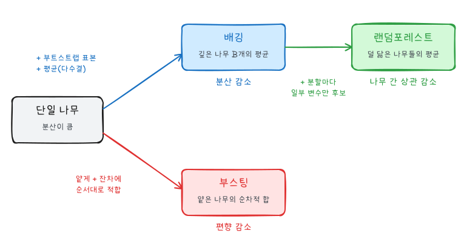
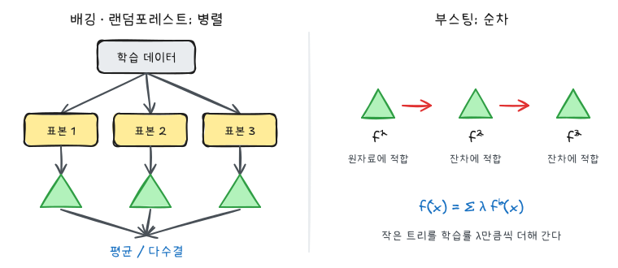
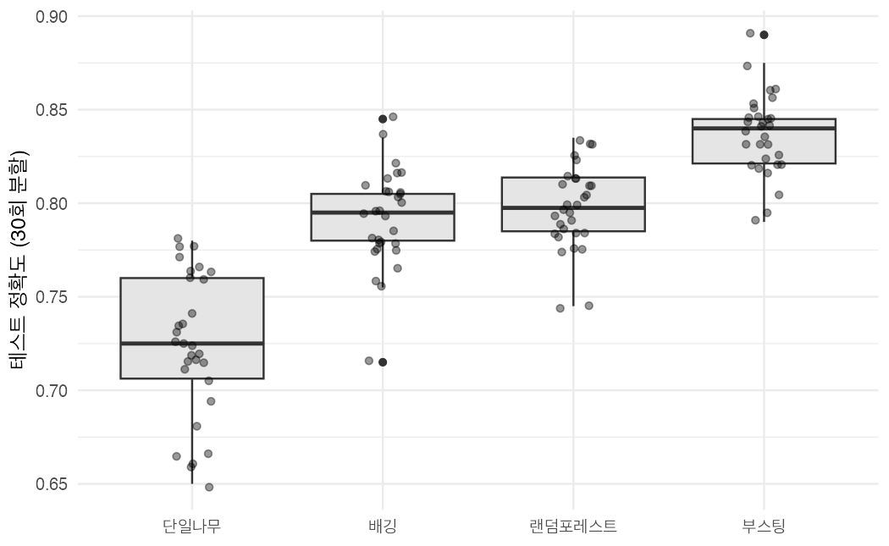
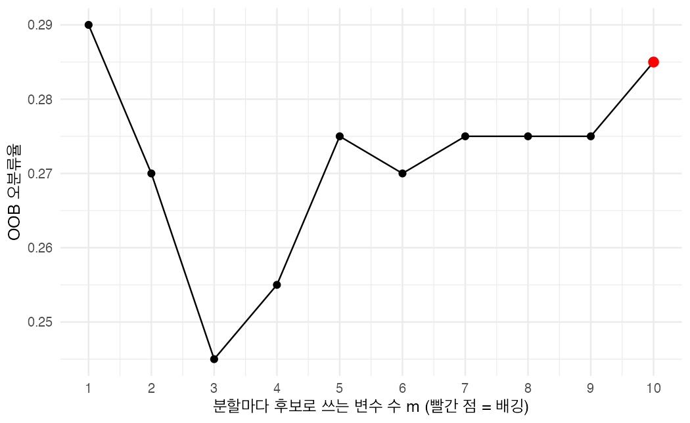
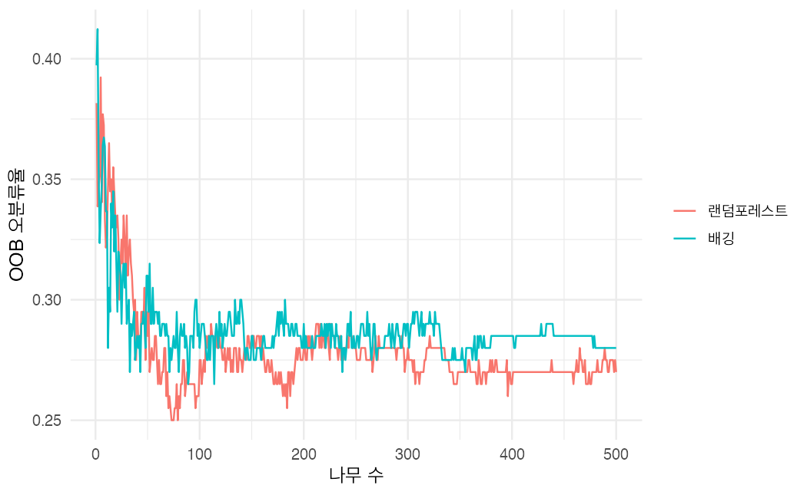
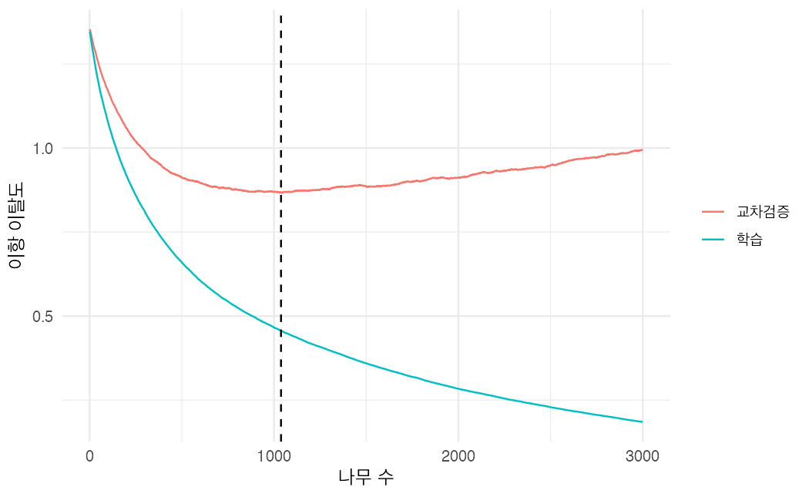
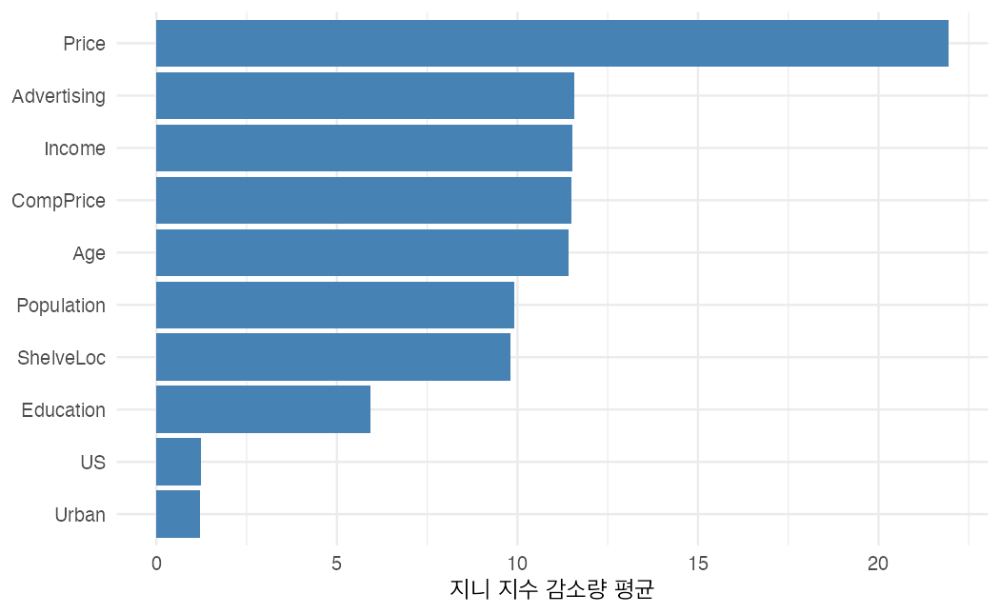

ISLR 5·8장과 이영미 교수님 데이터마이닝 강의의 앙상블 부분을 정리했다.

## 개요

[의사결정나무](/posts/dm-tree)는 해석이 쉬운 대신 분산이 크다. 학습 자료가 조금만 달라져도 첫 분할이 바뀌고, 그 아래의 구조가 전부 달라진다. 앙상블은 여러 나무를 결합해 이 문제를 완화하는 방법이며, 결합 방식에 따라 크게 두 갈래로 나뉜다. 배깅과 랜덤포레스트는 독립적으로 만든 깊은 나무들을 평균해 분산을 줄이고, 부스팅은 얕은 나무를 순차적으로 더해 편향을 줄인다. 부트스트랩은 앞의 두 방법이 서로 다른 학습 자료를 얻는 데 쓰는 재표집 도구다.



| | 부트스트랩 | 배깅 | 랜덤포레스트 | 부스팅 |
|---|---|---|---|---|
| 구성 | 복원추출에 의한 재표집 | 부트스트랩 + 평균 | 배깅 + 분할 변수의 무작위 제한 | 잔차에 대한 순차적 적합 |
| 대상으로 하는 문제 | 표본이 하나뿐임 | 나무의 큰 분산 | 배깅 나무 간의 높은 상관 | 얕은 나무의 큰 편향 |
| 개별 나무 | | 깊음, 상호 독립 | 깊음, 상호 독립 | 얕음, 이전 나무에 의존 |
| 나무 수 증가의 영향 | | 과적합 없음 | 과적합 없음 | 과적합 가능 |
| 주요 조율 모수 | $B$ | $B$ | $m$ | $B$, $\lambda$, $d$ |

## 1. 부트스트랩

원자료 $n$개에서 **복원추출로** $n$개를 뽑아 새 표본을 만든다. 같은 관측값이 여러 번 뽑히기도 하고 한 번도 뽑히지 않기도 한다. 특정 관측값이 한 번도 뽑히지 않을 확률은

$$
\left(1 - \frac{1}{n}\right)^n \to e^{-1} \approx 0.368
$$

이므로, 부트스트랩 표본 하나에는 원자료의 약 63.2%가 포함되고 나머지 36.8%는 빠진다. 빠진 관측값을 **OOB(out-of-bag)** 관측값이라 한다.

부트스트랩은 본래 [재표집](/posts/dm-resampling)에서 추정량의 표준오차를 구하기 위한 방법이다. 모집단에서 표본을 반복해 뽑을 수 없으므로, 주어진 표본을 모집단으로 간주하고 그로부터 다시 표본을 뽑는다. 앙상블에서는 이 방법을 서로 조금씩 다른 학습 자료를 여러 개 얻는 데 사용한다.

```r
library(tidyverse)
theme_set(theme_minimal(base_size = 12))
library(ISLR2)
library(rpart)
library(randomForest)
library(gbm)

# 부트스트랩 표본에 포함되는 고유 관측값의 비율
set.seed(1)
n <- 400
mean(replicate(1000, length(unique(sample(n, n, replace = TRUE))) / n))
```

$n = 400$에서 1,000번 반복한 평균은 0.632로 이론값과 일치한다.

## 2. 배깅

배깅(bootstrap aggregating)은 부트스트랩 표본 $B$개 각각에 나무를 적합하고, 그 예측을 평균(분류에서는 다수결)하는 방법이다.

$$
\hat f_{bag}(x) = \frac{1}{B}\sum_{b=1}^{B}\hat f^{*b}(x)
$$

근거는 평균의 분산이다. 분산이 $\sigma^2$인 독립 확률변수 $B$개의 평균은 분산이 $\sigma^2/B$이다. 각 나무를 가지치기 없이 깊게 키우면 편향은 작고 분산은 크다. 이를 평균하면 편향은 거의 그대로 둔 채 분산만 줄일 수 있다. 단일 나무에서는 분산을 줄이기 위해 가지치기로 편향을 일부 감수하지만, 배깅은 평균으로 분산을 줄이므로 가지치기가 필요하지 않다.

### OOB 오차

각 관측값은 평균적으로 약 $B/3$개 나무에서 OOB이다. 관측값마다 자신이 OOB인 나무들로만 예측해 오분류율을 구하면, 별도의 검증 자료 없이 테스트 오차를 추정할 수 있다. $B$가 충분히 크면 OOB 오차는 LOOCV 오차와 거의 같다.

## 3. 랜덤포레스트

랜덤포레스트는 배깅에서 **분할할 때마다 설명 변수 $p$개 중 무작위로 고른 $m$개만 분할 후보로 허용**하는 방법이다. $m = p$이면 배깅과 같다.

이 제한이 필요한 이유는 배깅이 평균하는 나무들이 독립이 아니기 때문이다. 영향력이 큰 설명 변수가 있으면 대부분의 나무가 그 변수로 첫 분할을 하게 되고, 그 결과 나무들의 예측이 비슷해진다. 상관계수가 $\rho$인 $B$개 확률변수의 평균의 분산은

$$
\rho\sigma^2 + \frac{1 - \rho}{B}\sigma^2
$$

이다. $B$를 늘리면 둘째 항은 0으로 가지만 첫째 항 $\rho\sigma^2$는 남는다. 따라서 배깅에서 분산 감소의 한계를 정하는 것은 나무의 수가 아니라 나무 간 상관이다. 랜덤포레스트는 강한 변수가 후보에서 제외되는 분할을 의도적으로 만들어 $\rho$를 낮춘다. 대신 개별 나무의 정확도가 다소 떨어지므로($\sigma^2$ 증가) $m$은 두 효과의 균형으로 정해진다.

- 관례적으로 분류에는 $m \approx \sqrt p$, 회귀에는 $m \approx p/3$을 쓴다.
- 설명 변수 간 상관이 클수록 작은 $m$이 유리하다.

## 4. 부스팅

부스팅은 나무를 독립적으로 만들지 않고, **이전까지의 모형이 설명하지 못한 부분에 다음 나무를 적합하는 과정을 순차적으로 반복**한다. 회귀의 경우 알고리즘은 다음과 같다.

1. $\hat f(x) = 0$, 잔차 $r_i = y_i$로 시작한다.
2. $b = 1, \dots, B$에 대해 반복한다.
   - 잔차 $r$에 분할이 $d$번인 작은 나무 $\hat f^b$를 적합한다.
   - $\hat f(x) \leftarrow \hat f(x) + \lambda\hat f^b(x)$
   - $r_i \leftarrow r_i - \lambda\hat f^b(x_i)$
3. 최종 모형은 $\hat f(x) = \sum_{b=1}^{B}\lambda\hat f^b(x)$이다.

개별 나무는 분할이 몇 번뿐이어서 편향이 크다(약한 학습기). 부스팅은 이 편향을 $\lambda$만큼씩 줄여 나간다. 배깅과 랜덤포레스트가 분산을 줄이는 방법이라면 부스팅은 편향을 줄이는 방법이다. 이 때문에 나무를 계속 추가하면 결국 학습 자료의 잡음까지 적합하게 되어 과적합이 일어난다.

| 조율 모수 | 의미 | 비고 |
|---|---|---|
| $B$ (`n.trees`) | 나무의 수 | 지나치게 크면 과적합하므로 교차검증으로 정한다 |
| $\lambda$ (`shrinkage`) | 학습률 | 0.01, 0.001 등. 작을수록 큰 $B$가 필요하다 |
| $d$ (`interaction.depth`) | 나무 하나의 분할 수 | $d = 1$이면 가법 모형이 되며, $d$는 교호작용의 차수를 제한한다 |

## 5. 방법 간 비교



| 구분 | 배깅 | 랜덤포레스트 | 부스팅 |
|---|---|---|---|
| 학습 자료 | 부트스트랩 표본 | 부트스트랩 표본 | 전체 자료 (잔차 갱신) |
| 나무 생성 | 병렬, 독립 | 병렬, 독립 | 순차, 의존 |
| 분할 후보 변수 | $p$개 전부 | 분할마다 $m$개 | $p$개 전부 |
| 개별 나무 | 깊음 (저편향·고분산) | 깊음 | 얕음 (고편향·저분산) |
| 감소시키는 오차 성분 | 분산 | 분산, 나무 간 상관 | 편향 |
| 나무의 수 | 클수록 안정 | 클수록 안정 | 조율 모수 |
| 결합 방식 | 동일 가중 평균 | 동일 가중 평균 | $\lambda$배 누적 합 |
| 병렬 계산 | 가능 | 가능 | 불가능 |

## 6. Carseats 자료를 이용한 비교

`ISLR2::Carseats`는 매장 400곳의 카시트 판매량 자료다. 판매량(`Sales`, 천 개)이 8을 넘으면 `High = "Yes"`로 두어 분류 문제로 바꾸고, 학습 자료와 테스트 자료를 200개씩 나눈다.

```r
carseats <- Carseats |>
  mutate(High = factor(if_else(Sales > 8, "Yes", "No"))) |>
  dplyr::select(-Sales)

set.seed(2)
idx <- sample(nrow(carseats), 200)
train <- carseats[idx, ]
test  <- carseats[-idx, ]
p <- ncol(carseats) - 1

acc <- function(pred) mean(pred == test$High)
```

### 테스트 정확도

```r
tree_fit <- rpart(High ~ ., data = train, method = "class")
bag_fit  <- randomForest(High ~ ., data = train, mtry = p, ntree = 500)
rf_fit   <- randomForest(High ~ ., data = train, mtry = floor(sqrt(p)),
                         ntree = 500, importance = TRUE)

train_gbm <- mutate(train, High = as.integer(High == "Yes"))
set.seed(2)
boost_fit <- gbm(High ~ ., data = train_gbm, distribution = "bernoulli",
                 n.trees = 3000, interaction.depth = 2, shrinkage = 0.01,
                 cv.folds = 5)
best_B <- gbm.perf(boost_fit, method = "cv", plot.it = FALSE)
prob <- predict(boost_fit, test, n.trees = best_B, type = "response")

c(tree     = acc(predict(tree_fit, test, type = "class")),
  bagging  = acc(predict(bag_fit, test)),
  rf       = acc(predict(rf_fit, test)),
  boosting = acc(if_else(prob > 0.5, "Yes", "No")),
  best_B   = best_B)
```

| 방법 | 테스트 정확도 |
|---|---|
| 단일 나무 | 0.775 |
| 배깅 | 0.825 |
| 랜덤포레스트 ($m = 3$) | 0.835 |
| 부스팅 ($d = 2$, $\lambda = 0.01$, $B = 1038$) | 0.895 |

`gbm`의 `bernoulli` 분포는 반응 변수를 0/1로 받으며, `cv.folds = 5`로 계산한 5겹 교차검증 오차가 최소인 나무 수를 `gbm.perf`로 고른다.

### 분할에 따른 안정성

정확도 하나로는 분산 감소 효과를 직접 볼 수 없다. 학습·테스트 분할을 30번 바꾸어 각 방법의 정확도가 얼마나 변하는지 비교한다. 부스팅은 반복마다 교차검증을 하면 계산이 오래 걸리므로 앞에서 고른 값에 가까운 $B = 1000$으로 고정했다.

```r
one_split <- function(seed) {
  set.seed(seed)
  i <- sample(nrow(carseats), 200)
  tr <- carseats[i, ]; te <- carseats[-i, ]
  a <- function(pred) mean(pred == te$High)
  g <- gbm(High ~ ., data = mutate(tr, High = as.integer(High == "Yes")),
           distribution = "bernoulli", n.trees = 1000,
           interaction.depth = 2, shrinkage = 0.01)
  pr <- predict(g, te, n.trees = 1000, type = "response")
  tibble(
    seed = seed,
    단일나무 = a(predict(rpart(High ~ ., data = tr, method = "class"), te, type = "class")),
    배깅 = a(predict(randomForest(High ~ ., data = tr, mtry = p, ntree = 300), te)),
    랜덤포레스트 = a(predict(randomForest(High ~ ., data = tr, mtry = 3, ntree = 300), te)),
    부스팅 = a(if_else(pr > 0.5, "Yes", "No"))
  )
}

splits <- map_dfr(1:30, one_split)
splits_long <- splits |>
  pivot_longer(-seed, names_to = "방법", values_to = "정확도") |>
  mutate(방법 = fct_inorder(방법))

splits_long |> group_by(방법) |>
  summarise(평균 = mean(정확도), 표준편차 = sd(정확도))

ggplot(splits_long, aes(방법, 정확도)) +
  geom_boxplot(fill = "grey90") +
  geom_jitter(width = 0.1, alpha = 0.4) +
  labs(x = NULL, y = "테스트 정확도 (30회 분할)")
```



| 방법 | 평균 정확도 | 표준편차 |
|---|---|---|
| 단일 나무 | 0.724 | 0.038 |
| 배깅 | 0.792 | 0.026 |
| 랜덤포레스트 | 0.798 | 0.023 |
| 부스팅 | 0.836 | 0.022 |

앙상블은 평균 정확도가 높을 뿐 아니라 분할에 따른 변동도 작다. 단일 나무의 표준편차 0.038이 배깅에서 0.026, 랜덤포레스트에서 0.023으로 줄어드는데, 이는 평균에 의한 분산 감소와 나무 간 상관 감소의 효과가 차례로 나타난 것이다. 앞의 단일 분할(0.775, 0.825, …)은 30회 평균보다 다소 높은 쪽에 해당하므로, 분할 하나의 결과만으로 방법을 비교하는 것은 위험하다.

### 나무 간 상관

랜덤포레스트가 배깅보다 나은 이유가 나무 간 상관의 감소에 있는지 확인하기 위해, 각 방법에서 나무 100개를 골라 테스트 자료에 대한 예측의 쌍별 일치율을 계산한다.

```r
tree_agreement <- function(fit) {
  pred <- predict(fit, test, predict.all = TRUE)$individual[, 1:100]
  pairs <- combn(100, 2)
  mean(map_dbl(seq_len(ncol(pairs)), \(k) mean(pred[, pairs[1, k]] == pred[, pairs[2, k]])))
}
c(bagging = tree_agreement(bag_fit), rf = tree_agreement(rf_fit))
```

평균 일치율은 배깅 0.660, 랜덤포레스트 0.624로, 분할 후보를 제한하면 나무들의 예측이 덜 비슷해진다. 개별 나무의 예측이 서로 덜 겹치므로 평균했을 때 분산이 더 크게 줄어든다.

### 분할 후보 변수 수 $m$의 영향

```r
set.seed(3)
mtry_oob <- map_dfr(1:p, \(m) {
  fit <- randomForest(High ~ ., data = train, mtry = m, ntree = 500)
  tibble(m = m, oob = tail(fit$err.rate[, "OOB"], 1))
})
mtry_oob

ggplot(mtry_oob, aes(m, oob)) +
  geom_line() + geom_point(size = 2) +
  geom_point(data = filter(mtry_oob, m == p), color = "red", size = 3) +
  scale_x_continuous(breaks = 1:p) +
  labs(x = "분할마다 후보로 쓰는 변수 수 m (빨간 점: 배깅)", y = "OOB 오분류율")
```



OOB 오분류율은 $m = 3$에서 0.245로 가장 낮고, $m = p = 10$인 배깅은 0.285다. $m = 1$에서도 0.29로 높은데, 매 분할에서 후보가 하나뿐이면 상관은 크게 낮아지지만 개별 나무가 지나치게 부정확해지기 때문이다. 앞에서 말한 상관과 개별 정확도의 균형이 $\sqrt{p} \approx 3$ 근처에서 맞춰진다.

### 나무의 수와 과적합

```r
tibble(trees = 1:500,
       배깅 = bag_fit$err.rate[, "OOB"],
       랜덤포레스트 = rf_fit$err.rate[, "OOB"]) |>
  pivot_longer(-trees) |>
  ggplot(aes(trees, value, color = name)) +
  geom_line() +
  labs(x = "나무 수", y = "OOB 오분류율", color = NULL)
```



```r
tibble(trees = seq_along(boost_fit$train.error),
       학습 = boost_fit$train.error,
       교차검증 = boost_fit$cv.error) |>
  pivot_longer(-trees) |>
  ggplot(aes(trees, value, color = name)) +
  geom_line() +
  geom_vline(xintercept = best_B, linetype = "dashed") +
  labs(x = "나무 수", y = "이항 이탈도", color = NULL)
```



배깅과 랜덤포레스트는 나무가 수십 개를 넘으면 OOB 오차가 안정되고, 이후 나무를 더해도 나빠지지 않는다. 평균을 취하는 방법이므로 나무를 추가해도 분산만 줄고 편향은 변하지 않기 때문이다. 반면 부스팅은 학습 오차가 계속 감소하는 동안 교차검증 오차는 약 1,000개에서 최소가 된 뒤 다시 증가한다. 편향을 계속 줄이는 과정에서 잡음까지 적합하기 때문이며, 그래서 부스팅에서는 나무의 수가 조율 모수가 된다.

### 변수 중요도

```r
importance(rf_fit) |>
  as_tibble(rownames = "variable") |>
  ggplot(aes(MeanDecreaseGini, fct_reorder(variable, MeanDecreaseGini))) +
  geom_col(fill = "steelblue") +
  labs(x = "지니 지수 감소량 평균", y = NULL)

summary(boost_fit, n.trees = best_B, plotit = FALSE)
```



앙상블은 수백 개의 나무로 이루어져 있어 단일 나무처럼 구조를 직접 읽을 수 없고, 변수 중요도로 해석한다. 랜덤포레스트의 `MeanDecreaseGini`는 해당 변수로 분할할 때 감소한 지니 지수를 모든 나무에 대해 평균한 값이며, 부스팅의 상대적 영향도(`rel.inf`)도 같은 원리로 계산된다. 두 방법 모두 `Price`가 가장 중요하다. 다만 순위에는 차이가 있다. 부스팅에서는 `ShelveLoc`이 16.4%로 2위인 반면, 랜덤포레스트의 지니 기준 중요도에서는 중간 정도에 그친다. 지니 기준 중요도는 분할점 후보가 많은 연속형 변수에 유리하게 편향되어 있어 범주가 3개뿐인 `ShelveLoc`이 과소평가되기 때문이다. 순열 중요도(`importance(rf_fit, type = 1)`)를 함께 확인하는 것이 좋다.

## 7. 결과의 해석

| 관찰된 결과 | 원인 |
|---|---|
| 세 앙상블 모두 단일 나무보다 정확도가 높음 | 단일 나무의 분산(배깅·랜덤포레스트) 또는 편향(부스팅)이 감소 |
| 앙상블은 분할이 바뀌어도 정확도의 변동이 작음 | 평균에 의한 분산 감소 |
| 랜덤포레스트가 배깅보다 우수 | 분할 후보 제한으로 나무 간 일치율이 0.660에서 0.624로 낮아짐 |
| 배깅·랜덤포레스트는 나무 수를 늘려도 성능이 유지됨 | 평균은 편향을 바꾸지 않음 |
| 부스팅은 나무 수가 지나치게 많으면 성능이 저하됨 | 편향을 줄이는 과정에서 잡음까지 적합 |
| 이 자료에서는 부스팅이 가장 정확함 | 변수 효과가 거의 가법적이어서 얕은 나무($d = 2$)의 합으로 잘 근사됨 |
| 단일 나무만 구조를 직접 해석할 수 있음 | 앙상블은 변수 중요도와 부분의존도를 통해 간접적으로 해석 |

## 8. 방법의 선택

| 상황 | 적합한 방법 |
|---|---|
| 분류 규칙 자체를 제시해야 함 | 가지치기한 단일 나무 |
| 조율 없이 안정적인 기준 성능이 필요함 | 랜덤포레스트 ($m = \sqrt p$, $B = 500$) |
| 설명 변수 간 상관이 큼 | 랜덤포레스트 (작은 $m$) |
| 예측 성능이 최우선이고 조율할 여유가 있음 | 부스팅 (작은 $\lambda$, $B$는 교차검증) |
| 병렬 계산이 중요함 | 배깅, 랜덤포레스트 |
| 잡음이 많은 자료 | 랜덤포레스트 (부스팅은 잡음을 따라가기 쉬움) |

## 정리

| | 배깅 | 랜덤포레스트 | 부스팅 |
|---|---|---|---|
| 구성 | 깊은 나무들의 평균 | 상관을 낮춘 깊은 나무들의 평균 | 얕은 나무들의 순차적 합 |
| 감소시키는 오차 성분 | 분산 | 분산, 나무 간 상관 | 편향 |
| 나무 수 증가 | 과적합 없음 | 과적합 없음 | 과적합 가능 |
| 주요 조율 모수 | $B$ | $m$ | $B$, $\lambda$, $d$ |
| Carseats 정확도 (30회 평균) | 0.792 | 0.798 | 0.836 |
