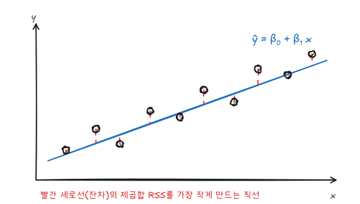
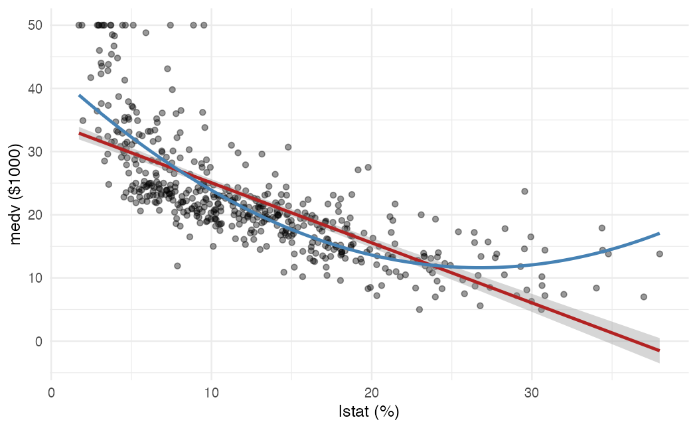
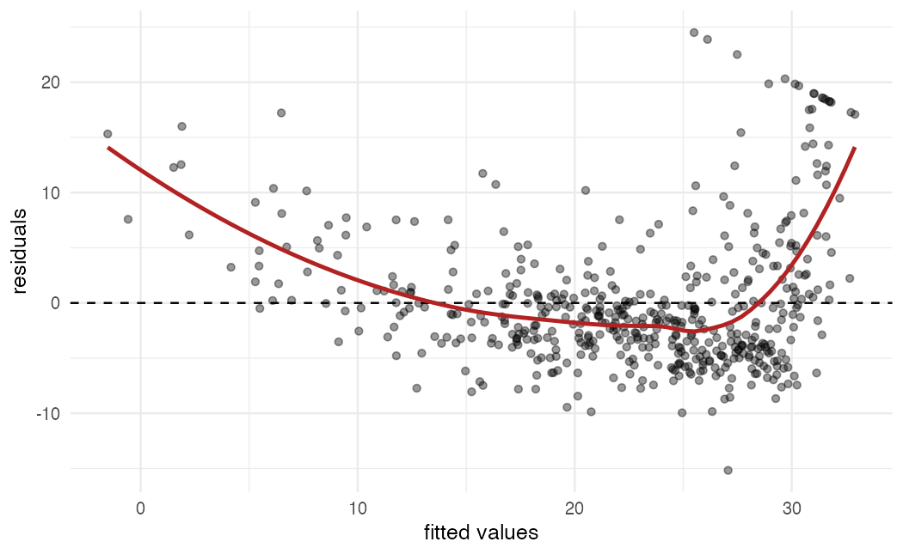

ISLR 3장과 이영미 교수님 데이터마이닝 강의의 선형회귀 부분을 정리했다. 선형회귀는 가장 단순한 지도학습 방법이지만, 이후 나오는 거의 모든 방법의 기준점이 된다.

## 단순선형회귀

설명 변수가 하나일 때 $f(X)$를 직선으로 둔다.

$$
Y = \beta_0 + \beta_1 X + \epsilon
$$

### 최소제곱 추정

$\hat y_i = \hat\beta_0 + \hat\beta_1 x_i$일 때, 잔차 $e_i = y_i - \hat y_i$의 제곱합을 최소화하는 계수를 고른다.

$$
RSS = \sum_{i=1}^{n} (y_i - \hat\beta_0 - \hat\beta_1 x_i)^2
$$



$RSS$를 $\beta_0, \beta_1$로 편미분해 0으로 두면 다음 해가 나온다.

$$
\hat\beta_1 = \frac{\sum_{i}(x_i - \bar x)(y_i - \bar y)}{\sum_{i}(x_i - \bar x)^2}, \qquad
\hat\beta_0 = \bar y - \hat\beta_1 \bar x
$$

두 번째 식에서 회귀직선은 항상 $(\bar x, \bar y)$를 지난다는 것을 알 수 있다.

### 계수의 정확도

$\epsilon$의 분산을 $\sigma^2$이라 하면 기울기 추정량의 표준오차는 다음과 같다.

$$
SE(\hat\beta_1)^2 = \frac{\sigma^2}{\sum_{i}(x_i - \bar x)^2}
$$

$x$가 넓게 퍼져 있을수록 기울기를 정확히 추정한다. $\sigma$는 $RSE = \sqrt{RSS/(n-2)}$로 추정한다. $H_0: \beta_1 = 0$의 검정 통계량은 다음과 같고, $H_0$에서 자유도 $n-2$인 $t$분포를 따른다.

$$
t = \frac{\hat\beta_1 - 0}{SE(\hat\beta_1)}
$$

### 적합도

| 지표 | 식 | 의미 |
|---|---|---|
| RSE | $\sqrt{RSS/(n-p-1)}$ | 반응 변수 단위로 본 잔차의 평균적인 크기 |
| $R^2$ | $1 - RSS/TSS$ | $Y$의 변동 중 모델이 설명한 비율 |

$TSS = \sum (y_i - \bar y)^2$이다. 단순선형회귀에서는 $R^2 = r^2$, 즉 $X$와 $Y$의 표본상관계수의 제곱과 같다.

## Boston 데이터 실습

`ISLR2::Boston`의 `medv`(주택 가격 중앙값, 천 달러)를 `lstat`(저소득층 비율, %)으로 설명한다.

```r
library(tidyverse)
theme_set(theme_minimal(base_size = 12))
library(ISLR2)

boston <- as_tibble(Boston)
fit1 <- lm(medv ~ lstat, data = boston)
summary(fit1)
```

출력에서 볼 것은 계수 추정값과 표준오차, $t$값, $p$값, 그리고 아래쪽의 RSE와 $R^2$다. `lstat`의 계수는 약 $-0.95$로, 저소득층 비율이 1%p 높은 지역은 주택 가격 중앙값이 평균적으로 약 950달러 낮다.

```r
confint(fit1)

predict(fit1, tibble(lstat = c(5, 10, 15)), interval = "confidence")
predict(fit1, tibble(lstat = c(5, 10, 15)), interval = "prediction")
```

신뢰구간은 평균 반응 $E(Y \mid X = x_0)$에 대한 구간이고, 예측구간은 개별 관측값 $Y$에 대한 구간이다. 예측구간은 $\epsilon$의 변동까지 포함하므로 항상 더 넓다.

```r
ggplot(boston, aes(lstat, medv)) +
  geom_point(alpha = 0.4) +
  geom_smooth(method = "lm", formula = y ~ x, color = "firebrick") +
  geom_smooth(method = "lm", formula = y ~ poly(x, 2), color = "steelblue", se = FALSE) +
  labs(x = "lstat (%)", y = "medv ($1000)")
```



산점도를 보면 관계가 휘어 있다. 빨간 직선은 양 끝에서 계통적으로 빗나가고, 파란 2차 곡선이 더 잘 맞는다. 선형회귀의 "선형"은 계수에 대한 선형이므로 $X^2$ 같은 항을 넣어도 여전히 선형회귀다.

## 다중선형회귀

$$
Y = \beta_0 + \beta_1 X_1 + \cdots + \beta_p X_p + \epsilon
$$

$\beta_j$는 **다른 설명 변수를 고정했을 때** $X_j$가 한 단위 증가할 때의 $Y$의 평균 변화다. 단순회귀의 계수와 다중회귀의 계수는 설명 변수끼리 상관이 있으면 달라질 수 있다.

```r
fit2 <- lm(medv ~ lstat + age, data = boston)
fit_all <- lm(medv ~ ., data = boston)
summary(fit_all)
```

### 전체 F 검정

"설명 변수 중 적어도 하나는 $Y$와 관련 있는가"는 $H_0: \beta_1 = \cdots = \beta_p = 0$에 대한 $F$ 검정으로 본다.

$$
F = \frac{(TSS - RSS)/p}{RSS/(n - p - 1)}
$$

변수가 많을 때 개별 $t$검정만 보면 우연히 유의한 계수가 나오기 쉽다. 전체 $F$ 검정은 변수 수를 반영하므로 먼저 확인한다.

### 질적 변수와 상호작용

범주형 변수는 가변수(dummy)로 들어간다. 수준이 $K$개면 가변수는 $K-1$개이고, 빠진 수준이 기준 범주가 된다. R은 factor를 넣으면 자동으로 처리한다.

상호작용항 $X_1 X_2$를 넣으면 $X_1$의 효과가 $X_2$ 값에 따라 달라지는 것을 허용한다.

$$
Y = \beta_0 + \beta_1 X_1 + \beta_2 X_2 + \beta_3 X_1 X_2 + \epsilon
= \beta_0 + (\beta_1 + \beta_3 X_2) X_1 + \beta_2 X_2 + \epsilon
$$

```r
fit_int <- lm(medv ~ lstat * age, data = boston)
coef(summary(fit_int))
```

`lstat * age`는 `lstat + age + lstat:age`의 줄임이다. 상호작용항을 넣을 때는 계층 원칙에 따라 주효과도 함께 넣는다.

### 잔차 진단

```r
boston |>
  mutate(fitted = fitted(fit1), resid = resid(fit1)) |>
  ggplot(aes(fitted, resid)) +
  geom_point(alpha = 0.4) +
  geom_hline(yintercept = 0, linetype = "dashed") +
  geom_smooth(method = "loess", formula = y ~ x, se = FALSE, color = "firebrick") +
  labs(x = "fitted values", y = "residuals")
```



잔차가 U자 패턴을 보이면 비선형성을 놓쳤다는 신호다. 그 밖에 확인할 것은 다음과 같다.

| 문제 | 확인 방법 | 대응 |
|---|---|---|
| 비선형성 | 잔차 대 적합값 그림의 패턴 | 다항항, 변환 |
| 이분산성 | 잔차 폭이 적합값에 따라 변함 | $\log Y$, $\sqrt Y$ 변환 |
| 이상점 | 스튜던트화 잔차 절댓값 3 초과 | 원인 확인 후 제외 여부 판단 |
| 고영향점 | 레버리지 $h_i$가 $(p+1)/n$보다 훨씬 큼 | 적합 결과 비교 |
| 공선성 | VIF가 5~10 이상 | 변수 제거, 결합 |

## 테스트 오차로 비교

```r
set.seed(1)
idx <- sample(nrow(boston), 0.7 * nrow(boston))
train <- boston[idx, ]
test  <- boston[-idx, ]

models <- list(
  lstat     = medv ~ lstat,
  lstat_sq  = medv ~ poly(lstat, 2),
  all       = medv ~ .
)
map_dbl(models, \(f) {
  fit <- lm(f, data = train)
  mean((test$medv - predict(fit, test))^2)
})
```

학습 데이터의 $R^2$는 변수를 넣을수록 커지기만 하므로 모델 비교에 쓸 수 없다. 테스트 MSE, 교차검증, 수정 $R^2$, AIC·BIC처럼 복잡도를 반영한 기준을 쓴다.

## 요약

| 항목 | 내용 |
|---|---|
| 추정 | $RSS$ 최소화, $\hat\beta_0 = \bar y - \hat\beta_1 \bar x$ |
| 계수 해석 | 다른 변수 고정 시 평균 변화 |
| 검정 | 개별: $t$, 전체: $F$ |
| 구간 | 신뢰구간(평균) < 예측구간(개별값) |
| 확장 | 다항항, 가변수, 상호작용 모두 선형회귀 안에서 처리 |
| 진단 | 잔차 패턴, 이분산, 이상점, 레버리지, 공선성 |
