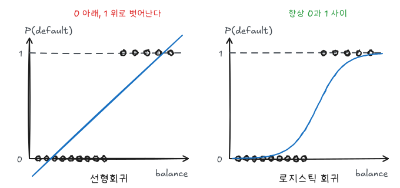
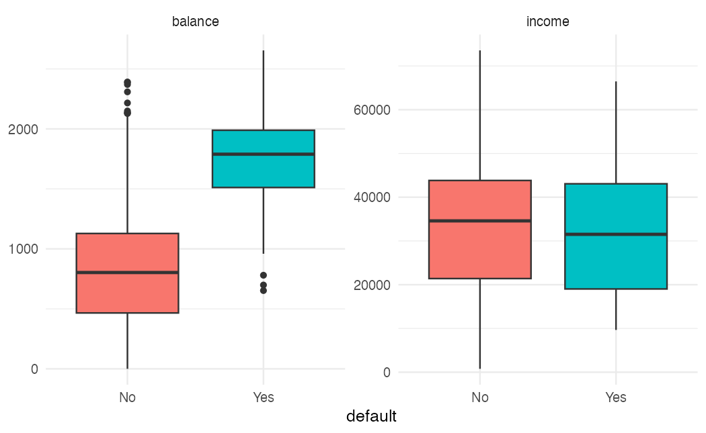
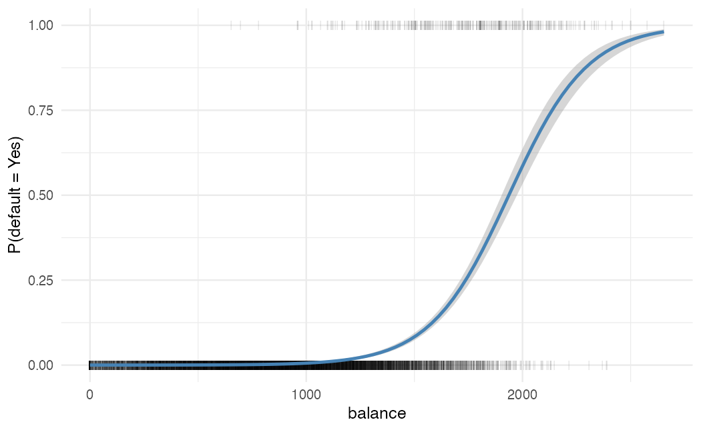
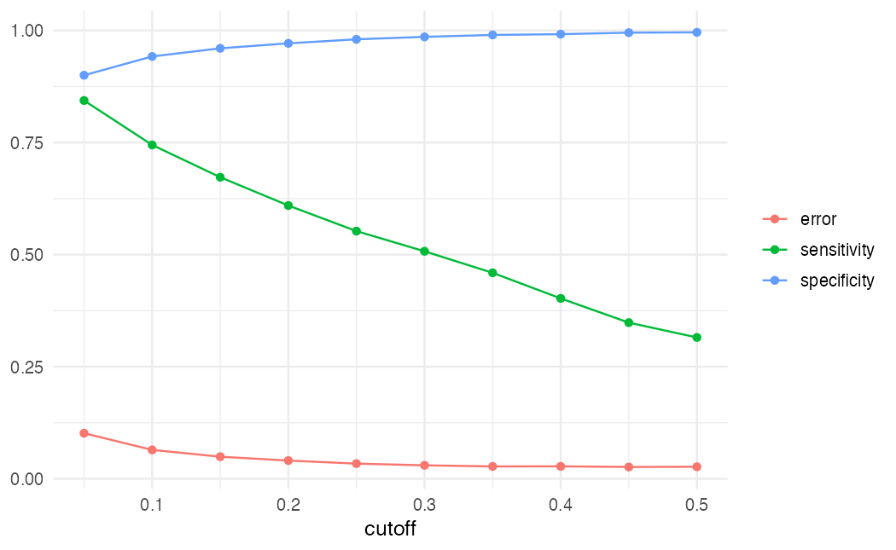

ISLR 4장과 이영미 교수님 데이터마이닝 강의의 로지스틱 회귀 부분을 정리했다. 이름은 회귀지만 목적은 $Y$가 특정 범주일 **확률**을 추정하는 분류 방법이다.

## 왜 선형회귀를 쓰지 않는가

$Y \in \{0, 1\}$을 그대로 선형회귀에 넣으면 $\hat Y$는 $P(Y = 1 \mid X)$의 추정치처럼 해석할 수 있지만, 값이 0보다 작거나 1보다 커질 수 있다.



범주가 3개 이상이면 문제가 더 커진다. 범주에 1, 2, 3 같은 숫자를 붙이면 범주 사이에 순서와 동일한 간격을 가정하게 되는데, 대부분의 범주형 변수에는 그런 구조가 없다.

## 로지스틱 모형

$Y \mid X \sim \text{Bernoulli}(p(X))$로 두고, $p(X) = P(Y = 1 \mid X)$를 로지스틱 함수로 모델링한다.

$$
p(X) = \frac{e^{\beta_0 + \beta_1 X}}{1 + e^{\beta_0 + \beta_1 X}}
$$

$\beta_0 + \beta_1 X$가 어떤 값이든 $p(X)$는 $(0, 1)$ 안에 있다. 정리하면 **로그 오즈(로짓)** 가 $X$의 선형식이 된다.

$$
\frac{p(X)}{1 - p(X)} = e^{\beta_0 + \beta_1 X}, \qquad
\log \frac{p(X)}{1 - p(X)} = \beta_0 + \beta_1 X
$$

### 계수 해석

- $X$가 한 단위 증가하면 로그 오즈가 $\beta_1$만큼 변한다.
- 오즈는 $e^{\beta_1}$배가 된다. 이것이 **오즈비**다.
- 확률 $p(X)$의 변화량은 일정하지 않다. 곡선의 기울기가 현재 $X$ 위치에 따라 다르기 때문이다. 다만 $\beta_1 > 0$이면 $X$가 커질 때 $p(X)$도 커진다는 방향은 항상 같다.

### 최대가능도 추정

계수는 최소제곱이 아니라 가능도를 최대화해 구한다.

$$
\ell(\beta_0, \beta_1) = \prod_{i: y_i = 1} p(x_i) \prod_{i: y_i = 0} \left(1 - p(x_i)\right)
$$

닫힌 해가 없으므로 반복 알고리즘(IRLS)으로 푼다. 검정에는 $t$ 대신 $z = \hat\beta_j / SE(\hat\beta_j)$를 쓴다.

## Default 데이터 실습

`ISLR2::Default`는 고객 10,000명의 신용카드 연체 여부(`default`)와 카드 잔액(`balance`), 소득(`income`), 학생 여부(`student`)를 담고 있다.

```r
library(tidyverse)
theme_set(theme_minimal(base_size = 12))
library(ISLR2)

default <- as_tibble(Default)
count(default, default)
```

연체 비율은 약 3.3%로 매우 불균형하다.

```r
default |>
  pivot_longer(c(balance, income)) |>
  ggplot(aes(default, value, fill = default)) +
  geom_boxplot(show.legend = FALSE) +
  facet_wrap(~name, scales = "free_y") +
  labs(x = "default", y = NULL)
```



`balance`는 연체 집단에서 확연히 높고, `income`은 두 집단의 차이가 작다.

### 적합과 예측

```r
fit_b <- glm(default ~ balance, data = default, family = binomial)
coef(summary(fit_b))

predict(fit_b, tibble(balance = c(1000, 2000)), type = "response")
```

`balance` 계수는 약 0.0055다. 잔액이 100달러 늘면 오즈가 $e^{0.55} \approx 1.73$배가 된다. 예측확률은 잔액 1,000달러에서 약 0.6%, 2,000달러에서 약 59%다. `type = "response"`를 빼면 로짓 척도의 값이 나온다.

```r
ggplot(default, aes(balance, as.numeric(default == "Yes"))) +
  geom_point(alpha = 0.1, shape = "|", size = 3) +
  geom_smooth(method = "glm", formula = y ~ x,
              method.args = list(family = binomial), color = "steelblue") +
  labs(x = "balance", y = "P(default = Yes)")
```



### 교란: student 계수의 부호가 바뀐다

```r
fit_s <- glm(default ~ student, data = default, family = binomial)
fit_all <- glm(default ~ balance + income + student, data = default, family = binomial)

coef(fit_s)["studentYes"]
coef(fit_all)["studentYes"]
```

`student`만 넣으면 계수가 양수(학생이 더 많이 연체)인데, `balance`를 함께 넣으면 음수가 된다.

```r
default |>
  group_by(student) |>
  summarise(mean_balance = mean(balance), default_rate = mean(default == "Yes"))
```

학생은 평균 잔액이 더 높고, 잔액이 높을수록 연체 확률이 높다. 그래서 학생 전체의 연체율은 높지만, **같은 잔액에서 비교하면** 학생이 오히려 덜 연체한다. 단순 모형의 계수는 `balance`의 효과까지 떠안은 값이다. 다중회귀에서처럼 계수는 다른 변수를 고정한 조건부 효과로 해석해야 한다.

## 분류 기준값과 혼동행렬

예측확률을 범주로 바꾸려면 기준값이 필요하다.

```r
prob <- predict(fit_all, type = "response")
pred <- if_else(prob > 0.5, "Yes", "No")

table(predicted = pred, actual = default$default)
mean(pred == default$default)
```

정확도는 약 97%지만, 모두 "No"로 찍어도 96.7%다. 실제 연체자 333명 중 맞힌 비율인 **민감도**를 보면 30% 남짓이다.

| | 실제 Yes | 실제 No |
|---|---|---|
| 예측 Yes | TP | FP |
| 예측 No | FN | TN |

- 민감도(재현율) $= TP / (TP + FN)$: 실제 연체자를 잡아낸 비율
- 특이도 $= TN / (TN + FP)$: 정상 고객을 정상으로 본 비율

연체자를 놓치는 비용이 크면 기준값을 낮춘다.

```r
cut_result <- map_dfr(seq(0.05, 0.5, by = 0.05), \(cut) {
  pred <- prob > cut
  actual <- default$default == "Yes"
  tibble(cutoff = cut,
         sensitivity = mean(pred[actual]),
         specificity = mean(!pred[!actual]),
         error = mean(pred != actual))
})

cut_result |>
  pivot_longer(-cutoff) |>
  ggplot(aes(cutoff, value, color = name)) +
  geom_line() + geom_point() +
  labs(x = "cutoff", y = NULL, color = NULL)
```



기준값을 낮추면 민감도는 올라가고 특이도와 전체 정확도는 조금 떨어진다. 어디에 둘지는 통계가 아니라 오분류 비용이 정한다. 모든 기준값에서의 민감도와 $1 - $ 특이도를 이은 것이 ROC 곡선이고, 그 아래 면적(AUC)은 기준값과 무관한 분류 성능 요약이다.

## 다범주 로지스틱 회귀

범주가 $K$개면 하나(예: $K$번째)를 기준으로 두고 나머지 $K-1$개에 대해 로그 오즈를 모델링한다.

$$
\log \frac{P(Y = k \mid X)}{P(Y = K \mid X)} = \beta_{k0} + \beta_{k1} X_1 + \cdots + \beta_{kp} X_p
$$

R에서는 `nnet::multinom()`으로 적합한다. 다범주에서는 다음 글의 LDA도 자주 쓴다.

## 요약

| 항목 | 내용 |
|---|---|
| 모형 | $\log\frac{p}{1-p} = \beta_0 + \beta^T X$ |
| 추정 | 최대가능도, `glm(family = binomial)` |
| 해석 | $e^{\beta_j}$ = 오즈비, 확률 변화량은 위치마다 다름 |
| 교란 | 단순 모형과 다중 모형의 계수 부호가 바뀔 수 있다 |
| 평가 | 불균형 자료에서는 정확도보다 민감도·특이도·AUC |
| 기준값 | 0.5는 관습, 오분류 비용으로 정한다 |
