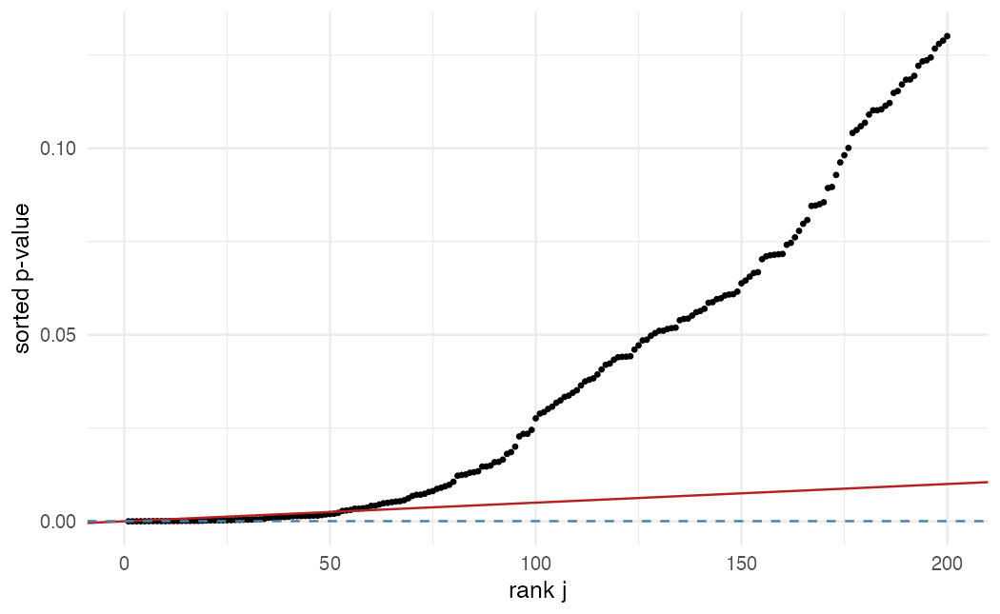

ISLR 13장을 짧게 정리했다. 데이터 마이닝에서는 변수 수천 개를 한꺼번에 검정하는 일이 흔하다. 유의수준 0.05로 독립인 검정 $m$개를 하면, 모든 귀무가설이 참이어도 평균 $0.05m$개가 우연히 유의하게 나온다.

## 오류의 종류

$m$개 가설 중 귀무가설이 참인 것이 $m_0$개라 하자.

| | $H_0$ 기각 안 함 | $H_0$ 기각 |
|---|---|---|
| $H_0$ 참 | $U$ | $V$ (거짓 양성) |
| $H_0$ 거짓 | $W$ | $S$ |
| 합 | $m - R$ | $R$ |

| 기준 | 정의 | 통제 대상 |
|---|---|---|
| FWER | $P(V \ge 1)$ | 거짓 양성이 **하나라도** 나올 확률 |
| FDR | $E\left[V / R\right]$ ($R = 0$이면 0) | 기각한 것 중 거짓 양성의 **비율** |

독립인 검정 $m$개를 각각 $\alpha$로 하면 $FWER = 1 - (1 - \alpha)^m$이다. $\alpha = 0.05$, $m = 100$이면 0.994다.

## FWER 통제

**본페로니**: 각 검정을 $\alpha / m$으로 한다. 합집합 상한 $P(\cup A_j) \le \sum P(A_j)$에서 $FWER \le m \cdot \alpha/m = \alpha$가 나온다. 검정 사이의 의존 구조와 무관하게 성립하지만 보수적이다.

**홀름**: $p$값을 오름차순 $p_{(1)} \le \cdots \le p_{(m)}$으로 놓고, $p_{(j)} > \alpha / (m - j + 1)$인 첫 $j$ 이전까지만 기각한다. 본페로니와 같이 FWER을 $\alpha$로 통제하면서 항상 같거나 더 많이 기각하므로, 본페로니 대신 쓰지 않을 이유가 없다.

## FDR 통제: 벤자미니-호크버그

수천 개를 검정하는 탐색 단계에서는 거짓 양성 하나도 허용하지 않는 FWER이 너무 엄격하다. "발견한 것 중 거짓 비율을 $q$ 이하로"가 더 현실적인 목표다.

1. $p$값을 오름차순 정렬한다.
2. $L = \max\{ j : p_{(j)} \le q j / m \}$를 찾는다.
3. $p_{(1)}, \dots, p_{(L)}$에 해당하는 가설을 모두 기각한다.

$p$값이 독립(또는 양의 의존)이면 $FDR \le q \cdot m_0 / m \le q$가 성립한다.

## 시뮬레이션

검정 1,000개 중 100개만 실제 효과가 있는 상황을 만든다.

```r
library(tidyverse)
theme_set(theme_minimal(base_size = 12))

set.seed(1)
m <- 1000; m1 <- 100
truth <- rep(c(TRUE, FALSE), c(m1, m - m1))
p <- map_dbl(seq_len(m), \(j) t.test(rnorm(20, mean = if (truth[j]) 0.8 else 0))$p.value)

methods <- c(none = "none", bonferroni = "bonferroni", holm = "holm", BH = "BH")
map_dfr(methods, \(meth) {
  reject <- p.adjust(p, method = meth) <= 0.05
  tibble(R = sum(reject), V = sum(reject & !truth), S = sum(reject & truth),
         FDP = if (sum(reject) > 0) V / R else 0)
}, .id = "method")
```

`p.adjust()`는 보정된 $p$값을 돌려주므로 0.05와 바로 비교하면 된다.

- 보정하지 않으면 128개를 기각하는데 그중 42개가 거짓 양성이다. 기대값 $900 \times 0.05 = 45$와 비슷하다. 발견의 약 1/3이 가짜다.
- 본페로니와 홀름은 거짓 양성이 0개지만 6개만 찾는다. 실제 효과 100개 중 94개를 놓친다.
- BH는 52개를 찾고 거짓 양성은 1개(FDP 약 2%)다. FDR 상한 $q \cdot m_0/m = 0.045$ 아래에 있으면서 본페로니보다 훨씬 많이 찾아낸다.

```r
tibble(rank = 1:m, p = sort(p)) |>
  filter(rank <= 200) |>
  ggplot(aes(rank, p)) +
  geom_point(size = 0.8) +
  geom_abline(intercept = 0, slope = 0.05 / m, color = "firebrick") +
  geom_hline(yintercept = 0.05 / m, color = "steelblue", linetype = "dashed") +
  labs(x = "rank j", y = "sorted p-value")
```



빨간 선은 BH 기준선 $qj/m$, 파란 점선은 본페로니 기준 $\alpha/m$이다. BH는 빨간 선 아래에 있는 마지막 점까지 모두 기각한다.

## 요약

| 방법 | 통제 | 기준 | 쓰임 |
|---|---|---|---|
| 보정 없음 | 없음 | $p \le \alpha$ | 검정이 하나일 때 |
| 본페로니 | FWER | $p \le \alpha / m$ | 검정 수가 적고 오류 비용이 클 때 |
| 홀름 | FWER | 단계적 $\alpha / (m - j + 1)$ | 본페로니의 상위 호환 |
| BH | FDR | $p_{(j)} \le qj/m$ | 탐색적 대량 검정 |
