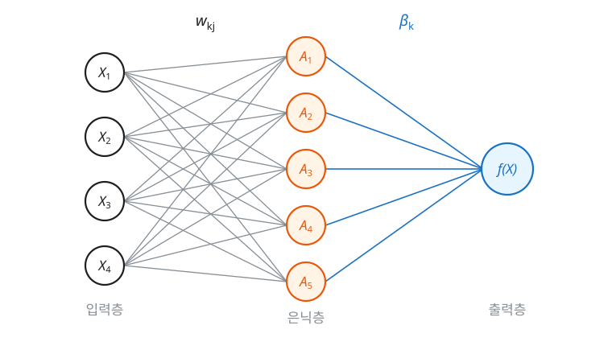
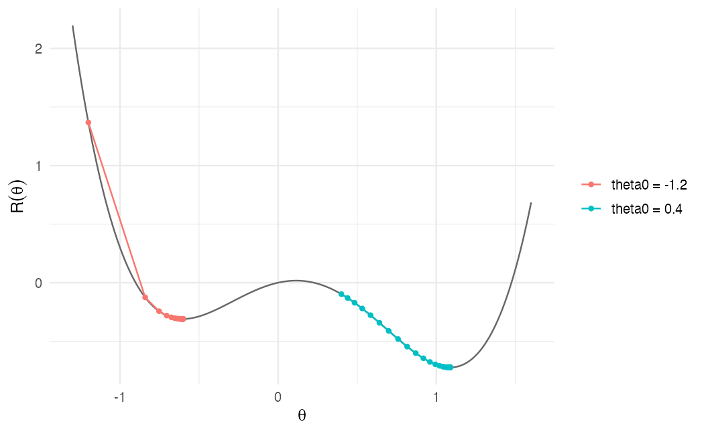
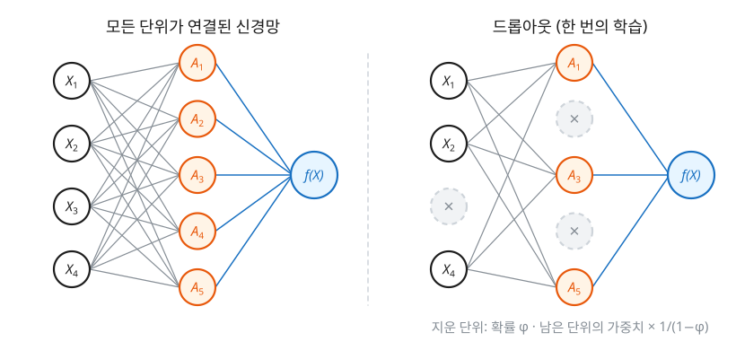
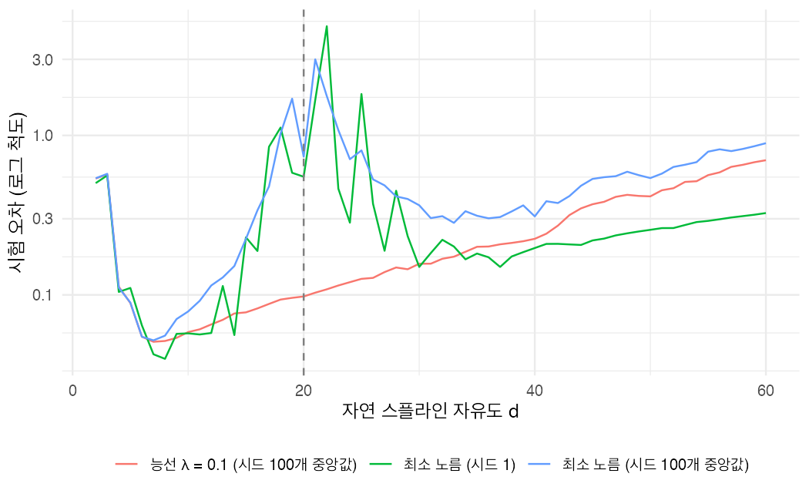
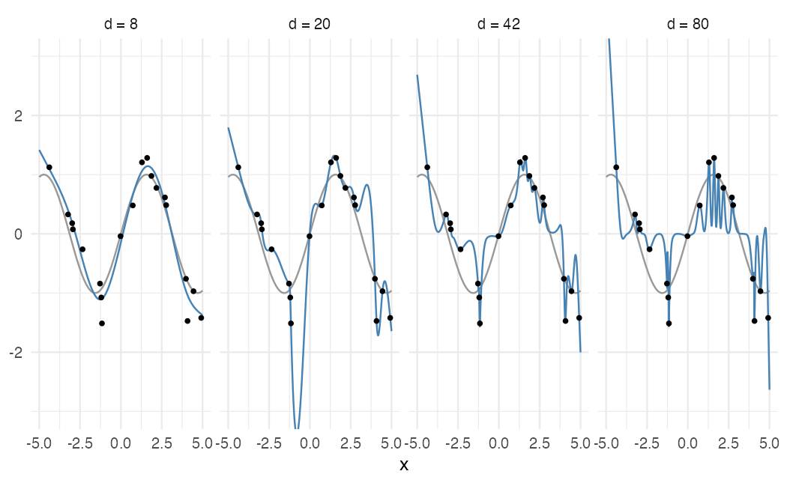

ISLR 10.1, 10.2, 10.7, 10.8을 바탕으로 정리했다. 신경망은 입력의 선형결합에 비선형 함수를 씌워 **새 특성을 만들고**, 그 특성으로 반응을 회귀하는 모형이다. [비선형 모형](/posts/dm-nonlinear)의 기저함수와 발상이 같지만, 기저함수의 모양을 미리 정하지 않고 자료에서 학습한다는 점이 다르다.

## 단층 신경망

입력 $X = (X_1, \dots, X_p)$에서 반응 $Y$를 예측하는 은닉층 하나짜리 신경망은 다음과 같다.

$$
f(X) = \beta_0 + \sum_{k=1}^{K} \beta_k A_k, \qquad A_k = h_k(X) = g\left(w_{k0} + \sum_{j=1}^{p} w_{kj} X_j\right)
$$

- $A_k$: $k$번째 **은닉 단위**의 활성. 입력의 선형결합 $z_k = w_{k0} + \sum_j w_{kj}X_j$를 활성화 함수 $g$에 넣은 값이다.
- $K$: 은닉 단위의 수. $w_{kj}$는 입력층에서 은닉층으로 가는 가중치, $\beta_k$는 은닉층에서 출력으로 가는 가중치다.
- 출력 $f(X)$는 $K$개의 새 특성 $A_1, \dots, A_K$에 대한 선형회귀다.



활성화 함수로는 두 가지를 주로 쓴다.

| 활성화 | 식 | 값의 범위 | 특징 |
|---|---|---|---|
| 시그모이드 | $g(z) = \dfrac{e^z}{1+e^z} = \dfrac{1}{1+e^{-z}}$ | $(0, 1)$ | 로지스틱 회귀와 같은 함수. 양 끝에서 기울기가 0에 가까워진다 |
| ReLU | $g(z) = (z)_+ = \max(0, z)$ | $[0, \infty)$ | 계산이 빠르고 기울기가 사라지지 않는다. 0에서 꺾이지만 $w_{k0}$가 꺾이는 위치를 옮긴다 |

**비선형 활성화가 필수다.** $g$가 항등함수라면 $f(X) = \beta_0 + \sum_k \beta_k (w_{k0} + \sum_j w_{kj}X_j)$이고, 정리하면 $X$의 선형모형일 뿐이다. 은닉층을 몇 개 쌓아도 마찬가지다.

양적 반응이면 제곱오차 $\sum_{i=1}^{n} (y_i - f(x_i))^2$를 최소화해 가중치를 추정한다.

### 예: 두 은닉 단위가 상호작용을 만든다

ISLR의 손계산 예다. $p = 2$, $K = 2$, $g(z) = z^2$으로 두고 가중치를 다음처럼 정한다.

$$
\beta_0 = 0, \;\; \beta_1 = \tfrac14, \;\; \beta_2 = -\tfrac14, \qquad (w_{10}, w_{11}, w_{12}) = (0, 1, 1), \;\; (w_{20}, w_{21}, w_{22}) = (0, 1, -1)
$$

그러면 $A_1 = (X_1 + X_2)^2$, $A_2 = (X_1 - X_2)^2$이고

$$
f(X) = \tfrac14 (X_1 + X_2)^2 - \tfrac14 (X_1 - X_2)^2 = X_1 X_2
$$

다. 두 입력의 합과 차를 각각 비선형으로 변환하고 더했더니 상호작용 항이 나왔다. 회귀에서 $X_1X_2$를 직접 넣어야 했던 상호작용을, 신경망은 가중치를 학습하면서 스스로 만든다.

```r
library(tidyverse)
library(ISLR2)
theme_set(theme_minimal(base_size = 12))

g <- function(z) z^2
f_nn <- function(x1, x2) {
  A1 <- g(0 + 1 * x1 + 1 * x2)
  A2 <- g(0 + 1 * x1 - 1 * x2)
  0 + A1 / 4 - A2 / 4
}
x1 <- c(2, -1, 0.5); x2 <- c(3, 4, -2)
rbind(nn = f_nn(x1, x2), product = x1 * x2)
```

세 점 모두 신경망 출력과 $X_1X_2$가 같다. 실제로는 $z^2$을 쓰지 않는다. $z^2$으로는 2차 다항식밖에 만들 수 없기 때문이다. 시그모이드나 ReLU는 단위를 늘릴수록 더 많은 함수를 근사한다.

## 다층 신경망

은닉층을 여러 개 쌓으면 앞 층의 활성이 다음 층의 입력이 된다. 은닉층이 둘이면

$$
A^{(1)}_k = g\left(w^{(1)}_{k0} + \sum_{j=1}^{p} w^{(1)}_{kj} X_j\right), \qquad
A^{(2)}_\ell = g\left(w^{(2)}_{\ell 0} + \sum_{k=1}^{K_1} w^{(2)}_{\ell k} A^{(1)}_k\right)
$$

이다. 가중치를 층별 행렬 $\mathbf W_1$($p+1$행 $K_1$열), $\mathbf W_2$($K_1+1$행 $K_2$열), 출력 가중치 $\mathbf B$로 묶는다. 각 행렬의 행이 하나 더 많은 것은 절편 때문이다.

출력이 여러 개일 수도 있다. 손글씨 숫자 자료 MNIST는 반응이 0~9 중 하나인 질적 변수인데, 이것을 원-핫 지시변수 10개로 두면 출력이 10개인 신경망이 된다. 출력층은 선형결합 $Z_m$을 소프트맥스로 확률로 바꾼다.

$$
Z_m = \beta_{m0} + \sum_{\ell=1}^{K_2} \beta_{m\ell} A^{(2)}_\ell, \qquad
f_m(X) = \Pr(Y = m \mid X) = \frac{e^{Z_m}}{\sum_{\ell=0}^{9} e^{Z_\ell}}
$$

손실은 다항 로지스틱 회귀와 같은 **교차 엔트로피**다. $y_{im}$은 관측 $i$가 숫자 $m$이면 1, 아니면 0이다.

$$
-\sum_{i=1}^{n} \sum_{m=0}^{9} y_{im} \log f_m(x_i)
$$

> **주의** 신경망에서 말하는 weights와 bias는 회귀의 계수와 절편이다. bias는 편향-분산 교환의 편향과 관계가 없다.

### 예: MNIST 신경망의 모수 수

ISLR의 MNIST 신경망은 입력 784개(28×28 픽셀), 은닉층 256개와 128개, 출력 10개다. 층마다 (입력 수 + 1) × (출력 수)개의 가중치가 있다.

```r
layers <- c(784, 256, 128, 10)
n_par <- (head(layers, -1) + 1) * tail(layers, -1)
n_par
sum(n_par)
c(multinom = (784 + 1) * 9, ratio = sum(n_par) / ((784 + 1) * 9))
```

모수가 235,146개로, 같은 입력의 다항 로지스틱 회귀(7,065개)의 약 33배이고 훈련 자료 60,000건의 약 4배다. 규제 없이는 쉽게 과적합한다. ISLR 표 10.1의 시험 오차율은 다음과 같다(ISLR 수치 인용).

| 방법 | 시험 오차율 |
|---|---|
| 신경망 + 능선 규제 | 2.3% |
| 신경망 + 드롭아웃 | 1.8% |
| 다항 로지스틱 회귀 | 7.2% |
| 선형판별분석 | 12.7% |

## 신경망의 적합

모수를 $\theta$로 묶으면 목적함수는

$$
R(\theta) = \frac12 \sum_{i=1}^{n} \left(y_i - f_\theta(x_i)\right)^2 = \sum_{i=1}^{n} R_i(\theta)
$$

이다. $\frac12$은 미분을 간단히 하려고 붙였을 뿐 해는 같다. 이 문제는 선형회귀와 달리 **비볼록**이다. 은닉 단위의 순서를 바꿔도 같은 함수가 되고, 비선형 함수가 겹겹이 들어 있어서 국소 최소가 여러 개다. 그래서 전역 최소를 찾기보다 좋은 국소 최소에 도달하기를 바라며, 두 가지 전략을 쓴다.

- **느린 학습**: 경사하강을 작은 걸음으로 반복하고, 과적합이 보이면 멈춘다(조기 종료).
- **규제**: 능선이나 Lasso 벌점, 드롭아웃.

### 경사하강

현재 값 $\theta^m$에서 목적함수가 가장 빨리 줄어드는 방향은 기울기의 반대 방향이다.

$$
\theta^{m+1} \leftarrow \theta^m - \rho \, \nabla R(\theta^m)
$$

$\rho$는 **학습률**이다. 비볼록 함수에서는 어디서 출발하느냐에 따라 도착하는 최소가 다르다. 국소 최소 하나와 전역 최소 하나가 있는 1차원 함수로 확인한다.

```r
R  <- function(t) t^4 - 0.8 * t^3 - 1.2 * t^2 + 0.3 * t
dR <- function(t) 4 * t^3 - 2.4 * t^2 - 2.4 * t + 0.3

gd <- function(theta0, rho = 0.05, steps = 40) {
  theta <- numeric(steps + 1); theta[1] <- theta0
  for (m in 1:steps) theta[m + 1] <- theta[m] - rho * dR(theta[m])
  tibble(step = 0:steps, theta = theta, R = R(theta))
}
paths <- bind_rows(`theta0 = -1.2` = gd(-1.2), `theta0 = 0.4` = gd(0.4), .id = "start")
paths |> group_by(start) |> slice_tail(n = 1)
```

```r
tibble(theta = seq(-1.3, 1.6, length.out = 300)) |>
  ggplot(aes(theta, R(theta))) +
  geom_line(color = "grey40") +
  geom_path(data = paths, aes(theta, R, color = start)) +
  geom_point(data = paths, aes(theta, R, color = start), size = 1.2) +
  labs(x = expression(theta), y = expression(R(theta)), color = NULL)
```



$\theta^0 = -1.2$에서 출발하면 $\theta \approx -0.60$의 국소 최소($R = -0.31$)에 멈추고, $\theta^0 = 0.4$에서 출발하면 $\theta \approx 1.09$의 전역 최소($R = -0.72$)에 도착한다. 두 경로 모두 기울기가 0인 곳에서 멈추므로, 경사하강만으로는 자신이 국소 최소에 있는지 알 수 없다.

### 역전파

기울기는 연쇄법칙으로 구한다. 단층 신경망에서 $z_{ik} = w_{k0} + \sum_j w_{kj}x_{ij}$로 두면 $R_i(\theta) = \frac12 \left(y_i - \beta_0 - \sum_k \beta_k g(z_{ik})\right)^2$이고

$$
\frac{\partial R_i}{\partial \beta_k} = -\left(y_i - f_\theta(x_i)\right) g(z_{ik}), \qquad
\frac{\partial R_i}{\partial w_{kj}} = -\left(y_i - f_\theta(x_i)\right) \beta_k \, g'(z_{ik}) \, x_{ij}
$$

이다. 두 식 모두 잔차 $y_i - f_\theta(x_i)$에서 출발한다. 출력 가중치 $\beta_k$의 기울기는 잔차에 그 은닉 단위의 활성을 곱한 것이고, 입력 가중치 $w_{kj}$의 기울기는 잔차를 $\beta_k g'(z_{ik})$만큼 은닉 단위 $k$로 나눠 보낸 뒤 입력 $x_{ij}$를 곱한 것이다. 잔차의 책임이 출력에서 입력 쪽으로 **거꾸로 전파**되며 나뉘기 때문에 역전파(backpropagation)라 부른다. 층이 많아도 같은 연쇄법칙을 층마다 반복할 뿐이다.

손으로 유도한 식이 맞는지는 유한 차분 $\{R(\theta + h e_j) - R(\theta - h e_j)\}/2h$와 비교해 확인한다. 시그모이드 은닉 단위 3개, 입력 2개, 관측 5개인 작은 신경망이다.

```r
sigmoid <- function(z) 1 / (1 + exp(-z))
set.seed(1)
X <- matrix(rnorm(10), 5, 2); y <- rnorm(5)
W <- matrix(rnorm(9), 3, 3)          # 행 k: (w_k0, w_k1, w_k2)
beta <- rnorm(4)                     # (beta_0, ..., beta_3)

loss <- function(W, beta) {
  Z <- cbind(1, X) %*% t(W)          # z_ik, 5 x 3
  f <- beta[1] + sigmoid(Z) %*% beta[-1]
  sum((y - f)^2) / 2
}

Z <- cbind(1, X) %*% t(W); A <- sigmoid(Z)
res <- as.vector(y - (beta[1] + A %*% beta[-1]))
grad_beta <- c(-sum(res), -colSums(res * A))
grad_W <- t(sapply(1:3, \(k) -colSums(res * beta[k + 1] * A[, k] * (1 - A[, k]) * cbind(1, X))))

h <- 1e-6
num_W <- W
for (i in seq_along(W)) {
  Wp <- W; Wp[i] <- W[i] + h; Wm <- W; Wm[i] <- W[i] - h
  num_W[i] <- (loss(Wp, beta) - loss(Wm, beta)) / (2 * h)
}
num_beta <- sapply(1:4, \(j) {
  bp <- beta; bp[j] <- beta[j] + h; bm <- beta; bm[j] <- beta[j] - h
  (loss(W, bp) - loss(W, bm)) / (2 * h)
})
c(max_diff_W = max(abs(grad_W - num_W)), max_diff_beta = max(abs(grad_beta - num_beta)))
```

시그모이드의 미분은 $g'(z) = g(z)(1 - g(z))$다. 해석적 기울기와 수치 기울기의 차이가 $10^{-9}$ 이하로, 위 식의 부호와 $\frac12$ 계수가 맞다.

### 확률적 경사하강

$\nabla R(\theta) = \sum_i \nabla R_i(\theta)$는 관측마다의 기울기를 더한 것이다. 매번 $n$개를 모두 쓰지 않고, 무작위로 뽑은 작은 **미니배치**의 기울기로 갱신하는 것이 **확률적 경사하강**(SGD)이다. 훈련 자료 전체를 한 번 훑는 것을 **에폭**이라 한다. ISLR의 MNIST 적합은 훈련 48,000건을 배치 128로 나눴으므로 에폭당 약 375번 갱신한다.

| | 경사하강 | 확률적 경사하강 |
|---|---|---|
| 한 번의 갱신에 쓰는 자료 | 전체 $n$개 | 미니배치 (예: 32, 128개) |
| 갱신 한 번의 비용 | 크다 | 작다 |
| 갱신 방향 | 정확한 기울기 | 잡음이 섞인 기울기 |
| 쓰임 | 작은 자료 | 큰 자료. 잡음이 규제처럼 작용하기도 한다 |

## 규제와 조율

모수가 많은 신경망은 규제가 필수다.

- **능선·Lasso 벌점**: 목적함수에 $\lambda \sum_j \theta_j^2$ 또는 $\lambda \sum_j |\theta_j|$를 더한다. MNIST라면 $R(\theta; \lambda) = -\sum_i \sum_m y_{im} \log f_m(x_i) + \lambda \sum_j \theta_j^2$이다. 층마다 $\lambda$를 다르게 줄 수 있고, ISLR의 MNIST 예는 $\mathbf W_1, \mathbf W_2$에만 벌점을 주고 출력 가중치 $\mathbf B$에는 주지 않았다.
- **드롭아웃**: 훈련 관측을 처리할 때마다 은닉 단위(또는 입력)를 확률 $\phi$로 무작위로 지운다. 남은 단위의 가중치는 $1/(1-\phi)$배로 키워 지운 몫을 메운다. 특정 단위에 의존하지 못하게 만드는 규제이며, 변수를 무작위로 빼는 [랜덤 포레스트](/posts/dm-ensemble)에서 착안했다.
- **조기 종료**: 검증 자료의 목적함수가 다시 오르기 시작하면 학습을 멈춘다. ISLR의 MNIST 적합은 약 30 에폭부터 검증 목적함수가 올랐다.



조율할 것은 은닉층의 수와 층별 단위 수, 층별 $\lambda$와 $\phi$, 배치 크기, 에폭 수, (이미지라면) 데이터 증강이다. 요즘은 단위를 넉넉히 두고 과적합은 규제로 막는다.

### 예: Hitters 연봉

ISLR 10.6과 10.9.1의 예다. 1986년 성적으로 1987년 연봉(`Salary`, 천 달러)을 예측한다. 결측을 뺀 263명을 2/3 훈련, 1/3 시험으로 나누고 선형회귀, Lasso, 신경망을 시험 자료의 평균절대오차(MAE)로 비교한다. 신경망은 ISLR 실습과 같이 은닉 단위 50개의 ReLU, 드롭아웃 0.4, RMSprop, 1,500 에폭, 배치 32다. `torch`와 `luz`를 쓴다.

```r
library(glmnet)
library(torch)
library(luz)

Gitters <- na.omit(Hitters)
n <- nrow(Gitters)
set.seed(13)
testid <- sample(1:n, trunc(n / 3))
x_raw <- model.matrix(Salary ~ . - 1, data = Gitters)
y <- Gitters$Salary

# 훈련 자료의 평균과 표준편차로 표준화
mu <- colMeans(x_raw[-testid, ]); s <- apply(x_raw[-testid, ], 2, sd)
x <- scale(x_raw, center = mu, scale = s)
mae <- function(pred) mean(abs(y[testid] - pred))
c(n = n, train = n - length(testid), test = length(testid), p = ncol(x))
```

```r
lfit <- lm(Salary ~ ., data = Gitters[-testid, ])
mae_lm <- mae(predict(lfit, Gitters[testid, ]))

set.seed(1)
cvfit <- cv.glmnet(x[-testid, ], y[-testid], type.measure = "mae")
mae_lasso <- mae(predict(cvfit, x[testid, ], s = "lambda.min"))
n_lasso <- sum(coef(cvfit, s = "lambda.min")[-1] != 0)
c(lm = mae_lm, lasso = mae_lasso, lasso_vars = n_lasso)
```

```r
modnn <- nn_module(
  initialize = function(input_size) {
    self$hidden <- nn_linear(input_size, 50)
    self$activation <- nn_relu()
    self$dropout <- nn_dropout(0.4)
    self$output <- nn_linear(50, 1)
  },
  forward = function(x) {
    x |> self$hidden() |> self$activation() |> self$dropout() |> self$output()
  }
)

fit_nn <- function(seed) {
  torch_manual_seed(seed); set.seed(seed)
  fitted <- modnn |>
    setup(loss = nn_mse_loss(), optimizer = optim_rmsprop) |>
    set_hparams(input_size = ncol(x)) |>
    fit(data = list(x[-testid, ], matrix(y[-testid], ncol = 1)),
        epochs = 1500, dataloader_options = list(batch_size = 32),
        accelerator = accelerator(cpu = TRUE), verbose = FALSE)
  as.numeric(predict(fitted, x[testid, ], accelerator = accelerator(cpu = TRUE)))
}
nn_pred <- map(1:3, fit_nn)
mae_nn <- map_dbl(nn_pred, mae)
mae_nn
```

| 모형 | 모수 수 | 시험 MAE |
|---|---|---|
| 선형회귀 | 20 | 254.7 |
| Lasso (교차검증 $\lambda$) | 변수 12개 | 253.1 |
| 신경망 (시드 1, 2, 3) | $50 \times 21 + 51 = 1{,}101$ | 278.9, 280.1, 282.8 |

신경망은 같은 구조, 같은 자료로 학습해도 시드(초기값과 드롭아웃의 난수)에 따라 시험 MAE가 278.9에서 282.8 사이로 달라진다. 비볼록 문제라 출발점마다 다른 해에 도착하기 때문이다. 이 분할에서는 선형회귀와 Lasso가 신경망보다 MAE가 25 정도 작았다. 신경망의 구조와 규제를 더 조율하면 좁혀질 수 있지만, 선형모형은 조율 없이 이 성능을 냈다. ISLR 표 10.2도 선형회귀 254.7, Lasso 252.3, 신경망 257.4로 세 모형이 비슷했다. 이 결과를 어떻게 읽을지는 [딥러닝](/posts/dm-deep-learning)의 "언제 딥러닝을 쓰는가"에서 다룬다.

> **주의** 신경망 한 번의 적합으로 결론을 내리지 않는다. 같은 모형이라도 초기값에 따라 결과가 달라진다. 또 위 비교는 이 분할 하나에서의 결과다.

## 보간과 이중 하강

[편향-분산 교환](/posts/dm-overview)에 따르면 훈련 오차가 0이 되도록 자료를 **보간**하는 모형은 과적합이라 피해야 한다. 그런데 모수가 자료 수보다 훨씬 많은 신경망이 훈련 오차 0에서도 시험 오차가 작은 경우가 있다. 이것을 보여 주는 현상이 **이중 하강**(double descent)이다. 모형의 자유도를 늘려 가면 시험 오차가 보간 문턱(자유도 = $n$)까지는 U자를 그리고, 문턱 근처에서 폭증한 뒤, 문턱을 넘으면 다시 내려간다.

ISLR의 설정을 따른다. $X \sim U[-5, 5]$, $Y = \sin X + \epsilon$, $\epsilon \sim N(0, 0.3^2)$에서 $n = 20$개를 뽑고, 자유도 $d$인 자연 스플라인(`splines::ns(x, df = d, intercept = TRUE)`, 절편 포함 열 수가 $d$)으로 적합한다. $d > 20$이면 최소제곱 해가 무수히 많으므로 그중 계수의 노름 $\sum_j \hat\beta_j^2$이 가장 작은 **최소 노름 해**를 고른다(`MASS::ginv`). 비교를 위해 같은 기저에 능선 회귀($\lambda = 0.1$)도 적합한다. 시험 오차는 참함수와의 거리 $\frac{1}{1000}\sum_t (\sin x_t - \hat f(x_t))^2$로 잰다.

```r
library(splines)

dd_fit <- function(x, y, xt, d, lambda = 0) {
  B <- ns(x, df = d, intercept = TRUE)
  Bt <- predict(B, xt)
  beta <- if (lambda == 0) MASS::ginv(B) %*% y
          else solve(crossprod(B) + lambda * diag(d), crossprod(B, y))
  list(train = mean((y - B %*% beta)^2), pred = as.vector(Bt %*% beta))
}
dd_sim <- function(seed, ds = 2:60, lambda = 0) {
  set.seed(seed)
  x <- runif(20, -5, 5); y <- sin(x) + rnorm(20, sd = 0.3)
  xt <- seq(-5, 5, length.out = 1000)
  map_dfr(ds, \(d) {
    fit <- dd_fit(x, y, xt, d, lambda)
    tibble(d = d, train = fit$train, test = mean((sin(xt) - fit$pred)^2))
  })
}
one <- dd_sim(1)
one |> filter(d %in% c(8, 15, 19, 20, 21, 25, 42, 60)) |> mutate(across(c(train, test), \(v) round(v, 3)))
```

```r
curves <- bind_rows(
  `최소 노름 (시드 1)` = one,
  `최소 노름 (시드 100개 중앙값)` = map_dfr(1:100, dd_sim) |> group_by(d) |> summarise(test = median(test)),
  `능선 λ = 0.1 (시드 100개 중앙값)` = map_dfr(1:100, dd_sim, lambda = 0.1) |> group_by(d) |> summarise(test = median(test)),
  .id = "fit")
curves |>
  ggplot(aes(d, test, color = fit)) +
  geom_line() +
  geom_vline(xintercept = 20, linetype = "dashed", color = "grey50") +
  scale_y_log10() +
  labs(x = "자연 스플라인 자유도 d", y = "시험 오차 (로그 척도)", color = NULL) +
  theme(legend.position = "bottom")
```



```r
summarise_dd <- curves |> filter(d %in% c(8, 20, 21, 42, 60)) |>
  pivot_wider(names_from = d, values_from = test, id_cols = fit)
summarise_dd
```

시드 1의 최소 노름 해는 $d = 8$에서 시험 오차가 0.040으로 가장 작고, $d$를 늘리면 $d = 20$의 0.551, $d = 21$의 1.67로 커진다. 문턱을 넘으면 다시 내려가 $d = 42$에서 0.209가 된다. 보간하는 모형($d = 42$)이 보간 직전의 모형($d = 19$, 0.583)보다 낫다. 시드 100개의 중앙값도 $d = 21$의 3.00에서 $d = 42$의 0.377로 내려가지만, $d$를 더 키우면 천천히 다시 오른다($d = 60$에서 0.894). 두 번째 하강은 어느 범위까지만 이어진다.

같은 기저에 능선 회귀를 적합하면 문턱에서 폭증하지 않는다. 중앙값이 $d = 20$에서 0.098, $d = 21$에서 0.103으로 최소 노름 해보다 훨씬 작고, 모든 $d$에서 최소 노름 해의 중앙값보다 낮다. 다만 능선 회귀도 가장 좋은 곳은 작은 $d$다($d = 8$에서 0.051).

시드 하나는 자료에 따라 곡선이 크게 흔들리므로 시드 100개의 **중앙값**을 함께 그렸다. 평균을 쓰지 않은 것은 문턱 근처에서 몇몇 시드의 오차가 수천 배로 커져 평균이 그 몇 개에 끌려가기 때문이다.

```r
xs <- tibble(x = seq(-5, 5, length.out = 400))
set.seed(1); x20 <- runif(20, -5, 5); y20 <- sin(x20) + rnorm(20, sd = 0.3)
fits <- map_dfr(c(8, 20, 42, 80), \(k) xs |> mutate(fhat = dd_fit(x20, y20, xs$x, k)$pred, d = paste("d =", k)))
fits |>
  mutate(d = fct_inorder(d)) |>
  ggplot(aes(x)) +
  geom_line(aes(y = sin(x)), color = "grey60") +
  geom_line(aes(y = fhat), color = "steelblue") +
  geom_point(data = tibble(x = x20, y = y20), aes(y = y), size = 1) +
  facet_wrap(~d, nrow = 1) +
  coord_cartesian(ylim = c(-3, 3)) +
  labs(y = NULL)
```



$d = 20$에서는 보간하는 해가 하나뿐이라 점 사이에서 크게 출렁인다($x = -1$ 근처). $d$가 커지면 점을 모두 지나는 해가 무수히 많아지고, 그중 계수의 노름이 가장 작은 해를 고른다. $d = 42$는 그 덕분에 큰 출렁임이 사라져 참함수에 더 가깝다. 하지만 기저가 촘촘해진 만큼 각 점 근처에서 뾰족하게 꺾이고, $d = 80$은 자료가 없는 양 끝에서 커진다. 훈련 오차는 넷 중 셋이 0으로 같으니, 훈련 오차로는 이 차이를 알 수 없다.

> **주의** 이중 하강은 편향-분산 교환과 모순되지 않는다. 가로축의 자유도 $d$가 보간 이후 모형의 실제 유연성을 나타내지 못할 뿐이다. 보간 이후에는 노름이 가장 작은 해를 고르므로, 유연성이 $d$만큼 늘지 않는다.

> **주의** 이중 하강은 신호 대 잡음비가 높을 때 나타난다(이 예는 $\mathrm{Var}(\sin X)/\sigma^2 \approx 5.9$). 훈련 오차 0이 항상 좋은 것은 아니다. 적절한 $\lambda$의 능선 회귀나 조기 종료는 보간하지 않고도 더 좋은 결과를 내며, 이중 하강을 보이지 않는다.

신경망에서 이중 하강이 문제 되지 않는 이유도 같다. 신경망은 보통 규제와 조기 종료를 함께 쓰고, 확률적 경사하강은 최소 노름 해와 비슷한 해로 가는 경향이 있다. [SVM](/posts/dm-svm)의 최대 마진 분류기도 분리 가능한 자료를 "보간"하는 해 중 하나를 고르는 방법이라는 점에서 같은 발상이다.

## 비교

| 모형 | 형태 | 비선형·상호작용 | 모수 수 | 적합 | 해석 |
|---|---|---|---|---|---|
| 선형회귀 | $\beta_0 + \sum_j \beta_j X_j$ | 직접 넣어야 함 | $p + 1$ | 닫힌 해 | 쉽다 |
| Lasso | 위와 같음 + $L_1$ 벌점 | 직접 넣어야 함 | $p + 1$ 중 일부 | 볼록 최적화 | 쉽다, 변수 선택 |
| 단층 신경망 | $\beta_0 + \sum_k \beta_k g(z_k)$ | 학습으로 만듦 | $K(p+1) + K + 1$ | 비볼록, 경사하강 | 어렵다 |
| 다층 신경망 | 층을 반복 | 학습으로 만듦 | 층마다 (입력+1)×출력 | 비볼록, SGD | 매우 어렵다 |

| 규제 | 작동 방식 | 조율 모수 |
|---|---|---|
| 능선 | 가중치 제곱합에 벌점, 0 쪽으로 축소 | $\lambda$ (층별) |
| Lasso | 가중치 절댓값 합에 벌점, 일부를 0으로 | $\lambda$ (층별) |
| 드롭아웃 | 학습마다 단위를 확률 $\phi$로 지움 | $\phi$ |
| 조기 종료 | 검증 오차가 오르면 중단 | 에폭 수 |

자료가 작거나 해석이 중요하면 선형모형이나 Lasso부터 적합한다. 신경망이 비슷한 성능이면 단순한 쪽을 택한다.

## 정리

- 단층 신경망: $A_k = g(w_{k0} + \sum_j w_{kj}X_j)$, $f(X) = \beta_0 + \sum_k \beta_k A_k$. 비선형 $g$가 없으면 선형모형이다.
- 다층·다출력: 소프트맥스 $f_m = e^{Z_m} / \sum_\ell e^{Z_\ell}$와 교차 엔트로피. 층별 모수는 (입력 수 + 1) × (출력 수).
- 적합: 목적함수가 비볼록이라 경사하강 $\theta \leftarrow \theta - \rho \nabla R$의 결과가 출발점에 따라 다르다. 기울기는 잔차를 거꾸로 나눠 보내는 역전파로 구한다.
- 규제: 능선·Lasso 벌점, 드롭아웃($1/(1-\phi)$ 보정), 조기 종료.
- 이중 하강: 보간 문턱 뒤 시험 오차가 다시 내려가는 현상. 편향-분산과 모순되지 않으며, 적절한 규제가 더 낫다.

## 참고자료

- James, G., Witten, D., Hastie, T., Tibshirani, R. (2023). *An Introduction to Statistical Learning with Applications in R*, 2nd ed., 10.1, 10.2, 10.7, 10.8, 10.9.1.
