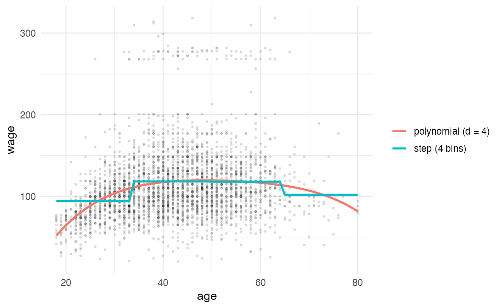
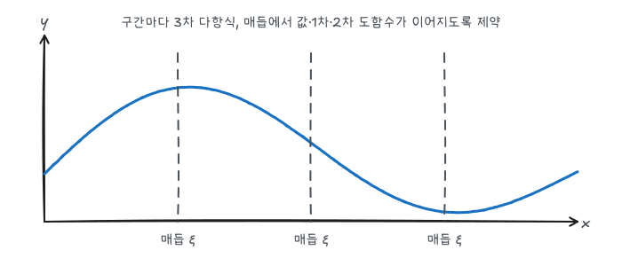
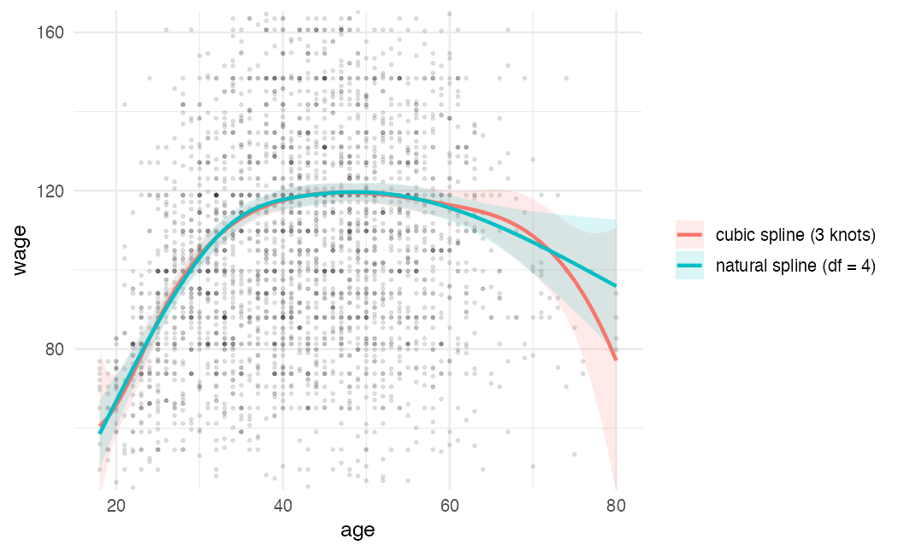
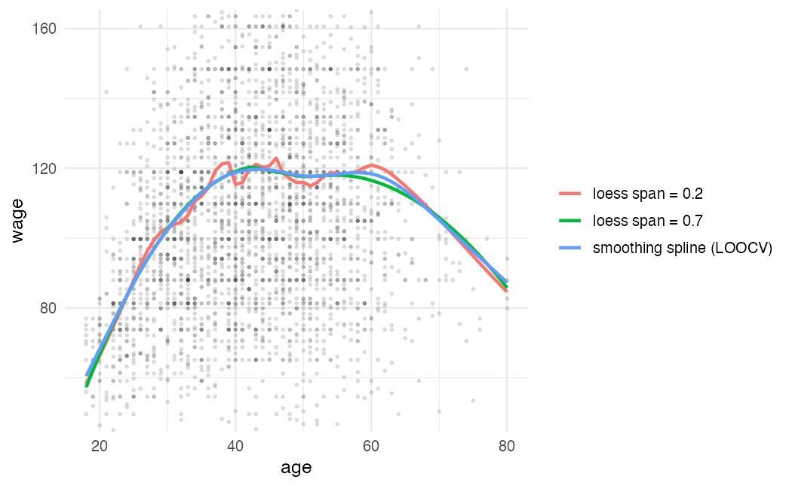
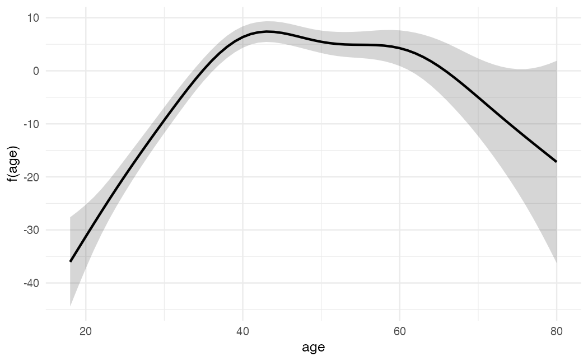

ISLR 7장과 이영미 교수님 데이터마이닝 강의 내용을 바탕으로 정리했다. 선형모형은 해석이 쉽지만 관계가 휘어 있으면 편향이 크다. 이 글의 방법들은 해석 가능성을 최대한 유지하면서 $f(X)$를 유연하게 만든다.

## 데이터

`ISLR2::Wage`는 미국 중부 대서양 지역 남성 3,000명의 임금(`wage`, 천 달러)과 나이, 연도, 학력 등이다.

```r
library(tidyverse)
library(ISLR2)
library(splines)
library(mgcv)
theme_set(theme_minimal(base_size = 12))

wage <- as_tibble(Wage)
age_grid <- tibble(age = seq(min(wage$age), max(wage$age)))
```

`splines`와 `mgcv`는 R과 함께 설치되는 패키지다.

## 기저 함수라는 관점

이 글의 방법 대부분은 $X$를 변환한 함수 $b_1(X), \dots, b_K(X)$를 만들고, 그것들로 선형회귀를 하는 것이다.

$$
y_i = \beta_0 + \beta_1 b_1(x_i) + \beta_2 b_2(x_i) + \cdots + \beta_K b_K(x_i) + \epsilon_i
$$

$b_k$가 정해져 있으므로 계수 추정은 여전히 최소제곱이고, 표준오차와 검정도 그대로 쓸 수 있다.

| 방법 | 기저 함수 $b_k(x)$ |
|---|---|
| 다항회귀 | $x, x^2, \dots, x^d$ |
| 계단 함수 | $I(c_k \le x < c_{k+1})$ |
| 회귀 스플라인 | 구간별 다항식 + 매듭에서의 연속 제약 |

### 다항회귀와 계단 함수

```r
fit_poly <- lm(wage ~ poly(age, 4), data = wage)
fit_step <- lm(wage ~ cut(age, 4), data = wage)

bind_rows(
  age_grid |> mutate(fit = predict(fit_poly, age_grid), model = "polynomial (d = 4)"),
  age_grid |> mutate(fit = predict(fit_step, age_grid), model = "step (4 bins)")
) |>
  ggplot(aes(age, fit, color = model)) +
  geom_point(data = wage, aes(age, wage), inherit.aes = FALSE, alpha = 0.1, size = 0.6) +
  geom_line(linewidth = 1) +
  labs(y = "wage", color = NULL)
```



다항회귀는 차수가 높으면 양 끝에서 크게 휘는 문제가 있다. 보통 $d \le 4$로 둔다. 계단 함수는 구간 안에서 상수라서 구간 경계를 어디에 두느냐에 따라 추세를 놓칠 수 있다. 차수 선택에는 중첩 모형 사이의 $F$ 검정(`anova()`)이나 교차검증을 쓴다.

```r
fits <- map(1:5, \(d) lm(wage ~ poly(age, d), data = wage))
do.call(anova, fits)
```

3차까지는 유의하게 좋아지고, 4차는 경계선(p ≈ 0.05), 5차는 불필요하다.

## 회귀 스플라인

$X$의 범위를 **매듭(knot)** $\xi_1, \dots, \xi_K$로 나누고 구간마다 3차 다항식을 적합하되, 매듭에서 함수값과 1차·2차 도함수가 연속이 되도록 제약한다.



구간 $K+1$개마다 3차식(계수 4개)이면 모수가 $4(K+1)$개인데, 매듭마다 연속 제약 3개가 걸려 자유도는 $4(K+1) - 3K = K + 4$다. 절단 거듭제곱 기저로 쓰면 다음과 같다.

$$
f(x) = \beta_0 + \beta_1 x + \beta_2 x^2 + \beta_3 x^3 + \sum_{k=1}^{K} \beta_{3+k} (x - \xi_k)_+^3
$$

$(x - \xi)_+ = \max(0, x - \xi)$다. $(x - \xi_k)_+^3$은 매듭에서 2차 도함수까지 0이므로 연속 조건을 자동으로 만족한다.

**자연 스플라인**은 여기에 "양 끝 구간에서는 선형"이라는 제약을 더한다. 데이터가 적은 경계에서 곡선이 크게 휘는 것을 막는다.

```r
fit_bs <- lm(wage ~ bs(age, knots = c(25, 40, 60)), data = wage)
fit_ns <- lm(wage ~ ns(age, df = 4), data = wage)

pred_band <- function(fit, name) {
  p <- predict(fit, age_grid, se.fit = TRUE)
  age_grid |> mutate(fit = p$fit, lo = fit - 2 * p$se.fit, hi = fit + 2 * p$se.fit, model = name)
}

bind_rows(pred_band(fit_bs, "cubic spline (3 knots)"), pred_band(fit_ns, "natural spline (df = 4)")) |>
  ggplot(aes(age, fit, color = model, fill = model)) +
  geom_point(data = wage, aes(age, wage), inherit.aes = FALSE, alpha = 0.1, size = 0.6) +
  geom_ribbon(aes(ymin = lo, ymax = hi), alpha = 0.15, color = NA) +
  geom_line(linewidth = 1) +
  coord_cartesian(ylim = c(50, 160)) +
  labs(y = "wage", color = NULL, fill = NULL)
```



양 끝(나이가 아주 적거나 많은 쪽)에서 3차 스플라인의 신뢰띠가 더 넓다. `bs(..., knots =)`로 매듭 위치를 직접 줄 수도 있고, `df`만 주면 분위수에 맞춰 매듭을 자동으로 둔다. 매듭 수(자유도)는 교차검증으로 정한다.

## 평활 스플라인

매듭 위치를 고민하지 않고, 다음을 최소화하는 함수 $g$를 찾는다.

$$
\sum_{i=1}^{n} (y_i - g(x_i))^2 + \lambda \int g''(t)^2\, dt
$$

둘째 항은 곡선이 휘는 정도에 대한 벌점이다. $\lambda = 0$이면 모든 점을 지나는 곡선, $\lambda \to \infty$이면 직선이 된다. 해는 모든 $x_i$에 매듭을 둔 자연 3차 스플라인을 수축한 것이다. $\lambda$ 대신 **유효 자유도** $df_\lambda$로 유연성을 말한다.

```r
ss_16 <- smooth.spline(wage$age, wage$wage, df = 16)
ss_cv <- smooth.spline(wage$age, wage$wage, cv = TRUE)
ss_cv$df
```

`cv = TRUE`는 LOOCV로 $\lambda$를 고른다. 평활 스플라인은 LOOCV를 [단축 공식](/posts/dm-resampling)처럼 한 번에 계산할 수 있다. 유효 자유도가 7 정도로 정해진다.

## 국소 회귀

$x_0$에서의 예측값을 구할 때, $x_0$ 근처 관측값(전체의 비율 $s$, span)에 거리가 가까울수록 큰 가중치를 주고 가중 최소제곱으로 직선(또는 2차식)을 적합한다. 이를 모든 $x_0$에서 반복한다. span이 작을수록 유연하다. `ggplot2`의 `geom_smooth()` 기본값인 `loess`가 이 방법이다.

```r
bind_rows(
  age_grid |> mutate(fit = predict(ss_cv, age_grid$age)$y, model = "smoothing spline (LOOCV)"),
  age_grid |> mutate(fit = predict(loess(wage ~ age, span = 0.2, data = wage), age_grid), model = "loess span = 0.2"),
  age_grid |> mutate(fit = predict(loess(wage ~ age, span = 0.7, data = wage), age_grid), model = "loess span = 0.7")
) |>
  ggplot(aes(age, fit, color = model)) +
  geom_point(data = wage, aes(age, wage), inherit.aes = FALSE, alpha = 0.1, size = 0.6) +
  geom_line(linewidth = 1) +
  coord_cartesian(ylim = c(50, 160)) +
  labs(y = "wage", color = NULL)
```



## 일반화가법모형(GAM)

변수가 여럿일 때, 각 변수에 대해 따로 비선형 함수를 두고 **더한다**.

$$
y_i = \beta_0 + f_1(x_{i1}) + f_2(x_{i2}) + \cdots + f_p(x_{ip}) + \epsilon_i
$$

각 $f_j$를 따로 그려 볼 수 있어 해석이 쉽다. "다른 변수를 고정했을 때 $X_j$의 효과"가 곧 $f_j$다. 대신 가법 구조라서 상호작용은 직접 넣어야 한다(`te(x1, x2)` 같은 2변수 평활항 등). 로지스틱 회귀에도 그대로 확장된다.

$$
\log \frac{p(X)}{1 - p(X)} = \beta_0 + f_1(X_1) + \cdots + f_p(X_p)
$$

```r
gam_fit <- gam(wage ~ s(year, k = 5) + s(age) + education, data = wage, method = "REML")
summary(gam_fit)
```

`mgcv::gam()`의 `s()`는 벌점 회귀 스플라인이고, 평활 정도를 REML로 자동 선택한다. `summary`의 `edf`가 각 항의 유효 자유도다. `year`는 값이 7개뿐이라 기저 차원 `k`를 작게 둔다. `edf`가 1에 가까우면 사실상 선형이다. 실제로 `s(year)`의 edf는 1.0으로 연도 효과는 선형이고, `s(age)`는 약 5로 뚜렷한 곡선이다.

```r
newd <- tibble(year = 2006, age = 18:80,
               education = factor("3. Some College", levels = levels(wage$education)))
p <- predict(gam_fit, newd, type = "terms", se.fit = TRUE)

newd |>
  mutate(fit = p$fit[, "s(age)"], se = p$se.fit[, "s(age)"]) |>
  ggplot(aes(age, fit)) +
  geom_ribbon(aes(ymin = fit - 2 * se, ymax = fit + 2 * se), alpha = 0.2) +
  geom_line(linewidth = 1) +
  labs(y = "f(age)")
```



`type = "terms"`는 각 항의 기여분 $\hat f_j(x)$를 따로 돌려준다. 나이 효과는 40대 초반까지 오르다가 60대 이후 떨어진다. 학력과 연도를 고정한 상태의 효과다.

## 요약

| 방법 | 유연성 조절 | 특징 |
|---|---|---|
| 다항회귀 | 차수 $d$ | 양 끝에서 불안정 |
| 계단 함수 | 구간 수 | 구간 안에서 상수 |
| 회귀 스플라인 | 매듭 수 (df = K + 4) | 국소적으로 유연, 매듭 위치 선택 |
| 자연 스플라인 | df | 경계에서 선형, 끝이 안정적 |
| 평활 스플라인 | $\lambda$ (유효 df) | 매듭 선택 불필요, LOOCV 단축 공식 |
| 국소 회귀 | span $s$ | 가까운 점만으로 국소 적합 |
| GAM | 항별 평활 정도 | 변수별 비선형 + 가법, 항별 해석 가능 |
