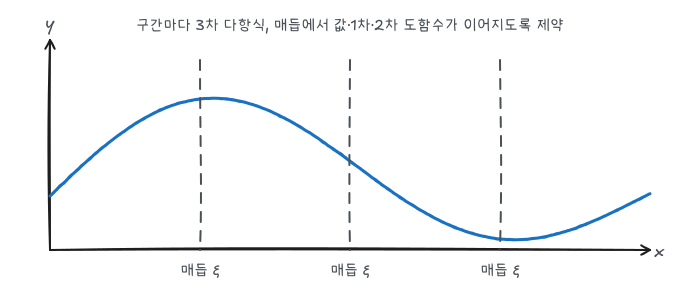
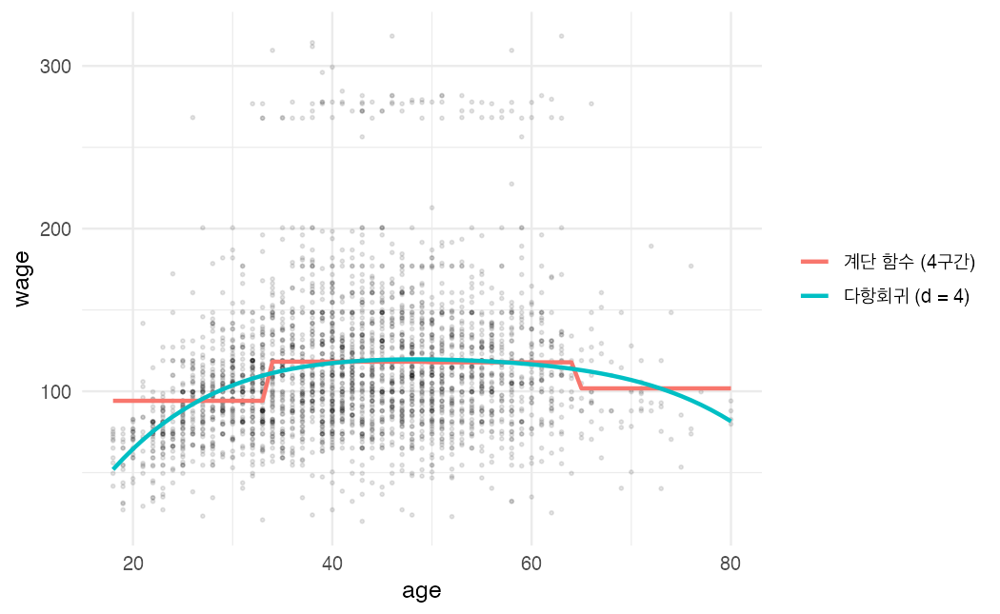
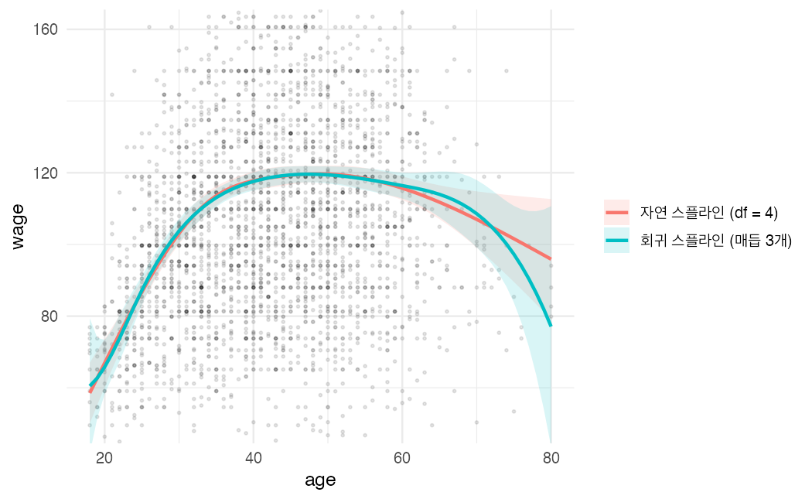
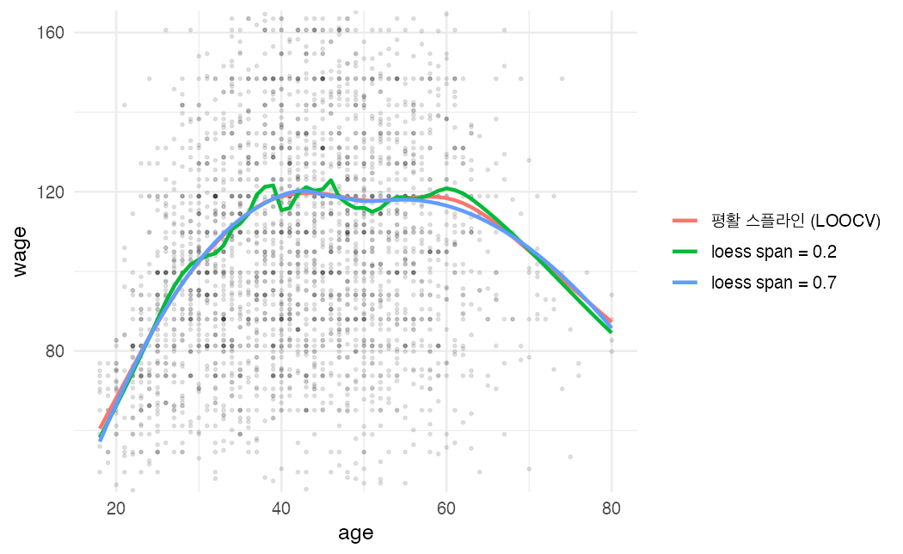
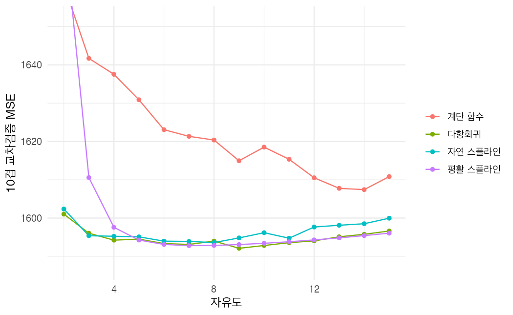
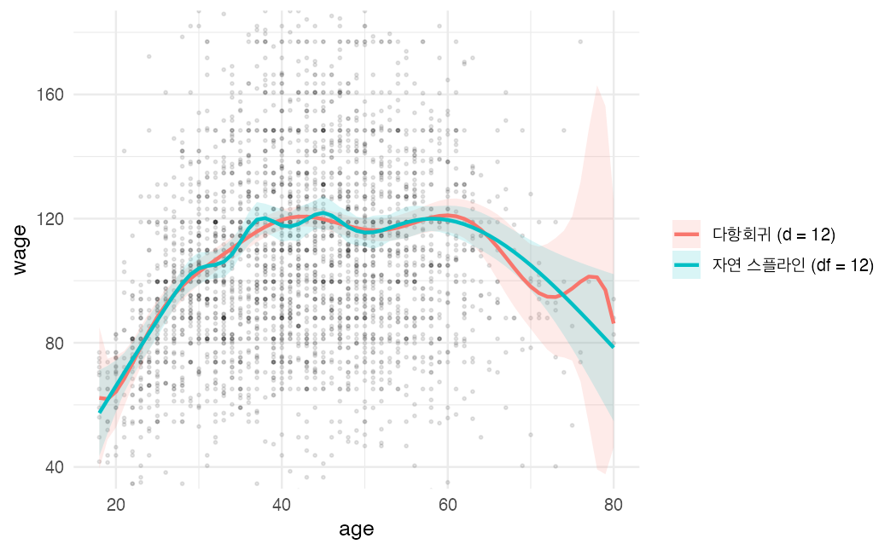
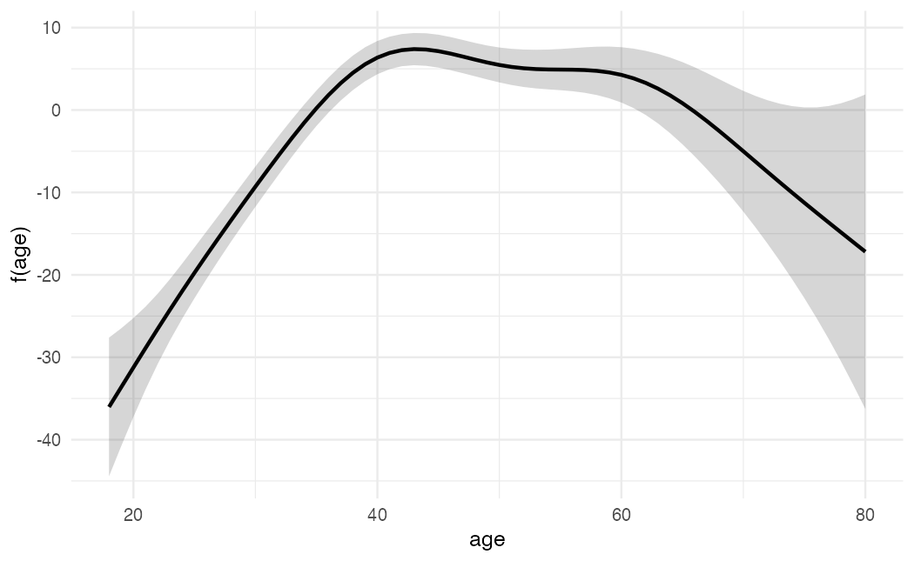

ISLR 7장과 이영미 교수님 데이터마이닝 강의 내용을 바탕으로 정리했다.

## 개요

선형모형은 해석이 쉽지만 관계가 휘어 있으면 편향이 크다. 이 글의 방법들은 선형모형의 해석 가능성을 가능한 한 유지하면서 $f(X)$를 유연하게 만든다. 유연성을 얻는 방식에 따라 세 부류로 나뉜다.

| 방식 | 방법 | 유연성 조절 |
|---|---|---|
| 기저 함수 + 최소제곱 | 다항회귀, 계단 함수, 회귀 스플라인, 자연 스플라인 | 기저 함수의 수 (차수, 구간 수, 매듭 수) |
| 벌점 최소제곱 | 평활 스플라인 | 곡률 벌점 $\lambda$ |
| 국소 가중 적합 | 국소 회귀 (loess) | 이웃의 비율 span |

또 하나의 중요한 축은 **전역적인가 국소적인가**다. 다항회귀는 한 점의 자료가 곡선 전체를 움직이는 전역적 방법이고, 나머지는 자료가 주변에만 영향을 주는 국소적 방법이다. 이 차이가 차수를 높였을 때의 안정성과 경계에서의 거동을 결정한다. GAM은 이 방법들을 여러 설명 변수로 확장하는 틀이다.

## 1. 기저 함수라는 관점

앞의 네 방법은 $X$를 변환한 함수 $b_1(X), \dots, b_K(X)$를 만들고 이를 설명 변수로 선형회귀를 한다.

$$
y_i = \beta_0 + \beta_1b_1(x_i) + \beta_2b_2(x_i) + \cdots + \beta_Kb_K(x_i) + \epsilon_i
$$

$b_k$가 미리 정해져 있으므로 계수 추정은 최소제곱이며, 표준오차와 검정을 그대로 쓸 수 있다. 방법 간의 차이는 기저 함수의 선택에 있다.

| 방법 | 기저 함수 $b_k(x)$ | 성질 |
|---|---|---|
| 다항회귀 | $x, x^2, \dots, x^d$ | 전역적 |
| 계단 함수 | $I(c_k \le x < c_{k+1})$ | 국소적, 불연속 |
| 회귀 스플라인 | $x, x^2, x^3, (x - \xi_k)_+^3$ | 국소적, 연속·매끄러움 |

## 2. 다항회귀

$$
y_i = \beta_0 + \beta_1x_i + \beta_2x_i^2 + \cdots + \beta_dx_i^d + \epsilon_i
$$

가장 단순한 확장이지만, 다항식은 정의역 전체에서 하나의 식이므로 어느 한 영역의 자료에 맞추려면 다른 영역의 곡선도 함께 움직인다. 차수가 높아질수록 자료가 적은 양 끝에서 곡선이 크게 휘며, 그래서 보통 $d \le 4$로 제한한다.

## 3. 계단 함수

$X$의 범위를 구간으로 나누고 구간마다 상수를 적합한다. 각 구간의 추정은 그 구간의 자료로만 정해지므로 국소적이지만, 구간 안에서 추세를 표현하지 못하고 경계에서 불연속이다. 구간의 경계를 어디에 두느냐에 따라 결과가 크게 달라진다.

## 4. 회귀 스플라인

$X$의 범위를 **매듭** $\xi_1, \dots, \xi_K$로 나누고 구간마다 3차 다항식을 적합하되, 매듭에서 함수값과 1차·2차 도함수가 연속이 되도록 제약한다. 계단 함수의 국소성과 다항식의 매끄러움을 함께 얻는 방법이다.



구간 $K + 1$개마다 계수가 4개인 3차식이면 모수가 $4(K + 1)$개인데, 매듭마다 연속 제약이 3개 걸리므로 자유도는 $4(K + 1) - 3K = K + 4$이다. 절단 거듭제곱 기저로 쓰면

$$
f(x) = \beta_0 + \beta_1x + \beta_2x^2 + \beta_3x^3 + \sum_{k=1}^{K}\beta_{3+k}(x - \xi_k)_+^3, \qquad (x - \xi)_+ = \max(0, x - \xi)
$$

이다. $(x - \xi_k)_+^3$은 매듭에서 2차 도함수까지 0이므로 연속 조건을 자동으로 만족한다.

## 5. 자연 스플라인

회귀 스플라인도 양 끝 구간에서는 자료가 적어 분산이 크다. 자연 스플라인은 **양 끝의 경계 매듭 바깥에서 함수가 선형**이라는 제약을 더한다. 끝 구간마다 2차·3차 항이 사라져 같은 매듭 수에서 자유도가 4 줄어들고, 경계에서 곡선이 안정된다.

## 6. 평활 스플라인

회귀 스플라인은 매듭의 수와 위치를 정해야 한다. 평활 스플라인은 매듭을 고르지 않고, 다음을 최소화하는 함수 $g$를 찾는다.

$$
\sum_{i=1}^{n}(y_i - g(x_i))^2 + \lambda\int g''(t)^2\,dt
$$

둘째 항은 곡선이 휘는 정도에 대한 벌점이다. $\lambda = 0$이면 모든 점을 지나는 곡선, $\lambda \to \infty$이면 직선이 된다. 이 문제의 해는 모든 $x_i$에 매듭을 둔 자연 3차 스플라인이며, 매듭이 $n$개라도 벌점이 계수를 수축하므로 과적합하지 않는다. [Ridge 회귀](/posts/dm-regularization)가 계수 크기에 벌점을 주었듯이, 평활 스플라인은 곡률에 벌점을 준다.

유연성은 $\lambda$ 대신 **유효 자유도** $df_\lambda = \text{tr}(S_\lambda)$로 나타낸다. $S_\lambda$는 $\hat{\mathbf g} = S_\lambda\mathbf y$인 평활행렬이다. 선형평활기이므로 LOOCV를 [단축 공식](/posts/dm-resampling)으로 한 번에 계산할 수 있다.

## 7. 국소 회귀

$x_0$에서의 예측값을 구할 때, $x_0$에 가까운 관측값(전체의 비율 $s$, span)에만 거리에 반비례하는 가중치를 주고 가중 최소제곱으로 직선(또는 2차식)을 적합한다. 이를 모든 $x_0$에서 반복한다. 전역적인 식을 하나도 가정하지 않는 가장 국소적인 방법이며, span이 작을수록 유연하다. `ggplot2`의 `geom_smooth()` 기본값인 `loess`가 이 방법이다. 설명 변수가 많아지면 이웃이 희박해져(차원의 저주) 성능이 떨어진다.

## 8. 일반화가법모형 (GAM)

설명 변수가 여럿일 때 각 변수에 대해 위의 방법 중 하나로 비선형 함수를 두고 **더한다**.

$$
y_i = \beta_0 + f_1(x_{i1}) + f_2(x_{i2}) + \cdots + f_p(x_{ip}) + \epsilon_i
$$

다른 변수를 고정했을 때 $X_j$의 효과가 곧 $f_j$이므로 각 항을 따로 그려 해석할 수 있다. 가법 구조라서 교호작용은 직접 넣어야 한다(두 변수 평활항 `te(x1, x2)` 등). 로지스틱 회귀 등 GLM에도 그대로 확장된다.

## 9. 방법 간 비교

| 구분 | 다항회귀 | 계단 함수 | 회귀 스플라인 | 자연 스플라인 | 평활 스플라인 | 국소 회귀 |
|---|---|---|---|---|---|---|
| 유연성 조절 | 차수 $d$ | 구간 수 | 매듭 수 ($df = K + 4$) | $df$ | $\lambda$ (유효 $df$) | span |
| 전역/국소 | 전역 | 국소 | 국소 | 국소 | 국소 | 국소 |
| 연속성 | 매끄러움 | 불연속 | 2차 도함수까지 연속 | 2차 도함수까지 연속 | 2차 도함수까지 연속 | 매끄러움 |
| 경계 거동 | 크게 휨 | 상수 | 다소 불안정 | 선형으로 안정 | 선형으로 안정 | 다소 불안정 |
| 정할 것 | 차수 | 구간 경계 | 매듭 위치·수 | 매듭 수 | $\lambda$ | span, 국소 차수 |
| 추정 | 최소제곱 | 최소제곱 | 최소제곱 | 최소제곱 | 벌점 최소제곱 | 국소 가중 최소제곱 |
| 추론 (SE, 검정) | 표준 | 표준 | 표준 | 표준 | 근사 | 근사 |

## 10. Wage 자료를 이용한 비교

`ISLR2::Wage`는 미국 중부 대서양 지역 남성 3,000명의 임금(`wage`, 천 달러)과 나이, 연도, 학력 등이다. 나이에 대한 임금의 관계를 각 방법으로 추정한다.

```r
library(tidyverse)
library(ISLR2)
library(splines)
library(mgcv)
theme_set(theme_minimal(base_size = 12))

wage <- as_tibble(Wage)
age_grid <- tibble(age = seq(min(wage$age), max(wage$age)))
```

### 적합 곡선

```r
fit_poly <- lm(wage ~ poly(age, 4), data = wage)
fit_step <- lm(wage ~ cut(age, 4), data = wage)

bind_rows(
  age_grid |> mutate(fit = predict(fit_poly, age_grid), model = "다항회귀 (d = 4)"),
  age_grid |> mutate(fit = predict(fit_step, age_grid), model = "계단 함수 (4구간)")
) |>
  ggplot(aes(age, fit, color = model)) +
  geom_point(data = wage, aes(age, wage), inherit.aes = FALSE, alpha = 0.1, size = 0.6) +
  geom_line(linewidth = 1) +
  labs(y = "wage", color = NULL)

fits <- map(1:5, \(d) lm(wage ~ poly(age, d), data = wage))
do.call(anova, fits)
```



계단 함수는 구간 안에서 상수이므로 20대의 급격한 상승을 계단 두 개로만 표현한다. 다항회귀의 차수는 중첩 모형 간 $F$ 검정으로 고를 수 있다. 3차까지는 유의하게 개선되고($p = 0.0017$), 4차는 경계($p = 0.051$), 5차는 불필요하다($p = 0.37$).

```r
fit_bs <- lm(wage ~ bs(age, knots = c(25, 40, 60)), data = wage)
fit_ns <- lm(wage ~ ns(age, df = 4), data = wage)

pred_band <- function(fit, name) {
  p <- predict(fit, age_grid, se.fit = TRUE)
  age_grid |> mutate(fit = p$fit, lo = fit - 2 * p$se.fit, hi = fit + 2 * p$se.fit, model = name)
}

bind_rows(pred_band(fit_bs, "회귀 스플라인 (매듭 3개)"), pred_band(fit_ns, "자연 스플라인 (df = 4)")) |>
  ggplot(aes(age, fit, color = model, fill = model)) +
  geom_point(data = wage, aes(age, wage), inherit.aes = FALSE, alpha = 0.1, size = 0.6) +
  geom_ribbon(aes(ymin = lo, ymax = hi), alpha = 0.15, color = NA) +
  geom_line(linewidth = 1) +
  coord_cartesian(ylim = c(50, 160)) +
  labs(y = "wage", color = NULL, fill = NULL)
```



자료가 적은 양 끝(20세 미만, 70세 이상)에서 회귀 스플라인의 신뢰띠가 자연 스플라인보다 넓다. 경계 밖을 선형으로 제한한 효과다.

```r
ss_cv <- smooth.spline(wage$age, wage$wage, cv = TRUE)
ss_cv$df

bind_rows(
  age_grid |> mutate(fit = predict(ss_cv, age_grid$age)$y, model = "평활 스플라인 (LOOCV)"),
  age_grid |> mutate(fit = predict(loess(wage ~ age, span = 0.2, data = wage), age_grid), model = "loess span = 0.2"),
  age_grid |> mutate(fit = predict(loess(wage ~ age, span = 0.7, data = wage), age_grid), model = "loess span = 0.7")
) |>
  ggplot(aes(age, fit, color = model)) +
  geom_point(data = wage, aes(age, wage), inherit.aes = FALSE, alpha = 0.1, size = 0.6) +
  geom_line(linewidth = 1) +
  coord_cartesian(ylim = c(50, 160)) +
  labs(y = "wage", color = NULL)
```



LOOCV로 고른 평활 스플라인의 유효 자유도는 6.8이다. span이 0.2인 국소 회귀는 이웃이 좁아 곡선이 울퉁불퉁하고, 0.7이면 평활 스플라인과 거의 같아진다.

### 자유도에 따른 교차검증 오차

같은 자유도에서 방법을 비교하면 유연성을 얻는 방식의 차이가 드러난다. 자유도를 2부터 15까지 바꾸며 10겹 교차검증 오차를 구한다. 모든 방법에 같은 fold를 쓴다.

```r
set.seed(1)
fold <- sample(rep(1:10, length.out = nrow(wage)))
cv_err <- function(fit_fun) {
  mean(map_dbl(1:10, \(j) {
    tr <- wage[fold != j, ]; te <- wage[fold == j, ]
    mean((te$wage - fit_fun(tr, te))^2)
  }))
}
step_pred <- function(tr, te, d) {
  br <- unique(quantile(wage$age, seq(0, 1, length.out = d + 2)))
  br[1] <- -Inf; br[length(br)] <- Inf
  predict(lm(wage ~ cut(age, br), data = tr), te)
}

flex <- expand_grid(df = 2:15, 방법 = c("다항회귀", "계단 함수", "자연 스플라인", "평활 스플라인")) |>
  mutate(cv = map2_dbl(df, 방법, \(d, m) cv_err(switch(m,
    "다항회귀" = \(tr, te) predict(lm(wage ~ poly(age, d), data = tr), te),
    "계단 함수" = \(tr, te) step_pred(tr, te, d),
    "자연 스플라인" = \(tr, te) predict(lm(wage ~ ns(age, df = d), data = tr), te),
    "평활 스플라인" = \(tr, te) predict(smooth.spline(tr$age, tr$wage, df = d), te$age)$y))))

flex |> group_by(방법) |> slice_min(cv, n = 1)
flex |> filter(df %in% c(4, 10, 15)) |> pivot_wider(names_from = 방법, values_from = cv)

ggplot(flex, aes(df, cv, color = 방법)) +
  geom_line() + geom_point(size = 1.5) +
  coord_cartesian(ylim = c(min(flex$cv) - 5, min(flex$cv) + 60)) +
  labs(x = "자유도", y = "10겹 교차검증 MSE", color = NULL)
```



| 방법 | 최소 CV MSE | 그때의 자유도 | 자유도 4 | 자유도 10 | 자유도 15 |
|---|---|---|---|---|---|
| 다항회귀 | 1592 | 9 | 1594 | 1593 | 1597 |
| 자연 스플라인 | 1594 | 8 | 1595 | 1596 | 1600 |
| 평활 스플라인 | 1593 | 7 | 1598 | 1593 | 1596 |
| 계단 함수 | 1607 | 14 | 1638 | 1619 | 1611 |

매끄러운 세 방법은 최소 오차가 1592~1594로 사실상 같고, 자유도 4~15 전체에서 차이가 10 이내다. 임금의 잡음 분산(약 1,590)이 커서 곡선 모양의 미세한 차이가 예측 오차에 거의 드러나지 않는다. 반면 계단 함수는 같은 자유도에서 항상 오차가 크다. 구간 안에서 상수라는 제약 때문에 20대의 급격한 상승을 표현하려면 구간을 매우 잘게 나누어야 하며, 자유도 14에서야 최소가 되어도 다른 방법보다 13 이상 크다.

다항회귀가 고차에서도 무너지지 않은 것은 나이가 18~80세에 고르게 분포하고 $n = 3000$으로 커서 내삽 영역에서는 고차 다항식도 안정적이기 때문이다. 차이는 예측 오차의 평균보다 경계에서 드러난다.

### 높은 자유도에서의 경계 거동

```r
fit_p12 <- lm(wage ~ poly(age, 12), data = wage)
fit_n12 <- lm(wage ~ ns(age, df = 12), data = wage)

bind_rows(pred_band(fit_p12, "다항회귀 (d = 12)"), pred_band(fit_n12, "자연 스플라인 (df = 12)")) |>
  ggplot(aes(age, fit, color = model, fill = model)) +
  geom_point(data = wage, aes(age, wage), inherit.aes = FALSE, alpha = 0.1, size = 0.6) +
  geom_ribbon(aes(ymin = lo, ymax = hi), alpha = 0.15, color = NA) +
  geom_line(linewidth = 1) +
  coord_cartesian(ylim = c(40, 180)) +
  labs(y = "wage", color = NULL, fill = NULL)
```



같은 자유도 12에서 두 곡선은 자료가 많은 25~60세에서는 거의 겹친다. 그러나 자료가 적은 70세 이상에서 다항회귀는 75세 근처에서 다시 올라갔다가 80세에 급격히 떨어지며, 신뢰띠가 40~160까지 벌어진다. 다항식은 전역적이어서 경계의 소수 관측값을 맞추려면 곡선 전체의 계수가 조정되고, 그 결과 끝에서 진동한다. 자연 스플라인은 경계 매듭 바깥을 선형으로 제한하므로 끝에서도 완만하게 감소하고 신뢰띠가 훨씬 좁다. 평균 예측 오차로는 구분되지 않던 두 방법의 차이가 외삽에 가까운 영역에서 분명해진다.

### GAM: 여러 설명 변수

```r
gam_fit <- gam(wage ~ s(year, k = 5) + s(age) + education, data = wage, method = "REML")
summary(gam_fit)

c(선형 = cv_err(\(tr, te) predict(lm(wage ~ year + age + education, data = tr), te)),
  `나이만 자연스플라인` = cv_err(\(tr, te) predict(lm(wage ~ year + ns(age, 5) + education, data = tr), te)),
  GAM = cv_err(\(tr, te) predict(gam(wage ~ s(year, k = 5) + s(age) + education,
                                     data = tr, method = "REML"), te)))
```

`mgcv::gam()`의 `s()`는 벌점 회귀 스플라인이며 평활 정도를 REML로 자동 선택한다. `summary`의 `edf`가 각 항의 유효 자유도다. `s(year)`의 edf는 1.00으로 연도 효과는 사실상 선형이고, `s(age)`는 5.07로 뚜렷한 곡선이다. 학력은 범주형이므로 일반 계수로 들어간다.

| 모형 | 10겹 CV MSE |
|---|---|
| 선형 (`year + age + education`) | 1290.9 |
| 나이만 자연 스플라인 (df = 5) | 1240.0 |
| GAM (`s(year) + s(age) + education`) | 1239.7 |

나이를 선형으로 둔 모형에 비해 나이의 곡선을 허용하면 CV 오차가 51 줄어든다. 나이만 자연 스플라인으로 둔 모형과 GAM의 차이는 0.3에 불과한데, GAM이 연도 효과를 사실상 선형(edf 1.00)으로 추정했기 때문이다. GAM은 각 항의 유연성을 자료로 정하므로, 필요 없는 곡선은 자동으로 선형에 가깝게 줄어든다.

```r
newd <- tibble(year = 2006, age = 18:80,
               education = factor("3. Some College", levels = levels(wage$education)))
p <- predict(gam_fit, newd, type = "terms", se.fit = TRUE)

newd |>
  mutate(fit = p$fit[, "s(age)"], se = p$se.fit[, "s(age)"]) |>
  ggplot(aes(age, fit)) +
  geom_ribbon(aes(ymin = fit - 2 * se, ymax = fit + 2 * se), alpha = 0.2) +
  geom_line(linewidth = 1) +
  labs(y = "f(age)")
```



`type = "terms"`는 각 항의 기여분 $\hat f_j(x)$를 따로 반환한다. 학력과 연도를 고정했을 때 임금은 40대 초반까지 오르다가 60대 이후 떨어진다.

## 11. 결과의 해석

| 관찰된 결과 | 원인 |
|---|---|
| 매끄러운 방법들의 CV 오차가 거의 같음 | 잡음 분산이 커서 곡선 모양의 작은 차이가 예측 오차에 묻힘 |
| 계단 함수가 같은 자유도에서 항상 나쁨 | 구간 안에서 상수라 추세를 표현하지 못함 |
| 고차 다항식이 경계에서 진동하고 신뢰띠가 넓음 | 기저 함수가 전역적이어서 경계의 소수 관측값이 곡선 전체를 움직임 |
| 자연 스플라인은 경계에서도 안정적 | 경계 바깥을 선형으로 제한해 끝 구간의 자유도를 줄임 |
| 평활 스플라인의 최적 자유도가 약 7 | 곡률 벌점이 자유도를 연속적으로 조절하며, LOOCV로 바로 선택 |
| GAM이 연도를 선형, 나이를 곡선으로 추정 | 항별 벌점이 자료에 맞추어 각 항의 유연성을 따로 정함 |
| 나이를 곡선으로 두면 CV 오차가 크게 감소 | 임금-나이 관계가 40대 정점의 역U자 형태 |

## 12. 방법의 선택

| 상황 | 적합한 방법 |
|---|---|
| 관계가 단순하고 차수가 낮음 ($d \le 3$) | 다항회귀 (추론이 쉬움) |
| 연령대별 평균처럼 구간 해석이 목적 | 계단 함수 |
| 매끄러운 곡선과 표준적인 추론이 필요함 | 자연 스플라인 (df는 교차검증) |
| 매듭을 고르고 싶지 않음 | 평활 스플라인 |
| 탐색적 시각화, 설명 변수가 1~2개 | 국소 회귀 |
| 설명 변수가 여럿이고 항별 해석이 필요함 | GAM |
| 변수 간 교호작용이 핵심 | GAM에 2변수 평활항 추가, 또는 [트리 기반 방법](/posts/dm-tree) |

## 정리

| | 다항회귀 | 계단 함수 | 회귀 스플라인 | 자연 스플라인 | 평활 스플라인 | 국소 회귀 | GAM |
|---|---|---|---|---|---|---|---|
| 방식 | 기저 | 기저 | 기저 | 기저 | 벌점 | 국소 가중 | 가법 결합 |
| 성질 | 전역 | 국소, 불연속 | 국소 | 국소, 경계 선형 | 국소, 매듭 불필요 | 국소 | 항별 선택 |
| 조율 | $d$ | 구간 수 | 매듭 | $df$ | $\lambda$ | span | 항별 평활 |
