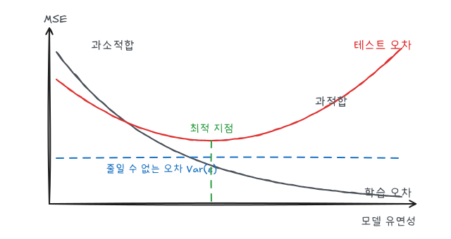
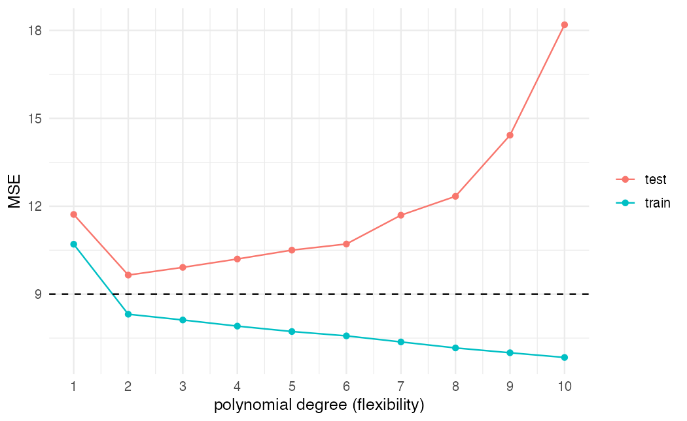
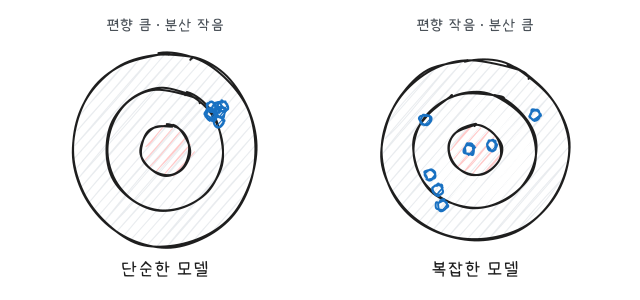

ISLR(*An Introduction to Statistical Learning*)과 전북대학교 이영미 교수님의 데이터마이닝 강의를 바탕으로 정리한 시리즈다. 이 글은 시리즈 전체에서 반복되는 틀, 즉 "무엇을 학습하고 무엇으로 평가하는가"를 다룬다.

## 시리즈 구성

| 글 | 문제 | 방법 |
|---|---|---|
| 선형회귀 | 회귀 | 최소제곱, 다중회귀 |
| 로지스틱 회귀 | 분류 | 로짓, 오즈비, 기준값 |
| 분류 | 분류 | 베이즈 분류기, LDA, QDA, KNN |
| 의사결정나무 | 회귀·분류 | 재귀적 이진 분할, 가지치기 |
| 앙상블 | 회귀·분류 | 배깅, 랜덤포레스트, 부스팅 |
| 군집분석 | 비지도 | K-means, 계층적 군집, SOM |
| 연관규칙 | 비지도 | 지지도, 신뢰도, 향상도, Apriori |

## 통계적 학습의 기본 식

입력 변수 $X = (X_1, \dots, X_p)$와 반응 변수 $Y$의 관계를 다음처럼 둔다.

$$
Y = f(X) + \epsilon, \qquad E(\epsilon) = 0
$$

$f$는 데이터에서 추정하려는 구조이고, $\epsilon$은 $X$로 설명할 수 없는 오차다. $f$를 추정하는 목적은 두 가지다.

- **예측**: 새로운 $X$에 대해 $\hat{Y} = \hat{f}(X)$를 잘 맞히는 것. $\hat f$의 형태는 블랙박스여도 된다.
- **추론**: 어떤 $X_j$가 $Y$와 관련 있는지, 관계의 방향과 크기가 어떤지 아는 것. $\hat f$의 형태가 해석 가능해야 한다.

## 문제의 분류

| 기준 | 구분 | 예 |
|---|---|---|
| 반응 변수 유무 | 지도학습: $Y$가 있다 | 회귀, 분류 |
| | 비지도학습: $Y$가 없다 | 군집분석, 연관규칙 |
| $Y$의 형태 | 회귀: 연속형 | 주택 가격, 매출 |
| | 분류: 범주형 | 연체 여부, 질병 유무 |

로지스틱 회귀처럼 이름에 "회귀"가 들어가도 범주형 $Y$의 확률을 추정하면 분류 방법으로 본다.

## 학습 오차와 테스트 오차

회귀에서 적합도는 평균제곱오차(MSE)로 잰다.

$$
MSE = \frac{1}{n} \sum_{i=1}^{n} \left(y_i - \hat{f}(x_i)\right)^2
$$

학습에 쓴 데이터로 계산하면 학습 MSE, 학습에 쓰지 않은 데이터로 계산하면 테스트 MSE다. 관심 있는 것은 테스트 MSE다.



- 모델이 유연해질수록 학습 MSE는 거의 항상 줄어든다. 데이터에 더 가깝게 휘어질 수 있기 때문이다.
- 테스트 MSE는 U자 모양이다. 처음에는 줄다가, 어느 지점부터 학습 데이터의 잡음까지 따라가면서 다시 커진다. 이것이 **과적합**이다.
- 테스트 MSE는 $Var(\epsilon)$ 아래로 내려갈 수 없다.

### 시뮬레이션으로 확인

참 함수가 2차식인 데이터를 만들고, 다항회귀 차수를 1부터 10까지 올려 본다.

```r
library(tidyverse)
theme_set(theme_minimal(base_size = 12))

set.seed(123)
n <- 100
sim <- tibble(
  x = runif(n, 0, 10),
  y = 2 + 1.5 * x - 0.2 * x^2 + rnorm(n, sd = 3)
)

train_id <- sample(n, 70)
train <- sim[train_id, ]
test  <- sim[-train_id, ]

mse <- function(fit, data) mean((data$y - predict(fit, data))^2)

result <- map_dfr(1:10, \(d) {
  fit <- lm(y ~ poly(x, d), data = train)
  tibble(degree = d, train = mse(fit, train), test = mse(fit, test))
})
result
```

```r
result |>
  pivot_longer(c(train, test), names_to = "set", values_to = "mse") |>
  ggplot(aes(degree, mse, color = set)) +
  geom_line() +
  geom_point() +
  geom_hline(yintercept = 9, linetype = "dashed") +
  scale_x_continuous(breaks = 1:10) +
  labs(x = "polynomial degree (flexibility)", y = "MSE", color = NULL)
```



점선은 $Var(\epsilon) = 3^2 = 9$다. 학습 MSE는 차수가 오를수록 계속 내려가지만, 테스트 MSE는 참 함수의 차수인 2 근처에서 가장 작고 이후로는 줄지 않거나 다시 커진다. 표본이 작아 곡선이 매끈하지는 않으므로 시드를 바꿔 여러 번 보면 경향이 더 분명해진다.

## 편향-분산 분해

고정된 점 $x_0$에서 기대 테스트 MSE는 세 부분으로 나뉜다.

$$
E\left[\left(y_0 - \hat{f}(x_0)\right)^2\right] = Var\left(\hat{f}(x_0)\right) + \left[Bias\left(\hat{f}(x_0)\right)\right]^2 + Var(\epsilon)
$$

기대값은 학습 데이터를 여러 번 새로 뽑아 $\hat f$를 다시 추정한다고 생각했을 때의 평균이다.

- **분산** $Var(\hat f(x_0))$: 학습 데이터가 바뀔 때 $\hat f(x_0)$가 얼마나 흔들리는가
- **편향** $Bias(\hat f(x_0)) = E[\hat f(x_0)] - f(x_0)$: 평균적으로 참값에서 얼마나 벗어나는가
- $Var(\epsilon)$: 어떤 모델로도 줄일 수 없는 오차



단순한 모델은 매번 비슷한 답을 내지만 과녁 중심에서 벗어나 있고(편향 큼, 분산 작음), 복잡한 모델은 평균적으로는 중심 근처지만 데이터마다 크게 흔들린다(편향 작음, 분산 큼). 테스트 MSE의 U자는 편향 감소와 분산 증가가 맞바뀌면서 생긴다.

## 분류에서의 오차

분류에서는 MSE 대신 오분류율을 쓴다.

$$
\frac{1}{n} \sum_{i=1}^{n} I(y_i \neq \hat{y}_i)
$$

테스트 오분류율을 가장 작게 만드는 분류기는 **베이즈 분류기**로, 각 $x_0$에서 $P(Y = k \mid X = x_0)$가 가장 큰 범주를 고른다. 실제로는 이 조건부 확률을 모르므로 로지스틱 회귀, LDA, KNN 등은 모두 이를 추정하는 서로 다른 방법이라고 볼 수 있다. 자세한 내용은 [분류 글](/posts/dm-classification)에서 다룬다.

## 요약

| 개념 | 핵심 |
|---|---|
| $Y = f(X) + \epsilon$ | 학습 대상은 $f$, $\epsilon$은 줄일 수 없다 |
| 학습 vs 테스트 오차 | 모델 선택은 테스트 오차 기준 |
| 과적합 | 학습 오차는 줄고 테스트 오차는 커지는 구간 |
| 편향-분산 | 유연성이 커지면 편향 감소, 분산 증가 |
| 베이즈 분류기 | 조건부 확률이 가장 큰 범주, 분류 오차의 하한 |
