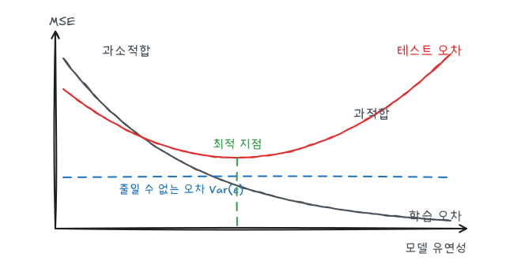
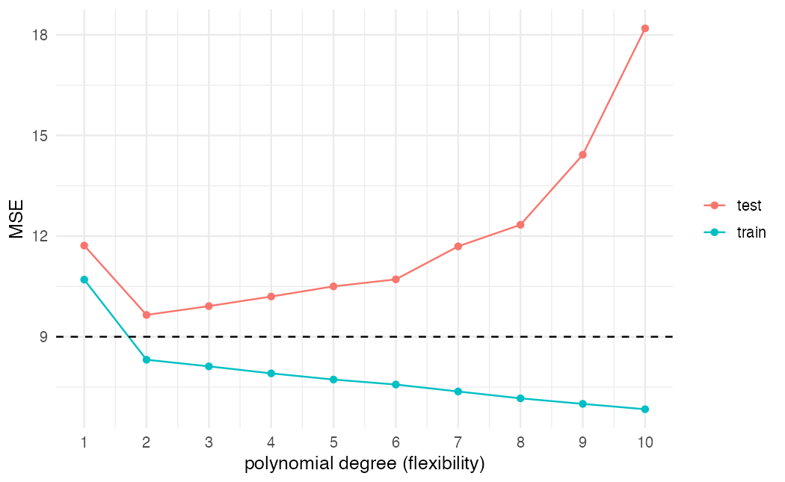
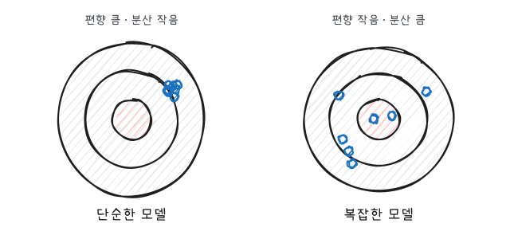
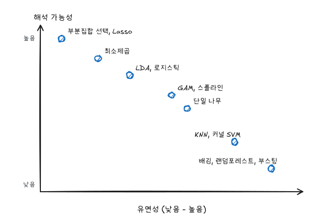

ISLR(*An Introduction to Statistical Learning*)과 전북대학교 이영미 교수님의 데이터마이닝 강의를 바탕으로 정리한 시리즈다. 이 글은 시리즈 전체에서 반복되는 틀, 즉 "무엇을 학습하고 무엇으로 평가하는가"를 다룬다.

## 데이터 마이닝이란

대규모로 저장된 데이터에서 통계학과 패턴 인식의 다양한 계량 기법으로 체계적이고 자동적으로 규칙이나 패턴을 찾아내는 분석이다(Gartner Group의 정의). 등장 배경은 저장 기술의 발달로 인한 대용량 데이터, 지식 서비스 중심의 산업 구조, 계산 능력의 향상이다.

| 특징 | 내용 |
|---|---|
| 대상 | 대용량의 관측 데이터 |
| 목표 | 모형의 일반화와 예측 |
| 방법 | 컴퓨터 계산 능력을 활용한 경험적 지식 발견 |
| 활용 | 기업 경영 전반의 데이터 기반 의사결정 |

자료에 의존해 현상을 해석하므로, 자료가 현실을 충분히 반영하지 못하면 잘못된 모형이 만들어질 위험이 있다.

## 시리즈 구성

| 글 | 문제 | 방법 | ISLR |
|---|---|---|---|
| 선형회귀 | 회귀 | 최소제곱, 다중회귀, 진단 | 3장 |
| 로지스틱 회귀 | 분류 | 로짓, 오즈비, 기준값, 포아송 GLM | 4장 |
| 분류 | 분류 | LDA, QDA, 나이브 베이즈, KNN, ROC | 4장 |
| 리샘플링 | 평가 | 교차검증, 부트스트랩 | 5장 |
| 변수선택과 정규화 | 회귀 | 부분집합 선택, Ridge, Lasso, PCR, PLS | 6장 |
| 선형을 넘어서 | 회귀 | 다항, 스플라인, 국소 회귀, GAM | 7장 |
| 의사결정나무 | 회귀·분류 | 재귀적 이진 분할, 가지치기 | 8장 |
| 앙상블 | 회귀·분류 | 배깅, 랜덤포레스트, 부스팅 | 8장 |
| 서포트 벡터 머신 | 분류 | 최대 마진, 커널 | 9장 |
| 신경망 | 회귀·분류 | 다층 신경망, 역전파, 규제, 이중 하강 | 10장 |
| 딥러닝 | 회귀·분류 | CNN, RNN, 시계열·문서 분류 | 10장 |
| 생존분석 | 생존 | Kaplan-Meier, 로그순위, Cox, 벌점 Cox | 11장 |
| 주성분분석 | 비지도 | 고유값 분해, SVD, PVE | 12장 |
| 군집분석 | 비지도 | K-means, 계층적 군집, SOM | 12장 |
| 연관규칙 | 비지도 | 지지도, 신뢰도, 향상도, Apriori | 강의 |
| 다중검정 | 검정 | FWER, FDR | 13장 |

[생존분석](/posts/dm-survival)은 [생명과학통계의 생존분석](/posts/biostat-survival-analysis)을 보완해 ISLR 11장의 예측 모형과 벌점 Cox 회귀 중심으로 다룬다.

## 통계적 학습의 기본 식

입력 변수 $X = (X_1, \dots, X_p)$와 반응 변수 $Y$의 관계를 다음처럼 둔다.

$$
Y = f(X) + \epsilon, \qquad E(\epsilon) = 0
$$

$f$는 데이터에서 추정하려는 구조이고, $\epsilon$은 $X$로 설명할 수 없는 오차다. $f$를 추정하는 목적은 두 가지다.

- **예측**: 새로운 $X$에 대해 $\hat{Y} = \hat{f}(X)$를 잘 맞히는 것. $\hat f$의 형태는 블랙박스여도 된다.
- **추론**: 어떤 $X_j$가 $Y$와 관련 있는지, 관계의 방향과 크기가 어떤지 아는 것. $\hat f$의 형태가 해석 가능해야 한다.

## 문제의 분류

| 기준 | 구분 | 예 |
|---|---|---|
| 반응 변수 유무 | 지도학습: $Y$가 있다 | 회귀, 분류 |
| | 비지도학습: $Y$가 없다 | 군집분석, 연관규칙 |
| $Y$의 형태 | 회귀: 연속형 | 주택 가격, 매출 |
| | 분류: 범주형 | 연체 여부, 질병 유무 |

로지스틱 회귀처럼 이름에 "회귀"가 들어가도 범주형 $Y$의 확률을 추정하면 분류 방법으로 본다.

## 학습 오차와 테스트 오차

회귀에서 적합도는 평균제곱오차(MSE)로 잰다.

$$
MSE = \frac{1}{n} \sum_{i=1}^{n} \left(y_i - \hat{f}(x_i)\right)^2
$$

학습에 쓴 데이터로 계산하면 학습 MSE, 학습에 쓰지 않은 데이터로 계산하면 테스트 MSE다. 관심 있는 것은 테스트 MSE다.



- 모델이 유연해질수록 학습 MSE는 거의 항상 줄어든다. 데이터에 더 가깝게 휘어질 수 있기 때문이다.
- 테스트 MSE는 U자 모양이다. 처음에는 줄다가, 어느 지점부터 학습 데이터의 잡음까지 따라가면서 다시 커진다. 이것이 **과적합**이다.
- 테스트 MSE는 $Var(\epsilon)$ 아래로 내려갈 수 없다.

### 시뮬레이션으로 확인

참 함수가 2차식인 데이터에서 학습 데이터 50개로 다항회귀를 적합하고, 같은 모형에서 새로 뽑은 테스트 데이터 1,000개로 MSE를 잰다. 한 번의 표본은 우연의 영향이 크므로 이 과정을 100번 반복해 평균을 낸다.

```r
library(tidyverse)
theme_set(theme_minimal(base_size = 12))

f <- function(x) 2 + 1.5 * x - 0.2 * x^2
gen <- function(n) tibble(x = runif(n, 0, 10), y = f(x) + rnorm(n, sd = 3))
mse <- function(fit, data) mean((data$y - predict(fit, data))^2)

set.seed(123)
result <- map_dfr(1:100, \(rep) {
  train <- gen(50)
  test  <- gen(1000)
  map_dfr(1:10, \(d) {
    fit <- lm(y ~ poly(x, d), data = train)
    tibble(rep = rep, degree = d, train = mse(fit, train), test = mse(fit, test))
  })
}) |>
  group_by(degree) |>
  summarise(train = mean(train), test = mean(test))
result
```

```r
result |>
  pivot_longer(c(train, test), names_to = "set", values_to = "mse") |>
  ggplot(aes(degree, mse, color = set)) +
  geom_line() +
  geom_point() +
  geom_hline(yintercept = 9, linetype = "dashed") +
  scale_x_continuous(breaks = 1:10) +
  labs(x = "polynomial degree (flexibility)", y = "MSE", color = NULL)
```



점선은 $Var(\epsilon) = 3^2 = 9$다. 학습 MSE는 차수가 오를수록 계속 내려가 9보다도 작아진다. 잡음까지 외우고 있다는 뜻이다. 테스트 MSE는 참 함수의 차수인 2에서 가장 작고, 차수가 높아질수록 다시 커진다. 테스트 MSE가 9 아래로 내려가지 않는 것도 확인할 수 있다.

반복 없이 한 번만 해 보면 곡선이 들쭉날쭉하고, 테스트 데이터가 작으면 우연히 9보다 작게 나오기도 한다. 테스트 오차도 결국 표본에서 계산한 추정값이기 때문이다.

## 편향-분산 분해

고정된 점 $x_0$에서 기대 테스트 MSE는 세 부분으로 나뉜다.

$$
E\left[\left(y_0 - \hat{f}(x_0)\right)^2\right] = Var\left(\hat{f}(x_0)\right) + \left[Bias\left(\hat{f}(x_0)\right)\right]^2 + Var(\epsilon)
$$

기대값은 학습 데이터를 여러 번 새로 뽑아 $\hat f$를 다시 추정한다고 생각했을 때의 평균이다.

- **분산** $Var(\hat f(x_0))$: 학습 데이터가 바뀔 때 $\hat f(x_0)$가 얼마나 흔들리는가
- **편향** $Bias(\hat f(x_0)) = E[\hat f(x_0)] - f(x_0)$: 평균적으로 참값에서 얼마나 벗어나는가
- $Var(\epsilon)$: 어떤 모델로도 줄일 수 없는 오차



단순한 모델은 매번 비슷한 답을 내지만 과녁 중심에서 벗어나 있고(편향 큼, 분산 작음), 복잡한 모델은 평균적으로는 중심 근처지만 데이터마다 크게 흔들린다(편향 작음, 분산 큼). 테스트 MSE의 U자는 편향 감소와 분산 증가가 맞바뀌면서 생긴다.

## 분류에서의 오차

분류에서는 MSE 대신 오분류율을 쓴다.

$$
\frac{1}{n} \sum_{i=1}^{n} I(y_i \neq \hat{y}_i)
$$

테스트 오분류율을 가장 작게 만드는 분류기는 **베이즈 분류기**로, 각 $x_0$에서 $P(Y = k \mid X = x_0)$가 가장 큰 범주를 고른다. 실제로는 이 조건부 확률을 모르므로 로지스틱 회귀, LDA, KNN 등은 모두 이를 추정하는 서로 다른 방법이라고 볼 수 있다. 자세한 내용은 [분류 글](/posts/dm-classification)에서 다룬다.

## 시리즈 방법의 비교

이 시리즈의 방법들은 모두 $f$를 추정하는 서로 다른 방식이며, 대부분 **유연성과 해석 가능성의 교환** 위에 놓여 있다. 유연한 방법일수록 다양한 형태의 $f$를 근사할 수 있어 편향이 작지만, 분산이 크고 결과를 해석하기 어렵다.



| 방법 | 문제 | 접근 | 유연성을 정하는 것 | 해석 |
|---|---|---|---|---|
| [선형회귀](/posts/dm-linear-regression) | 회귀 | 모수적 | 설명 변수의 수 | 계수 |
| [로지스틱 회귀](/posts/dm-logistic-regression) | 분류 | 모수적, 판별적 | 설명 변수의 수 | 오즈비 |
| [LDA·QDA·나이브 베이즈](/posts/dm-classification) | 분류 | 모수적, 생성적 | 분포 가정 | 판별축 |
| KNN ([회귀](/posts/dm-linear-regression)·[분류](/posts/dm-classification)) | 회귀·분류 | 비모수적 | 이웃 수 $K$ | 어려움 |
| [부분집합·Ridge·Lasso·PCR](/posts/dm-regularization) | 회귀 | 모수적 + 제약 | 변수 수, $\lambda$, 성분 수 | 계수 |
| [스플라인·GAM](/posts/dm-nonlinear) | 회귀 | 준모수적 | 자유도, 평활 모수 | 항별 곡선 |
| [의사결정나무](/posts/dm-tree) | 회귀·분류 | 비모수적 | 잎의 수 ($\alpha$) | 규칙 |
| [배깅·랜덤포레스트·부스팅](/posts/dm-ensemble) | 회귀·분류 | 비모수적, 결합 | 나무 수, $m$, $\lambda$, $d$ | 변수 중요도 |
| [SVM](/posts/dm-svm) | 분류 | 비모수적 (커널) | 비용, 커널 모수 | 어려움 |
| [신경망](/posts/dm-neural-network) | 회귀·분류 | 비모수적 (모수 다수) | 층·은닉 단위 수, 규제 | 어려움 |
| [딥러닝(CNN·RNN)](/posts/dm-deep-learning) | 회귀·분류 | 구조 반영 신경망 | 필터·은닉 단위, 드롭아웃 | 어려움 |
| [생존분석(KM·Cox)](/posts/dm-survival) | 생존 (중도절단) | 비모수·준모수적 | 공변량, 벌점 $\lambda$ | 생존곡선·위험비 |
| [PCA](/posts/dm-pca) | 비지도 | 차원축소 | 주성분 수 | 적재량 |
| [군집분석](/posts/dm-clustering) | 비지도 | 거리 기반 | 군집 수, 연결 방법 | 군집 프로파일 |
| [연관규칙](/posts/dm-association-rule) | 비지도 | 빈도 기반 | 최소 지지도·신뢰도 | 규칙 |

**모수적 방법**은 $f$의 형태(예: 선형)를 미리 정하고 소수의 모수만 추정한다. 형태가 맞으면 적은 자료로도 정확하지만, 틀리면 편향이 남는다. **비모수적 방법**은 형태를 가정하지 않아 편향이 작지만, 같은 정확도를 얻는 데 훨씬 많은 자료가 필요하고 설명 변수가 많아지면 성능이 급격히 떨어진다(차원의 저주). 어느 방법이 나은지는 참 $f$의 형태, 표본 크기, 해석의 필요성에 따라 달라진다.

## 요약

| 개념 | 핵심 |
|---|---|
| $Y = f(X) + \epsilon$ | 학습 대상은 $f$, $\epsilon$은 줄일 수 없다 |
| 학습 vs 테스트 오차 | 모델 선택은 테스트 오차 기준 |
| 과적합 | 학습 오차는 줄고 테스트 오차는 커지는 구간 |
| 편향-분산 | 유연성이 커지면 편향 감소, 분산 증가 |
| 베이즈 분류기 | 조건부 확률이 가장 큰 범주, 분류 오차의 하한 |
