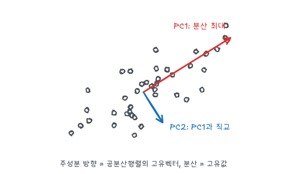
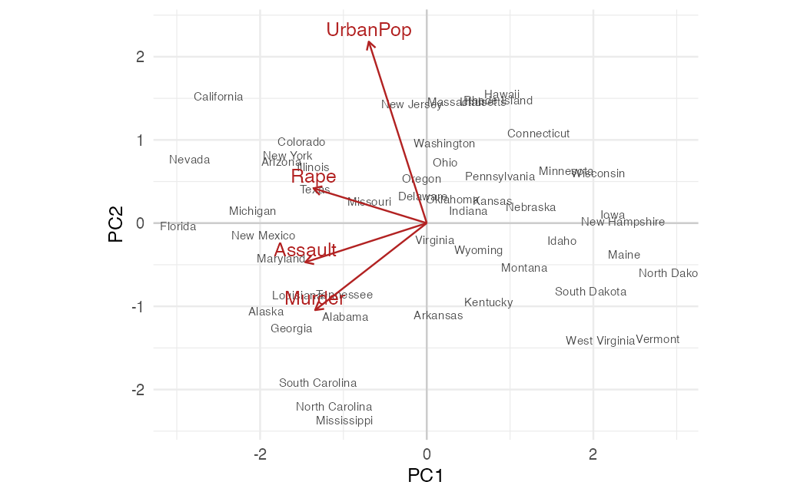
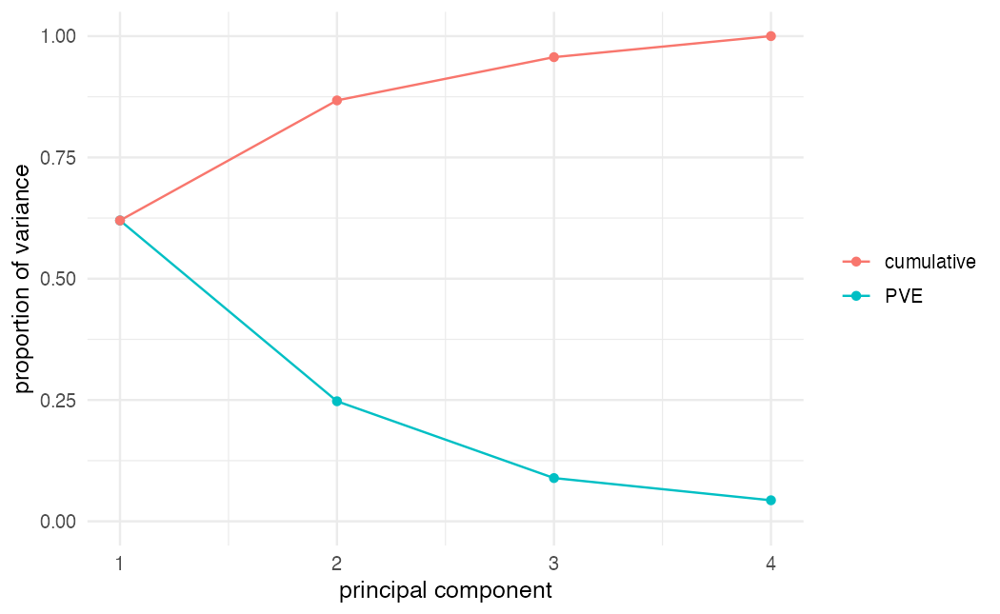

ISLR 12장과 이영미 교수님 데이터마이닝 강의 내용을 바탕으로 정리했다. 주성분분석(PCA)은 상관된 변수 $p$개를 서로 상관없는 소수의 새 변수(주성분)로 요약하는 비지도학습이다. 시각화, 군집분석 전처리, [주성분회귀](/posts/dm-regularization)에 쓰인다.

## 주성분의 정의

평균을 뺀 자료 $X$ ($n \times p$)에서 첫 번째 주성분은 분산이 가장 큰 정규화된 선형결합이다.

$$
Z_1 = \phi_{11} X_1 + \phi_{21} X_2 + \cdots + \phi_{p1} X_p, \qquad \sum_{j=1}^{p} \phi_{j1}^2 = 1
$$

$$
\phi_1 = \arg\max_{\lVert\phi\rVert = 1} \frac{1}{n} \sum_{i=1}^{n} \Big( \sum_{j=1}^{p} \phi_j x_{ij} \Big)^2
$$

제약 $\lVert\phi\rVert = 1$이 없으면 계수를 키워 분산을 무한히 크게 만들 수 있다. 두 번째 주성분 $Z_2$는 $Z_1$과 상관이 없는(즉 $\phi_2 \perp \phi_1$) 선형결합 중 분산이 가장 큰 것이고, 이런 식으로 최대 $\min(n - 1, p)$개까지 만든다.



| 용어 | 뜻 | `prcomp` 결과 |
|---|---|---|
| 적재값 $\phi_{jm}$ | $m$번째 주성분에서 변수 $j$의 가중치 | `rotation` |
| 점수 $z_{im}$ | 관측값 $i$의 $m$번째 주성분 값 | `x` |
| 주성분 분산 | 고유값 $\lambda_m$ | `sdev^2` |

## 고유값 분해와 SVD

$\frac{1}{n} \phi^T X^T X \phi$를 $\lVert\phi\rVert = 1$ 아래에서 최대화하는 문제는 라그랑주 승수법으로 풀면 다음이 된다.

$$
S \phi = \lambda \phi, \qquad S = \frac{1}{n - 1} X^T X
$$

즉 적재값 벡터는 표본공분산행렬 $S$의 **고유벡터**이고, 주성분의 분산은 그 **고유값**이다. 고유값이 큰 순서대로 PC1, PC2, ...가 된다. $S$가 대칭행렬이므로 고유벡터는 서로 직교한다([선형대수 - 고유값](/posts/la-eigen)).

실제 계산은 $X$의 특이값 분해로 한다([선형대수 - SVD](/posts/la-svd)).

$$
X = U D V^T \quad \Rightarrow \quad X^T X = V D^2 V^T
$$

$V$의 열이 적재값, $UD$가 점수, $d_m^2 / (n-1)$이 주성분 분산이다. `prcomp()`는 SVD를 쓰고, `princomp()`는 공분산행렬의 고유값 분해를 쓴다.

## USArrests 실습

```r
library(tidyverse)
theme_set(theme_minimal(base_size = 12))

apply(USArrests, 2, var)
```

`Assault`의 분산이 다른 변수보다 수백 배 크다. 표준화하지 않으면 PC1은 거의 `Assault` 하나가 된다.

```r
pca_raw <- prcomp(USArrests, scale. = FALSE)
pca <- prcomp(USArrests, scale. = TRUE)

round(pca_raw$rotation[, 1], 3)
pca$rotation
```

단위가 다른 변수는 `scale. = TRUE`로 표준화한다. 그러면 공분산행렬 대신 상관행렬의 고유값 분해를 하는 것과 같다. 모든 변수가 같은 단위라면 표준화하지 않는 것이 자연스러울 수도 있다.

표준화한 결과의 적재값을 읽어 보면 다음과 같다.

- **PC1**: 세 범죄 변수(`Murder`, `Assault`, `Rape`)에 비슷한 크기의 가중치가 걸린다. 전반적인 **범죄율** 축이다.
- **PC2**: `UrbanPop`에 가중치가 집중된다. **도시화** 축이다.

적재값의 부호는 임의다. $\phi$와 $-\phi$는 같은 방향을 나타내므로 소프트웨어마다 부호가 반대로 나올 수 있다.

### 고유값 분해로 확인

```r
eig <- eigen(cor(USArrests))
all.equal(eig$values, pca$sdev^2)
all.equal(abs(eig$vectors), abs(unname(pca$rotation)))
```

부호 차이를 없애려고 절댓값으로 비교했다.

### 바이플롯

```r
scores <- as_tibble(pca$x[, 1:2]) |> mutate(state = rownames(USArrests))
loads <- as_tibble(pca$rotation[, 1:2]) |>
  mutate(var = rownames(pca$rotation), PC1 = PC1 * 2.5, PC2 = PC2 * 2.5)

ggplot(scores, aes(PC1, PC2)) +
  geom_hline(yintercept = 0, color = "grey80") +
  geom_vline(xintercept = 0, color = "grey80") +
  geom_text(aes(label = state), size = 2.6, color = "grey30") +
  geom_segment(data = loads, aes(x = 0, y = 0, xend = PC1, yend = PC2),
               arrow = arrow(length = unit(0.2, "cm")), color = "firebrick") +
  geom_text(data = loads, aes(label = var), color = "firebrick", nudge_y = 0.15) +
  coord_equal()
```



점은 주의 점수, 화살표는 변수의 적재값(보기 좋게 2.5배)이다. 이 데이터에서 PC1은 세 범죄 변수가 모두 음수 방향으로 나와서 왼쪽일수록 범죄율이 높고, 화살표가 `UrbanPop` 쪽인 주는 도시 인구 비율이 높다. 세 범죄 화살표가 한 방향으로 모여 있다는 것은 세 변수의 상관이 높다는 뜻이다.

## 몇 개의 주성분을 쓸까

$m$번째 주성분의 **설명 분산 비율(PVE)** 은 다음과 같다.

$$
PVE_m = \frac{\lambda_m}{\sum_{k=1}^{p} \lambda_k} = \frac{\sum_{i} z_{im}^2}{\sum_{j} \sum_{i} x_{ij}^2}
$$

```r
pve <- pca$sdev^2 / sum(pca$sdev^2)

tibble(PC = seq_along(pve), PVE = pve, cumulative = cumsum(pve)) |>
  pivot_longer(-PC) |>
  ggplot(aes(PC, value, color = name)) +
  geom_line() + geom_point() +
  scale_y_continuous(limits = c(0, 1)) +
  labs(x = "principal component", y = "proportion of variance", color = NULL)
```



PC1이 약 62%, PC2가 약 25%로 두 성분이 87%를 설명한다. 정해진 규칙은 없고 흔히 쓰는 기준은 다음과 같다.

- **스크리 그림의 팔꿈치**: PVE가 급격히 줄다가 완만해지는 지점까지
- **누적 비율**: 80~90%를 넘는 지점까지
- **카이저 기준**: 상관행렬 기준 고유값이 1보다 큰 성분 (평균적인 원변수 하나보다 많이 설명하는 성분)
- **지도학습에 쓸 때**: PCR처럼 교차검증으로 정한다

## 행렬 근사로서의 PCA

PCA는 분산 최대화 말고도 "자료에 가장 가까운 $M$차원 부분공간"으로 볼 수 있다. 처음 $M$개 주성분으로 자료를 근사하면 다음과 같다.

$$
x_{ij} \approx \sum_{m=1}^{M} z_{im} \phi_{jm}
$$

이 근사는 모든 rank-$M$ 근사 중 제곱오차 $\sum_{i,j}(x_{ij} - \hat x_{ij})^2$가 가장 작다. SVD의 절단 근사와 같은 결과다. ISLR은 이 성질을 이용해 결측값을 채우는 **행렬 완성**도 다룬다. 결측이 아닌 칸에서만 근사 오차를 최소화하고, 근사값으로 결측 칸을 채우는 일을 반복한다.

```r
X <- scale(USArrests)
approx_err <- map_dbl(1:4, \(M) {
  X_hat <- pca$x[, 1:M, drop = FALSE] %*% t(pca$rotation[, 1:M, drop = FALSE])
  sum((X - X_hat)^2) / sum(X^2)
})
tibble(M = 1:4, unexplained = round(approx_err, 3), PVE_cum = round(cumsum(pve), 3))
```

$1 - $ 누적 PVE가 근사 오차 비율과 정확히 같게 나온다. 분산 최대화와 근사 오차 최소화가 같은 문제라는 것을 확인할 수 있다.

## 요약

| 항목 | 내용 |
|---|---|
| 정의 | 분산이 최대인 정규화된 선형결합, 서로 직교 |
| 계산 | 공분산(상관)행렬의 고유벡터 = $X$의 SVD의 $V$ |
| 표준화 | 단위가 다르면 `scale. = TRUE` |
| 해석 | 적재값으로 축의 의미, 부호는 임의 |
| 성분 수 | 스크리 그림, 누적 PVE, 카이저 기준, 교차검증 |
| 다른 관점 | 제곱오차가 가장 작은 rank-$M$ 근사 |
