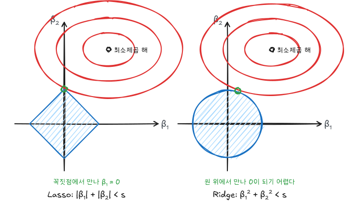
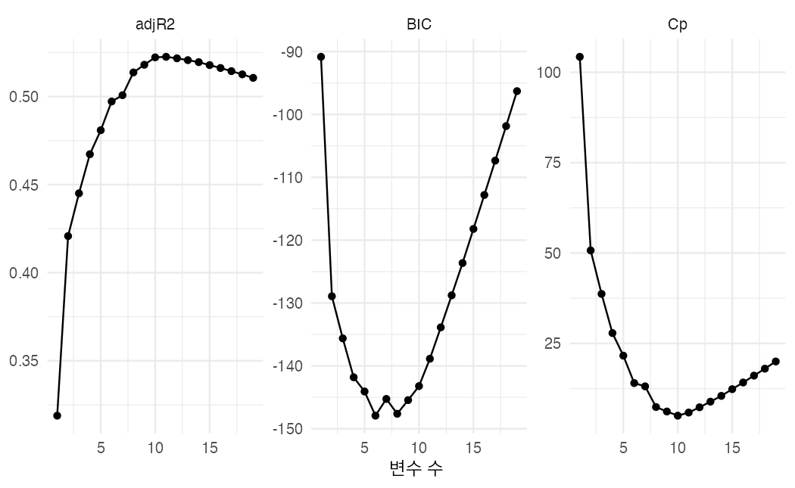
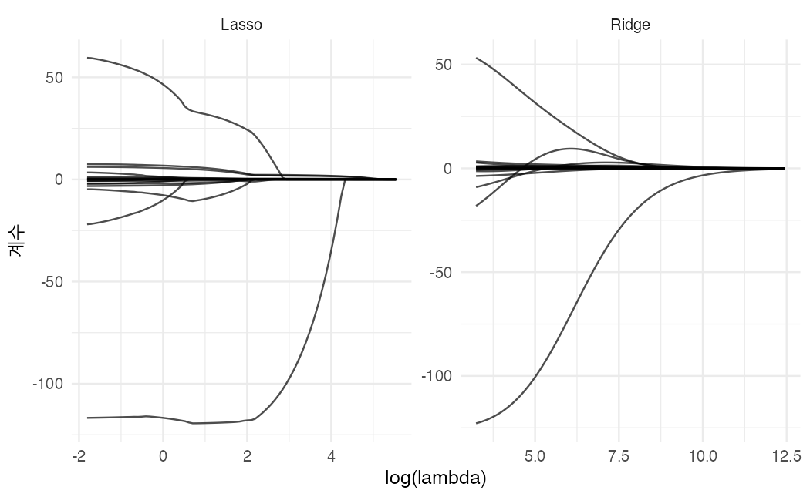
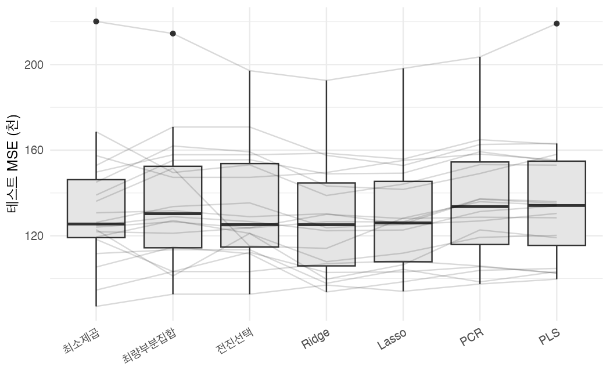
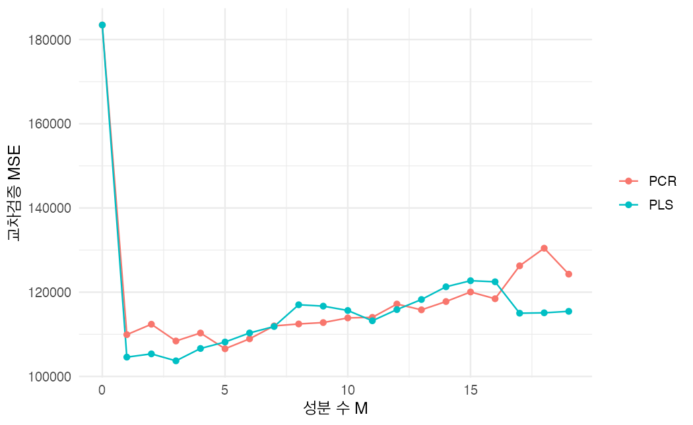
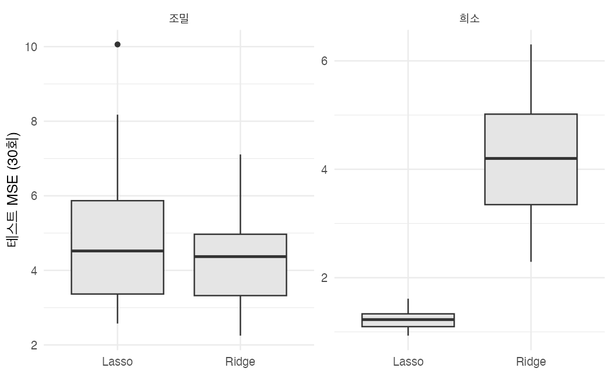

ISLR 6장과 이영미 교수님 데이터마이닝 강의 내용을 바탕으로 정리했다.

## 개요

설명 변수가 많으면 최소제곱 추정량은 불편이지만 분산이 커지고, $p > n$이면 해가 하나로 정해지지도 않는다. 선형모형의 틀을 유지하면서 이 문제를 다루는 방법은 세 갈래로 나뉜다. 세 접근 모두 **편향을 약간 허용하는 대신 분산을 줄인다**는 점은 같고, 계수 공간에 어떤 제약을 거느냐가 다르다.

| 접근 | 방법 | 계수에 거는 제약 | 변수 선택 |
|---|---|---|---|
| 부분집합 선택 | 최량부분집합, 전진·후진 선택 | 0이 아닌 계수의 개수 제한 ($L_0$) | 함 |
| 수축(정규화) | Ridge | 계수 제곱합 제한 ($L_2$) | 하지 않음 |
| | Lasso | 계수 절댓값 합 제한 ($L_1$) | 함 |
| 차원축소 | PCR, PLS | 설명 변수의 선형결합 $M$개로 투영 | 하지 않음 |

## 1. 최소제곱의 한계

최소제곱 추정량 $\hat\beta = (X^TX)^{-1}X^Ty$의 분산은 $\sigma^2(X^TX)^{-1}$이다. $p$가 $n$에 가까워지거나 설명 변수 간 공선성이 크면 $X^TX$가 특이행렬에 가까워져 분산이 커진다. 이때 테스트 오차의 대부분은 편향이 아니라 분산에서 온다. 아래의 방법들은 이 분산을 줄이는 서로 다른 방식이다.

자료는 `ISLR2::Hitters`를 쓴다. 메이저리그 타자 263명의 연봉(`Salary`, 천 달러)과 성적 변수 19개다.

```r
library(tidyverse)
library(ISLR2)
library(leaps)
library(glmnet)
library(pls)
theme_set(theme_minimal(base_size = 12))

hitters <- na.omit(Hitters)
x <- model.matrix(Salary ~ ., hitters)[, -1]   # 범주형은 가변수로, 절편 열 제거
y <- hitters$Salary
dim(x)
```

## 2. 부분집합 선택

### 최량부분집합 선택

변수 개수 $k = 1, \dots, p$마다 $\binom pk$개 모형을 모두 적합해 RSS가 가장 작은 모형 $\mathcal M_k$를 고르고, 다시 $\mathcal M_0, \dots, \mathcal M_p$ 중 하나를 고른다. 두 번째 단계에서는 RSS나 $R^2$를 쓸 수 없다. 변수가 늘수록 항상 좋아지기 때문이다. 대신 테스트 오차를 반영하는 기준을 쓴다.

| 기준 | 식 ($d$: 변수 수, $\hat\sigma^2$: 전체 모형의 오차분산 추정값) | 선택 |
|---|---|---|
| $C_p$ | $\frac1n(RSS + 2d\hat\sigma^2)$ | 최소 |
| AIC | 최소제곱 모형에서는 $C_p$에 비례 | 최소 |
| BIC | $\frac1n(RSS + \log(n)\,d\hat\sigma^2)$ | 최소 |
| 수정 $R^2$ | $1 - \frac{RSS/(n - d - 1)}{TSS/(n - 1)}$ | 최대 |

$n > 7$이면 $\log n > 2$이므로 BIC는 $C_p$보다 변수 추가에 큰 벌점을 주어 더 작은 모형을 고른다.

### 단계적 선택

최량부분집합은 $2^p$개 모형을 비교해야 하므로 $p$가 40만 넘어도 계산이 어렵다. 전진 선택은 빈 모형에서 시작해 RSS를 가장 많이 줄이는 변수를 하나씩 추가하며, 비교하는 모형 수가 $1 + p(p + 1)/2$개로 줄어든다. 대신 한 번 들어간 변수는 빠지지 않으므로 최적 조합을 놓칠 수 있다. 후진 선택은 전체 모형에서 하나씩 제거하므로 $n > p$여야 한다.

부분집합 선택의 근본적인 문제는 변수를 넣거나 빼는 **이산적** 결정이라는 점이다. 자료가 조금 바뀌면 선택되는 변수가 달라질 수 있어 결과의 분산이 크다.

## 3. Ridge 회귀

Ridge 회귀는 RSS에 계수 제곱합의 벌점을 더한 것을 최소화한다.

$$
\hat\beta^R = \arg\min_\beta\left\{\sum_{i=1}^{n}\Big(y_i - \beta_0 - \sum_j\beta_jx_{ij}\Big)^2 + \lambda\sum_{j=1}^{p}\beta_j^2\right\} = (X^TX + \lambda I)^{-1}X^Ty
$$

$\lambda = 0$이면 최소제곱이고, $\lambda \to \infty$이면 모든 계수가 0으로 간다. 절편에는 벌점을 주지 않으며, 벌점이 계수의 크기에 의존하므로 변수를 표준화한 뒤 적합한다.

$X^TX$에 $\lambda I$를 더하면 역행렬이 항상 존재하고 그 크기가 작아진다. 따라서 공선성이 크거나 $p > n$이어도 해가 안정적이다. 부분집합 선택과 달리 $\lambda$에 따라 계수가 **연속적으로** 줄어들므로 자료의 작은 변화에 덜 민감하다.

## 4. Lasso

Lasso는 벌점을 계수 절댓값의 합으로 바꾼 것이다.

$$
\hat\beta^L = \arg\min_\beta\left\{\sum_{i=1}^{n}\Big(y_i - \beta_0 - \sum_j\beta_jx_{ij}\Big)^2 + \lambda\sum_{j=1}^{p}\lvert\beta_j\rvert\right\}
$$

벌점의 형태만 다르지만 결과는 크게 다르다. Lasso는 $\lambda$가 충분히 크면 일부 계수를 **정확히 0**으로 만든다. 즉 수축과 변수 선택을 동시에 한다.

### 계수가 정확히 0이 되는 이유

두 문제는 각각 다음 제약 최적화 문제와 동치다.

$$
\min_\beta RSS \quad\text{s.t.}\quad \sum_j\beta_j^2 \le s \;\;(\text{Ridge}), \qquad \sum_j\lvert\beta_j\rvert \le s \;\;(\text{Lasso})
$$



RSS의 등고선(타원)이 제약 영역에 처음 닿는 점이 해다. Lasso의 제약 영역은 축 위에 꼭짓점이 있는 마름모여서 등고선이 꼭짓점에 닿기 쉽고, 이때 한 계수가 정확히 0이 된다. Ridge의 제약 영역은 원이어서 꼭짓점이 없으므로 계수가 0에 가까워질 뿐 0이 되지는 않는다.

직교 설계($X^TX = I$)에서는 두 추정량을 명시적으로 쓸 수 있어 차이가 더 분명하다.

$$
\hat\beta_j^R = \frac{\hat\beta_j^{OLS}}{1 + \lambda}, \qquad
\hat\beta_j^L = \text{sign}(\hat\beta_j^{OLS})\left(\lvert\hat\beta_j^{OLS}\rvert - \frac\lambda2\right)_+
$$

Ridge는 모든 계수를 같은 **비율**로 줄이고, Lasso는 모든 계수에서 같은 **양**을 빼되 0보다 작아지면 0으로 둔다(연성 임계값).

### Elastic Net

Ridge와 Lasso의 벌점을 섞은 것이다($\alpha\lvert\beta\rvert + (1 - \alpha)\beta^2/2$). 상관이 높은 변수 묶음이 있을 때 Lasso는 그중 하나만 임의로 고르는 경향이 있는데, Elastic Net은 묶음을 함께 남긴다.

## 5. 주성분회귀 (PCR)

설명 변수를 선형결합 $Z_m = \sum_j\phi_{jm}X_j$ $M$개로 바꾸고($M < p$), $Z_1, \dots, Z_M$으로 최소제곱 회귀를 한다. PCR은 $Z_m$을 [주성분](/posts/dm-pca)으로 정한다. $X$의 변동이 큰 방향이 $Y$와도 관련이 있다고 가정하는 셈이며, 방향을 정할 때 $Y$를 보지 않는 비지도 방식이다.

PCR은 변수 선택이 아니다. 각 주성분이 원래 변수 전부의 결합이기 때문이다. 오히려 Ridge와 밀접하다. $X$의 특이값을 $d_1 \ge \cdots \ge d_p$라 하면, 두 방법은 주성분 방향의 계수를 다음과 같이 다룬다.

| 방법 | $j$번째 주성분 방향에 곱하는 수축 계수 |
|---|---|
| Ridge | $\dfrac{d_j^2}{d_j^2 + \lambda}$ (분산이 작은 방향일수록 많이 줄임) |
| PCR | $j \le M$이면 1, 아니면 0 (분산이 작은 방향을 버림) |

Ridge는 분산이 작은 방향을 연속적으로 줄이고, PCR은 불연속적으로 잘라낸다. 그래서 두 방법의 결과는 대체로 비슷하며, Ridge가 조금 더 매끄럽다.

## 6. 부분최소제곱 (PLS)

PLS도 선형결합 $M$개로 회귀하지만, 방향을 $Y$와의 공분산이 크도록 정한다. 첫 방향은 각 $X_j$의 계수를 $Y$에 대한 단순회귀계수에 비례하게 둔 것이다. $Y$를 보고 방향을 정하는 지도 방식이므로 PCR보다 적은 성분으로 $Y$를 설명하지만, $Y$에 맞추는 만큼 분산 감소 효과는 PCR보다 작다.

## 7. 방법 간 비교

| 구분 | 부분집합 선택 | Ridge | Lasso | PCR | PLS |
|---|---|---|---|---|---|
| 제약 | $\lVert\beta\rVert_0 \le k$ | $\lVert\beta\rVert_2^2 \le s$ | $\lVert\beta\rVert_1 \le s$ | 상위 $M$개 주성분 공간 | $Y$와 공분산이 큰 $M$개 방향 |
| 조율 모수 | 변수 수 $k$ | $\lambda$ | $\lambda$ | $M$ | $M$ |
| 계수 변화 | 이산적 (넣거나 뺌) | 연속적 수축 | 연속적 수축 + 0 | 이산적 (방향 단위) | 이산적 (방향 단위) |
| 변수 선택 | 함 | 하지 않음 | 함 | 하지 않음 | 하지 않음 |
| $Y$ 사용 여부 | 사용 | 사용 | 사용 | 방향 결정에 미사용 | 사용 |
| 계산 | $2^p$ 또는 $p^2$ | 닫힌 해 | 볼록 최적화 | 고유값 분해 | 반복 계산 |
| 해석 | 쉬움 | 모든 변수 남음 | 쉬움 (희소) | 어려움 | 어려움 |
| 유리한 참 모형 | 소수 변수 | 다수 변수가 조금씩 기여 | 소수 변수 | 분산이 큰 방향이 $Y$와 관련 | $Y$와 관련된 방향이 분산은 작음 |

## 8. Hitters 자료를 이용한 비교

### 부분집합 선택의 기준별 결과

```r
best <- regsubsets(Salary ~ ., data = hitters, nvmax = 19)
best_sum <- summary(best)

tibble(d = 1:19, Cp = best_sum$cp, BIC = best_sum$bic, adjR2 = best_sum$adjr2) |>
  pivot_longer(-d) |>
  ggplot(aes(d, value)) +
  geom_line() + geom_point() +
  facet_wrap(~name, scales = "free_y") +
  labs(x = "변수 수", y = NULL)

c(Cp = which.min(best_sum$cp), BIC = which.min(best_sum$bic), adjR2 = which.max(best_sum$adjr2))

fwd <- regsubsets(Salary ~ ., data = hitters, nvmax = 19, method = "forward")
rbind(최량 = names(coef(best, 7)), 전진 = names(coef(fwd, 7)))
```



$C_p$는 10개, BIC는 6개, 수정 $R^2$는 11개를 고른다. 같은 자료에서도 기준에 따라 선택되는 모형의 크기가 크게 다르며, 앞에서 말한 대로 BIC가 가장 작은 모형을 고른다. 변수 7개 모형에서는 최량부분집합(`Hits`, `Walks`, `CAtBat`, `CHits`, `CHmRun`, `DivisionW`, `PutOuts`)과 전진 선택(`AtBat`, `Hits`, `Walks`, `CRBI`, `CWalks`, `DivisionW`, `PutOuts`)의 결과가 달라진다. 전진 선택이 앞 단계의 선택에 묶여 있기 때문이다.

### Ridge와 Lasso의 계수 경로

```r
ridge <- glmnet(x, y, alpha = 0)
lasso <- glmnet(x, y, alpha = 1)

path_df <- function(fit, name) {
  as_tibble(t(as.matrix(fit$beta))) |>
    mutate(log_lambda = log(fit$lambda)) |>
    pivot_longer(-log_lambda, names_to = "variable", values_to = "coef") |>
    mutate(model = name)
}

bind_rows(path_df(ridge, "Ridge"), path_df(lasso, "Lasso")) |>
  ggplot(aes(log_lambda, coef, group = variable)) +
  geom_line(alpha = 0.7) +
  facet_wrap(~model, scales = "free") +
  labs(x = "log(lambda)", y = "계수")
```



`glmnet`은 `alpha = 0`이면 Ridge, `alpha = 1`이면 Lasso를 적합하고 기본으로 변수를 표준화한다. 그림에서 Ridge의 계수는 $\lambda$가 커지면서 모두 함께 0에 다가가지만, Lasso의 계수는 하나씩 정확히 0이 된다. 앞의 제약 영역 그림에서 본 차이가 계수 경로에 그대로 나타난다.

### 계수의 비교

교차검증으로 고른 $\lambda$에서 최소제곱, Ridge, Lasso의 계수를 나란히 놓는다.

```r
set.seed(1)
cv_ridge_all <- cv.glmnet(x, y, alpha = 0)
cv_lasso_all <- cv.glmnet(x, y, alpha = 1)

coef_tbl <- tibble(
  변수 = rownames(coef(cv_lasso_all))[-1],
  최소제곱 = coef(lm(Salary ~ ., hitters))[-1],
  Ridge = as.numeric(coef(cv_ridge_all, s = "lambda.min"))[-1],
  Lasso = as.numeric(coef(cv_lasso_all, s = "lambda.min"))[-1]
)
coef_tbl |> mutate(across(-변수, \(v) round(v, 2)))
colSums(coef_tbl[, -1] != 0)
```

| 변수 | 최소제곱 | Ridge | Lasso |
|---|---|---|---|
| Hits | 7.50 | 2.77 | 6.56 |
| Walks | 6.23 | 3.38 | 5.44 |
| HmRun | 4.33 | −1.37 | 0.89 |
| RBI | −1.04 | 0.71 | 0 |
| CHits | 0.13 | 0.14 | 0 |
| LeagueN | 62.6 | 53.2 | 42.5 |
| NewLeagueN | −24.8 | −18.1 | −6.65 |
| 0이 아닌 계수 수 | 19 | 19 | 17 |

교차검증으로 고른 $\lambda$에서 Ridge는 `Hits`, `Walks` 같은 계수를 최소제곱의 절반 이하로 줄이지만 0인 계수는 하나도 없다. 서로 상관이 높은 누적 성적 변수들 사이에서는 부호가 바뀌기도 한다(`HmRun` 4.33 → −1.37). 공선성이 큰 변수들 사이에서 효과를 고르게 나누어 갖도록 수축하기 때문이다. Lasso는 `RBI`, `CHits`를 정확히 0으로 만들고 나머지는 최소제곱에 가깝게 둔다. `lambda.min`은 예측 오차가 최소인 지점이라 변수를 2개만 제거했지만, 더 단순한 `lambda.1se`를 쓰면 `Walks`, `CHmRun`, `CRBI` 세 변수만 남는다.

### 같은 분할에서의 테스트 오차

자료를 반으로 나누어 학습 자료에서 각 방법의 조율 모수를 정하고(부분집합 선택은 BIC, Ridge·Lasso는 10겹 교차검증, PCR·PLS는 교차검증), 테스트 자료로 평균제곱오차를 비교한다. 분할 하나의 결과는 운에 좌우되므로 분할을 20번 바꾸어 반복한다.

```r
pred_rs <- function(fit, newdata, id) {
  mat <- model.matrix(Salary ~ ., newdata)
  co <- coef(fit, id)
  as.numeric(mat[, names(co)] %*% co)
}

one_split <- function(seed) {
  set.seed(seed)
  tr <- sample(nrow(hitters), nrow(hitters) / 2)
  dtr <- hitters[tr, ]; dte <- hitters[-tr, ]
  mse <- function(pred) mean((dte$Salary - as.numeric(pred))^2)

  bs <- regsubsets(Salary ~ ., dtr, nvmax = 19)
  fw <- regsubsets(Salary ~ ., dtr, nvmax = 19, method = "forward")
  cr <- cv.glmnet(x[tr, ], y[tr], alpha = 0)
  cl <- cv.glmnet(x[tr, ], y[tr], alpha = 1)
  pc <- pcr(Salary ~ ., data = dtr, scale = TRUE, validation = "CV")
  pl <- plsr(Salary ~ ., data = dtr, scale = TRUE, validation = "CV")
  m_pc <- which.min(RMSEP(pc, estimate = "CV")$val[1, 1, -1])
  m_pl <- which.min(RMSEP(pl, estimate = "CV")$val[1, 1, -1])

  tibble(seed = seed,
         최소제곱 = mse(predict(lm(Salary ~ ., dtr), dte)),
         최량부분집합 = mse(pred_rs(bs, dte, which.min(summary(bs)$bic))),
         전진선택 = mse(pred_rs(fw, dte, which.min(summary(fw)$bic))),
         Ridge = mse(predict(cr, x[-tr, ], s = "lambda.min")),
         Lasso = mse(predict(cl, x[-tr, ], s = "lambda.min")),
         PCR = mse(predict(pc, dte, ncomp = m_pc)),
         PLS = mse(predict(pl, dte, ncomp = m_pl)))
}

reg_splits <- map_dfr(1:20, one_split)
reg_long <- reg_splits |>
  pivot_longer(-seed, names_to = "방법", values_to = "MSE") |>
  mutate(방법 = fct_inorder(방법))

reg_long |> group_by(방법) |>
  summarise(평균 = round(mean(MSE)), 중앙값 = round(median(MSE)), 표준편차 = round(sd(MSE)))

ggplot(reg_long, aes(방법, MSE / 1000)) +
  geom_boxplot(fill = "grey90") +
  geom_line(aes(group = seed), alpha = 0.15) +
  labs(x = NULL, y = "테스트 MSE (천)") +
  theme(axis.text.x = element_text(angle = 30, hjust = 1))
```



| 방법 | 평균 | 중앙값 | 표준편차 |
|---|---|---|---|
| 최소제곱 | 132,786 | 125,490 | 28,978 |
| 최량부분집합 | 135,318 | 130,304 | 29,096 |
| 전진 선택 | 133,493 | 125,198 | 25,723 |
| Ridge | **127,105** | **125,164** | 25,956 |
| Lasso | 128,995 | 126,009 | 25,438 |
| PCR | 135,053 | 133,607 | 27,125 |
| PLS | 135,824 | 134,133 | 29,105 |

평균 테스트 MSE는 Ridge가 가장 작고 Lasso가 뒤를 잇는다. 부분집합 선택과 PCR·PLS는 최소제곱보다도 약간 나쁘다. 그림에서 회색 선은 같은 분할을 이은 것인데, 분할에 따른 차이(선의 높이)가 방법 간 차이보다 훨씬 크다. 그래서 분할 하나로 방법을 비교하면 결론이 쉽게 뒤집힌다. 같은 분할 안에서 비교하면 Ridge와 Lasso가 대부분의 분할에서 최소제곱보다 낮다.

### PCR과 PLS의 성분 수

```r
set.seed(1)
train <- sample(nrow(hitters), nrow(hitters) / 2)
pcr_fit <- pcr(Salary ~ ., data = hitters, subset = train, scale = TRUE, validation = "CV")
pls_fit <- plsr(Salary ~ ., data = hitters, subset = train, scale = TRUE, validation = "CV")

cv_curve <- function(fit, name) {
  rmsep <- RMSEP(fit, estimate = "CV")$val[1, 1, ]
  tibble(M = seq_along(rmsep) - 1, cv_mse = rmsep^2, model = name)
}

bind_rows(cv_curve(pcr_fit, "PCR"), cv_curve(pls_fit, "PLS")) |>
  ggplot(aes(M, cv_mse, color = model)) +
  geom_line() + geom_point() +
  labs(x = "성분 수 M", y = "교차검증 MSE", color = NULL)
```



$M = 0$은 절편만 있는 모형이다. PLS는 $Y$를 보고 방향을 정하므로 첫 한두 성분에서 오차가 빠르게 줄고, PCR은 $Y$와 무관하게 $X$의 분산 순서대로 성분을 쌓으므로 더 많은 성분이 필요하다. 성분을 충분히 쓰면 두 방법의 오차는 비슷해진다.

## 9. 모의실험: 희소한 참 모형과 조밀한 참 모형

Ridge와 Lasso 중 어느 쪽이 나은지는 참 모형에 달려 있다. $n = 50$, $p = 45$인 자료를 두 가지로 생성해 비교한다.

- **조밀**: 45개 계수가 모두 0이 아니고 크기가 작음($\beta_j \sim N(0, 0.5^2)$)
- **희소**: 2개 계수만 0이 아님($\beta_1 = 3$, $\beta_2 = -3$)

```r
sim_once <- function(type, n = 50, p = 45) {
  beta <- if (type == "조밀") rnorm(p, 0, 0.5) else c(3, -3, rep(0, p - 2))
  X <- matrix(rnorm((n + 500) * p), n + 500)
  yy <- as.numeric(X %*% beta + rnorm(n + 500))
  tr <- 1:n
  mse <- function(fit) mean((yy[-tr] - predict(fit, X[-tr, ], s = "lambda.min"))^2)
  c(Ridge = mse(cv.glmnet(X[tr, ], yy[tr], alpha = 0)),
    Lasso = mse(cv.glmnet(X[tr, ], yy[tr], alpha = 1)))
}

set.seed(10)
sim_rl <- map_dfr(c("조밀", "희소"), \(t) map_dfr(1:30, \(r) as_tibble_row(sim_once(t)) |> mutate(참모형 = t)))

sim_rl |> group_by(참모형) |> summarise(across(c(Ridge, Lasso), \(v) round(mean(v), 2)))

sim_rl |>
  pivot_longer(c(Ridge, Lasso), names_to = "방법", values_to = "MSE") |>
  ggplot(aes(방법, MSE)) +
  geom_boxplot(fill = "grey90") +
  facet_wrap(~참모형, scales = "free_y") +
  labs(x = NULL, y = "테스트 MSE (30회)")
```



| 참 모형 | Ridge | Lasso |
|---|---|---|
| 조밀 (45개 모두 기여) | **4.28** | 4.93 |
| 희소 (2개만 기여) | 4.18 | **1.22** |

조밀한 경우에는 Ridge가 낫다. Lasso는 작은 계수 다수를 0으로 만들어 실제로 존재하는 효과를 버리기 때문이다. 희소한 경우에는 Lasso의 테스트 MSE가 Ridge의 3분의 1 이하다. Ridge는 효과가 없는 43개 변수의 계수를 0으로 만들지 못하고 작은 값으로 남겨 두므로, 그만큼의 분산이 예측에 섞인다.

## 10. 결과의 해석

| 관찰된 결과 | 원인 |
|---|---|
| Ridge·Lasso가 최소제곱보다 테스트 오차가 작음 | 누적 성적 변수 간 공선성으로 최소제곱의 분산이 큼. 수축으로 분산을 줄임 |
| 부분집합 선택이 최소제곱보다도 나쁨 | 변수를 넣고 빼는 이산적 결정이라 분할에 따라 선택이 바뀌어 분산이 큼 |
| 기준에 따라 고르는 변수 수가 6~11개로 다름 | BIC의 벌점 $\log n$이 $C_p$의 2보다 커서 더 작은 모형을 고름 |
| Lasso만 계수가 정확히 0이 됨 | $L_1$ 제약 영역의 꼭짓점이 축 위에 있음 (연성 임계값) |
| Ridge에서 상관이 높은 변수의 부호가 바뀜 | 공선성이 있는 변수들 사이에서 효과를 고르게 나누어 수축 |
| 조밀한 참 모형에서는 Ridge, 희소한 참 모형에서는 Lasso가 우수 | Lasso는 작은 효과를 버리고, Ridge는 없는 효과를 0으로 만들지 못함 |
| PCR·PLS가 Ridge보다 나쁨 | 주성분 방향을 불연속적으로 자르므로, 같은 원리를 연속적으로 적용하는 Ridge보다 거침 |
| 분할 간 차이가 방법 간 차이보다 큼 | $n = 263$으로 작고 연봉 분포의 꼬리가 길어 테스트 자료 구성에 민감 |

## 11. 방법의 선택

| 상황 | 적합한 방법 |
|---|---|
| 해석 가능한 작은 모형이 필요하고 $p$가 작음 | 최량부분집합 (BIC 또는 교차검증) |
| $p$가 크고 해석 가능한 희소 모형이 필요함 | Lasso |
| 다수의 변수가 조금씩 기여하거나 공선성이 큼 | Ridge |
| 상관이 높은 변수 묶음을 함께 남기고 싶음 | Elastic Net |
| 설명 변수의 차원이 매우 크고 분산이 몇 방향에 몰려 있음 | PCR |
| 적은 수의 성분으로 $Y$를 설명하고 싶음 | PLS |
| 기준 간 결과가 다름 | 교차검증 오차를 우선 |

## 정리

| | 부분집합 선택 | Ridge | Lasso | PCR | PLS |
|---|---|---|---|---|---|
| 제약 | $L_0$ | $L_2$ | $L_1$ | 주성분 투영 | $Y$ 공분산 방향 투영 |
| 변수 선택 | 함 | 하지 않음 | 함 | 하지 않음 | 하지 않음 |
| 계수 변화 | 이산적 | 연속적 | 연속적 + 0 | 이산적 | 이산적 |
| 조율 모수 | $k$ | $\lambda$ | $\lambda$ | $M$ | $M$ |
| 유리한 참 모형 | 희소 | 조밀 | 희소 | 분산이 큰 방향이 중요 | $Y$ 관련 방향이 중요 |
