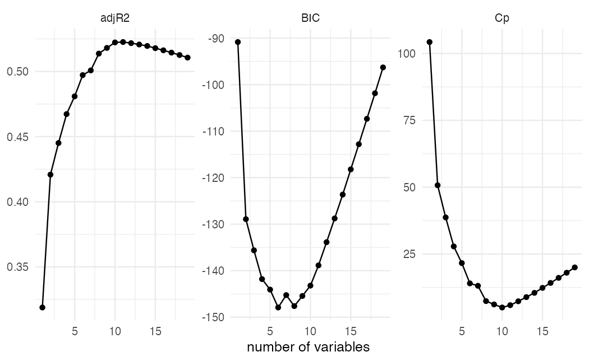
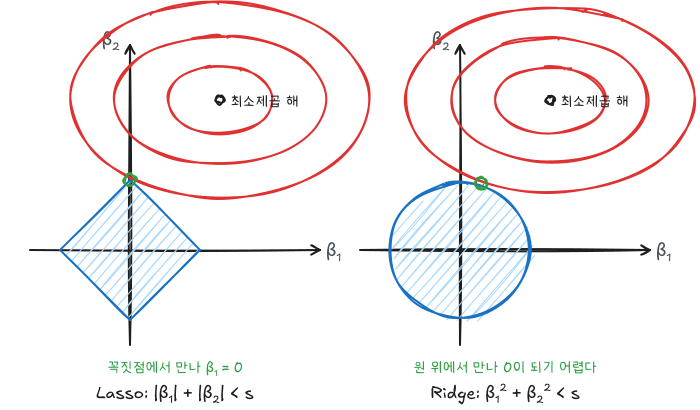
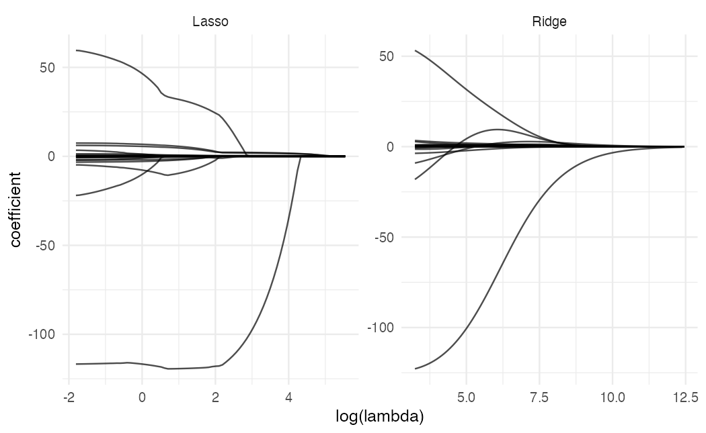
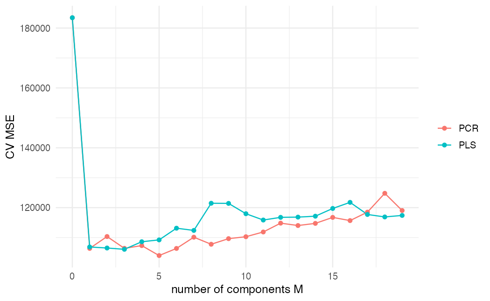

ISLR 6장과 이영미 교수님 데이터마이닝 강의 내용을 바탕으로 정리했다. 설명 변수가 많으면 최소제곱 추정은 분산이 커지고, $p > n$이면 해가 하나로 정해지지도 않는다. 선형모형을 유지하면서 이 문제를 다루는 방법은 세 갈래다.

| 갈래 | 아이디어 | 방법 |
|---|---|---|
| 부분집합 선택 | 변수 일부만 쓴다 | 최량부분집합, 전진·후진 선택 |
| 수축(정규화) | 계수를 0 쪽으로 줄인다 | Ridge, Lasso |
| 차원축소 | 변수의 선형결합 $M$개로 회귀한다 | PCR, PLS |

## 데이터

`ISLR2::Hitters`는 메이저리그 타자 연봉(`Salary`, 천 달러)과 성적 변수 19개다. 연봉 결측이 있는 행은 뺀다.

```r
library(tidyverse)
library(ISLR2)
library(leaps)
library(glmnet)
library(pls)
theme_set(theme_minimal(base_size = 12))

hitters <- na.omit(Hitters)
dim(hitters)
```

## 부분집합 선택

### 최량부분집합

변수 개수 $k = 1, \dots, p$마다 $\binom{p}{k}$개 모형을 모두 적합해 RSS가 가장 작은 $\mathcal{M}_k$를 고른다. 그다음 $\mathcal{M}_0, \dots, \mathcal{M}_p$ 중 하나를 고른다. 이때 RSS나 $R^2$는 변수가 늘수록 항상 좋아지므로 쓸 수 없고, 테스트 오차를 반영하는 기준이 필요하다.

| 기준 | 식 ($d$ = 변수 수, $\hat\sigma^2$ = 전체 모형의 오차분산 추정) | 고르는 방향 |
|---|---|---|
| $C_p$ | $\frac{1}{n}(RSS + 2d\hat\sigma^2)$ | 작을수록 |
| AIC | 최소제곱 모형에서는 $C_p$에 비례 | 작을수록 |
| BIC | $\frac{1}{n}(RSS + \log(n)\, d\hat\sigma^2)$ | 작을수록 |
| 수정 $R^2$ | $1 - \frac{RSS/(n-d-1)}{TSS/(n-1)}$ | 클수록 |

BIC는 $n > 7$이면 $\log n > 2$라서 $C_p$보다 변수 추가에 더 큰 벌점을 주고, 더 작은 모형을 고르는 경향이 있다.

```r
best <- regsubsets(Salary ~ ., data = hitters, nvmax = 19)
best_sum <- summary(best)

tibble(d = 1:19, Cp = best_sum$cp, BIC = best_sum$bic, adjR2 = best_sum$adjr2) |>
  pivot_longer(-d) |>
  ggplot(aes(d, value)) +
  geom_line() + geom_point() +
  facet_wrap(~name, scales = "free_y") +
  labs(x = "number of variables", y = NULL)
```



```r
c(Cp = which.min(best_sum$cp), BIC = which.min(best_sum$bic), adjR2 = which.max(best_sum$adjr2))
coef(best, which.min(best_sum$bic))
```

기준마다 고르는 변수 수가 다르다. BIC가 가장 작은 모형을 고른다.

### 단계적 선택

최량부분집합은 $2^p$개 모형을 봐야 해서 $p$가 40만 넘어도 계산이 어렵다. **전진 선택**은 빈 모형에서 시작해 RSS를 가장 많이 줄이는 변수를 하나씩 더한다. 모형 수는 $1 + p(p+1)/2$개로 줄지만, 최적 조합을 놓칠 수 있다. **후진 선택**은 전체 모형에서 하나씩 빼므로 $n > p$여야 한다.

```r
fwd <- regsubsets(Salary ~ ., data = hitters, nvmax = 19, method = "forward")
rbind(best = names(coef(best, 7)), forward = names(coef(fwd, 7)))
```

변수 7개 모형부터 최량부분집합과 전진 선택의 결과가 달라진다.

## 수축: Ridge와 Lasso

최소제곱의 RSS에 계수 크기에 대한 벌점을 더한다.

$$
\text{Ridge: } \sum_{i=1}^{n}\Big(y_i - \beta_0 - \sum_{j} \beta_j x_{ij}\Big)^2 + \lambda \sum_{j=1}^{p} \beta_j^2
$$

$$
\text{Lasso: } \sum_{i=1}^{n}\Big(y_i - \beta_0 - \sum_{j} \beta_j x_{ij}\Big)^2 + \lambda \sum_{j=1}^{p} \lvert \beta_j \rvert
$$

- $\lambda = 0$이면 최소제곱, $\lambda \to \infty$이면 모든 계수가 0이다.
- 절편 $\beta_0$에는 벌점을 주지 않는다.
- 벌점이 계수 크기에 의존하므로 **변수를 표준화한 뒤** 적합한다. `glmnet`은 기본으로 표준화한다.

### 왜 Lasso만 계수가 정확히 0이 되는가

두 문제는 각각 다음 제약식 문제와 같다.

$$
\min_\beta RSS \quad \text{s.t.} \quad \sum_j \beta_j^2 \le s \quad \text{(Ridge)}, \qquad \sum_j \lvert\beta_j\rvert \le s \quad \text{(Lasso)}
$$



RSS의 등고선(빨간 타원)이 제약 영역에 처음 닿는 점이 해다. Lasso의 영역은 축 위에 꼭짓점이 있는 마름모라서 꼭짓점에서 닿기 쉽고, 그러면 한 계수가 정확히 0이 된다. Ridge의 원에는 꼭짓점이 없어서 계수가 0에 가까워질 뿐 정확히 0이 되지는 않는다. 그래서 Lasso는 **변수 선택**까지 해 주고, 해석이 쉬운 희소 모형을 만든다.

### 편향-분산 관점

$\lambda$가 커지면 계수가 줄어 분산이 줄고 편향이 늘어난다. 최소제곱의 분산이 큰 상황($p$가 $n$에 가깝거나 공선성이 클 때)에서는 조금의 편향으로 분산을 크게 줄여 테스트 오차가 작아진다. 참 모형에서 대부분의 계수가 0이면 Lasso가, 많은 변수가 조금씩 기여하면 Ridge가 유리하다.

### glmnet 실습

`glmnet`은 공식 대신 설명 변수 행렬과 반응 벡터를 받는다. `alpha = 0`이면 Ridge, `alpha = 1`이면 Lasso다.

```r
x <- model.matrix(Salary ~ ., hitters)[, -1]
y <- hitters$Salary

ridge <- glmnet(x, y, alpha = 0)
lasso <- glmnet(x, y, alpha = 1)

path_df <- function(fit, name) {
  b <- as.matrix(fit$beta)
  as_tibble(t(b)) |>
    mutate(log_lambda = log(fit$lambda)) |>
    pivot_longer(-log_lambda, names_to = "variable", values_to = "coef") |>
    mutate(model = name)
}

bind_rows(path_df(ridge, "Ridge"), path_df(lasso, "Lasso")) |>
  ggplot(aes(log_lambda, coef, group = variable)) +
  geom_line(alpha = 0.7) +
  facet_wrap(~model, scales = "free") +
  labs(x = "log(lambda)", y = "coefficient")
```



`model.matrix()`는 범주형 변수를 가변수로 바꿔 준다. `[, -1]`은 절편 열을 뺀다. Ridge는 모든 계수가 함께 서서히 0에 다가가고, Lasso는 $\lambda$가 커지면서 계수가 하나씩 정확히 0이 된다.

### 람다 선택

```r
set.seed(1)
train <- sample(nrow(x), nrow(x) / 2)

cv_ridge <- cv.glmnet(x[train, ], y[train], alpha = 0, nfolds = 10)
cv_lasso <- cv.glmnet(x[train, ], y[train], alpha = 1, nfolds = 10)

test_mse <- function(cvfit, s) mean((y[-train] - predict(cvfit, x[-train, ], s = s))^2)
ols <- lm(Salary ~ ., data = hitters[train, ])

c(ols = mean((y[-train] - predict(ols, hitters[-train, ]))^2),
  ridge_min = test_mse(cv_ridge, "lambda.min"),
  lasso_min = test_mse(cv_lasso, "lambda.min"),
  lasso_1se = test_mse(cv_lasso, "lambda.1se"))
```

이 분할에서는 Ridge와 Lasso(`lambda.min`)의 테스트 MSE가 최소제곱보다 15~18% 작다. `lambda.1se`의 Lasso는 변수를 몇 개만 남기는 대신 최소제곱과 비슷한 수준이다. 단순함과 예측력을 맞바꾼 결과다.

`cv.glmnet()`은 $\lambda$ 격자마다 10겹 교차검증 오차를 계산한다. `lambda.min`은 오차가 가장 작은 $\lambda$, `lambda.1se`는 최소 오차에서 1 표준오차 이내인 가장 큰(가장 단순한) $\lambda$다.

```r
coef(cv_lasso, s = "lambda.1se")
```

Lasso는 계수 다수를 정확히 0으로 만든다. 남은 변수만 보면 어떤 성적이 연봉과 관련 있는지 바로 읽힌다. Ridge와 Lasso를 섞은 **Elastic Net**은 `alpha`를 0과 1 사이로 둔다. 상관이 높은 변수 묶음을 함께 남기는 성질이 있다.

## 차원축소: PCR과 PLS

설명 변수 $X_1, \dots, X_p$를 선형결합 $Z_m = \sum_j \phi_{jm} X_j$ $M$개로 바꾸고, $Z_1, \dots, Z_M$으로 최소제곱 회귀를 한다($M < p$).

- **PCR(주성분회귀)**: $Z_m$을 [주성분](/posts/dm-pca)으로 정한다. $X$의 변동이 큰 방향이 $Y$와도 관련 있다고 가정한다. $Y$를 보지 않고 방향을 정하는 비지도 방식이다.
- **PLS(부분최소제곱)**: $Y$와의 공분산이 큰 방향으로 $Z_m$을 정한다. 지도 방식이다.

PCR은 변수 선택이 아니다. 모든 $Z_m$이 원래 변수 전부의 결합이기 때문이다. 오히려 Ridge와 비슷하게 동작한다.

```r
set.seed(1)
pcr_fit <- pcr(Salary ~ ., data = hitters, subset = train, scale = TRUE, validation = "CV")
pls_fit <- plsr(Salary ~ ., data = hitters, subset = train, scale = TRUE, validation = "CV")

cv_curve <- function(fit, name) {
  rmsep <- RMSEP(fit, estimate = "CV")$val[1, 1, ]
  tibble(M = seq_along(rmsep) - 1, cv_mse = rmsep^2, model = name)
}

bind_rows(cv_curve(pcr_fit, "PCR"), cv_curve(pls_fit, "PLS")) |>
  ggplot(aes(M, cv_mse, color = model)) +
  geom_line() + geom_point() +
  labs(x = "number of components M", y = "CV MSE", color = NULL)
```



`scale = TRUE`로 변수를 표준화한다. `M = 0`은 절편만 있는 모형이다. PLS는 $Y$를 보고 방향을 정하므로 보통 PCR보다 적은 성분으로 비슷한 오차에 이른다. 다만 분산을 줄이는 효과는 PCR보다 작아서 최종 성능은 비슷한 경우가 많다.

## 요약

| 방법 | 변수 선택 | 조율 모수 | 특징 |
|---|---|---|---|
| 최량부분집합 | O | 변수 수 | $p$가 크면 계산 불가 |
| 전진·후진 | O | 변수 수 | 빠르지만 최적 보장 없음 |
| Ridge | X | $\lambda$ | 모든 계수를 함께 수축, 공선성에 강함 |
| Lasso | O | $\lambda$ | 계수를 정확히 0으로, 희소 모형 |
| PCR | X | $M$ | $X$의 분산 방향, 비지도 |
| PLS | X | $M$ | $Y$와의 공분산 방향, 지도 |
| 선택 기준 | | | $C_p$·AIC·BIC·수정 $R^2$ 또는 교차검증 |
