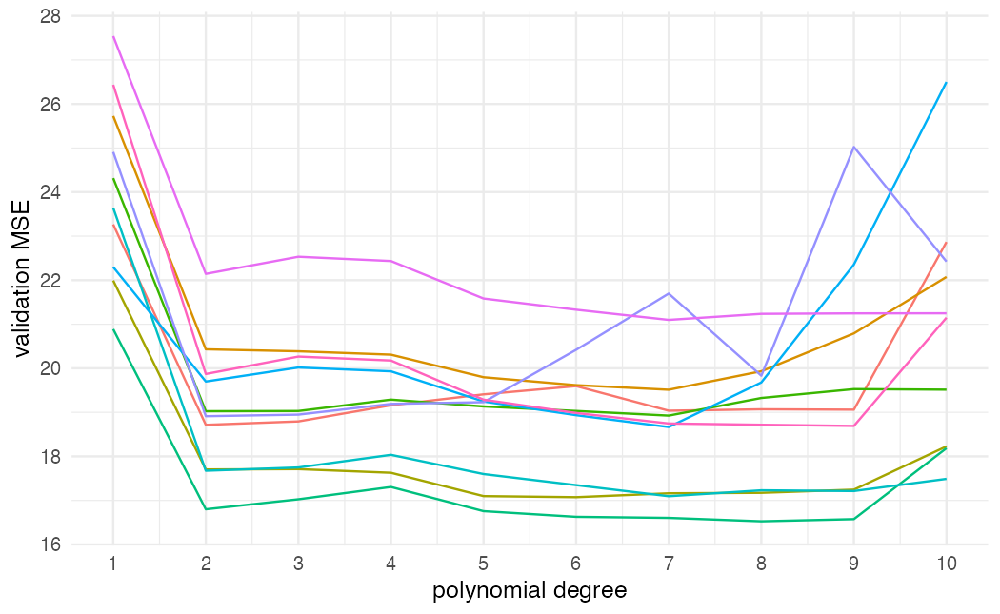
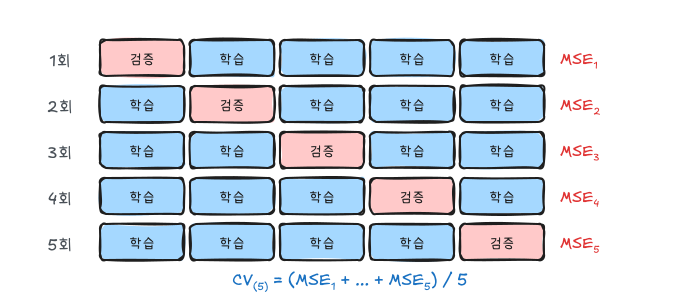
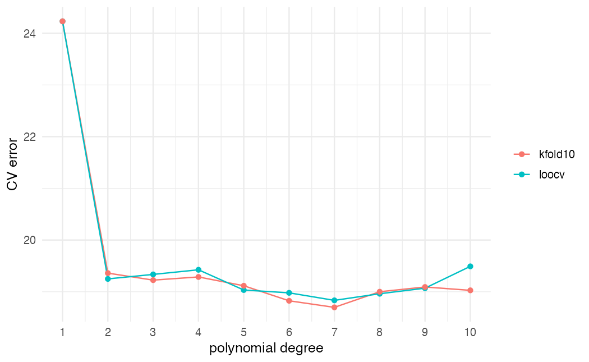
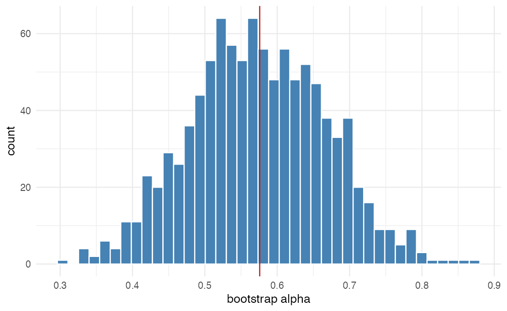

ISLR 5장과 이영미 교수님 데이터마이닝 강의 내용을 바탕으로 정리했다. 리샘플링은 학습 데이터에서 표본을 반복해서 뽑아 모델을 여러 번 적합하는 방법이다. 쓰임새는 두 가지다.

- **교차검증**: 테스트 오차를 추정해 모델이나 조율 모수를 고른다.
- **부트스트랩**: 추정량의 불확실성(표준오차, 신뢰구간)을 잰다.

## 검증셋 방법과 그 한계

가장 단순한 방법은 데이터를 학습용과 검증용으로 한 번 나누는 것이다. 문제가 두 가지 있다.

1. 어떻게 나누느냐에 따라 검증 오차가 크게 달라진다.
2. 데이터 일부만으로 학습하므로 전체로 학습했을 때보다 성능이 나쁘게 나온다. 즉 테스트 오차를 **과대추정**한다.

`ISLR2::Auto`에서 `mpg`를 `horsepower`의 다항식으로 예측하면서 분할을 10번 바꿔 본다.

```r
library(tidyverse)
library(ISLR2)
library(boot)
theme_set(theme_minimal(base_size = 12))

auto <- as_tibble(Auto)

val_mse <- function(seed, d) {
  set.seed(seed)
  idx <- sample(nrow(auto), nrow(auto) / 2)
  fit <- lm(mpg ~ poly(horsepower, d), data = auto[idx, ])
  mean((auto$mpg[-idx] - predict(fit, auto[-idx, ]))^2)
}

val <- expand_grid(seed = 1:10, degree = 1:10) |>
  mutate(mse = map2_dbl(seed, degree, val_mse))

ggplot(val, aes(degree, mse, group = seed, color = factor(seed))) +
  geom_line(show.legend = FALSE) +
  scale_x_continuous(breaks = 1:10) +
  labs(x = "polynomial degree", y = "validation MSE")
```



모든 분할에서 1차보다 2차가 확실히 낫다는 점은 같지만, 곡선의 높이는 분할마다 크게 다르다. 3차 이상이 나은지는 분할에 따라 결론이 갈린다.

## LOOCV

관측값 하나를 검증용으로 빼고 나머지 $n-1$개로 학습하는 일을 $n$번 반복한다.

$$
CV_{(n)} = \frac{1}{n} \sum_{i=1}^{n} MSE_i, \qquad MSE_i = (y_i - \hat y_{(-i)})^2
$$

$\hat y_{(-i)}$는 $i$번째 관측값을 빼고 적합한 모델의 예측이다. 학습에 거의 모든 데이터를 쓰므로 편향이 작고, 분할이 무작위가 아니므로 결과가 하나로 정해진다.

### 최소제곱의 단축 공식

선형회귀(다항회귀 포함)에서는 모델을 $n$번 적합할 필요가 없다.

$$
CV_{(n)} = \frac{1}{n} \sum_{i=1}^{n} \left( \frac{y_i - \hat y_i}{1 - h_i} \right)^2
$$

$h_i$는 $i$번째 관측값의 레버리지(모자행렬 $H = X(X^TX)^{-1}X^T$의 대각원소)다. 레버리지가 큰 점일수록 잔차를 크게 부풀려 반영한다.

```r
fit2 <- lm(mpg ~ poly(horsepower, 2), data = auto)
loocv_shortcut <- mean((resid(fit2) / (1 - hatvalues(fit2)))^2)

glm2 <- glm(mpg ~ poly(horsepower, 2), data = auto)
loocv_glm <- cv.glm(auto, glm2)$delta[1]

c(shortcut = loocv_shortcut, cv.glm = loocv_glm)
```

`boot::cv.glm()`은 실제로 $n$번 적합한다. 두 값이 같게 나온다. `glm()`에 `family`를 주지 않으면 `lm()`과 같은 최소제곱 적합이다.

## k-겹 교차검증

데이터를 $k$개 묶음(fold)으로 나누고, 한 묶음씩 돌아가며 검증용으로 쓴다.



$$
CV_{(k)} = \frac{1}{k} \sum_{j=1}^{k} MSE_j
$$

LOOCV는 $k = n$인 특수한 경우다. 보통 $k = 5$ 또는 $10$을 쓴다.

```r
set.seed(17)
cv_res <- tibble(degree = 1:10) |>
  mutate(
    loocv = map_dbl(degree, \(d) cv.glm(auto, glm(mpg ~ poly(horsepower, d), data = auto))$delta[1]),
    kfold10 = map_dbl(degree, \(d) cv.glm(auto, glm(mpg ~ poly(horsepower, d), data = auto), K = 10)$delta[1])
  )

cv_res |>
  pivot_longer(-degree) |>
  ggplot(aes(degree, value, color = name)) +
  geom_line() + geom_point() +
  scale_x_continuous(breaks = 1:10) +
  labs(x = "polynomial degree", y = "CV error", color = NULL)
```



두 곡선이 거의 겹친다. 검증셋 방법보다 훨씬 안정적이고, 2차 이후로는 개선이 거의 없다는 결론이 분명하다.

### 왜 k = 5, 10인가

| | LOOCV | k-겹 (k = 5, 10) |
|---|---|---|
| 계산량 | 모델 $n$번 적합 | 모델 $k$번 적합 |
| 편향 | 작다 ($n-1$개로 학습) | 조금 크다 ($(k-1)n/k$개로 학습) |
| 분산 | 크다 | 작다 |

LOOCV의 $n$개 모델은 학습 데이터가 거의 같아 서로 상관이 매우 높다. 상관이 높은 값들의 평균은 분산이 크다. $k$-겹은 학습 데이터의 겹침이 적어 이 상관이 낮다. 편향과 분산을 함께 보면 $k = 5$ 또는 $10$이 경험적으로 균형이 좋다.

### 교차검증에서 흔한 실수

전처리나 변수 선택을 **전체 데이터로 먼저 한 뒤** 교차검증을 하면 안 된다. 예를 들어 반응 변수와 상관이 큰 변수 100개를 전체 데이터에서 고른 다음 교차검증하면, 검증 묶음의 정보가 이미 변수 선택에 들어가 오차가 지나치게 낙관적으로 나온다. 표준화, 변수 선택, 결측 대체처럼 데이터에서 무언가를 배우는 단계는 모두 각 fold의 학습 데이터 안에서 해야 한다.

### 분류에서의 교차검증

MSE 대신 오분류율을 쓴다.

$$
CV_{(k)} = \frac{1}{k} \sum_{j=1}^{k} Err_j, \qquad Err_j = \frac{1}{n_j} \sum_{i \in \text{fold } j} I(y_i \neq \hat y_i)
$$

`cv.glm()`은 `cost` 인자로 손실함수를 바꿀 수 있다.

```r
default <- ISLR2::Default
fit_logit <- glm(default ~ balance + student, data = default, family = binomial)
miss_rate <- function(y, prob) mean(abs(y - prob) > 0.5)

set.seed(1)
cv.glm(default, fit_logit, cost = miss_rate, K = 10)$delta[1]
```

`cost`의 첫 인자는 0/1 반응값, 둘째는 예측확률이다. `abs(y - prob) > 0.5`는 기준값 0.5에서 틀린 경우다.

## 부트스트랩

표준오차를 공식으로 구하기 어려운 통계량도 많다. 부트스트랩은 **원자료를 모집단처럼 보고** 복원추출로 표본을 반복 생성해, 통계량의 표본분포를 흉내 낸다.

1. 원자료 $n$개에서 복원추출로 $n$개를 뽑아 $Z^{*1}$을 만든다.
2. $Z^{*1}$로 통계량 $\hat\alpha^{*1}$을 계산한다.
3. 이를 $B$번 반복한다.
4. $\hat\alpha^{*1}, \dots, \hat\alpha^{*B}$의 표준편차를 $SE(\hat\alpha)$의 추정치로 쓴다.

$$
SE_B(\hat\alpha) = \sqrt{\frac{1}{B - 1} \sum_{r=1}^{B} \left( \hat\alpha^{*r} - \bar{\alpha}^{*} \right)^2}
$$

### 투자 비율의 표준오차

`ISLR2::Portfolio`는 두 자산의 수익률 $X, Y$다. $\alpha X + (1-\alpha) Y$의 분산을 최소로 만드는 비율은 다음과 같다.

$$
\alpha = \frac{\sigma_Y^2 - \sigma_{XY}}{\sigma_X^2 + \sigma_Y^2 - 2\sigma_{XY}}
$$

$\hat\alpha$의 표준오차는 공식으로 구하기 어렵다.

```r
alpha_fn <- function(data, idx) {
  x <- data$X[idx]; y <- data$Y[idx]
  (var(y) - cov(x, y)) / (var(x) + var(y) - 2 * cov(x, y))
}

alpha_fn(Portfolio, 1:100)

set.seed(1)
boot_alpha <- boot(Portfolio, alpha_fn, R = 1000)
boot_alpha
```

`boot()`에 넘기는 함수는 데이터와 **행 번호 벡터**를 받아 통계량을 돌려줘야 한다. 출력의 `original`은 원자료의 $\hat\alpha \approx 0.58$, `std. error`는 부트스트랩 표준오차다.

```r
tibble(alpha = boot_alpha$t[, 1]) |>
  ggplot(aes(alpha)) +
  geom_histogram(bins = 40, fill = "steelblue", color = "white") +
  geom_vline(xintercept = boot_alpha$t0, color = "firebrick") +
  labs(x = "bootstrap alpha", y = "count")

boot.ci(boot_alpha, type = c("perc", "norm"))
```



`boot.ci`의 백분위수 구간은 부트스트랩 값의 2.5%, 97.5% 분위수를 그대로 쓴다.

### 회귀계수의 표준오차와 비교

```r
coef_fn <- function(data, idx) coef(lm(mpg ~ horsepower + I(horsepower^2), data = data[idx, ]))

set.seed(1)
boot_coef <- boot(auto, coef_fn, R = 1000)

tibble(term = names(coef_fn(auto, seq_len(nrow(auto)))),
       se_formula = coef(summary(lm(mpg ~ horsepower + I(horsepower^2), data = auto)))[, "Std. Error"],
       se_boot = apply(boot_coef$t, 2, sd))
```

`summary()`의 표준오차는 오차의 등분산과 모형이 맞다는 가정에서 나온 공식값이다. 부트스트랩은 그런 가정이 필요 없다. 2차 모형처럼 모형이 데이터에 잘 맞으면 두 값이 비슷하다. 1차 모형으로 바꿔 보면 공식값이 상대적으로 작게 나오는데, 모형이 틀려 잔차 분산 추정이 왜곡되기 때문이다.

## 요약

| 방법 | 목적 | 핵심 |
|---|---|---|
| 검증셋 | 테스트 오차 추정 | 분할에 따라 결과가 흔들리고 과대추정 |
| LOOCV | 테스트 오차 추정 | 편향 작음, 분산 큼. 최소제곱은 $h_i$로 한 번에 계산 |
| k-겹 CV | 테스트 오차 추정 | $k = 5, 10$이 편향-분산 균형 |
| 부트스트랩 | 표준오차, 신뢰구간 | 원자료에서 복원추출, 가정이 적다 |
| 주의 | 데이터에서 배우는 모든 단계는 fold 안에서 | 그렇지 않으면 오차가 낙관적으로 나온다 |
