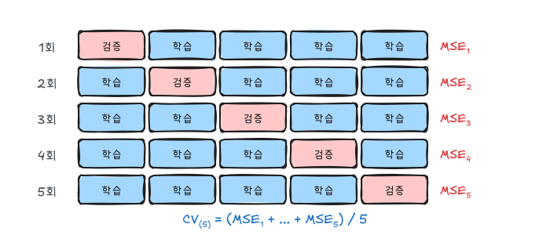
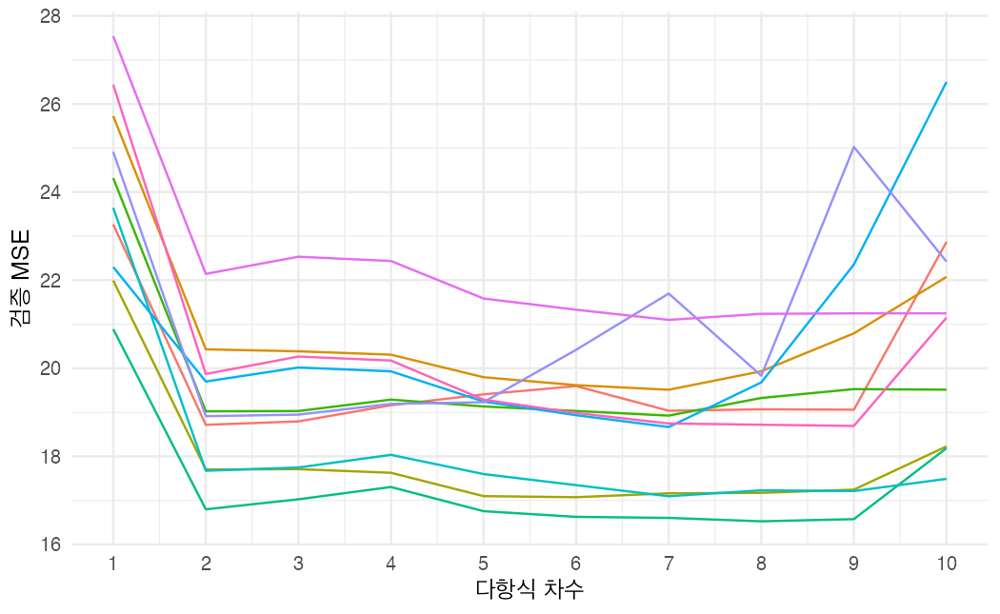
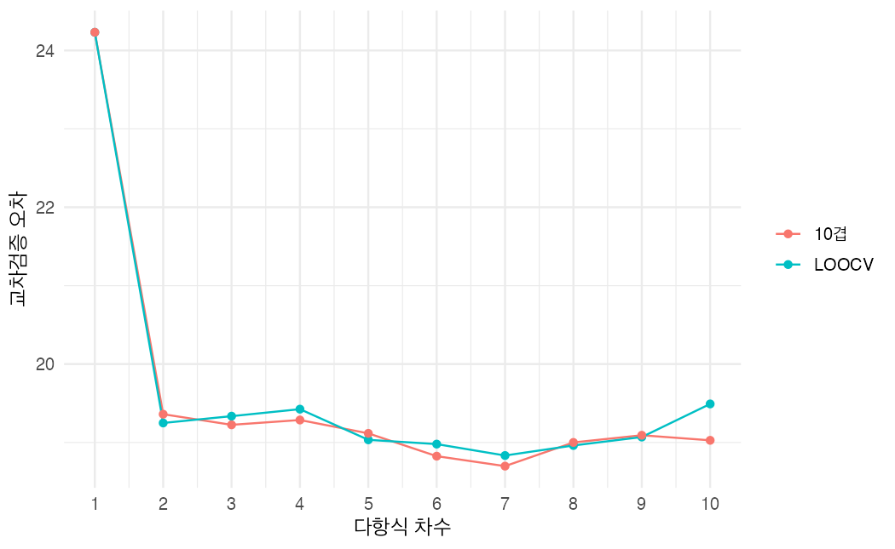
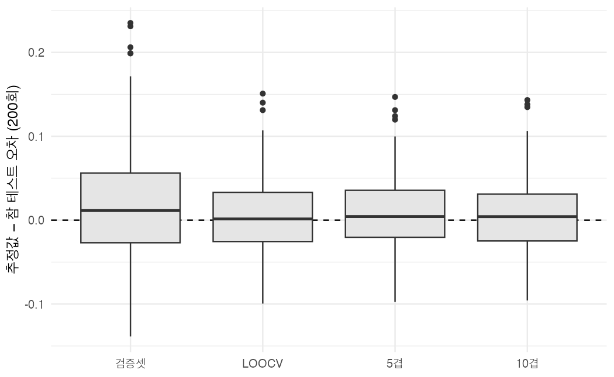
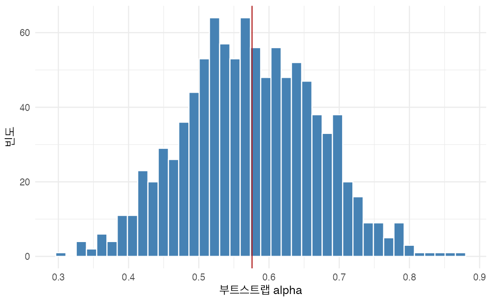

ISLR 5장과 이영미 교수님 데이터마이닝 강의 내용을 바탕으로 정리했다.

## 개요

리샘플링은 학습 자료에서 표본을 반복해 뽑아 모형을 여러 번 적합하는 방법이다. 목적에 따라 두 부류로 나뉜다.

| 목적 | 방법 | 추정 대상 |
|---|---|---|
| 모형 평가·선택 | 검증셋 방법, LOOCV, k-겹 교차검증 | 테스트 오차 |
| 추정량의 불확실성 | 부트스트랩 | 표준오차, 신뢰구간 |

교차검증 방법들은 테스트 오차라는 같은 대상을 추정하므로, 비교의 기준은 **추정량으로서의 편향과 분산, 그리고 계산량**이다.

| | 검증셋 | LOOCV | k-겹 ($k = 5, 10$) |
|---|---|---|---|
| 학습에 쓰는 자료 | 약 $n/2$ | $n - 1$ | $(k - 1)n/k$ |
| 모형 적합 횟수 | 1 | $n$ | $k$ |
| 테스트 오차 추정의 편향 | 큼 (과대추정) | 거의 없음 | 작음 |
| 추정의 분산 | 큼 (분할에 의존) | 큼 (모형 간 상관) | 작음 |

## 1. 검증셋 방법

자료를 학습용과 검증용으로 한 번 나누고, 검증 자료의 오차로 테스트 오차를 추정한다. 단순하지만 두 가지 문제가 있다.

1. 분할에 따라 추정값이 크게 달라진다(분산).
2. 자료의 절반만으로 학습하므로, 전체 자료로 학습한 모형의 테스트 오차를 과대추정한다(편향).

## 2. LOOCV

관측값 하나를 검증용으로 빼고 나머지 $n - 1$개로 학습하는 과정을 $n$번 반복한다.

$$
CV_{(n)} = \frac1n\sum_{i=1}^{n}(y_i - \hat y_{(-i)})^2
$$

$\hat y_{(-i)}$는 $i$번째 관측값을 빼고 적합한 모형의 예측값이다. 학습에 거의 모든 자료를 쓰므로 편향이 거의 없고, 분할에 무작위성이 없어 결과가 하나로 정해진다.

선형회귀에서는 모형을 $n$번 적합할 필요 없이

$$
CV_{(n)} = \frac1n\sum_{i=1}^{n}\left(\frac{y_i - \hat y_i}{1 - h_i}\right)^2
$$

로 한 번에 계산된다. $h_i$는 모자행렬 $H = X(X^TX)^{-1}X^T$의 $i$번째 대각원소(레버리지)이며, 레버리지가 큰 점일수록 잔차를 크게 부풀려 반영한다.

## 3. k-겹 교차검증

자료를 $k$개 묶음으로 나누고, 한 묶음씩 돌아가며 검증용으로 쓴다.



$$
CV_{(k)} = \frac1k\sum_{j=1}^{k}MSE_j
$$

LOOCV는 $k = n$인 특수한 경우다. LOOCV보다 편향은 약간 크지만 분산이 작다는 점이 핵심이다. LOOCV의 $n$개 모형은 학습 자료가 $n - 2$개씩 겹쳐 거의 같은 모형이므로, 그 오차들은 서로 상관이 매우 높다. 상관이 높은 값들의 평균은 분산이 크다. $k$-겹은 학습 자료의 겹침이 적어 이 상관이 낮다. 편향과 분산을 함께 고려할 때 $k = 5$ 또는 $10$이 경험적으로 균형이 좋다.

분류 문제에서는 MSE 대신 오분류율 $\frac{1}{n_j}\sum_{i \in \text{fold } j}I(y_i \ne \hat y_i)$를 쓴다.

## 4. 부트스트랩

교차검증이 테스트 오차를 추정한다면, 부트스트랩은 추정량 자체의 표본분포를 추정한다. 원자료를 모집단으로 간주하고 복원추출로 표본을 반복 생성한다.

1. 원자료 $n$개에서 복원추출로 $n$개를 뽑아 $Z^{*1}$을 만든다.
2. $Z^{*1}$로 통계량 $\hat\alpha^{*1}$을 계산한다.
3. 이를 $B$번 반복한다.
4. $\hat\alpha^{*1}, \dots, \hat\alpha^{*B}$의 표준편차를 $SE(\hat\alpha)$의 추정값으로 쓴다.

$$
SE_B(\hat\alpha) = \sqrt{\frac{1}{B - 1}\sum_{r=1}^{B}(\hat\alpha^{*r} - \bar\alpha^*)^2}
$$

공식에 의한 표준오차는 모형과 오차 분포에 대한 가정에서 유도되지만, 부트스트랩은 그런 가정 없이 자료의 경험적 분포만 사용한다. 따라서 공식이 없는 통계량에도 쓸 수 있고, 모형 가정이 틀린 경우에도 비교적 정확하다.

## 5. 방법 간 비교

| 구분 | 검증셋 | LOOCV | k-겹 CV | 부트스트랩 |
|---|---|---|---|---|
| 추정 대상 | 테스트 오차 | 테스트 오차 | 테스트 오차 | 추정량의 분포 |
| 표집 | 비복원, 1회 분할 | 비복원, $n$회 | 비복원, $k$회 | 복원, $B$회 |
| 학습 자료 크기 | $n/2$ | $n - 1$ | $(k - 1)n/k$ | $n$ (중복 포함) |
| 추정의 편향 | 큼 | 거의 없음 | 작음 | — |
| 추정의 분산 | 큼 | 큼 | 작음 | — |
| 결과의 무작위성 | 있음 | 없음 | 있음 (분할) | 있음 (재표집) |
| 계산량 | 1회 적합 | $n$회 (선형회귀는 1회) | $k$회 | $B$회 |

부트스트랩 표본으로 학습하고 원자료 전체로 평가하면 테스트 오차를 추정할 수도 있지만, 학습 자료와 평가 자료가 약 63% 겹쳐 오차를 과소추정한다. 테스트 오차 추정에는 교차검증이 적합하다.

## 6. Auto 자료를 이용한 비교

`ISLR2::Auto`에서 `mpg`를 `horsepower`의 다항식으로 예측하며 차수를 고른다.

```r
library(tidyverse)
library(ISLR2)
library(boot)
theme_set(theme_minimal(base_size = 12))

auto <- as_tibble(Auto)
```

### 검증셋 방법: 분할에 따른 변동

```r
val_mse <- function(seed, d) {
  set.seed(seed)
  idx <- sample(nrow(auto), nrow(auto) / 2)
  fit <- lm(mpg ~ poly(horsepower, d), data = auto[idx, ])
  mean((auto$mpg[-idx] - predict(fit, auto[-idx, ]))^2)
}

val <- expand_grid(seed = 1:10, degree = 1:10) |>
  mutate(mse = map2_dbl(seed, degree, val_mse))

ggplot(val, aes(degree, mse, group = seed, color = factor(seed))) +
  geom_line(show.legend = FALSE) +
  scale_x_continuous(breaks = 1:10) +
  labs(x = "다항식 차수", y = "검증 MSE")
```



모든 분할에서 2차가 1차보다 낫다는 점은 같지만, 곡선의 높이는 분할마다 크게 다르고 3차 이상이 나은지는 분할에 따라 결론이 갈린다.

### LOOCV와 10겹 교차검증

```r
fit2 <- lm(mpg ~ poly(horsepower, 2), data = auto)
c(단축공식 = mean((resid(fit2) / (1 - hatvalues(fit2)))^2),
  cv.glm = cv.glm(auto, glm(mpg ~ poly(horsepower, 2), data = auto))$delta[1])

set.seed(17)
cv_res <- tibble(degree = 1:10) |>
  mutate(
    LOOCV = map_dbl(degree, \(d) cv.glm(auto, glm(mpg ~ poly(horsepower, d), data = auto))$delta[1]),
    `10겹` = map_dbl(degree, \(d) cv.glm(auto, glm(mpg ~ poly(horsepower, d), data = auto), K = 10)$delta[1])
  )

cv_res |>
  pivot_longer(-degree) |>
  ggplot(aes(degree, value, color = name)) +
  geom_line() + geom_point() +
  scale_x_continuous(breaks = 1:10) +
  labs(x = "다항식 차수", y = "교차검증 오차", color = NULL)
```



2차 모형의 LOOCV 오차는 단축 공식과 `cv.glm()`의 $n$회 적합이 모두 19.25로 같다. LOOCV와 10겹 곡선은 거의 겹치며, 검증셋 방법과 달리 2차 이후로 개선이 거의 없다는 결론이 분명하다.

## 7. 모의실험: 테스트 오차 추정량의 편향과 분산

실제 자료에서는 참 테스트 오차를 모르므로 추정량의 편향과 분산을 직접 볼 수 없다. 참 모형을 알고 있는 자료를 생성해 비교한다. $y = \sin(2x) + x + \varepsilon$, $\varepsilon \sim N(0, 0.5^2)$에서 $n = 100$개를 뽑아 3차 다항회귀를 적합하고, 테스트 자료 10,000개로 계산한 참 테스트 오차와 각 방법의 추정값을 200번 비교한다.

```r
gen_xy <- function(n) {
  x <- runif(n, -2, 2)
  tibble(x = x, y = sin(2 * x) + x + rnorm(n, sd = 0.5))
}
kfold_mse <- function(d, k) {
  fold <- sample(rep(1:k, length.out = nrow(d)))
  mean(map_dbl(1:k, \(j) {
    fit <- lm(y ~ poly(x, 3, raw = TRUE), data = d[fold != j, ])
    mean((d$y[fold == j] - predict(fit, d[fold == j, ]))^2)
  }))
}

set.seed(2022)
big_test <- gen_xy(10000)
est <- map_dfr(1:200, \(r) {
  d <- gen_xy(100)
  fit <- lm(y ~ poly(x, 3, raw = TRUE), data = d)
  idx <- sample(100, 50)
  fit_half <- lm(y ~ poly(x, 3, raw = TRUE), data = d[idx, ])
  tibble(
    참값 = mean((big_test$y - predict(fit, big_test))^2),
    검증셋 = mean((d$y[-idx] - predict(fit_half, d[-idx, ]))^2),
    LOOCV = mean((resid(fit) / (1 - hatvalues(fit)))^2),
    `5겹` = kfold_mse(d, 5),
    `10겹` = kfold_mse(d, 10)
  )
})

est_long <- est |>
  mutate(rep = row_number()) |>
  pivot_longer(c(검증셋, LOOCV, `5겹`, `10겹`), names_to = "방법", values_to = "추정값") |>
  mutate(방법 = fct_inorder(방법), 오차 = 추정값 - 참값)

est_long |> group_by(방법) |>
  summarise(편향 = round(mean(오차), 4), 표준편차 = round(sd(오차), 4),
            RMSE = round(sqrt(mean(오차^2)), 4))

ggplot(est_long, aes(방법, 오차)) +
  geom_hline(yintercept = 0, linetype = "dashed") +
  geom_boxplot(fill = "grey90") +
  labs(x = NULL, y = "추정값 − 참 테스트 오차 (200회)")
```



| 방법 | 편향 | 표준편차 | RMSE |
|---|---|---|---|
| 검증셋 | 0.0188 | 0.0677 | 0.0701 |
| LOOCV | 0.0035 | 0.0436 | 0.0437 |
| 5겹 | 0.0072 | 0.0456 | 0.0460 |
| 10겹 | 0.0050 | 0.0436 | 0.0438 |

참 테스트 오차는 약 0.27 근처다. 검증셋 방법은 학습 자료가 절반뿐이라 오차를 평균 0.019만큼 과대추정하고, 분할에 따른 변동도 가장 커서 RMSE가 다른 방법의 1.5배 이상이다. 편향은 학습 자료가 클수록 작아져 LOOCV(0.0035) < 10겹(0.0050) < 5겹(0.0072) 순서다.

이론에서는 LOOCV의 분산이 k-겹보다 크다고 했지만, 이 모의실험에서는 LOOCV와 10겹의 표준편차가 같다. 3차 다항회귀처럼 모수가 적은 안정적인 모형에서는 관측값 하나를 뺄 때 모형이 거의 변하지 않으므로 LOOCV의 분산이 커지지 않는다. 분산 차이는 KNN이나 깊은 나무처럼 학습 자료에 민감한 방법에서 크게 나타난다. 결과적으로 이 설정에서는 LOOCV와 10겹이 사실상 같은 성능을 보이며, 5겹은 편향이 조금 더 크다.

### 교차검증 전에 변수를 고르면

교차검증에서 흔한 실수는 변수 선택이나 전처리를 **전체 자료로 먼저 한 뒤** 교차검증하는 것이다. 반응 변수와 아무 관계가 없는 설명 변수 1,000개에서 상관이 큰 10개를 골라 회귀하는 경우를 보자. 참 테스트 MSE는 반응 변수의 분산인 1 이상이어야 한다.

```r
set.seed(5)
n <- 50; p <- 1000
X <- matrix(rnorm(n * p), n)
yy <- rnorm(n)
fold <- sample(rep(1:5, length.out = n))

pick <- function(Xs, ys) order(abs(cor(Xs, ys)), decreasing = TRUE)[1:10]
cv_lm <- function(select_inside) {
  sel_all <- pick(X, yy)
  mean(map_dbl(1:5, \(j) {
    tr <- fold != j
    sel <- if (select_inside) pick(X[tr, ], yy[tr]) else sel_all
    fit <- lm(yy[tr] ~ X[tr, sel])
    mean((yy[!tr] - cbind(1, X[!tr, sel]) %*% coef(fit))^2)
  }))
}
c(잘못된_방법 = cv_lm(FALSE), 올바른_방법 = cv_lm(TRUE))
```

| 방법 | 교차검증 MSE |
|---|---|
| 전체 자료로 변수를 고른 뒤 교차검증 (잘못된 방법) | 0.746 |
| 각 fold의 학습 자료 안에서 변수 선택 (올바른 방법) | 1.659 |

반응 변수와 무관한 잡음 변수만 있는데도 잘못된 방법은 MSE를 0.75로 추정한다. 반응 변수의 분산(1)보다 작으므로, 아무 의미 없는 모형이 예측력이 있는 것처럼 보인다. 변수를 고를 때 이미 검증 fold의 반응값을 보았기 때문이다. 선택을 fold 안에서 하면 MSE가 1.66으로 나온다. 잡음에 과적합한 모형의 실제 성능이 정직하게 드러난 값이다. 표준화, 변수 선택, 결측 대체처럼 자료에서 무언가를 학습하는 단계는 모두 교차검증 루프 안에 있어야 한다.

## 8. 부트스트랩과 공식에 의한 표준오차

### 공식이 없는 통계량: 투자 비율

`ISLR2::Portfolio`는 두 자산의 수익률 $X$, $Y$이다. $\alpha X + (1 - \alpha)Y$의 분산을 최소로 하는 비율은

$$
\alpha = \frac{\sigma_Y^2 - \sigma_{XY}}{\sigma_X^2 + \sigma_Y^2 - 2\sigma_{XY}}
$$

이다. $\hat\alpha$의 표준오차는 공식으로 구하기 어렵다.

```r
alpha_fn <- function(data, idx) {
  x <- data$X[idx]; y <- data$Y[idx]
  (var(y) - cov(x, y)) / (var(x) + var(y) - 2 * cov(x, y))
}

set.seed(1)
boot_alpha <- boot(Portfolio, alpha_fn, R = 1000)
boot_alpha
boot.ci(boot_alpha, type = c("perc", "norm"))

tibble(alpha = boot_alpha$t[, 1]) |>
  ggplot(aes(alpha)) +
  geom_histogram(bins = 40, fill = "steelblue", color = "white") +
  geom_vline(xintercept = boot_alpha$t0, color = "firebrick") +
  labs(x = "부트스트랩 alpha", y = "빈도")
```



`boot()`에 넘기는 함수는 자료와 행 번호 벡터를 받아 통계량을 반환해야 한다. $\hat\alpha = 0.576$, 부트스트랩 표준오차는 0.094다. 95% 신뢰구간은 정규근사가 $(0.394, 0.761)$, 백분위수 방법이 $(0.392, 0.754)$로 비슷하다. 부트스트랩 분포가 대칭에 가깝기 때문이다.

### 모형 가정이 맞을 때와 틀릴 때: 회귀계수

```r
se_compare <- function(form) {
  coef_fn <- function(data, idx) coef(lm(form, data = data[idx, ]))
  set.seed(1)
  b <- boot(auto, coef_fn, R = 1000)
  tibble(항 = names(coef(lm(form, data = auto))),
         공식 = coef(summary(lm(form, data = auto)))[, "Std. Error"],
         부트스트랩 = apply(b$t, 2, sd)) |>
    mutate(비 = round(부트스트랩 / 공식, 2))
}
se_compare(mpg ~ horsepower)
se_compare(mpg ~ horsepower + I(horsepower^2))
```

| 모형 | 항 | 공식 | 부트스트랩 | 비 |
|---|---|---|---|---|
| 1차 | 절편 | 0.717 | 0.844 | 1.18 |
| | horsepower | 0.0064 | 0.0074 | 1.14 |
| 2차 | 절편 | 1.80 | 2.03 | 1.13 |
| | horsepower | 0.0311 | 0.0324 | 1.04 |
| | horsepower² | 0.000122 | 0.000117 | 0.96 |

1차 모형에서는 부트스트랩 표준오차가 공식보다 14~18% 크다. `mpg`와 `horsepower`의 관계가 곡선이어서 1차 모형의 잔차에 체계적인 패턴이 남고, 공식이 가정하는 오차의 독립·등분산이 깨져 공식이 불확실성을 과소평가하기 때문이다. 관계를 제대로 반영한 2차 모형에서는 두 값의 비가 0.96~1.13으로 1에 가까워진다. 부트스트랩은 모형 가정이 맞는지 점검하는 도구로도 쓸 수 있다.

## 9. 결과의 해석

| 관찰된 결과 | 원인 |
|---|---|
| 검증셋 MSE가 분할마다 크게 다름 | 학습·검증 자료가 한 번의 무작위 분할에 좌우됨 |
| 검증셋이 테스트 오차를 과대추정함 | 자료의 절반만으로 학습해 모형이 덜 정확함 |
| LOOCV의 편향이 가장 작음 | $n - 1$개로 학습해 전체 자료의 모형과 거의 같음 |
| 이 모의실험에서 LOOCV와 10겹의 분산이 같음 | 모수가 적은 안정적인 모형에서는 LOOCV 모형 간 상관 문제가 작음 |
| 선형회귀의 LOOCV가 한 번의 적합으로 계산됨 | 레버리지를 이용한 단축 공식 |
| 교차검증 전 변수 선택이 MSE를 크게 과소추정함 | 검증 fold의 정보가 변수 선택에 새어 들어감 |
| 1차 모형에서 부트스트랩 표준오차가 공식보다 큼 | 모형이 틀려 공식의 가정(독립·등분산 오차)이 깨짐 |

## 10. 방법의 선택

| 상황 | 적합한 방법 |
|---|---|
| 모형 선택·조율 모수 결정 (일반적인 경우) | 5겹 또는 10겹 교차검증 |
| 선형회귀·다항회귀의 차수 선택 | LOOCV (단축 공식으로 계산 비용 없음) |
| 자료가 매우 크고 계산이 비쌈 | 검증셋 방법 (자료가 크면 단점이 약해짐) |
| 자료가 작음 | LOOCV 또는 반복 k-겹 |
| 공식이 없는 통계량의 표준오차·신뢰구간 | 부트스트랩 |
| 모형 가정(등분산, 함수 형태)이 의심됨 | 부트스트랩 표준오차와 공식값을 비교 |
| 변수 선택·표준화 등 전처리가 있음 | 반드시 각 fold의 학습 자료 안에서 수행 |

## 정리

| | 검증셋 | LOOCV | k-겹 CV | 부트스트랩 |
|---|---|---|---|---|
| 목적 | 테스트 오차 | 테스트 오차 | 테스트 오차 | 표준오차·신뢰구간 |
| 편향 | 큼 | 거의 없음 | 작음 | |
| 분산 | 큼 | 큼 | 작음 | |
| 계산 | 1회 | $n$회 (선형은 1회) | $k$회 | $B$회 |
| 주의 | 분할 의존 | 모형 간 상관 | 전처리는 fold 안에서 | 테스트 오차 추정에는 부적합 |
