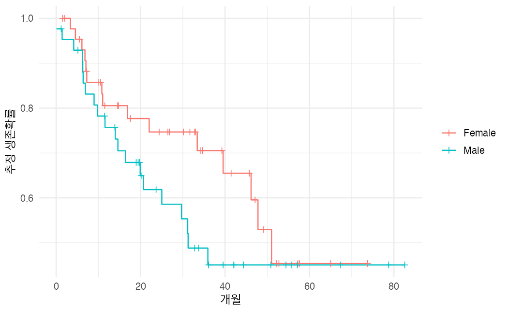
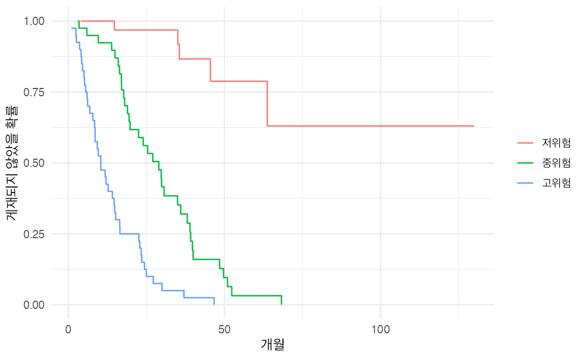
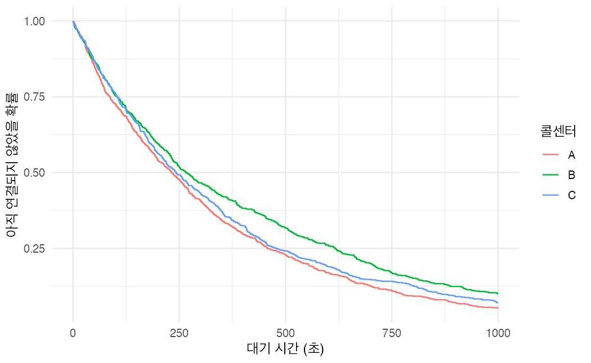

ISLR 11장을 바탕으로 정리했다. 생존분석은 어떤 사건이 일어나기까지의 **시간**을 반응으로 하는 분석이다. 환자의 사망까지의 시간, 논문 게재까지의 시간, 고객이 상담원과 연결되기까지의 시간이 모두 예다. 어려운 점은 사건을 끝까지 관측하지 못한 **중도절단** 관측이 섞여 있다는 것이다. 임상 해석과 SAS 절차는 [생명과학통계의 생존분석](/posts/biostat-survival-analysis)에서 다루고, 이 글은 ISLR 범위와 예측 모형(벌점 Cox, C-지수)에 초점을 둔다.

## 생존시간과 중도절단

관측 $i$마다 실제 사건 시간 $T$와 중도절단 시간 $C$(연구 종료, 추적 소실 등)가 있고, 둘 중 먼저 오는 것만 관측한다.

$$
Y = \min(T, C), \qquad \delta = I(T \le C)
$$

$\delta = 1$이면 사건을 관측했고 $Y = T$다. $\delta = 0$이면 중도절단되어 $T > Y$라는 것만 안다.

중도절단 관측을 버리거나 $Y$를 그대로 사건 시간으로 쓰면 생존시간을 과소추정한다. 대신 **독립 중도절단**을 가정한다. 예측변수가 주어졌을 때 사건 시간 $T$와 중도절단 시간 $C$가 독립이라는 뜻이다. 몸이 아파서 연구를 그만둔 환자처럼 중도절단이 사건과 관련 있으면 이 가정이 깨지고, 생존을 과대추정하게 된다. 자료만으로는 이 가정을 검정할 수 없으므로 자료가 어떻게 모였는지 보고 판단한다.

예제는 `ISLR2::BrainCancer`다. 뇌종양 환자 88명의 사망 또는 중도절단까지의 개월 수(`time`)와 상태(`status`, 1 = 사망)다.

```r
library(tidyverse)
library(ISLR2)
library(survival)
theme_set(theme_minimal(base_size = 12))

table(BrainCancer$status)
```

88명 중 35명이 사망했고 53명은 중도절단이다.

## Kaplan-Meier 생존곡선

생존함수 $S(t) = \Pr(T > t)$는 시점 $t$까지 사건이 일어나지 않을 확률이다. 사건이 관측된 서로 다른 시점을 $d_1 < d_2 < \cdots < d_K$, 시점 $d_k$ 직전에 아직 위험에 놓인(사건도 중도절단도 없던) 수를 $r_k$, 그 시점의 사건 수를 $q_k$라 하자. $d_k$를 넘길 확률은 $d_{k-1}$을 넘긴 사람이 $d_k$도 넘길 조건부확률을 차례로 곱한 것이다.

$$
\hat S(d_k) = \prod_{j=1}^{k} \frac{r_j - q_j}{r_j}
$$

이것이 **Kaplan-Meier 추정량**이다. 중도절단된 사람은 그 시점까지는 위험 집합 $r_j$에 들어가 정보를 주고, 그 뒤로 빠진다. 사건 시점 사이에서는 값이 일정해서 계단 모양이 된다.

정의대로 직접 계산해 `survfit()`과 비교한다.

```r
km_manual <- function(time, status) {
  d <- sort(unique(time[status == 1]))
  r <- sapply(d, \(t) sum(time >= t))
  q <- sapply(d, \(t) sum(time == t & status == 1))
  tibble(time = d, n.risk = r, n.event = q, surv = cumprod((r - q) / r))
}
manual <- km_manual(BrainCancer$time, BrainCancer$status)
fit_km <- survfit(Surv(time, status) ~ 1, data = BrainCancer)
head(manual, 4)
max(abs(manual$surv - summary(fit_km)$surv))
```

직접 계산한 값과 `survfit()`의 차이가 0로 같다. 성별로 나눠 그린다.

```r
fit_sex <- survfit(Surv(time, status) ~ sex, data = BrainCancer)
broom::tidy(fit_sex) |>
  mutate(strata = sub("sex=", "", strata)) |>
  ggplot(aes(time, estimate, color = strata)) +
  geom_step() +
  geom_point(data = \(d) filter(d, n.censor > 0), shape = 3) +
  labs(x = "개월", y = "추정 생존확률", color = NULL)
```



## 로그순위 검정

두 집단의 생존곡선이 같은지 검정한다. 사건 시점 $d_k$마다 2×2 표(집단 × 사건 여부)를 만든다. 귀무가설(두 집단의 생존이 같다) 아래에서, 그 시점의 사건 $q_k$개가 위험 집합 크기에 비례해 나뉜다고 보면 집단 1의 사건 수 $q_{1k}$의 평균과 분산은

$$
\mu_k = \frac{r_{1k}}{r_k} q_k, \qquad
\mathrm{Var}(q_{1k}) = \frac{q_k (r_{1k}/r_k)(1 - r_{1k}/r_k)(r_k - q_k)}{r_k - 1}
$$

이다. 관측과 기댓값의 차이를 모든 시점에서 더해 표준화한 것이 로그순위 통계량이다.

$$
W = \frac{\sum_{k=1}^{K} (q_{1k} - \mu_k)}{\sqrt{\sum_{k=1}^{K} \mathrm{Var}(q_{1k})}}
$$

시점별 2×2 표들은 독립이 아니지만, 표본이 크면 $W$는 근사적으로 표준정규분포를 따른다($W^2$은 자유도 1의 카이제곱).

```r
survdiff(Surv(time, status) ~ sex, data = BrainCancer)
```

$W^2 =$ 1.44, $p =$ 0.23로, 성별에 따라 생존이 다르다는 증거가 약하다.

## Cox 비례위험모형

### 위험함수

**위험함수**는 시점 $t$까지 살아남은 사람이 바로 다음 순간에 사건을 겪을 순간 비율이다.

$$
h(t) = \lim_{\Delta t \to 0} \frac{\Pr(t < T \le t + \Delta t \mid T > t)}{\Delta t} = \frac{f(t)}{S(t)}
$$

$f(t)$는 $T$의 밀도다. 위험함수, 밀도, 생존함수 중 하나를 알면 나머지가 정해진다. 모수 모형이라면 가능도는 사건이면 밀도, 중도절단이면 생존확률을 곱해

$$
L = \prod_{i=1}^{n} f(y_i)^{\delta_i} S(y_i)^{1-\delta_i}
$$

이다. 그러나 $h(t)$의 모양(지수분포라면 상수)을 미리 정해야 한다.

### 비례위험 가정과 부분가능도

Cox 모형은 위험함수를 기저위험과 예측변수 부분의 곱으로 둔다.

$$
h(t \mid x_i) = h_0(t) \exp\left(\sum_{j=1}^{p} x_{ij} \beta_j\right)
$$

$h_0(t)$는 모든 예측변수가 0일 때의 **기저위험**이고 모양을 가정하지 않는다. 두 사람의 위험비 $h(t \mid x_i)/h(t \mid x_{i'}) = \exp(\sum_j (x_{ij} - x_{i'j})\beta_j)$는 $t$에 의존하지 않는다. 이것이 **비례위험** 가정이다. $x_j$가 1 늘면 위험이 언제나 $e^{\beta_j}$배가 된다. 절편은 없다. $h_0(t)$에 흡수되기 때문이다.

$h_0(t)$를 모른 채로 $\beta$를 추정하는 것이 **부분가능도**다. 사건 시점 $y_i$($\delta_i = 1$)에서 위험 집합 $\{i' : y_{i'} \ge y_i\}$ 중 하필 $i$에게 사건이 일어날 확률은

$$
\frac{h_0(y_i)\exp(\sum_j x_{ij}\beta_j)}{\sum_{i' : y_{i'} \ge y_i} h_0(y_i)\exp(\sum_j x_{i'j}\beta_j)} = \frac{\exp(\sum_j x_{ij}\beta_j)}{\sum_{i' : y_{i'} \ge y_i} \exp(\sum_j x_{i'j}\beta_j)}
$$

로, $h_0(y_i)$가 약분된다. 사건 시점마다 이 확률을 곱한 것이 부분가능도다.

$$
PL(\beta) = \prod_{i : \delta_i = 1} \frac{\exp(\sum_j x_{ij}\beta_j)}{\sum_{i' : y_{i'} \ge y_i} \exp(\sum_j x_{i'j}\beta_j)}
$$

이것을 최대화한 $\hat\beta$는 사건 시점에 동률이 없다고 가정한다. 동률이 있으면 근사(R `coxph()`의 기본은 Efron)를 쓴다.

```r
cox_sex <- coxph(Surv(time, status) ~ sex, data = BrainCancer)
c(score_test = unname(summary(cox_sex)$sctest["test"]),
  logrank = survdiff(Surv(time, status) ~ sex, data = BrainCancer)$chisq)
```

> **주의** 이진 예측변수 하나만 넣은 Cox 모형의 점수 검정은 로그순위 검정과 같다. 위 출력에서 두 통계량은 모두 1.4405다. 사건 시점에 동률이 많으면 동률 처리 방식에 따라 조금 달라질 수 있다.

### 예: BrainCancer

모든 예측변수를 넣는다.

```r
cox_bc <- coxph(Surv(time, status) ~ sex + diagnosis + loc + ki + gtv + stereo, data = BrainCancer)
broom::tidy(cox_bc, exponentiate = TRUE) |> mutate(across(where(is.numeric), \(v) round(v, 3)))
```

`estimate`는 위험비 $e^{\hat\beta_j}$다. 남성의 위험은 여성의 1.20배지만 $p =$ 0.61로 유의하지 않다. Karnofsky 지수(`ki`, 일상 활동 능력)가 1 오르면 위험이 0.947배가 되고($p =$ 0.003), 고등급 신경교종(`HG glioma`)은 수막종보다 위험이 8.62배다. 다른 변수를 고정했을 때의 비교다.

비례위험 가정은 `cox.zph()`로 점검한다. 시간에 따른 잔차의 추세를 검정하며, 작은 p-값은 위험비가 시간에 따라 변한다는 뜻이다.

```r
cox.zph(cox_bc)
```

모든 변수의 p-값이 0.36 이상이고 전체 검정(`GLOBAL`)도 $p = 0.89$라서, 이 자료에서는 비례위험 가정을 의심할 근거가 없다.

### 예: Publication

미국 국립심폐혈연구소가 지원한 임상시험 244건이 결과를 논문으로 내기까지의 개월 수다. 사건은 게재이므로 위험비가 클수록 **빨리 게재된다.** `posres`는 결과가 유의했는지다.

```r
survdiff(Surv(time, status) ~ posres, data = Publication)$chisq |>
  pchisq(df = 1, lower.tail = FALSE)
cox_pub <- coxph(Surv(time, status) ~ . - mech, data = Publication)
broom::tidy(cox_pub, exponentiate = TRUE) |> mutate(across(where(is.numeric), \(v) signif(v, 3)))
```

로그순위 검정으로 결과의 유의 여부를 비교하면 $p =$ 0.36로 차이가 없어 보인다. 그런데 표본 크기, 예산, 영향력 등을 함께 넣은 Cox 모형에서는 유의한 결과의 게재 위험비가 1.77($p =$ 0.001)이다. 다른 변수를 보정하자 숨어 있던 차이가 드러났다. ISLR은 `mech`(지원 방식, 14수준)까지 넣었는데, 여기서는 유의하지 않은 `mech`를 빼고 적합했다.

## 벌점 Cox 모형

[Ridge와 Lasso](/posts/dm-regularization)처럼 음의 로그 부분가능도에 벌점을 더한다.

$$
-\log PL(\beta) + \lambda P(\beta), \qquad P(\beta) = \sum_j \beta_j^2 \;\text{(능선)} \;\text{또는}\; \sum_j |\beta_j| \;\text{(Lasso)}
$$

$\lambda$는 교차검증으로 고른다. 교차검증 오차로는 부분가능도 이탈도(음의 로그 부분가능도의 2배)를 쓴다.

Publication을 훈련과 시험 절반씩으로 나누고, `mech`를 포함한 모든 변수로 Lasso Cox를 적합한다.

```r
library(glmnet)
set.seed(1)
train <- sample(nrow(Publication), nrow(Publication) / 2)
x <- model.matrix(Surv(time, status) ~ ., data = Publication)[, -1]
y <- Surv(Publication$time, Publication$status)

cvfit <- cv.glmnet(x[train, ], y[train], family = "cox", cox.ties = "efron")
b <- coef(cvfit, s = "lambda.min")
b[b[, 1] != 0, , drop = FALSE]
```

교차검증 오차가 가장 작은 $\lambda$에서 임상 종료점 여부(`clinend`)와 영향력(`impact`) 두 변수만 남았다. ISLR의 분할에서는 `budget`과 `impact`가 남았다. Lasso가 고르는 변수는 분할에 따라 달라진다.

시험 자료에서는 예측 생존시간과 실제 생존시간을 직접 비교하기 어렵다. 중도절단된 관측은 실제 시간을 모르고, Cox 모형은 시간 하나가 아니라 생존곡선 전체를 예측하기 때문이다. 대신 훈련 자료의 계수로 시험 관측의 **위험 점수** $\hat\eta_i = \sum_j \hat\beta_j x_{ij}$를 계산하고, 점수의 3분위로 저·중·고위험 집단을 나눠 생존곡선이 갈라지는지 본다.

```r
eta <- as.numeric(predict(cvfit, x[-train, ], s = "lambda.min"))
risk <- factor(ntile(eta, 3), labels = c("저위험", "중위험", "고위험"))
fit_risk <- survfit(y[-train] ~ risk)
broom::tidy(fit_risk) |>
  mutate(strata = fct_inorder(sub("risk=", "", strata))) |>
  ggplot(aes(time, estimate, color = strata)) +
  geom_step() +
  labs(x = "개월", y = "게재되지 않았을 확률", color = NULL)
```



세 곡선이 저·중·고위험 순서대로 뚜렷하게 갈라진다. 고위험 집단은 30개월 무렵 대부분 게재됐지만, 저위험 집단은 끝까지 60% 넘게 게재되지 않았다. 훈련 자료로 고른 두 변수의 위험 점수가 시험 자료에서도 게재 속도를 구분한다.

## 추가 주제

**C-지수.** 분류의 AUC는 양성과 음성을 하나씩 뽑았을 때 양성의 점수가 더 클 확률이다. 생존에서는 "먼저 사건을 겪은 쪽의 위험 점수가 더 큰가"를 센다.

$$
C = \frac{\sum_{i, i' : y_i > y_{i'}} I(\hat\eta_{i'} > \hat\eta_i)\,\delta_{i'}}{\sum_{i, i' : y_i > y_{i'}} \delta_{i'}}
$$

$\delta_{i'}$를 곱하는 이유는, $i'$이 사건을 관측했을 때만 $y_i > y_{i'}$에서 $t_i > t_{i'}$를 확신할 수 있기 때문이다.

```r
concordance(y[-train] ~ eta, reverse = TRUE)$concordance
```

시험 자료의 C-지수는 0.813다. 시험 자료에서 임의로 두 시험을 뽑으면, 어느 쪽이 먼저 게재될지 약 81%의 확률로 맞힌다(ISLR은 Cox 모형으로 0.733).

**시간 척도.** 시간 0을 어디로 잡을지 정해야 한다. Publication은 연구 종료 시점, 임상시험은 치료 시작일, 역학 연구는 출생일(나이를 시간으로)로 잡기도 한다. 나이를 시간 척도로 쓰면 나이를 보정할 필요가 없지만 나이의 효과는 추정할 수 없다.

**시간의존 공변량.** 부분가능도는 사건 시점마다 위험 집합을 다시 구성하므로, 매주 잰 혈압처럼 시간에 따라 변하는 $x_{ij}(t)$를 그 시점의 값 $x_{ij}(y_i)$로 넣으면 된다. 스탠퍼드 심장이식 자료에서 "이식을 받은 적이 있는가"를 고정 변수로 쓰면, 이식받을 때까지 살아남은 건강한 환자가 이식 집단에 몰려 이식 효과가 부풀려진다. "시점 $t$까지 이식을 받았는가"라는 시간의존 공변량으로 해결한다.

**비례위험 점검.** 질적 변수라면 수준별 로그 위험(또는 $\log(-\log \hat S(t))$) 곡선이 평행한지 본다. 생존곡선이 교차하면 의심한다. 양적 변수는 구간으로 나눠 같은 방법을 쓴다. 위의 `cox.zph()`가 이것을 검정으로 한다.

**생존나무.** [회귀나무](/posts/dm-tree)의 분할 기준을 "두 자식 마디의 생존곡선 차이를 최대로"로 바꾼 것이다. 이것을 모아 랜덤 생존 숲을 만든다.

## 예: 콜센터 모의 자료

ISLR 11.8.3처럼 참 계수를 아는 모의 자료로 Cox 모형이 계수를 되찾는지 본다. 고객 2,000명이 상담원과 연결되기까지의 대기 시간(초)이고, 사건은 연결이다. 위험이 클수록 빨리 연결된다. 예측변수는 근무 상담원 수(5~15명), 콜센터(A, B, C), 시간대(오전, 오후, 저녁)다. 기저위험이 상수(지수분포)인 비례위험모형에서 자료를 만들고, 1,000초가 지나도 연결되지 않으면 고객이 전화를 끊어 중도절단된다고 둔다.

```r
set.seed(4)
n <- 2000
calls <- tibble(
  Operators = sample(5:15, n, replace = TRUE),
  Center = factor(sample(c("A", "B", "C"), n, replace = TRUE)),
  Time = factor(sample(c("Morn", "After", "Even"), n, replace = TRUE), levels = c("After", "Even", "Morn"))
)
true_beta <- c(Operators = 0.04, CenterB = -0.3, CenterC = 0, TimeEven = 0.2, TimeMorn = -0.2)
X <- model.matrix(~ Operators + Center + Time, data = calls)[, -1]
T_event <- rexp(n, rate = 1 / 500 * exp(X %*% true_beta))
calls <- calls |> mutate(Y = pmin(T_event, 1000), status = as.integer(T_event <= 1000))
mean(calls$status)

fit_calls <- coxph(Surv(Y, status) ~ Operators + Center + Time, data = calls)
tibble(term = names(true_beta), true = true_beta, estimate = round(coef(fit_calls), 3),
       se = round(sqrt(diag(vcov(fit_calls))), 3))
```

고객의 93%가 1,000초 안에 연결되고 7%가 중도절단됐다. 추정 계수는 참값에 가깝다. 상담원 수는 참값 0.04에 추정 0.045(표준오차 0.007)다. 상담원이 한 명 늘면 연결 위험이 $e^{0.045} = 1.05$배가 된다. 콜센터 B(참값 −0.3, 추정 −0.222)와 C(참값 0, 추정 −0.085)는 표준오차 0.057의 1.5배 안에서 참값과 다르다. 표본 하나의 추정이므로 이 정도 차이는 우연으로 생길 수 있다.

```r
survfit(Surv(Y, status) ~ Center, data = calls) |>
  broom::tidy() |>
  mutate(strata = sub("Center=", "", strata)) |>
  ggplot(aes(time, estimate, color = strata)) +
  geom_step() +
  labs(x = "대기 시간 (초)", y = "아직 연결되지 않았을 확률", color = "콜센터")
```



```r
survdiff(Surv(Y, status) ~ Center, data = calls)
```

세 콜센터의 생존곡선이 같은지에 대한 로그순위 검정은 $\chi^2 = 15.5$(자유도 2), $p = 0.0004$다. 집단이 셋 이상이면 자유도가 (집단 수 − 1)인 카이제곱 검정으로 확장된다. B의 관측 연결 수(600)가 기대(675)보다 적어 가장 느리다.

## 비교

| 방법 | 질문 | 예측변수 | 가정 | 결과 |
|---|---|---|---|---|
| Kaplan-Meier | 시간에 따른 생존확률은? | 없음 (집단별로 따로) | 독립 중도절단 | 계단 모양 $\hat S(t)$ |
| 로그순위 검정 | 두 집단의 생존이 같은가? | 집단 하나 | 독립 중도절단 | 검정통계량, p-값 |
| Cox 모형 | 각 변수가 위험을 몇 배 바꾸나? | 여러 개 (양적·질적) | 비례위험 | 위험비 $e^{\beta_j}$ |
| 벌점 Cox | 어떤 변수로 위험을 예측하나? | 많을 때 | 비례위험 | 축소된 $\hat\beta$, 위험 점수 |

| | 로지스틱 회귀 | Cox 모형 |
|---|---|---|
| 반응 | 정해진 기간 안의 사건 여부 (0/1) | 사건까지의 시간 + 중도절단 |
| 모형 | $\log\{p/(1-p)\} = \beta_0 + x^T\beta$ | $\log h(t \mid x) = \log h_0(t) + x^T\beta$ |
| 계수의 해석 | 오즈비 $e^{\beta_j}$ | 위험비 $e^{\beta_j}$ |
| 중도절단 | 쓸 수 없다 (기간을 다 채우지 못한 관측을 버림) | 위험 집합으로 정보를 쓴다 |

## 정리

- 관측: $Y = \min(T, C)$, $\delta = I(T \le C)$. 독립 중도절단을 가정한다.
- Kaplan-Meier: $\hat S(d_k) = \prod_{j \le k}(r_j - q_j)/r_j$. 중도절단 관측은 위험 집합에서 빠지기 전까지 정보를 준다.
- 로그순위: 사건 시점별 관측 $-$ 기대를 더해 표준화. 이진 변수 하나의 Cox 점수 검정과 같다.
- Cox: $h(t \mid x) = h_0(t)e^{x^T\beta}$. 부분가능도에서 $h_0$가 약분된다. 위험비는 시간에 따라 일정하다는 가정이 있다.
- 벌점 Cox의 평가는 시험 자료의 위험 점수로: 위험 집단별 KM 곡선, C-지수.

## 참고자료

- James, G., Witten, D., Hastie, T., Tibshirani, R. (2023). *An Introduction to Statistical Learning with Applications in R*, 2nd ed., 11장.
