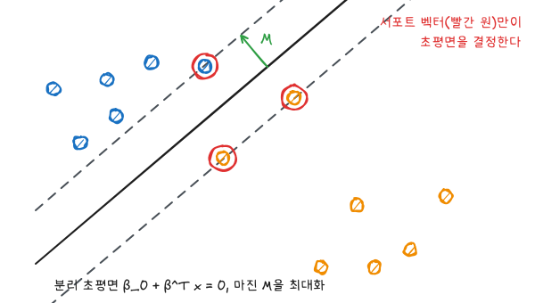
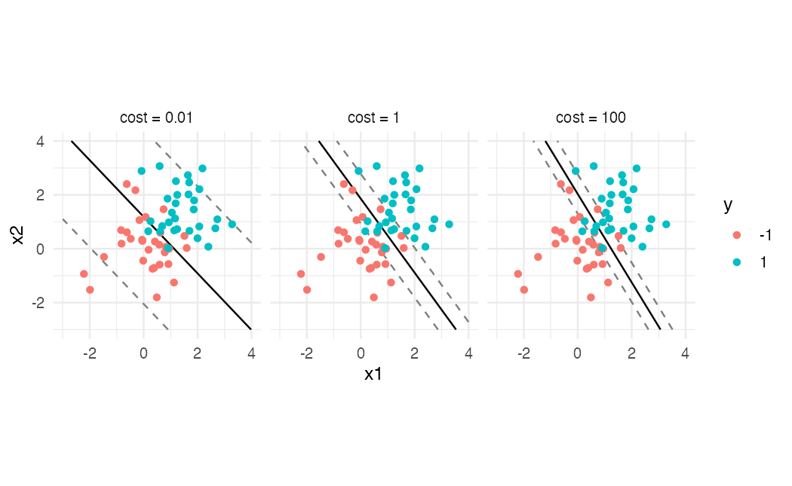
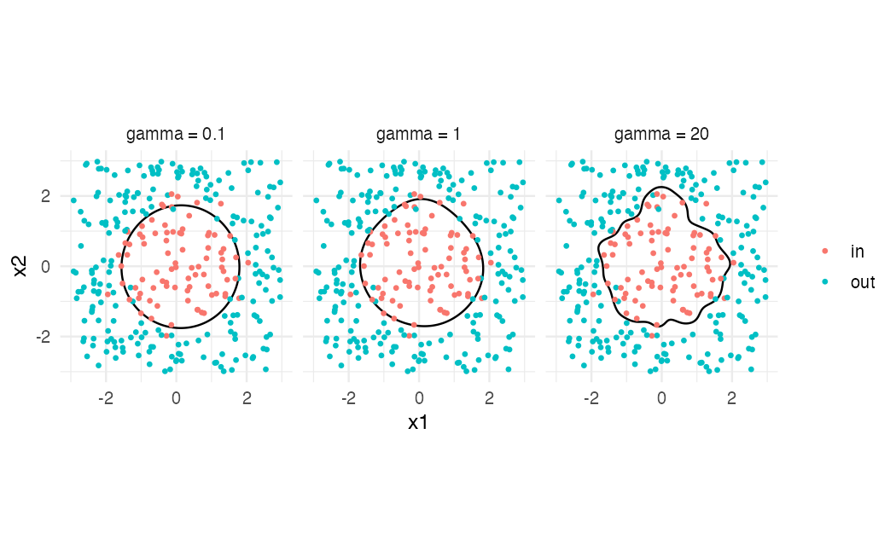

ISLR 9장과 이영미 교수님 데이터마이닝 강의 내용을 바탕으로 정리했다. SVM은 확률모형 대신 **기하학적인 경계**로 분류하는 방법이다. 최대 마진 분류기에서 출발해 두 단계로 일반화된다.

| 단계 | 경계 | 겹침 허용 |
|---|---|---|
| 최대 마진 분류기 | 초평면 | 불가 (완전히 분리돼야 함) |
| 서포트 벡터 분류기 | 초평면 | 허용 (비용 $C$로 조절) |
| 서포트 벡터 머신 | 커널로 만든 비선형 경계 | 허용 |

## 최대 마진 분류기

$p$차원 공간의 초평면은 $\beta_0 + \beta_1 X_1 + \cdots + \beta_p X_p = 0$이다. 반응을 $y_i \in \{-1, 1\}$로 두면, 초평면이 두 범주를 완전히 나눈다는 것은 모든 $i$에 대해 $y_i(\beta_0 + \beta^T x_i) > 0$이라는 뜻이다.

분리 초평면이 여럿 있을 때, 가장 가까운 관측값까지의 거리(**마진**)가 가장 큰 것을 고른다.

$$
\max_{\beta_0, \beta, M} M \quad \text{s.t.} \quad \sum_{j=1}^{p} \beta_j^2 = 1, \quad y_i(\beta_0 + \beta^T x_i) \ge M \;\; (i = 1, \dots, n)
$$

$\lVert\beta\rVert = 1$로 고정하면 $y_i(\beta_0 + \beta^T x_i)$가 곧 초평면까지의 부호 있는 거리다.



마진 경계 위에 놓인 관측값을 **서포트 벡터**라 한다. 초평면은 서포트 벡터에만 의존하고, 마진 밖의 관측값은 움직여도 해가 바뀌지 않는다. 모든 관측값을 쓰는 LDA와 대조되는 성질이다.

## 서포트 벡터 분류기

현실에서는 완전히 분리되지 않는 경우가 대부분이고, 분리되더라도 관측값 하나에 초평면이 크게 흔들릴 수 있다. 그래서 일부 관측값이 마진 안쪽이나 반대편에 오는 것을 허용한다.

$$
\max M \quad \text{s.t.} \quad \lVert\beta\rVert = 1, \quad y_i(\beta_0 + \beta^T x_i) \ge M(1 - \epsilon_i), \quad \epsilon_i \ge 0, \quad \sum_{i=1}^{n} \epsilon_i \le C
$$

- $\epsilon_i = 0$: 마진 바깥 올바른 쪽
- $0 < \epsilon_i \le 1$: 마진 안쪽이지만 올바른 쪽
- $\epsilon_i > 1$: 초평면 반대편 (오분류)

ISLR의 $C$는 위반의 **예산**이다. $C$가 크면 마진이 넓어지고 서포트 벡터가 많아져 편향은 크고 분산은 작다. 주의할 점은 R의 `e1071::svm()`에 들어가는 `cost`는 반대 의미라는 것이다. `cost`는 위반에 대한 **벌점**이라서, `cost`가 크면 마진이 좁고 서포트 벡터가 적다.

### 시뮬레이션: cost에 따른 경계

```r
library(tidyverse)
library(ISLR2)
library(e1071)
theme_set(theme_minimal(base_size = 12))

set.seed(1)
sim <- tibble(x1 = rnorm(60), x2 = rnorm(60), y = rep(c(-1, 1), each = 30)) |>
  mutate(x1 = x1 + 1.3 * (y == 1), x2 = x2 + 1.3 * (y == 1), y = factor(y))

grid <- expand_grid(x1 = seq(-3, 4, length.out = 150), x2 = seq(-3, 4, length.out = 150))

boundary <- function(fit, name) {
  grid |> mutate(dv = attr(predict(fit, grid, decision.values = TRUE), "decision.values")[, 1],
                 model = name)
}
fits <- list(`cost = 0.01` = 0.01, `cost = 1` = 1, `cost = 100` = 100) |>
  map(\(cst) svm(y ~ ., data = sim, kernel = "linear", cost = cst, scale = FALSE))

map(fits, \(f) length(f$index))
```

`fit$index`는 서포트 벡터의 행 번호다. `cost`가 커질수록 서포트 벡터 수가 줄어든다.

```r
imap_dfr(fits, boundary) |>
  ggplot(aes(x1, x2)) +
  geom_contour(aes(z = dv), breaks = 0, color = "black") +
  geom_contour(aes(z = dv), breaks = c(-1, 1), color = "grey50", linetype = "dashed") +
  geom_point(data = sim, aes(color = y)) +
  facet_wrap(~model) +
  coord_equal() +
  labs(color = "y")
```



실선이 결정경계, 점선이 마진 경계다. `cost`가 작으면 마진이 넓고 많은 점이 마진 안에 들어온다. 결정함숫값 ±1인 곳이 `e1071`의 마진 경계다.

## 커널과 서포트 벡터 머신

서포트 벡터 분류기의 해는 관측값 사이의 **내적**만으로 표현된다.

$$
f(x) = \beta_0 + \sum_{i \in \mathcal{S}} \alpha_i \langle x, x_i \rangle
$$

$\mathcal{S}$는 서포트 벡터의 집합이고, 그 밖의 관측값은 $\alpha_i = 0$이다. 내적 $\langle x, x_i \rangle$를 다른 유사도 함수 $K(x, x_i)$로 바꾸면 비선형 경계가 된다. 이것이 SVM이다.

| 커널 | $K(x, x')$ | 조율 모수 |
|---|---|---|
| 선형 | $\sum_j x_j x'_j$ | `cost` |
| 다항 | $(1 + \sum_j x_j x'_j)^d$ | `cost`, `degree` |
| 방사(RBF) | $\exp(-\gamma \sum_j (x_j - x'_j)^2)$ | `cost`, `gamma` |

변수를 늘려 고차원에서 선형 분류를 하는 것과 효과는 같지만, 고차원 좌표를 실제로 계산하지 않고 커널 값만 계산하므로 빠르다. 방사 커널은 $x$와 멀리 떨어진 $x_i$의 영향이 거의 0이 되는 **국소적** 방법이다. $\gamma$가 클수록 더 국소적이고 경계가 울퉁불퉁하다.

```r
set.seed(1)
ring <- tibble(x1 = runif(300, -3, 3), x2 = runif(300, -3, 3)) |>
  mutate(y = factor(if_else(x1^2 + x2^2 + rnorm(300, sd = 0.8) < 3.5, "in", "out")))

rbf_fits <- list(`gamma = 0.1` = 0.1, `gamma = 1` = 1, `gamma = 20` = 20) |>
  map(\(g) svm(y ~ ., data = ring, kernel = "radial", gamma = g, cost = 1))

imap_dfr(rbf_fits, boundary) |>
  ggplot(aes(x1, x2)) +
  geom_contour(aes(z = dv), breaks = 0, color = "black") +
  geom_point(data = ring, aes(color = y), size = 0.8) +
  facet_wrap(~model) +
  coord_equal(xlim = c(-3, 3), ylim = c(-3, 3)) +
  labs(color = NULL)
```



$\gamma$가 작으면 경계가 거의 직선이라 원 모양을 못 잡고, 너무 크면 개별 점을 따라가며 과적합한다.

## OJ 데이터 실습

`ISLR2::OJ`는 고객 1,070명이 두 오렌지 주스 브랜드(`CH`, `MM`) 중 무엇을 샀는지와 가격·할인 등 17개 변수다.

```r
set.seed(1)
idx <- sample(nrow(OJ), 800)
oj_train <- OJ[idx, ]
oj_test  <- OJ[-idx, ]
err <- function(fit) mean(predict(fit, oj_test) != oj_test$Purchase)

tune_lin <- tune(svm, Purchase ~ ., data = oj_train, kernel = "linear",
                 ranges = list(cost = c(0.01, 0.1, 1, 5, 10)))
tune_rbf <- tune(svm, Purchase ~ ., data = oj_train, kernel = "radial",
                 ranges = list(cost = c(0.1, 1, 5, 10), gamma = c(0.001, 0.01, 0.1, 1)))

tune_rbf$best.parameters
c(linear = err(tune_lin$best.model), radial = err(tune_rbf$best.model))
```

`tune()`은 격자의 모든 조합에 대해 10겹 교차검증 오차를 계산하고, 가장 좋은 조합으로 전체 학습 데이터에 다시 적합한 모델을 `best.model`에 담는다. `svm()`은 기본으로 변수를 표준화한다(`scale = TRUE`). 이 데이터에서는 경계가 거의 선형이라 두 커널의 테스트 오분류율이 비슷하다.

## 다범주 SVM

SVM은 원래 두 범주용이다. $K$개 범주로 확장하는 방법은 두 가지다.

- **일대일(OVO)**: 범주 쌍 $\binom{K}{2}$개마다 SVM을 적합하고 다수결로 정한다. `e1071`의 방식이다.
- **일대다(OVA)**: 범주 하나 대 나머지로 $K$개를 적합하고 $f_k(x)$가 가장 큰 범주를 고른다.

## 로지스틱 회귀와의 관계

서포트 벡터 분류기는 다음 벌점 최소화 문제로 다시 쓸 수 있다.

$$
\min_{\beta_0, \beta} \sum_{i=1}^{n} \max\left[0,\, 1 - y_i f(x_i)\right] + \lambda \sum_{j=1}^{p} \beta_j^2
$$

첫 항이 **힌지 손실**이다. $y_i f(x_i) \ge 1$(마진 바깥 올바른 쪽)이면 손실이 정확히 0이라서, 그런 관측값은 해에 영향을 주지 않는다. 로지스틱 회귀의 손실 $\log(1 + e^{-y_i f(x_i)})$은 모양이 비슷하지만 0이 되지 않는다. 그래서 두 방법은 결과가 비슷한 경우가 많고, 범주가 잘 분리되면 SVM이, 겹침이 크면 로지스틱 회귀가 조금 나은 경향이 있다. 둘째 항은 [Ridge](/posts/dm-regularization)와 같은 벌점이다.

## 요약

| 항목 | 내용 |
|---|---|
| 최대 마진 | 분리 가능할 때 마진 $M$ 최대화, 서포트 벡터만 해를 결정 |
| 서포트 벡터 분류기 | 위반 허용, ISLR의 $C$ = 예산, `e1071`의 `cost` = 벌점 |
| 커널 | 내적을 $K(x, x')$로 대체해 비선형 경계 |
| 방사 커널 | $\gamma$ 클수록 국소적, 과적합 위험 |
| 조율 | `tune()`으로 `cost`, `gamma` 교차검증 |
| 다범주 | 일대일 또는 일대다 |
| 관계 | 힌지 손실 + Ridge 벌점, 로지스틱 회귀와 유사 |
