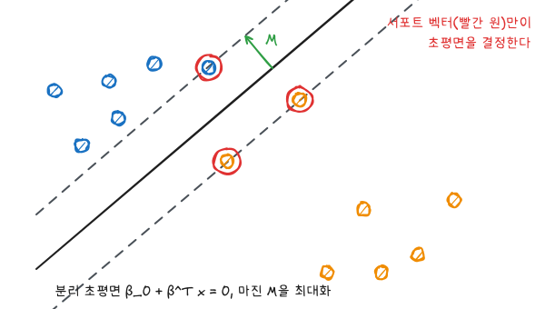
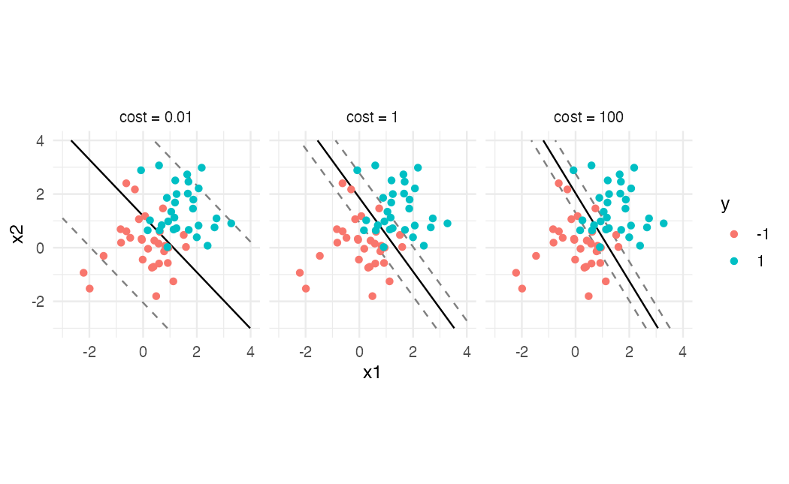
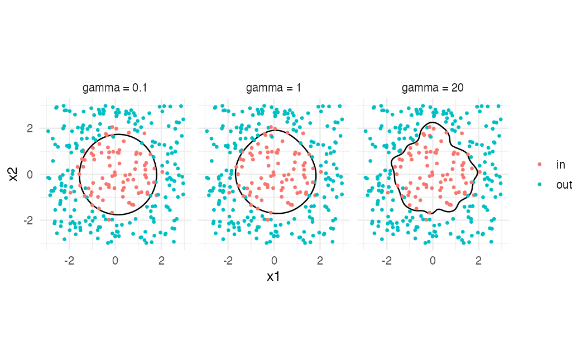
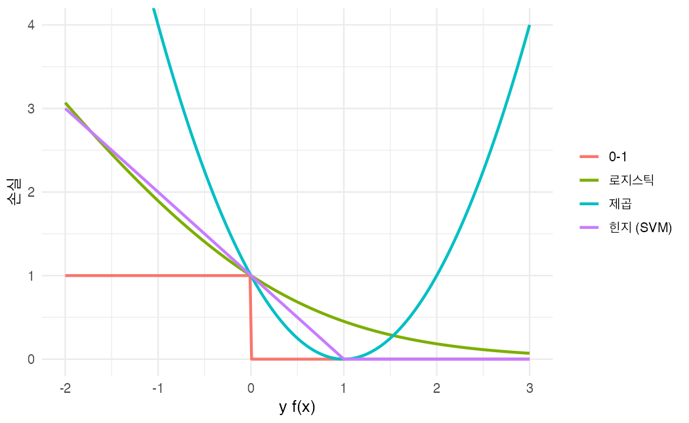

ISLR 9장과 이영미 교수님 데이터마이닝 강의 내용을 바탕으로 정리했다.

## 개요

SVM은 확률모형을 세우지 않고 **기하학적인 경계**로 분류하는 방법이다. 최대 마진 분류기에서 출발해, 오분류를 허용하는 서포트 벡터 분류기, 커널로 비선형 경계를 만드는 서포트 벡터 머신 순으로 일반화된다.

| | 최대 마진 분류기 | 서포트 벡터 분류기 | 서포트 벡터 머신 |
|---|---|---|---|
| 경계 | 초평면 | 초평면 | 커널에 의한 비선형 경계 |
| 마진 위반 | 허용하지 않음 (완전 분리 필요) | 허용 (비용으로 조절) | 허용 |
| 적용 조건 | 범주가 선형 분리 가능 | 항상 | 항상 |
| 조율 모수 | 없음 | 비용 | 비용, 커널 모수 |

[분류](/posts/dm-classification)에서 다룬 로지스틱 회귀·LDA와 비교하면, SVM은 경계를 정하는 데 **경계 근처의 관측값(서포트 벡터)만** 쓴다는 점이 가장 큰 차이다.

## 1. 최대 마진 분류기

$p$차원 공간의 초평면은 $\beta_0 + \beta^Tx = 0$이다. 반응을 $y_i \in \{-1, 1\}$로 두면, 초평면이 두 범주를 완전히 나눈다는 것은 모든 $i$에 대해 $y_i(\beta_0 + \beta^Tx_i) > 0$이라는 뜻이다. 분리 초평면이 여럿이면, 가장 가까운 관측값까지의 거리(**마진**)가 가장 큰 것을 고른다.

$$
\max_{\beta_0, \beta, M}M \quad\text{s.t.}\quad \lVert\beta\rVert = 1, \quad y_i(\beta_0 + \beta^Tx_i) \ge M \;\; (i = 1, \dots, n)
$$

$\lVert\beta\rVert = 1$로 고정하면 $y_i(\beta_0 + \beta^Tx_i)$가 초평면까지의 부호 있는 거리가 된다.



마진 경계 위의 관측값을 **서포트 벡터**라 한다. 초평면은 서포트 벡터에만 의존하며, 마진 밖의 관측값은 움직여도 해가 바뀌지 않는다. 모든 관측값의 평균과 공분산을 쓰는 LDA와 대조되는 성질이다. 그러나 이 성질 때문에 관측값 하나만 추가되어도 초평면이 크게 바뀔 수 있고, 범주가 겹치면 해가 존재하지 않는다.

## 2. 서포트 벡터 분류기

일부 관측값이 마진 안쪽이나 초평면 반대편에 놓이는 것을 허용한다.

$$
\max M \quad\text{s.t.}\quad \lVert\beta\rVert = 1, \quad y_i(\beta_0 + \beta^Tx_i) \ge M(1 - \epsilon_i), \quad \epsilon_i \ge 0, \quad \sum_{i=1}^{n}\epsilon_i \le C
$$

여유변수 $\epsilon_i$가 0이면 마진 바깥의 올바른 쪽, $0 < \epsilon_i \le 1$이면 마진 안쪽, $\epsilon_i > 1$이면 오분류다. ISLR의 $C$는 위반의 **예산**이다. $C$가 크면 마진이 넓어지고 서포트 벡터가 많아져, 더 많은 관측값이 경계를 정하는 데 참여하므로 편향은 커지고 분산은 작아진다.

R의 `e1071::svm()`에서 `cost`는 반대 의미다. `cost`는 위반에 대한 **벌점**이므로, `cost`가 크면 마진이 좁고 서포트 벡터가 적다.

## 3. 서포트 벡터 머신

서포트 벡터 분류기의 해는 관측값 사이의 **내적**만으로 표현된다.

$$
f(x) = \beta_0 + \sum_{i \in \mathcal S}\alpha_i\langle x, x_i\rangle
$$

$\mathcal S$는 서포트 벡터의 집합이고, 나머지 관측값은 $\alpha_i = 0$이다. 내적 $\langle x, x_i\rangle$을 다른 유사도 함수 $K(x, x_i)$로 바꾸면 비선형 경계가 된다.

| 커널 | $K(x, x')$ | 조율 모수 |
|---|---|---|
| 선형 | $\sum_jx_jx'_j$ | `cost` |
| 다항 | $(1 + \sum_jx_jx'_j)^d$ | `cost`, `degree` |
| 방사(RBF) | $\exp(-\gamma\sum_j(x_j - x'_j)^2)$ | `cost`, `gamma` |

커널은 설명 변수를 고차원으로 변환해 선형 분류하는 것과 같은 효과를 내지만, 고차원 좌표를 직접 계산하지 않고 커널 값만 계산한다. [비선형 회귀](/posts/dm-nonlinear)에서 기저 함수를 명시적으로 만들었던 것과 대조된다. 방사 커널은 멀리 떨어진 $x_i$의 영향이 거의 0이 되는 국소적 방법이며, $\gamma$가 클수록 더 국소적이어서 경계가 불규칙해진다. 이 점에서 [KNN](/posts/dm-classification)과 비슷하게 작동한다.

### 다범주 확장

SVM은 원래 두 범주용이다. 범주 쌍 $\binom K2$개마다 SVM을 적합하고 다수결로 정하는 **일대일(OVO)** 방식(`e1071`의 방식)과, 범주 하나 대 나머지로 $K$개를 적합해 $f_k(x)$가 가장 큰 범주를 고르는 **일대다(OVA)** 방식이 있다.

## 4. 손실함수 관점: 로지스틱 회귀와의 관계

서포트 벡터 분류기는 다음 벌점 최소화 문제와 동치다.

$$
\min_{\beta_0, \beta}\sum_{i=1}^{n}\max\left[0,\; 1 - y_if(x_i)\right] + \lambda\sum_{j=1}^{p}\beta_j^2
$$

첫 항이 **힌지 손실**, 둘째 항은 [Ridge](/posts/dm-regularization)와 같은 벌점이다. 로지스틱 회귀(벌점을 붙인 경우)는 손실만 다르다.

| 방법 | 손실 $L(y f(x))$ | 마진 $yf(x) \ge 1$인 관측값 |
|---|---|---|
| SVM | $\max(0, 1 - yf(x))$ (힌지) | 손실 정확히 0, 해에 영향 없음 |
| 로지스틱 회귀 | $\log(1 + e^{-yf(x)})$ | 손실이 작지만 0이 아님, 모두 영향 |
| 최소제곱 (LDA와 관련) | $(1 - yf(x))^2$ | 너무 잘 맞혀도 손실이 증가 |

힌지 손실과 로지스틱 손실은 모양이 비슷하므로 두 방법의 결과도 비슷한 경우가 많다. 다만 SVM은 잘 분류된 관측값을 완전히 무시하므로 범주가 잘 분리될 때 유리하고, 로지스틱 회귀는 모든 관측값을 반영하고 확률을 함께 추정하므로 겹침이 클 때 유리한 경향이 있다.

## 5. 방법 간 비교

| 구분 | 최대 마진 | 서포트 벡터 분류기 | 커널 SVM | 로지스틱 회귀 | LDA |
|---|---|---|---|---|---|
| 경계 | 선형 | 선형 | 비선형 | 선형 | 선형 |
| 경계를 정하는 관측값 | 서포트 벡터 | 서포트 벡터 | 서포트 벡터 | 전체 | 전체 (평균, 공분산) |
| 분포 가정 | 없음 | 없음 | 없음 | 로그 오즈 선형 | 정규, 공통 공분산 |
| 확률 출력 | 없음 | 없음 | 없음 (후처리로 근사) | 있음 | 있음 |
| 조율 모수 | 없음 | 비용 | 비용, 커널 모수 | 없음 (벌점 시 $\lambda$) | 없음 |
| 분리 가능한 자료 | 해 존재 | 안정적 | 안정적 | 계수 발산 | 안정적 |

## 6. 자료를 이용한 비교

```r
library(tidyverse)
library(ISLR2)
library(e1071)
library(MASS)
theme_set(theme_minimal(base_size = 12))

grid <- expand_grid(x1 = seq(-3, 4, length.out = 150), x2 = seq(-3, 4, length.out = 150))
boundary <- function(fit, name, g = grid) {
  g |> mutate(dv = attr(predict(fit, g, decision.values = TRUE), "decision.values")[, 1],
              model = name)
}
```

### 비용에 따른 경계와 서포트 벡터

```r
set.seed(1)
sim <- tibble(x1 = rnorm(60), x2 = rnorm(60), y = rep(c(-1, 1), each = 30)) |>
  mutate(x1 = x1 + 1.3 * (y == 1), x2 = x2 + 1.3 * (y == 1), y = factor(y))

fits <- list(`cost = 0.01` = 0.01, `cost = 1` = 1, `cost = 100` = 100) |>
  map(\(cst) svm(y ~ ., data = sim, kernel = "linear", cost = cst, scale = FALSE))
map_int(fits, \(f) length(f$index))

imap_dfr(fits, boundary) |>
  ggplot(aes(x1, x2)) +
  geom_contour(aes(z = dv), breaks = 0, color = "black") +
  geom_contour(aes(z = dv), breaks = c(-1, 1), color = "grey50", linetype = "dashed") +
  geom_point(data = sim, aes(color = y)) +
  facet_wrap(~model) +
  coord_equal() +
  labs(color = "y")
```



실선이 결정경계, 점선이 마진 경계(결정함숫값 ±1)다. 서포트 벡터의 수는 `cost = 0.01`에서 56개, 1에서 22개, 100에서 18개다. `cost`가 작으면 마진이 넓어 60개 중 거의 모든 관측값이 경계를 정하는 데 참여하고, `cost`가 크면 경계 근처의 소수만 남는다. 앞에서 말한 편향-분산의 교환이 서포트 벡터 수로 나타난다.

### 커널 모수에 따른 경계

```r
set.seed(1)
ring <- tibble(x1 = runif(300, -3, 3), x2 = runif(300, -3, 3)) |>
  mutate(y = factor(if_else(x1^2 + x2^2 + rnorm(300, sd = 0.8) < 3.5, "in", "out")))

rbf_fits <- list(`gamma = 0.1` = 0.1, `gamma = 1` = 1, `gamma = 20` = 20) |>
  map(\(g) svm(y ~ ., data = ring, kernel = "radial", gamma = g, cost = 1))

imap_dfr(rbf_fits, boundary) |>
  ggplot(aes(x1, x2)) +
  geom_contour(aes(z = dv), breaks = 0, color = "black") +
  geom_point(data = ring, aes(color = y), size = 0.8) +
  facet_wrap(~model) +
  coord_equal(xlim = c(-3, 3), ylim = c(-3, 3)) +
  labs(color = NULL)
```



$\gamma$가 작으면 경계가 거의 직선이어서 원 모양을 잡지 못하고, 너무 크면 개별 점을 따라가며 과적합한다.

### 손실함수의 비교

```r
tibble(m = seq(-2, 3, length.out = 300)) |>
  mutate(`힌지 (SVM)` = pmax(0, 1 - m),
         `로지스틱` = log(1 + exp(-m)) / log(2),
         `제곱` = (1 - m)^2,
         `0-1` = as.numeric(m < 0)) |>
  pivot_longer(-m, names_to = "손실", values_to = "값") |>
  ggplot(aes(m, 값, color = 손실)) +
  geom_line(linewidth = 1) +
  coord_cartesian(ylim = c(0, 4)) +
  labs(x = "y f(x)", y = "손실", color = NULL)
```



로지스틱 손실은 $y f(x) = 0$에서 힌지 손실과 같은 값을 갖도록 $\log 2$로 나누어 그렸다. 힌지 손실과 로지스틱 손실은 $yf(x) < 1$에서 거의 같은 모양이고, $yf(x) > 1$에서 힌지 손실만 정확히 0이다. 제곱 손실은 $yf(x) > 1$에서 다시 커져, 너무 확실하게 맞힌 관측값에도 벌점을 준다. 세 손실 모두 계산이 어려운 0-1 손실(오분류 여부)을 볼록함수로 대신한 것이다.

### 경계가 비선형인 자료에서의 비교

```r
set.seed(2)
ring_te <- tibble(x1 = runif(2000, -3, 3), x2 = runif(2000, -3, 3)) |>
  mutate(y = factor(if_else(x1^2 + x2^2 + rnorm(2000, sd = 0.8) < 3.5, "in", "out")))
er <- function(pred) mean(pred != ring_te$y)

tune_ring <- tune(svm, y ~ ., data = ring, kernel = "radial",
                  ranges = list(cost = c(0.1, 1, 10), gamma = c(0.1, 0.5, 1, 2)))
p_log <- predict(glm(y ~ x1 + x2, data = ring, family = binomial), ring_te, type = "response")
p_log2 <- predict(glm(y ~ x1 + x2 + I(x1^2) + I(x2^2), data = ring, family = binomial),
                  ring_te, type = "response")

c(로지스틱 = er(if_else(p_log > 0.5, "out", "in")),
  LDA = er(predict(lda(y ~ x1 + x2, data = ring), ring_te)$class),
  선형SVM = er(predict(svm(y ~ ., data = ring, kernel = "linear"), ring_te)),
  방사SVM = er(predict(tune_ring$best.model, ring_te)),
  `로지스틱 + 제곱항` = er(if_else(p_log2 > 0.5, "out", "in")))
tune_ring$best.parameters
```

| 방법 | 테스트 오분류율 |
|---|---|
| 로지스틱 회귀 | 0.296 |
| LDA | 0.296 |
| 선형 SVM | 0.296 |
| 방사 커널 SVM (`cost = 10`, `gamma = 0.1`) | **0.056** |
| 로지스틱 + 제곱항 | 0.058 |

경계가 원이므로 선형 경계를 쓰는 세 방법은 모두 사실상 한 범주로 예측하는 수준에 머물며, 오분류율이 같다. 방사 커널 SVM은 경계의 형태를 몰라도 원을 찾아 오분류율을 0.056으로 낮춘다. 그러나 경계가 원이라는 것을 알고 로지스틱 회귀에 $x_1^2$, $x_2^2$를 넣으면 0.058로 거의 같은 성능을 내면서 계수 해석도 유지된다. 커널의 장점은 비선형성 그 자체가 아니라 **형태를 모를 때** 자동으로 찾아 준다는 데 있다.

### OJ 자료

`ISLR2::OJ`는 고객 1,070명이 두 오렌지 주스 브랜드(`CH`, `MM`) 중 무엇을 샀는지와 가격·할인 등 17개 변수다.

```r
set.seed(1)
idx <- sample(nrow(OJ), 800)
oj_train <- OJ[idx, ]
oj_test  <- OJ[-idx, ]
err <- function(pred) mean(pred != oj_test$Purchase)

tune_lin <- tune(svm, Purchase ~ ., data = oj_train, kernel = "linear",
                 ranges = list(cost = c(0.01, 0.1, 1, 5, 10)))
tune_rbf <- tune(svm, Purchase ~ ., data = oj_train, kernel = "radial",
                 ranges = list(cost = c(0.1, 1, 5, 10), gamma = c(0.001, 0.01, 0.1, 1)))
tune_rbf$best.parameters

p_oj <- predict(glm(Purchase ~ ., data = oj_train, family = binomial), oj_test, type = "response")
c(선형SVM = err(predict(tune_lin$best.model, oj_test)),
  방사SVM = err(predict(tune_rbf$best.model, oj_test)),
  로지스틱 = err(if_else(p_oj > 0.5, "MM", "CH")),
  LDA = err(predict(lda(Purchase ~ ., data = oj_train), oj_test)$class),
  서포트벡터비율 = length(tune_lin$best.model$index) / nrow(oj_train))
```

`tune()`은 격자의 모든 조합에 대해 10겹 교차검증 오차를 계산하고, 가장 좋은 조합으로 전체 학습 자료에 다시 적합한 모형을 `best.model`에 담는다. `svm()`은 기본으로 변수를 표준화한다.

| 방법 | 테스트 오분류율 |
|---|---|
| 선형 SVM | **0.148** |
| 방사 커널 SVM (`cost = 5`, `gamma = 0.01`) | 0.174 |
| 로지스틱 회귀 | 0.156 |
| LDA | 0.159 |

OJ 자료에서는 선형 SVM이 가장 낮고 로지스틱 회귀와 LDA가 근소한 차이로 뒤따른다. 방사 커널은 오히려 나쁘다. 구매 선택이 가격 차이와 할인 같은 변수의 거의 선형적인 함수이므로, 커널의 추가 유연성은 분산만 늘린다. 선형 SVM의 서포트 벡터는 학습 자료의 41%로, 두 범주가 상당히 겹쳐 있음을 보여 준다. 겹침이 이 정도이면 힌지 손실과 로지스틱 손실의 차이가 크지 않아 두 방법의 성능이 비슷하다. 로지스틱 회귀의 공선성 경고는 `SalePriceMM`처럼 다른 변수의 선형결합인 변수가 포함되어 있기 때문이다.

## 7. 결과의 해석

| 관찰된 결과 | 원인 |
|---|---|
| `cost`가 작을수록 서포트 벡터가 많음 (56 → 22 → 18) | 위반 벌점이 작아 마진이 넓어지고 더 많은 관측값이 경계를 정함 |
| `gamma`가 크면 경계가 개별 점을 따라감 | 방사 커널의 영향 범위가 좁아져 국소적으로 적합 |
| 원형 경계에서 선형 방법 셋이 같은 오차 | 선형 경계로는 원을 표현할 수 없음 |
| 원형 경계에서 방사 SVM과 로지스틱+제곱항이 비슷 | 커널은 변수 변환을 암묵적으로 하는 것과 같음 |
| OJ에서 선형 방법이 방사 커널보다 나음 | 경계가 거의 선형이어서 추가 유연성은 분산만 늘림 |
| OJ에서 SVM과 로지스틱의 성능이 비슷 | 겹침이 큰 자료에서는 힌지 손실과 로지스틱 손실이 거의 같게 작동 |

## 8. 방법의 선택

| 상황 | 적합한 방법 |
|---|---|
| 경계가 대략 선형이고 확률이나 계수 해석이 필요함 | 로지스틱 회귀 |
| 경계가 대략 선형이고 범주가 잘 분리됨 | 선형 SVM 또는 LDA |
| 경계가 비선형이고 형태를 알 수 없음 | 방사 커널 SVM (`cost`, `gamma`를 교차검증) |
| 경계의 비선형 형태를 짐작할 수 있음 | 로지스틱 회귀에 변환항 추가 (해석 유지) |
| $p$가 매우 크고 $n$이 작음 (텍스트 등) | 선형 SVM |
| 범주가 3개 이상 | 일대일 SVM, 또는 LDA·다항 로지스틱 |

## 정리

| | 서포트 벡터 분류기 | 커널 SVM | 로지스틱 회귀 |
|---|---|---|---|
| 경계 | 선형 | 비선형 | 선형 |
| 손실 | 힌지 | 힌지 | 로지스틱 |
| 경계를 정하는 관측값 | 서포트 벡터 | 서포트 벡터 | 전체 |
| 확률 | 없음 | 없음 | 있음 |
| 조율 | `cost` | `cost`, `gamma` | — |
