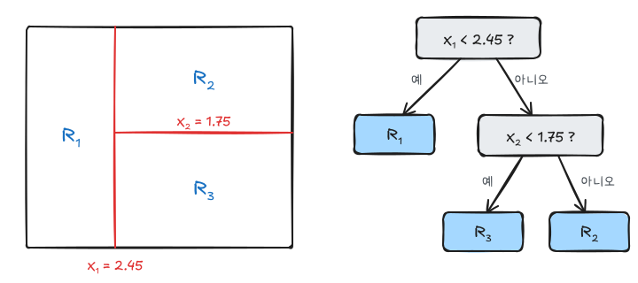
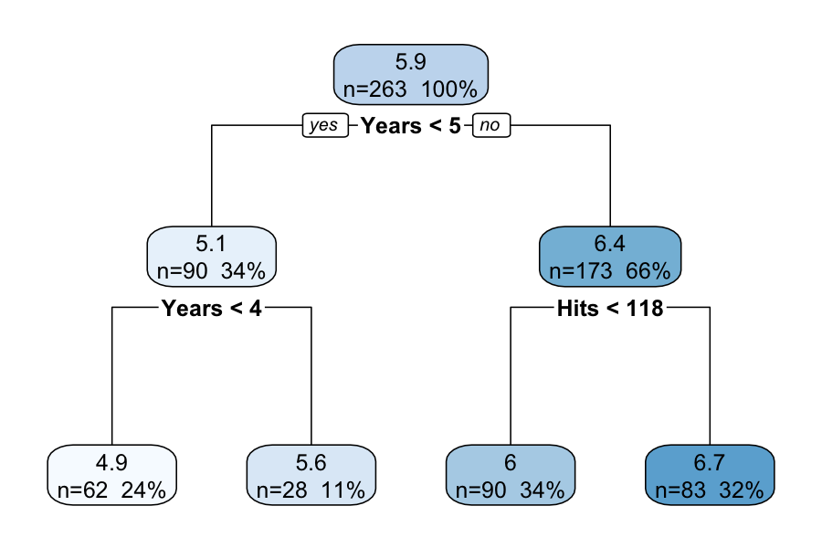
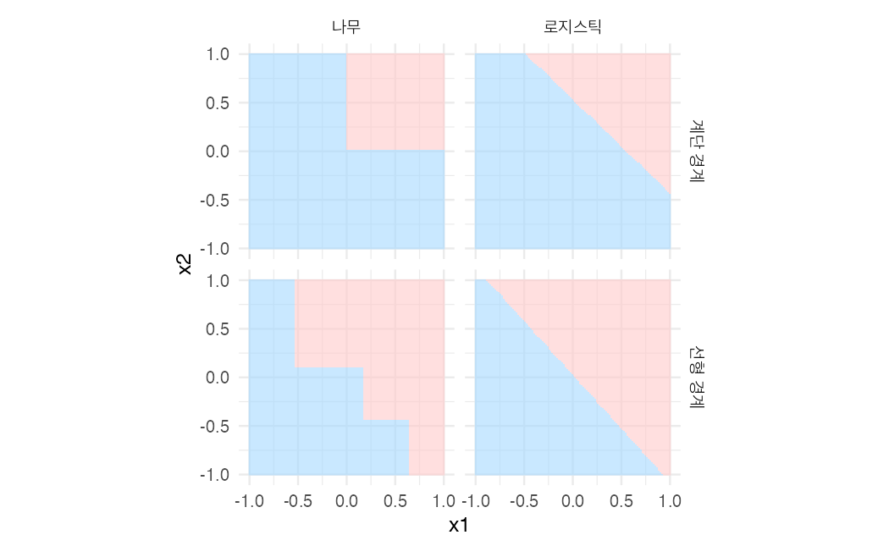
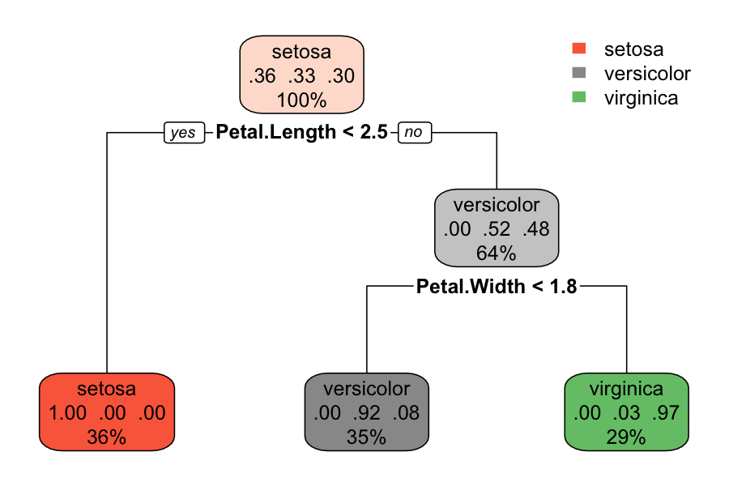
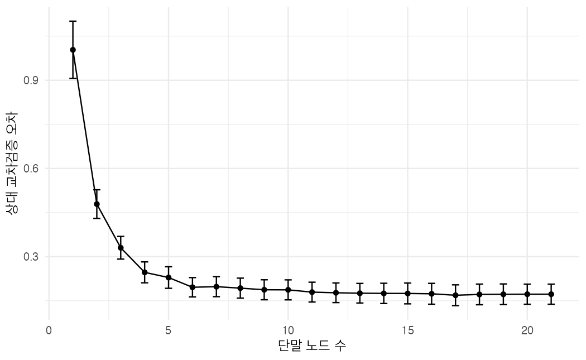
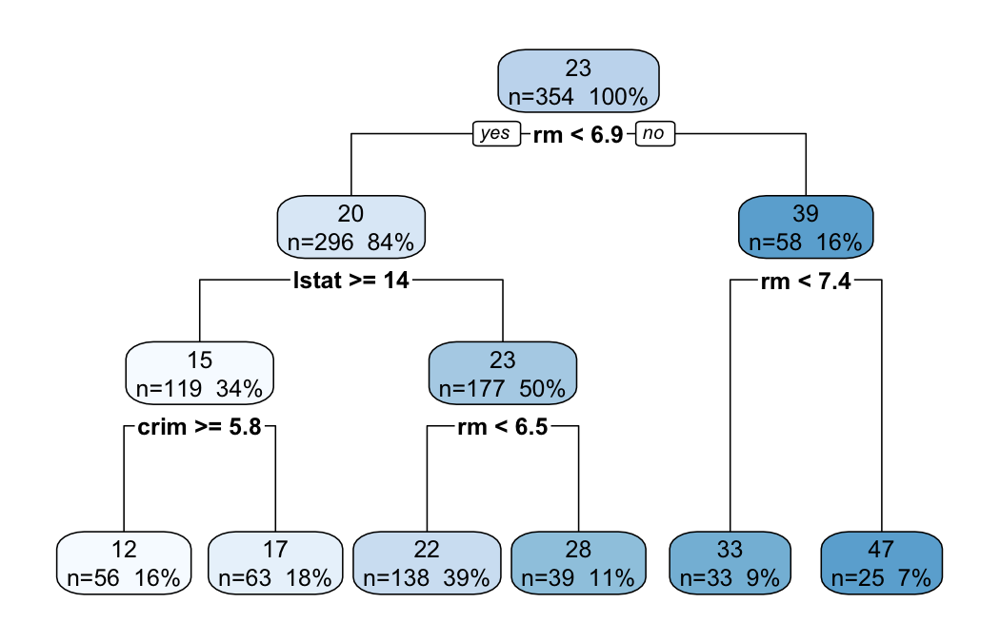

ISLR 8장과 이영미 교수님 데이터마이닝 강의의 의사결정나무 부분을 정리했다.

## 개요

의사결정나무는 설명 변수 공간을 직사각형 영역으로 나누고, 각 영역 안에서 단순한 예측값(회귀는 평균, 분류는 최빈 범주)을 쓰는 방법이다. 선형모형이 공간 전체에 하나의 식을 적합한다면, 나무는 공간을 조각내어 조각마다 상수를 둔다.

| | 선형모형 | 의사결정나무 |
|---|---|---|
| 모형의 형태 | $f(x) = \beta_0 + \sum_j\beta_jx_j$ | $f(x) = \sum_{m=1}^{M}c_mI(x \in R_m)$ |
| 경계 | 초평면 (임의의 방향) | 축에 평행한 계단 |
| 교호작용 | 직접 지정해야 함 | 분할 구조로 자동 반영 |
| 해석 | 계수 | 분할 규칙 (그림) |
| 분산 | 작음 | 큼 |

나무를 만드는 과정은 **성장**(어떤 기준으로 나누는가)과 **가지치기**(얼마나 키우는가)의 두 단계로 나뉜다.

## 1. 재귀적 이진 분할



모든 가능한 분할을 비교해 최적의 나무를 찾는 것은 계산이 불가능하므로, 위에서 아래로 **탐욕적으로** 나눈다.

1. 모든 변수 $X_j$와 모든 분할점 $s$에 대해 $\{X_j < s\}$, $\{X_j \ge s\}$로 나눴을 때의 불순도를 계산한다.
2. 불순도를 가장 많이 줄이는 $(j, s)$로 나눈다.
3. 나뉜 각 영역에서 같은 과정을 반복하고, 노드의 관측값 수가 일정 수 미만이 되면 멈춘다.

탐욕적이라는 것은 현재 단계에서 가장 좋은 분할을 고를 뿐 이후 단계를 고려하지 않는다는 뜻이다. 첫 분할이 그 아래의 모든 분할을 제약하므로, 첫 분할이 바뀌면 나무 전체가 달라진다. 이것이 나무의 분산이 큰 근본적인 이유다.

## 2. 분할 기준

### 회귀나무

$$
RSS = \sum_{j=1}^{J}\sum_{i \in R_j}(y_i - \hat y_{R_j})^2
$$

### 분류나무

$\hat p_{mk}$를 노드 $m$에서 범주 $k$의 비율이라 하자.

| 기준 | 식 | 특징 |
|---|---|---|
| 오분류율 | $1 - \max_k\hat p_{mk}$ | 분할의 질 차이에 둔감 |
| 지니 지수 | $\sum_k\hat p_{mk}(1 - \hat p_{mk})$ | 노드가 순수할수록 0 |
| 엔트로피 | $-\sum_k\hat p_{mk}\log\hat p_{mk}$ | 지니와 거의 같은 동작 |

오분류율이 성장 기준으로 부적합한 이유는 예로 확인할 수 있다. 400:400인 노드를 (300:100, 100:300)으로 나누는 분할 A와 (200:400, 200:0)으로 나누는 분할 B를 비교하면, 두 분할 모두 오분류가 200개로 오분류율이 같다. 그러나 분할 B는 순수한 노드(200:0)를 하나 만들어 이후 분할에 더 유리하다. 지니 지수는 A가 0.375, B가 0.333(가중평균)으로 B를 선호한다. 지니와 엔트로피는 $\hat p$에 대해 엄격히 오목한 함수이므로 노드를 순수하게 만드는 분할에 더 큰 보상을 준다.

성장에는 지니 지수나 엔트로피를 쓰고, 가지치기와 최종 평가에는 목표 자체인 오분류율을 쓰는 것이 일반적이다.

## 3. 비용복잡도 가지치기

나무를 끝까지 키우면 학습 자료에 과적합한다. 반대로 불순도 감소가 작을 때 일찍 멈추면, 당장은 효과가 없지만 다음 단계에서 큰 감소를 만드는 분할을 놓칠 수 있다(예: XOR 구조). 그래서 크게 키운 뒤 잘라낸다.

$$
\sum_{m=1}^{\lvert T\rvert}\sum_{i \in R_m}(y_i - \hat y_{R_m})^2 + \alpha\lvert T\rvert
$$

$\lvert T\rvert$는 단말 노드 수, $\alpha \ge 0$는 크기에 대한 벌점이다. $\alpha = 0$이면 가장 큰 나무, $\alpha$가 커질수록 작은 나무가 선택된다. [Lasso](/posts/dm-regularization)가 계수 크기에 벌점을 주었다면 가지치기는 잎의 수에 벌점을 준다. $\alpha$는 교차검증으로 정하며, `rpart`의 `cp`는 이 $\alpha$를 루트 노드의 오차로 나눈 상대적인 값이다.

$\alpha$를 고르는 기준은 두 가지다.

- **최소 교차검증 오차**: 교차검증 오차가 가장 작은 나무
- **1-SE 규칙**: 최소 오차 + 1 표준오차 이내에서 가장 작은 나무. 교차검증 오차 자체의 불확실성을 고려해 더 단순한 나무를 고른다.

## 4. 강의 예제: 야구 선수 연봉

메이저리그 타자의 연봉을 경력 연수(`Years`)와 전년도 안타 수(`Hits`)로 설명한다. 연봉은 오른쪽으로 치우쳐 로그를 취한다.

```r base w=6 h=4
library(tidyverse)
theme_set(theme_minimal(base_size = 12))
library(ISLR2)
library(rpart)
library(rpart.plot)

hitters <- na.omit(Hitters)
salary_tree <- rpart(log(Salary) ~ Years + Hits, data = hitters,
                     control = rpart.control(maxdepth = 2))
rpart.plot(salary_tree, type = 2, extra = 101)
```



첫 분할은 경력 약 4.5년이다. 경력이 짧은 선수는 연봉이 낮고, 경력이 긴 선수 안에서는 안타가 많을수록 연봉이 높다. "경력이 짧으면 안타 수가 연봉과 별 관련이 없다"는 교호작용을 따로 지정하지 않아도 분할 구조가 표현한다. 선형모형에서 같은 내용을 표현하려면 `Years × Hits` 교호작용항과 함께 비선형 변환이 필요하다.

## 5. 나무와 선형모형의 비교: 경계의 형태

나무와 선형모형 중 어느 쪽이 나은지는 참 경계의 형태에 달려 있다. 두 가지 모의자료로 확인한다.

- **선형 경계**: $x_1 + x_2 > 0$이면 범주 1
- **계단 경계**: $x_1 > 0$이고 $x_2 > 0$이면 범주 1 (축에 평행한 직사각형)

```r
gen_b <- function(n, type) {
  d <- tibble(x1 = runif(n, -1, 1), x2 = runif(n, -1, 1))
  y <- if (type == "선형 경계") d$x1 + d$x2 > 0 else d$x1 > 0 & d$x2 > 0
  flip <- runif(n) < 0.05
  mutate(d, y = factor(as.integer(xor(y, flip))))
}

set.seed(11)
boundary_cmp <- map_dfr(c("선형 경계", "계단 경계"), \(type) map_dfr(1:30, \(r) {
  tr <- gen_b(200, type); te <- gen_b(2000, type)
  p_log <- predict(glm(y ~ x1 + x2, data = tr, family = binomial), te, type = "response")
  fit_t <- rpart(y ~ x1 + x2, data = tr, method = "class")
  fit_t <- prune(fit_t, cp = fit_t$cptable[which.min(fit_t$cptable[, "xerror"]), "CP"])
  tibble(경계 = type,
         로지스틱 = mean(as.integer(p_log > 0.5) != as.integer(as.character(te$y))),
         나무 = mean(predict(fit_t, te, type = "class") != te$y))
}))

boundary_cmp |> group_by(경계) |> summarise(across(c(로지스틱, 나무), \(v) round(mean(v), 3)))
```

```r
set.seed(12)
grid <- expand_grid(x1 = seq(-1, 1, length.out = 120), x2 = seq(-1, 1, length.out = 120))
plot_b <- map_dfr(c("선형 경계", "계단 경계"), \(type) {
  tr <- gen_b(300, type)
  fit_t <- rpart(y ~ x1 + x2, data = tr, method = "class")
  fit_t <- prune(fit_t, cp = fit_t$cptable[which.min(fit_t$cptable[, "xerror"]), "CP"])
  p_log <- predict(glm(y ~ x1 + x2, data = tr, family = binomial), grid, type = "response")
  bind_rows(grid |> mutate(pred = as.integer(p_log > 0.5), 방법 = "로지스틱"),
            grid |> mutate(pred = as.integer(as.character(predict(fit_t, grid, type = "class"))), 방법 = "나무")) |>
    mutate(경계 = type)
})

ggplot(plot_b, aes(x1, x2, fill = factor(pred))) +
  geom_raster(alpha = 0.6) +
  facet_grid(경계 ~ 방법) +
  coord_equal() +
  scale_fill_manual(values = c("0" = "#a5d8ff", "1" = "#ffc9c9"), guide = "none")
```



| 참 경계 | 로지스틱 회귀 | 나무 |
|---|---|---|
| 선형 ($x_1 + x_2 > 0$) | **0.077** | 0.148 |
| 계단 ($x_1 > 0$, $x_2 > 0$) | 0.131 | **0.061** |

라벨 잡음이 5%이므로 두 경우 모두 이론적 최소 오분류율은 0.05다. 경계가 대각선이면 로지스틱 회귀가 거의 최소에 도달하지만, 나무는 대각선을 축에 평행한 계단으로 근사해야 하므로 오분류율이 두 배다. 경계가 직사각형이면 반대로 나무가 분할 두 번으로 경계를 정확히 표현하고, 로지스틱 회귀는 직사각형의 모서리를 직선 하나로 잘라 낼 수밖에 없다. 그림에서 대각선 경계를 따라 나무가 만든 계단 모양을 볼 수 있다.

## 6. 분류나무 실습: iris

```r
set.seed(1000)
train_id <- sample(nrow(iris), 0.7 * nrow(iris))
train <- iris[train_id, ]
test  <- iris[-train_id, ]

cart_iris <- rpart(Species ~ ., data = train, method = "class")
cart_iris
```

```r base w=6 h=4
rpart.plot(cart_iris, type = 2, extra = 104)
```



```r
pred <- predict(cart_iris, test, type = "class")
table(predicted = pred, actual = test$Species)
mean(pred == test$Species)
```

꽃잎 길이 2.45cm 미만으로 setosa를 먼저 떼어 내고(순수 노드), 꽃잎 너비 1.75cm로 나머지 둘을 나눈다. 분할 두 번으로 테스트 정확도 0.956이며, versicolor와 virginica의 경계에서 2개를 틀린다. `extra = 104`는 노드마다 범주별 비율과 전체 중 비중을 표시한다.

## 7. 가지치기 기준의 비교: Boston

```r
set.seed(1)
idx <- sample(nrow(Boston), 0.7 * nrow(Boston))
b_train <- Boston[idx, ]
b_test  <- Boston[-idx, ]

big_tree <- rpart(medv ~ ., data = b_train, method = "anova",
                  control = rpart.control(cp = 0.001))
printcp(big_tree)

as_tibble(big_tree$cptable) |>
  ggplot(aes(nsplit + 1, xerror)) +
  geom_line() + geom_point() +
  geom_errorbar(aes(ymin = xerror - xstd, ymax = xerror + xstd), width = 0.3) +
  labs(x = "단말 노드 수", y = "상대 교차검증 오차")
```



`cp = 0.001`로 일부러 크게 키운다. `printcp`의 `xerror`는 10겹 교차검증 오차(루트 대비 상대값), `xstd`는 그 표준오차다.

```r
cpt <- big_tree$cptable
best <- which.min(cpt[, "xerror"])
one_se <- min(which(cpt[, "xerror"] <= cpt[best, "xerror"] + cpt[best, "xstd"]))

min_tree <- prune(big_tree, cp = cpt[best, "CP"])
se_tree  <- prune(big_tree, cp = cpt[one_se, "CP"])
leaves <- function(fit) sum(fit$frame$var == "<leaf>")
mse <- function(pred) mean((b_test$medv - pred)^2)

tibble(모형 = c("가지치기 없음", "최소 CV 오차", "1-SE 규칙", "선형회귀"),
       잎 = c(leaves(big_tree), leaves(min_tree), leaves(se_tree), NA),
       테스트MSE = c(mse(predict(big_tree, b_test)), mse(predict(min_tree, b_test)),
                     mse(predict(se_tree, b_test)), mse(predict(lm(medv ~ ., b_train), b_test))))
```

```r base w=7 h=4.5
rpart.plot(se_tree, type = 2, extra = 101)
```



| 모형 | 잎의 수 | 테스트 MSE |
|---|---|---|
| 가지치기 없음 (`cp = 0.001`) | 21 | 29.5 |
| 최소 교차검증 오차 | 17 | 29.8 |
| 1-SE 규칙 | 6 | 36.2 |
| 선형회귀 | — | **27.3** |

이 분할에서는 가지치기 없는 나무와 최소 교차검증 오차의 나무가 거의 같고, 1-SE 규칙으로 고른 나무는 잎이 6개로 훨씬 단순한 대신 테스트 MSE가 6 이상 크다. 교차검증 오차 곡선이 잎 6개 이후에도 완만하게 계속 감소했기 때문에(상대 오차 0.196 → 0.169), 1-SE 규칙이 남아 있는 개선을 버린 것이다. 1-SE 규칙은 해석을 위해 단순한 나무가 필요할 때의 기준이며, 예측이 목적이면 최소 교차검증 오차를 쓰는 편이 낫다.

선형회귀가 가장 정확하다. `medv`와 `lstat`, `rm`의 관계가 대체로 단조롭고 부드러워서, 이를 계단으로 근사하는 나무보다 선형식이 잘 맞는다. 단일 나무의 강점은 정확도보다 해석에 있다. 가지치기한 나무를 보면 `rm`(방 수)으로 먼저 나누고 `lstat`(저소득층 비율)으로 다시 나누는 규칙이 한눈에 보인다.

## 8. 단일 나무의 불안정성

부트스트랩 표본 100개에 각각 나무를 적합하고, 첫 분할 변수와 분할점이 얼마나 바뀌는지 본다.

```r
set.seed(3)
first_split <- map_dfr(1:100, \(b) {
  d <- b_train[sample(nrow(b_train), replace = TRUE), ]
  fr <- rpart(medv ~ ., data = d)$frame
  tibble(변수 = as.character(fr$var[1]),
         분할점 = rpart(medv ~ ., data = d)$splits[1, "index"],
         잎 = sum(fr$var == "<leaf>"))
})
count(first_split, 변수)
first_split |> group_by(변수) |> summarise(분할점_범위 = paste(range(round(분할점, 2)), collapse = " ~ "))
summary(first_split$잎)
```

| 첫 분할 변수 | 횟수 | 분할점 범위 |
|---|---|---|
| `rm` | 97 | 6.67 ~ 7.15 |
| `lstat` | 3 | 7.64 ~ 8.98 |

100개 나무 중 97개가 `rm`으로 첫 분할을 하지만, 분할점은 6.67에서 7.15까지 움직이고 3개는 아예 `lstat`으로 시작한다. 첫 분할이 조금만 달라져도 그 아래 모든 영역이 달라지므로, 기본 설정으로 키운 나무의 잎 수도 6~10개로 다양하다. 이 자료처럼 지배적인 변수가 있는 경우에도 구조가 이만큼 흔들리며, 이것이 [앙상블](/posts/dm-ensemble)이 여러 나무를 평균해 분산을 줄이는 이유다.

## 9. 결과의 해석

| 관찰된 결과 | 원인 |
|---|---|
| 대각선 경계에서 나무가 로지스틱보다 2배 나쁨 | 축에 평행한 분할만 가능해 대각선을 계단으로 근사 |
| 직사각형 경계에서 나무가 로지스틱보다 2배 좋음 | 분할 두 번으로 경계를 정확히 표현 |
| Boston에서 선형회귀가 나무보다 정확 | 반응과 주요 변수의 관계가 부드럽고 단조적 |
| 1-SE 규칙의 나무가 테스트 오차가 큼 | 교차검증 오차가 완만하게 계속 감소하는 구간을 잘라냄 |
| 부트스트랩 표본마다 분할점과 나무 크기가 달라짐 | 탐욕적 분할에서 첫 분할의 변화가 아래 구조 전체로 전파 |
| iris에서 분할 두 번으로 95.6% 정확도 | 꽃잎 측정값의 범주 경계가 축에 평행에 가까움 |

## 10. 방법의 선택

| 상황 | 적합한 방법 |
|---|---|
| 규칙을 그대로 설명해야 함 (의료 진단 기준, 대출 심사 등) | 가지치기한 단일 나무 |
| 참 경계가 대략 선형이고 설명 변수가 양적 | 선형·로지스틱 회귀 |
| 교호작용과 비선형이 많고 범주형 변수가 섞임 | 나무, 그리고 그 확장인 앙상블 |
| 예측 정확도가 우선 | [앙상블](/posts/dm-ensemble) (랜덤포레스트, 부스팅) |
| 단순함을 우선해 가지치기 | 1-SE 규칙 |

## 정리

| 단계 | 방법 | 핵심 |
|---|---|---|
| 성장 | 재귀적 이진 분할 | 탐욕적, 첫 분할이 전체 구조를 좌우 |
| 분할 기준 | 회귀: RSS, 분류: 지니·엔트로피 | 오분류율은 성장 기준으로 둔감 |
| 가지치기 | 비용복잡도 $\alpha\lvert T\rvert$ | 최소 CV 오차 또는 1-SE 규칙 |
| 선형모형 대비 | 축에 평행한 경계, 교호작용 자동 | 분산이 크고 선형 경계에 약함 |
