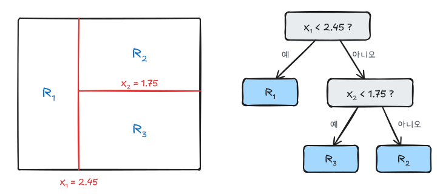
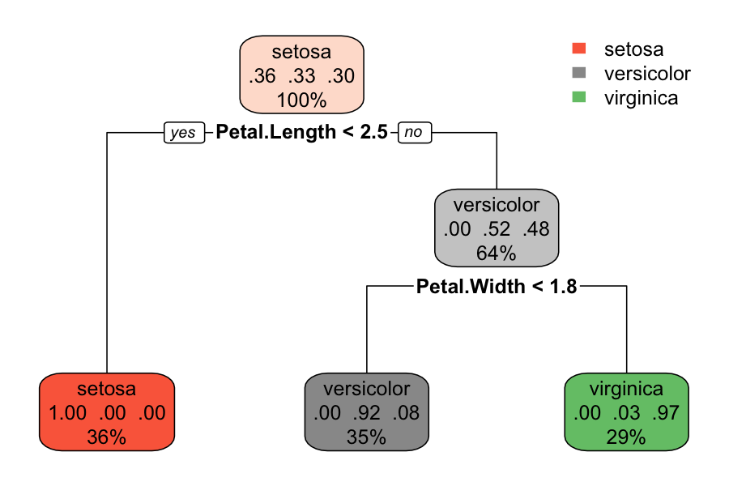
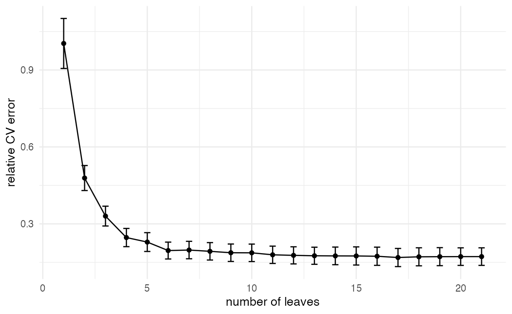
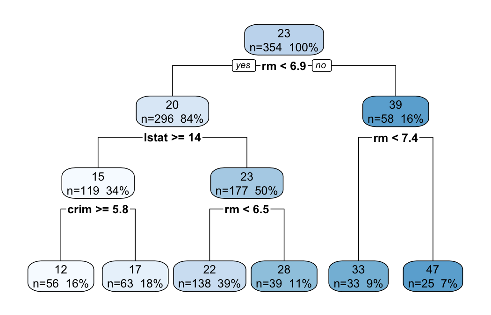

ISLR 8장과 이영미 교수님 데이터마이닝 강의의 의사결정나무 부분을 정리했다. 트리는 설명 변수 공간을 직사각형 영역으로 나누고, 각 영역 안에서 단순한 예측값(평균 또는 최빈 범주)을 쓰는 방법이다.

## 분할과 나무 구조



왼쪽의 영역 분할과 오른쪽의 나무는 같은 모델이다. 위에서부터 조건을 따라 내려가 도착한 단말 노드(잎)가 그 관측값의 영역이다. 영역 $R_1, \dots, R_J$가 정해지면 예측은 다음과 같다.

- 회귀나무: 영역 안 관측값의 평균 $\hat y_{R_j}$
- 분류나무: 영역 안에서 가장 많은 범주

## 재귀적 이진 분할

가능한 모든 분할을 비교해 최적의 나무를 찾는 것은 계산이 불가능하다. 그래서 **위에서 아래로, 탐욕적으로** 나눈다.

1. 모든 변수 $X_j$와 모든 분할점 $s$에 대해 $\{X_j < s\}$, $\{X_j \ge s\}$로 나눴을 때의 오차를 계산한다.
2. 오차를 가장 많이 줄이는 $(j, s)$로 나눈다.
3. 나뉜 각 영역에서 같은 과정을 반복한다. 노드의 관측값 수가 일정 수 미만이 되면 멈춘다.

탐욕적이라는 것은 지금 단계에서 가장 좋은 분할을 고를 뿐, 이후 단계까지 고려하지 않는다는 뜻이다.

### 회귀나무의 기준

$$
RSS = \sum_{j=1}^{J} \sum_{i \in R_j} (y_i - \hat y_{R_j})^2
$$

### 분류나무의 기준

$\hat p_{mk}$를 노드 $m$에서 범주 $k$의 비율이라 하자.

| 기준 | 식 | 특징 |
|---|---|---|
| 오분류율 | $1 - \max_k \hat p_{mk}$ | 분할의 차이에 둔감해 성장 기준으로는 잘 안 쓴다 |
| 지니 지수 | $\sum_k \hat p_{mk}(1 - \hat p_{mk})$ | 노드가 순수할수록 0에 가깝다 |
| 엔트로피 | $-\sum_k \hat p_{mk} \log \hat p_{mk}$ | 지니와 거의 같은 동작 |

두 범주에서 $\hat p = 0.5$이면 지니 지수는 $2 \times 0.5 \times 0.5 = 0.5$로 최대, $\hat p = 0$ 또는 $1$이면 0이다. 성장에는 지니나 엔트로피를 쓰고, 가지치기 후 성능 평가에는 오분류율을 주로 쓴다.

## 비용복잡도 가지치기

나무를 끝까지 키우면 학습 데이터에 과적합된다. 그렇다고 RSS 감소가 작을 때 일찍 멈추면, 당장은 효과가 없지만 다음 단계에서 큰 감소를 만드는 분할을 놓칠 수 있다. 그래서 크게 키운 뒤 잘라낸다.

$$
\sum_{m=1}^{|T|} \sum_{i \in R_m} (y_i - \hat y_{R_m})^2 + \alpha |T|
$$

$|T|$는 단말 노드 수, $\alpha \ge 0$는 크기에 대한 벌점이다. $\alpha = 0$이면 가장 큰 나무, $\alpha$가 커질수록 작은 나무가 선택된다. $\alpha$는 교차검증으로 정한다. `rpart`의 `cp`는 이 $\alpha$를 루트 노드의 오차로 나눈 상대적인 값이다.

## 분류나무 실습: iris

```r
library(tidyverse)
theme_set(theme_minimal(base_size = 12))
library(rpart)
library(rpart.plot)

set.seed(1000)
train_id <- sample(nrow(iris), 0.7 * nrow(iris))
train <- iris[train_id, ]
test  <- iris[-train_id, ]

cart_iris <- rpart(Species ~ ., data = train, method = "class")
cart_iris
```

```r base w=6 h=4
rpart.plot(cart_iris, type = 2, extra = 104)
```



`extra = 104`는 노드마다 범주별 비율과 전체 중 비중을 표시한다. 꽃잎 길이로 setosa를 먼저 떼어 내고, 꽃잎 너비로 나머지 둘을 나눈다.

```r
pred <- predict(cart_iris, test, type = "class")
table(predicted = pred, actual = test$Species)
mean(pred == test$Species)
```

## 회귀나무와 가지치기: Boston

```r
library(ISLR2)

set.seed(1)
idx <- sample(nrow(Boston), 0.7 * nrow(Boston))
b_train <- Boston[idx, ]
b_test  <- Boston[-idx, ]

big_tree <- rpart(medv ~ ., data = b_train, method = "anova",
                  control = rpart.control(cp = 0.001))
printcp(big_tree)
```

`cp = 0.001`로 일부러 크게 키운다. `printcp`의 `xerror`는 10겹 교차검증 오차(루트 대비 상대값), `xstd`는 그 표준오차다.

```r
as_tibble(big_tree$cptable) |>
  ggplot(aes(nsplit + 1, xerror)) +
  geom_line() + geom_point() +
  geom_errorbar(aes(ymin = xerror - xstd, ymax = xerror + xstd), width = 0.3) +
  labs(x = "number of leaves", y = "relative CV error")
```



어느 정도 이상에서는 노드를 늘려도 교차검증 오차가 거의 줄지 않는다. 최소 `xerror`를 고르거나, 그보다 단순하게 **1-SE 규칙**(최소 `xerror` + 1 표준오차 안에서 가장 작은 나무)을 쓴다.

```r
cpt <- big_tree$cptable
best <- which.min(cpt[, "xerror"])
one_se <- min(which(cpt[, "xerror"] <= cpt[best, "xerror"] + cpt[best, "xstd"]))

pruned <- prune(big_tree, cp = cpt[one_se, "CP"])

mse <- function(fit) mean((b_test$medv - predict(fit, b_test))^2)
c(big = mse(big_tree), pruned = mse(pruned), leaves = sum(pruned$frame$var == "<leaf>"))
```

```r base w=7 h=4.5
rpart.plot(pruned, type = 2, extra = 101)
```



가지치기한 나무는 노드 수가 훨씬 적은데도 테스트 MSE가 비슷하거나 더 작다. 나무를 보면 `rm`(방 수)과 `lstat`이 주요 분할 변수다.

## 장단점

| 장점 | 단점 |
|---|---|
| 그림으로 설명하기 쉽다 | 단일 나무의 예측 정확도는 낮은 편 |
| 질적 변수를 가변수 없이 처리 | 데이터가 조금 바뀌어도 구조가 크게 바뀐다(분산 큼) |
| 스케일링 불필요, 상호작용 자동 반영 | 축에 평행한 경계만 만든다 |

분산이 크다는 단점은 여러 나무를 평균내는 [앙상블](/posts/dm-ensemble)로 보완한다.
