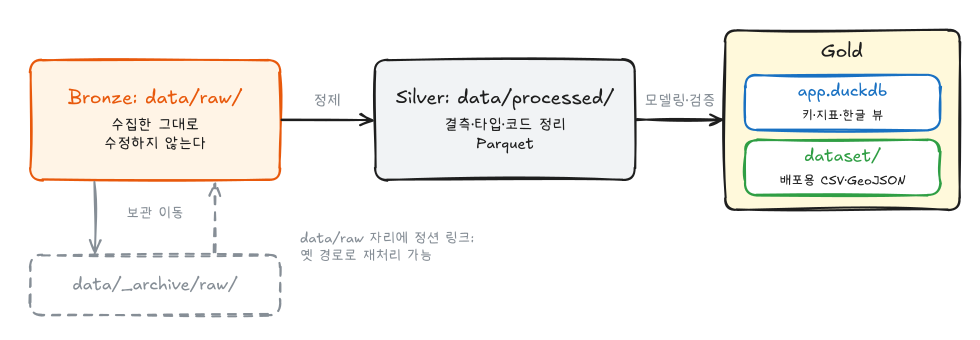
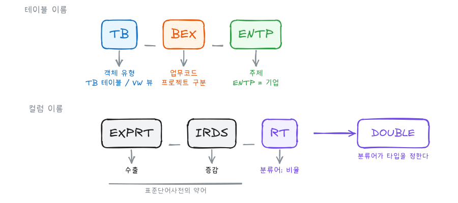
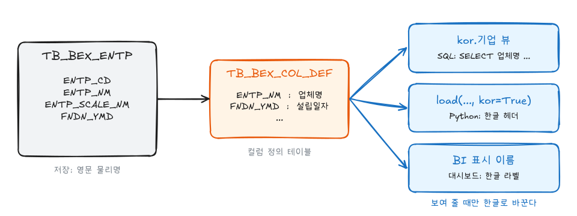

프로젝트가 길어지면 데이터 폴더에는 `final_v2.csv`, `company_list_new.csv` 같은 파일이 쌓이고, 컬럼 이름은 작업자마다 `corp_name`, `company_nm`, `ent_name`으로 갈린다. 이 글은 이런 혼란을 막는 세 가지를 정리한다. 데이터를 단계별로 나눠 두는 **저장소 구조**, 이름만 보고 뜻과 타입을 알 수 있게 하는 **명명 규칙**, 그리고 영문 이름 때문에 생기는 불편을 줄이는 **한글 표시 방법**이다. 예시는 기업의 수출 실적을 분석하는 가상의 프로젝트(업무코드 `BEX`)로 든다.

## 1. 저장소를 계층으로 나누기

데이터 폴더가 어지러워지는 가장 큰 이유는 손대지 않은 원본, 전처리 중간 산출물, 최종 데이터가 한곳에 섞이기 때문이다. 이를 단계별 계층으로 분리한다. Databricks 등에서 **메달리온(Medallion) 아키텍처**라는 이름으로 정리한 방식이다.



| 계층 | 폴더 | 성격 | 포맷 |
|---|---|---|---|
| Bronze | `data/raw/` | 수집한 그대로 보존. 재처리의 출발점 | 원본 CSV, JSON, API 응답 |
| Silver | `data/processed/` | 결측 정리, 타입 변환, 코드 매핑을 마친 데이터 | Parquet |
| Gold | `data/app.duckdb`, `data/dataset/` | 키 관계 정리, 지표 산출, 검증을 마친 배포본 | DuckDB, CSV, GeoJSON |

규칙은 하나다. **데이터는 왼쪽에서 오른쪽으로만 흐르고, 왼쪽 계층은 고치지 않는다.** 정제 규칙이 바뀌면 raw에서 다시 만든다. 그래야 결과가 어떻게 나왔는지 언제든 재현할 수 있다. Silver에 Parquet을 쓰는 이유는 [Parquet 글](/posts/parquet-compression-sorting)에서 다룬다.

### 원본은 지우지 말고 격리한다

DB를 다 만들었다고 raw를 지우면, 나중에 공급처 데이터의 오류가 발견되거나 새 컬럼이 필요할 때 파이프라인을 다시 돌릴 수 없다. 대신 `data/_archive/raw/`처럼 밑줄로 시작하는 보관 폴더로 옮겨 일상 작업 경로에서 치운다.

기존 스크립트가 `data/raw`를 참조한다면 옛 자리에 링크를 걸어 둔다. Windows에서는 디렉터리 정션을 쓰면 용량을 더 쓰지 않고 옛 경로가 그대로 동작한다. 정션은 관리자 권한 없이도 만들 수 있다.

```bat
mklink /J data\raw data\_archive\raw
```

macOS·Linux라면 `ln -s _archive/raw data/raw`가 같은 역할을 한다.

```
project_root/
├── data/
│   ├── app.duckdb          # 분석용 통합 DB
│   ├── dataset/            # 검증된 최종 CSV / GeoJSON
│   ├── docs/               # 테이블·컬럼 정의서
│   └── _archive/           # raw, processed 보관
└── src/                    # 수집·전처리·빌드 코드
```

## 2. 이름 짓기



### 테이블: `[유형]_[업무코드]_[주제]`

| 구성 요소 | 값 | 설명 |
|---|---|---|
| 객체 유형 | `TB_`, `VW_`, `MV_` | 물리 테이블, 뷰, 구체화된 뷰 |
| 업무코드 | `BEX` | 프로젝트를 구분하는 2~4자리 영문 약어 |
| 주제 | `ENTP`, `KSIC`, `HSK_EXIM` | 표준 단어 약어의 조합 |

접두어만 보고도 실제 데이터인지(`TB_`) 다른 테이블을 조합해 보여 주는 것인지(`VW_`) 알 수 있고, 업무코드 덕분에 여러 프로젝트의 테이블이 한 DB에 있어도 섞이지 않는다. 테이블은 역할에 따라 네 종류로 나눠 생각하면 설계가 쉬워진다.

| 종류 | 역할 | 예시 |
|---|---|---|
| 기준정보 (Dimension) | 다른 테이블이 참조하는 코드표. 행이 적고 거의 안 바뀐다 | `TB_BEX_STRTG_IND` 전략산업 코드, `TB_BEX_NATN` 국가 |
| 마스터 (Master) | 분석의 주인공이 되는 개체 | `TB_BEX_ENTP` 기업, `TB_BEX_ENTP_BZPL` 사업장 |
| 실적 (Fact) | 대용량 시계열·거래 데이터 | `TB_BEX_FNST_DTL` 결산별 재무상세, `TB_BEX_HSK_NATN_EXIM` 월별 국가별 수출입 |
| 분석 결과 | 모형·평가 산출물 | `TB_BEX_ENTP_CPBL_EVL` 기업 수출역량 평가 |

### 컬럼: 표준 약어 + 분류어

컬럼 이름이 제각각이 되는 것을 막으려면 두 가지를 정해 둔다. 하나는 단어 약어를 모은 **표준단어사전**(기업 → `ENTP`, 수출 → `EXPRT`)이고, 다른 하나는 이름 끝에 붙는 **분류어**다. 분류어는 그 컬럼이 어떤 종류의 값인지 알려 주므로 타입도 따라서 정해진다.

| 분류어 | 의미 | 타입 | 예시 |
|---|---|---|---|
| `_CD` | 코드 | VARCHAR | `STRTG_IND_CD` 전략산업코드, `NATN_CD` |
| `_NM` | 명칭 | VARCHAR | `ENTP_NM` 기업명, `BZPL_NM` 사업장명 |
| `_NO` | 식별번호 | VARCHAR | `BRNO` 사업자등록번호, `CRNO` 법인등록번호 |
| `_AMT` | 금액 | BIGINT / DOUBLE | `EXPRT_AMT` 수출금액, `SLS_AMT` 매출액 |
| `_CNT` | 수량·건수 | INTEGER / BIGINT | `EMP_CNT` 직원수 |
| `_RT` | 비율 | DOUBLE | `EXPRT_IRDS_RT` 수출증감률, `DEBT_RT` 부채비율 |
| `_YM` | 년월 | VARCHAR(6) | `CRTR_YM` 기준년월 `'202606'` |
| `_YMD` | 일자 | DATE / VARCHAR(8) | `FNDN_YMD` 설립일자 |
| `_YN` | 여부 | VARCHAR(1) | `CLSBIZ_YN` 폐업여부 `'Y'`/`'N'` |
| `_SN` | 일련번호 | INTEGER | `BZPL_SN` 사업장순번 |

> **주의** 코드와 번호는 숫자처럼 보여도 문자열로 둔다. 산업분류코드 `01`이나 사업자번호의 앞자리 `0`이 숫자 변환에서 사라지면 조인이 오류 없이 조용히 어긋난다.

`BRNO`처럼 관용적으로 굳은 약어는 분류어 규칙의 예외로 둔다. 규칙을 어긴 이름과 비교하면 차이가 분명하다.

| 나쁜 예 | 문제 | 표준 예 |
|---|---|---|
| `final_company_list_v2` | 버전과 상태가 이름에 섞임 | `TB_BEX_ENTP` |
| `code`, `name` | 어느 테이블의 무엇인지 모름, 조인 때 이름이 겹침 | `HSK_CD`, `HSK_NM` |
| `money`, `export_val` | 단위와 종류가 불분명 | `EXPRT_AMT` |
| `is_closed` (True/False) | 도구마다 참·거짓 표기가 다름 | `CLSBIZ_YN` (`'Y'`/`'N'`) |
| `date` (`'2026.06.30'`) | SQL 예약어, 형식 불명 | `STLM_YMD`, `CRTR_YM` |

## 3. 영문으로 저장하고 한글로 보기

영문 물리명은 인코딩 오류, 운영체제 간 호환, 예약어 충돌을 피하는 데 필요하지만, `ENTP_SCALE_NM`을 보고 바로 뜻을 알기는 어렵다. 해법은 **저장은 영문으로 하고, 사람이 볼 때만 한글로 바꾸는 것**이다. 이때 영문과 한글의 대응을 여러 곳에 따로 적어 두면 금방 어긋나므로, DB 안의 컬럼 정의 테이블 하나에서 모든 한글 표시가 나오게 한다.



### 컬럼 정의 테이블

정의서를 엑셀로만 두지 않고 DB 안에 테이블로 넣는다. 모르는 컬럼이 나오면 쿼리 한 줄로 확인할 수 있다.

```sql
SELECT COL_NM, COL_KOR_NM, DATA_TYPE_NM, UNIT_NM, COL_DC
FROM main.TB_BEX_COL_DEF
WHERE TBL_NM = 'TB_BEX_ENTP_CPBL_EVL';
```

### SQL: 한글 뷰 스키마

물리 테이블 위에 한글 별칭을 붙인 뷰를 별도 스키마(`kor`)에 만든다. DB를 빌드할 때 정의 테이블을 읽어 자동으로 생성하면 관리 부담이 없다.

```sql
CREATE SCHEMA IF NOT EXISTS kor;

CREATE OR REPLACE VIEW kor.기업 AS
SELECT
    ENTP_CD       AS "업체코드",
    ENTP_NM       AS "업체명",
    ENTP_SCALE_NM AS "기업규모명",
    FNDN_YMD      AS "설립일자"
FROM main.TB_BEX_ENTP;

SELECT 업체명, 설립일자
FROM kor.기업
WHERE 기업규모명 = '중소기업';
```

뷰는 데이터를 복사하지 않으므로 용량이 늘지 않고, 원본 테이블이 갱신되면 그대로 따라간다.

### Python: 로딩 헬퍼

데이터를 불러오는 함수 하나를 두고, 옵션에 따라 정의 테이블을 보고 헤더를 바꾼다.

```python
import duckdb

def load(table, kor=False, db="data/app.duckdb"):
    with duckdb.connect(db, read_only=True) as con:
        df = con.execute(f"SELECT * FROM main.{table}").df()
        if kor:
            mapping = dict(con.execute(
                "SELECT COL_NM, COL_KOR_NM FROM main.TB_BEX_COL_DEF WHERE TBL_NM = ?",
                [table],
            ).fetchall())
            df = df.rename(columns=mapping)
    return df
```

### BI 도구: 표시 이름

Power BI나 Tableau에서는 컬럼마다 표시 이름(Display Name)을 한글로 지정한다. 내부 처리는 영문 컬럼으로 하고 화면에는 한글만 보인다.

### 단계별로 어느 이름을 쓸까

| 작업 | 이름 | 이유 |
|---|---|---|
| 파이프라인 개발 | 영문 물리명 | 인코딩 오류 방지, 자동화 스크립트 안정성 |
| 탐색적 분석, 시각화 | 한글 뷰·한글 컬럼 | 뜻을 바로 알 수 있고 축 라벨·범례에 그대로 들어간다 |
| 머신러닝 피처 | 영문 물리명 | 일부 라이브러리는 컬럼 이름의 한글·특수문자·공백에서 오류가 난다 |

## 4. 배포 파일에서 자주 걸리는 문제

### 엑셀에서 한글 CSV가 깨질 때

UTF-8로 저장한 CSV를 한국어 엑셀에서 더블클릭해 열면 한글이 깨진다. 엑셀이 BOM(Byte Order Mark) 없는 파일을 CP949로 해석하기 때문이다. BOM은 파일 맨 앞의 3바이트 `EF BB BF`로, 이 파일이 UTF-8이라고 알려 주는 표시다. 반대로 BOM을 모르는 도구에서 BOM 있는 파일을 열면 첫 컬럼 이름 앞에 ``가 붙어 보인다.

| 용도 | 인코딩 | 저장 |
|---|---|---|
| 엑셀로 열 배포용 CSV | BOM 포함 UTF-8 | Python `encoding="utf-8-sig"`, R `readr::write_excel_csv()` / `data.table::fwrite(..., bom = TRUE)` (Base R `fileEncoding = "UTF-8-BOM"`은 읽기 전용) |
| 웹·API용 JSON, GeoJSON | BOM 없는 UTF-8 | `encoding="utf-8"` |

### 엑셀로 열 수 없는 데이터

| 한계 | 값 | 대응 |
|---|---|---|
| 시트 행 수 | 1,048,576행 | 넘는 부분은 잘린다. 대용량 실적 테이블은 DuckDB나 파이썬으로 분석한다 |
| 셀 글자 수 | 32,767자 | 행정구역 경계 같은 다각형 좌표는 WKT 문자열 하나가 이를 쉽게 넘는다. 공간 데이터는 CSV에 넣지 않고 GeoJSON(RFC 7946, WGS84 경위도)으로 따로 둔다 |

## 정리

- 데이터는 raw → processed → DB·dataset으로 한 방향으로만 흐르고, 원본은 지우지 않고 보관 폴더로 옮긴다.
- 테이블은 `TB_` + 업무코드 + 주제, 컬럼은 표준 약어 + 분류어로 짓는다. 분류어가 타입을 정하고, 코드·번호는 문자열이다.
- 영문과 한글의 대응은 컬럼 정의 테이블 한 곳에 두고, 한글 뷰·로딩 헬퍼·BI 표시 이름이 모두 그것을 읽게 한다.
- 엑셀용 CSV는 BOM을 붙이고, 백만 행이 넘거나 공간 좌표가 든 데이터는 엑셀 밖에서 다룬다.
