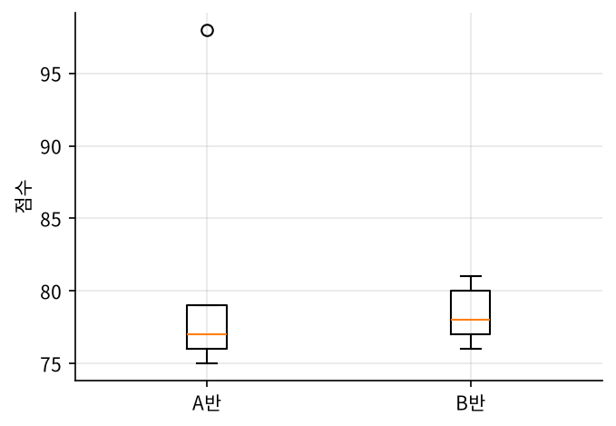
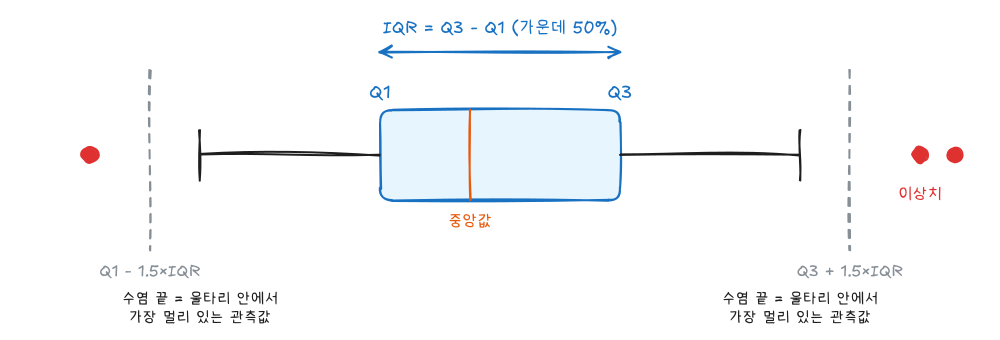
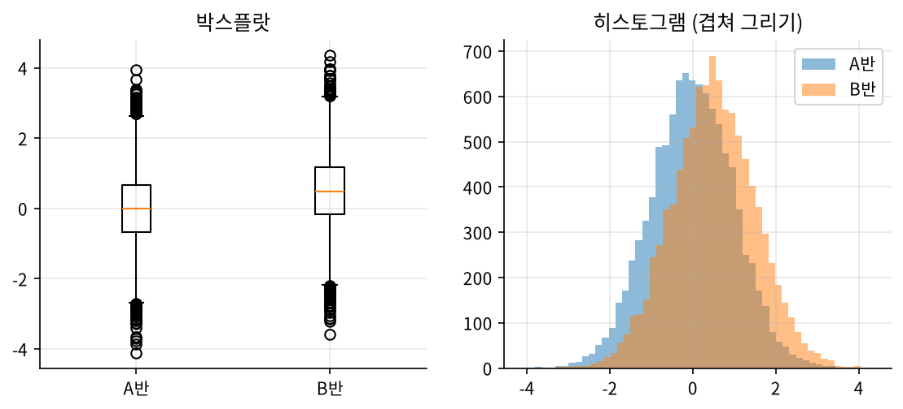
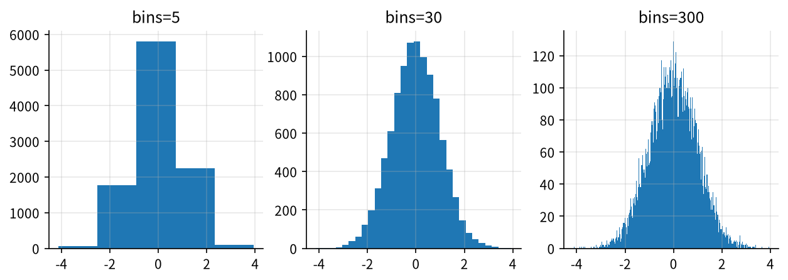
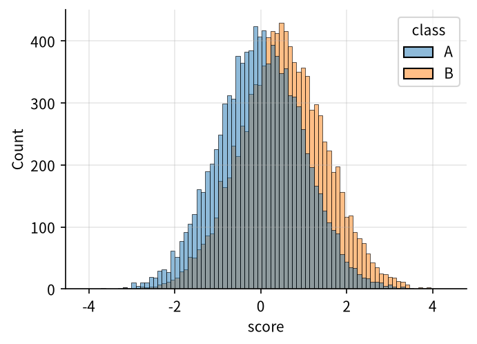
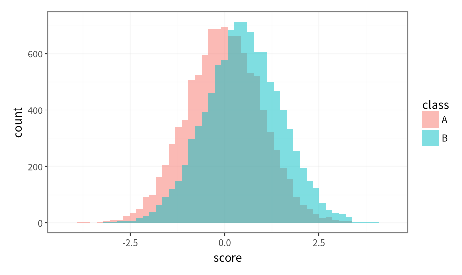

데이터 시각화의 첫 질문은 "숫자 하나로 요약해도 되는가"이다. 평균은 가장 흔한 요약값이지만, 분포의 모양에 따라 좋은 요약이 되기도 하고 오해를 만들기도 한다. 이 글은 분포를 직접 보는 두 도구인 박스플랏과 히스토그램을 정리한다.

```python
import numpy as np
import pandas as pd
import matplotlib.pyplot as plt
```

## 1. 평균은 괜찮은 측정값인가

전북고에서 두 선생님이 통계학을 가르친다. A반 10명과 B반 10명의 점수는 다음과 같다.

```python
y1 = [75, 75, 76, 76, 77, 77, 79, 79, 79, 98]  # A반
y2 = [76, 76, 77, 77, 78, 78, 80, 80, 80, 81]  # B반
np.mean(y1), np.mean(y2)
```

```
(79.1, 78.3)
```

평균만 보면 A반이 0.8점 높으니 "A반 학생들의 실력이 평균적으로 좋다"고 결론 내기 쉽다. 그런데 A반의 평균은 98점을 받은 학생 한 명이 끌어올린 값이다. 나머지 9명은 75~79점으로 B반 학생들보다 대체로 낮다. 중앙값으로 비교하면 A반 77점, B반 78점으로 순서가 뒤집힌다.

평균이나 중앙값처럼 분포의 중심을 나타내는 값을 **중심경향값**(measure of central tendency)이라 한다. 어떤 중심경향값이 적절한지는 분포의 모양에 달려 있으므로, 요약하기 전에 **분포를 먼저 본다.**

## 2. 박스플랏

```python
plt.boxplot([y1, y2])
```



A반 상자 위의 동떨어진 점이 98점이다. 상자 안의 선은 평균이 아니라 **중앙값**이다. 그림 한 장으로 "A반은 한 명을 빼면 B반보다 낮다"가 바로 보인다.

박스플랏은 다섯 개의 위치로 분포를 요약한다.



| 요소 | 뜻 |
|---|---|
| 상자 | 1사분위수 $Q_1$(25%)에서 3사분위수 $Q_3$(75%)까지. 자료의 가운데 50% |
| 상자 안의 선 | 중앙값(50%) |
| IQR | 사분위범위 $Q_3 - Q_1$. 퍼짐의 정도 |
| 울타리 | $Q_1 - 1.5\,\mathrm{IQR}$, $Q_3 + 1.5\,\mathrm{IQR}$ |
| 수염 | 울타리 안에 있는 관측값 중 가장 멀리 있는 값까지 |
| 점 | 울타리 밖의 관측값(이상치 후보) |

A반은 $Q_1 = 76$, $Q_3 = 79$, $\mathrm{IQR} = 3$이므로 울타리는 71.5와 83.5이다. 98점은 83.5 밖이라 점으로 찍히고, 위쪽 수염은 울타리 안에서 가장 큰 79점에서 끝난다.

> **주의** 수염의 끝은 울타리($Q_3 + 1.5\,\mathrm{IQR}$) 자체가 아니라 **울타리 안의 실제 관측값**이다. 그래서 위아래 수염의 길이가 다를 수 있다. 1.5라는 배수는 관례이고, `plt.boxplot(whis=...)`로 바꿀 수 있다.

## 3. 히스토그램

**히스토그램**은 $x$축에 변수의 구간을, $y$축에 그 구간에 들어간 관측값의 수를 그린 그림이다. 박스플랏이 다섯 숫자로 요약한다면 히스토그램은 분포의 모양 자체를 보여준다.

이번에는 평균이 좋은 요약이 되는 경우를 보자. 두 반의 점수가 모양이 같은 정규분포에서 나오고 위치만 다르다고 하자.

```python
np.random.seed(43052)
y1 = np.random.normal(loc=0, scale=1, size=10000)    # A반
y2 = np.random.normal(loc=0.5, scale=1, size=10000)  # B반
(np.mean(y2) - np.mean(y1)).round(3)
```

```
0.51
```

```python
fig, axs = plt.subplots(1, 2, figsize=(9, 3.5))
axs[0].boxplot([y1, y2])
axs[1].hist(y1, bins=50, alpha=0.5, label='A반')
axs[1].hist(y2, bins=50, alpha=0.5, label='B반')
axs[1].legend()
```



두 분포의 모양은 거의 같고, B반은 A반을 오른쪽으로 옮겨 놓은 것처럼 보인다. 이런 상황에서는 "B반 점수 ≈ A반 점수 + 0.51"이라고 요약해도 무리가 없다. 즉 **분포의 모양이 같고 위치만 다를 때** 평균의 차이는 좋은 비교값이 된다. 1절의 자료는 이 조건을 깨는 예였다.

박스플랏에서 위아래로 점이 많이 찍힌 것은 자료가 1만 개라서이다. 정규분포에서도 이론적으로 약 0.7%가 1.5 IQR 울타리 밖으로 나가고, 이 표본의 A반에서는 87개가 점으로 찍혔다. 점이 많다고 해서 이상한 자료라는 뜻은 아니다.

`alpha`는 투명도다. 히스토그램 두 개를 겹칠 때 투명도를 주지 않으면 뒤의 막대가 가려진다.

### 구간의 수

히스토그램은 구간의 수(`bins`)에 따라 인상이 달라진다.

```python
fig, axs = plt.subplots(1, 3, figsize=(10, 3))
for ax, k in zip(axs, [5, 30, 300]):
    ax.hist(y1, bins=k)
    ax.set_title(f'bins={k}')
```



구간이 너무 적으면 모양이 뭉개지고, 너무 많으면 막대마다 표본이 적어 들쭉날쭉해진다. 자료의 수에 맞게 몇 가지 값을 시도해 본다.

## 4. 같은 그림, 다른 패키지

파이썬에는 시각화 패키지가 여럿 있다. 같은 겹친 히스토그램을 세 가지로 그려 본다. seaborn과 plotnine은 자료를 "점수 열과 반 열"이 있는 데이터프레임 하나로 받는다.

```python
df = pd.concat([pd.DataFrame({'score': y1, 'class': 'A'}),
                pd.DataFrame({'score': y2, 'class': 'B'})], ignore_index=True)
```

**seaborn**은 matplotlib 위에 만든 패키지로, `hue`에 열 이름을 주면 그룹별로 색을 나눈다.

```python
import seaborn as sns
sns.histplot(df, x='score', hue='class')
```



**plotnine**은 R의 ggplot2 문법을 파이썬으로 옮긴 패키지다. 문법은 [7편](/posts/dv-07-grammar-of-graphics)에서 자세히 다룬다.

```python
from plotnine import *
ggplot(df) + geom_histogram(aes(x='score', fill='class'), position='identity', alpha=0.5, bins=50)
```



**plotly**는 마우스로 확대하거나 값을 확인할 수 있는 인터랙티브 그림을 만든다.

```python
import plotly.express as px
px.histogram(df, x='score', color='class', barmode='overlay', opacity=0.5, nbins=80)
```

<iframe src="/charts/dv/dv01-hist.html" width="100%" height="400px" frameborder="0" scrolling="no"></iframe>

| 패키지 | 특징 | 언제 쓰는가 |
|---|---|---|
| matplotlib | 가장 기본. 세밀한 조정이 가능하지만 코드가 길어지기 쉽다 | 모든 그림의 바탕, 논문용 그림 |
| seaborn | matplotlib 위에서 통계 그래프를 짧게 | 그룹별 분포, 밀도곡선 |
| plotnine | ggplot2 문법. 변수와 그림 요소를 대응시켜 쌓는다 | 변수가 많은 탐색 |
| plotly | 인터랙티브 | 웹 게시, 값 확인이 필요한 탐색 |

## 5. 비교

| | 박스플랏 | 히스토그램 |
|---|---|---|
| 보여주는 것 | 중앙값, 사분위수, 이상치 | 분포의 모양(봉우리 수, 치우침) |
| 장점 | 여러 그룹을 나란히 비교하기 좋다 | 모양이 바로 보인다 |
| 약점 | 봉우리가 둘인 분포도 같은 상자로 보일 수 있다 | 구간 수에 따라 인상이 바뀐다. 그룹이 많으면 겹쳐 보기 어렵다 |
| 필요한 변수 | 하나(그룹별로 나란히) | 하나 |

## 정리

- 평균은 분포의 모양이 같고 위치만 다를 때 좋은 비교값이다. 이상치가 있거나 모양이 다르면 분포를 먼저 본다.
- 박스플랏: 상자는 $Q_1$~$Q_3$, 선은 중앙값, 수염은 울타리($\pm 1.5\,\mathrm{IQR}$) 안의 가장 먼 관측값까지.
- 히스토그램은 구간의 수에 민감하다. 겹쳐 그릴 때는 `alpha`로 투명도를 준다.
- 다음 글은 이미지 자료에 히스토그램을 적용해 명암을 고치는 방법을 다룬다.

## 참고자료

- 최규빈, 「데이터시각화」 강의노트 1주차 (전북대학교, 2021)
- [Central tendency (Wikipedia)](https://en.wikipedia.org/wiki/Central_tendency)
