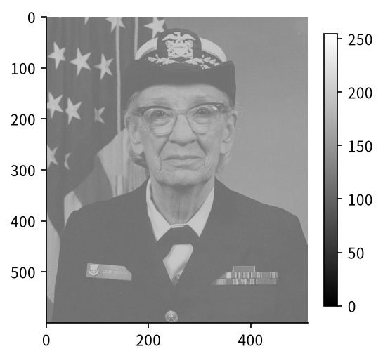
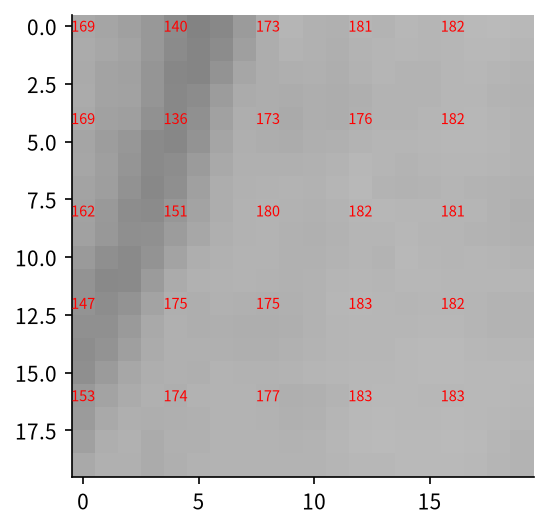
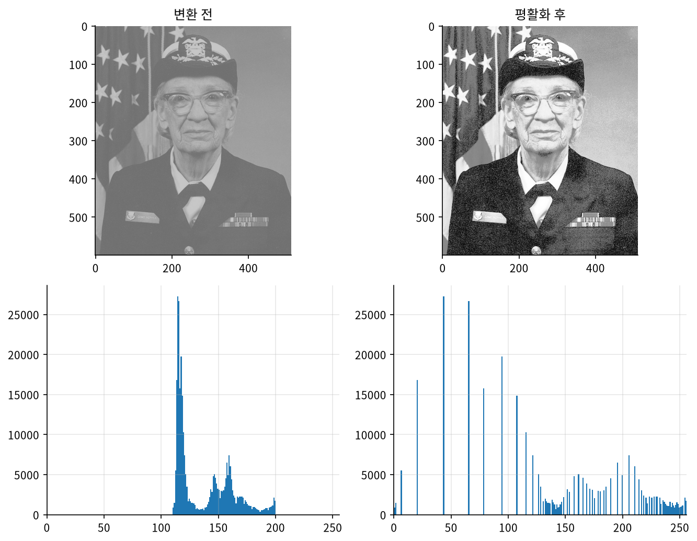
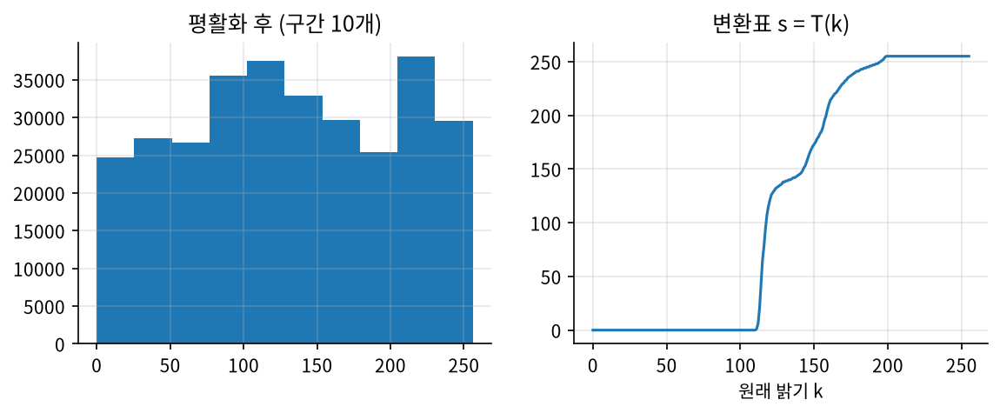
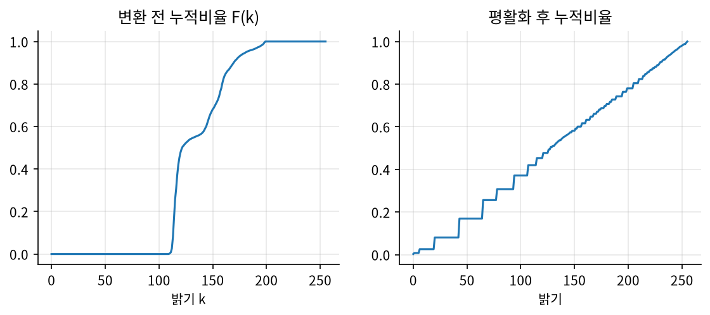
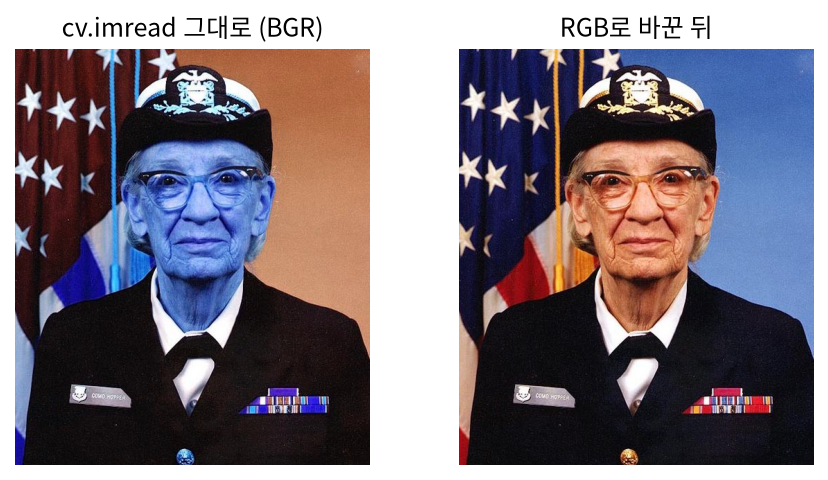
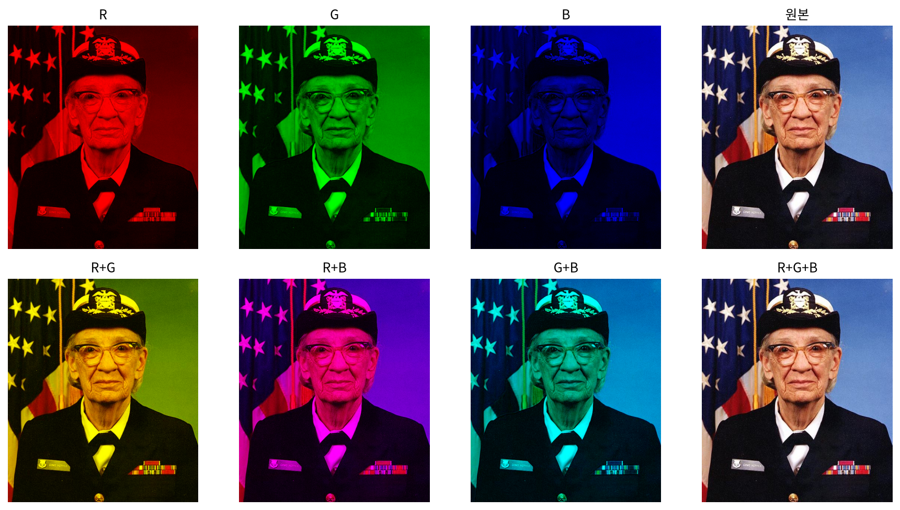

[앞 글](/posts/dv-01-boxplot-histogram)에서 히스토그램은 변수 하나의 분포를 보여주는 그림이었다. 이미지도 숫자의 모임이므로 히스토그램을 그릴 수 있다. 이 글은 이미지가 어떤 자료인지 확인하고, 히스토그램을 변형해 흐릿한 사진의 명암대비를 높이는 **히스토그램 평활화**(histogram equalization, HE)를 정리한다.

예제 사진은 matplotlib에 들어 있는 표본 사진(Grace Hopper, 퍼블릭 도메인)이다. 명암대비가 낮은 사진을 만들기 위해 밝기를 일부러 좁은 범위로 눌렀다.

```python
import numpy as np
import cv2 as cv
import matplotlib.pyplot as plt
import matplotlib.cbook as cbook

path = cbook.get_sample_data('grace_hopper.jpg', asfileobj=False)
gray = cv.imread(path, 0)                         # 0: 흑백으로 읽기
low = (gray * 0.35 + 110).astype(np.uint8)        # 밝기를 110~199로 압축
```

## 1. 이미지는 행렬이다

```python
plt.imshow(low, cmap='gray', vmin=0, vmax=255)
plt.colorbar()
```



화면에는 사진이 보이지만 `low`는 넘파이 행렬일 뿐이다.

```python
low.shape, low.dtype
low[200:203, 250:253]
```

```
((600, 512), dtype('uint8'))
array([[169, 165, 160],
       [171, 167, 163],
       [170, 164, 161]], dtype=uint8)
```

세로 600 × 가로 512개의 숫자가 있고, 각 숫자는 0(검정)에서 255(흰색) 사이의 밝기다. `imshow`는 이 숫자들을 값이 클수록 밝게 칠한 것이다. 일부를 확대해 숫자를 함께 적으면 이 관계가 보인다.



| | 흑백 이미지 | 컬러 이미지 |
|---|---|---|
| 차원 | 세로 × 가로 | 세로 × 가로 × 3 |
| 값 | 0~255, 클수록 밝음 | 채널마다 0~255, 클수록 그 색이 진함 |
| 자료형 | `uint8` (부호 없는 8비트 정수) | `uint8` |

## 2. 히스토그램 평활화

행렬을 벡터로 펴서(`flatten`) 히스토그램을 그리면 밝기의 분포가 보인다.

```python
plt.hist(low.flatten(), 256, [0, 256])
```

컴퓨터는 0~255의 256단계를 표현할 수 있는데, 이 사진은 110~199의 90단계만 쓰고 그나마 절반 이상(54%)이 110~130에 몰려 있다. 그래서 사진 전체가 회색으로 뿌옇다. **히스토그램을 0~255 전체로 고르게 펴면** 명암대비가 커질 것이다. OpenCV에는 이 기능이 있다.

```python
eq = cv.equalizeHist(low)
```



평활화 후에는 별, 모자의 장식, 옷의 질감이 또렷해졌다. 히스토그램도 0~255 전체로 퍼졌다.

### 원리: 누적비율로 바꾸기

평활화는 각 밝기 $k$를 **그 밝기 이하인 픽셀의 비율**로 바꾸는 변환이다. 픽셀 수를 $N$, 밝기가 $k$ 이하인 픽셀 수를 $\mathrm{cdf}(k)$라 하면

$$
T(k) = \mathrm{round}\left( \frac{\mathrm{cdf}(k) - \mathrm{cdf}_{\min}}{N - \mathrm{cdf}_{\min}} \times 255 \right)
$$

이다. $\mathrm{cdf}_{\min}$은 0이 아닌 가장 작은 누적값으로, 가장 어두운 밝기가 0으로 가도록 맞추는 항이다.

왜 평평해지는가? 연속형 확률변수 $X$의 누적분포함수 $F$에 대해 $F(X)$는 균등분포 $\mathcal U(0,1)$를 따른다. 평활화는 밝기를 자기 누적분포함수에 넣은 것이므로 결과가 균등분포에 가까워진다. 픽셀이 많이 몰린 구간은 누적비율이 가파르게 오르므로 넓게 벌어지고, 픽셀이 적은 구간은 좁게 모인다.

직접 구현해 OpenCV 결과와 비교한다.

```python
h = np.bincount(low.ravel(), minlength=256)    # 밝기별 픽셀 수
cdf = h.cumsum()
cmin = cdf[cdf > 0].min()
lut = np.round((cdf - cmin) / (low.size - cmin) * 255).clip(0, 255).astype(np.uint8)
manual = lut[low]                              # 변환표를 픽셀마다 적용
(manual == eq).mean()
```

```
1.0
```

모든 픽셀이 일치한다. 아래 왼쪽은 평활화 후 밝기를 10개 구간으로 센 히스토그램이고, 오른쪽은 변환표 $T(k)$다.



10개 구간으로 세면 구간마다 2만 5천~3만 8천 개로 고르다. 변환표는 픽셀이 몰린 110~130 근처에서 가파르게 올라간다.

> **주의** 평활화는 새로운 밝기 단계를 만들지 않는다. 원래 90단계였던 밝기가 79단계로 오히려 줄었다(같은 값으로 합쳐진 단계가 있다). 256단계 히스토그램을 보면 막대 사이가 듬성듬성 비어 있는 이유다. 평평해지는 것은 **누적비율**이고, 막대 하나하나의 높이가 같아지는 것은 아니다.



## 3. 컬러 이미지와 RGB 채널

컬러 이미지는 빨강(R), 초록(G), 파랑(B) 세 장의 흑백 행렬을 겹친 3차원 배열이다.

```python
bgr = cv.imread(path)
bgr.shape
```

```
(600, 512, 3)
```

> **주의** `cv.imread`는 채널을 **B, G, R 순서**로 읽는다. matplotlib의 `imshow`는 R, G, B 순서를 기대하므로 그대로 그리면 빨강과 파랑이 뒤바뀐다. `cv.cvtColor(img, cv.COLOR_BGR2RGB)`로 바꾸거나 `plt.imread`로 읽는다.



채널 하나만 남기고 나머지를 0으로 만들면 그 색 성분만 보인다.

```python
img = cv.cvtColor(bgr, cv.COLOR_BGR2RGB)
r, g, b = [np.zeros_like(img) for _ in range(3)]
r[:, :, 0] = img[:, :, 0]
g[:, :, 1] = img[:, :, 1]
b[:, :, 2] = img[:, :, 2]
plt.imshow(r + g)      # 빨강 + 초록
```



빨강과 초록을 더하면 노란 기운이, 초록과 파랑을 더하면 청록 기운이 돈다. 세 채널을 모두 더하면 원본과 정확히 같다(`(r + g + b == img).all()`이 `True`). 각 채널은 서로 다른 칸만 채우므로 `uint8` 덧셈에서 넘침이 생기지 않는다.

## 정리

- 흑백 이미지는 0~255 값의 (세로 × 가로) 행렬, 컬러 이미지는 (세로 × 가로 × 3) 배열이다.
- 히스토그램 평활화: $T(k) = \mathrm{round}\big((\mathrm{cdf}(k) - \mathrm{cdf}_{\min}) / (N - \mathrm{cdf}_{\min}) \times 255\big)$. 밝기를 누적비율로 바꿔 분포를 고르게 편다.
- 평활화 후 고르게 되는 것은 누적비율이다. 밝기 단계의 수는 늘지 않는다.
- OpenCV는 BGR 순서로 읽는다. matplotlib으로 그릴 때는 RGB로 바꾼다.

## 참고자료

- 최규빈, 「데이터시각화」 강의노트 2주차 (전북대학교, 2021)
- [Histogram equalization (Wikipedia)](https://en.wikipedia.org/wiki/Histogram_equalization)
