matplotlib은 그림 하나를 `plt.plot()` 한 줄로 그리게 해 주지만, 그림 여러 개를 나란히 놓거나 일부만 고치려면 그 뒤의 구조를 알아야 한다. 이 글은 matplotlib의 **Figure, Axes, Axis** 구조를 정리한다. 이후 글의 모든 서브플랏이 이 구조 위에서 그려진다.

```python
import numpy as np
import matplotlib.pyplot as plt
```

## 1. plt.plot: 산점도와 라인플랏

`plt.plot(x, y)`는 점들을 선으로 잇는다. 세 번째 인자로 **형식 문자열**을 주면 점의 모양, 선의 모양, 색을 한 번에 정한다.

```python
x = [1, 2, 3, 4]
y = [1, 2, 4, 3]
plt.plot(x, y)
plt.plot(x, y, 'o:r')   # 점 o, 점선 :, 빨강 r
```

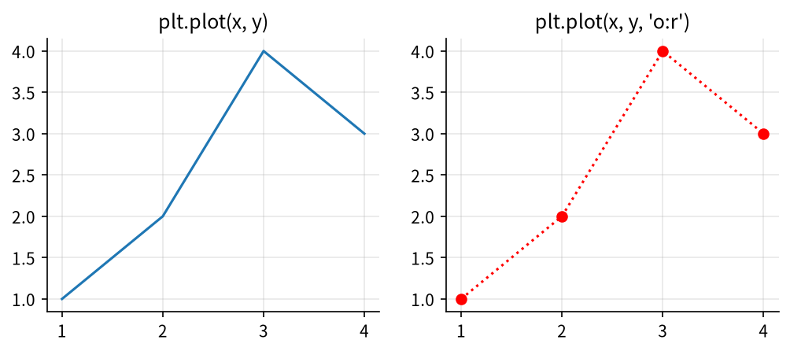

| 구분 | 기호 예 |
|---|---|
| 점(marker) | `o` 원, `.` 작은 점, `x` 엑스, `X` 굵은 엑스, `s` 사각형, `^` 삼각형 |
| 선(line) | `-` 실선, `--` 파선, `:` 점선, `-.` 일점쇄선, 생략하면 선 없음 |
| 색(color) | `r` `g` `b` `k`(검정) `m`(자홍) `c`(청록) `y` `w` |

선 기호를 빼고 점 기호만 쓰면(`'o'`) 산점도가 된다. 같은 함수로 산점도와 라인플랏을 모두 그릴 수 있다.

`plt.plot`을 여러 번 부르면 한 그림에 **겹쳐 그린다**. 자료와 참 직선을 함께 그리면 다음과 같다.

```python
np.random.seed(43052)
x = np.arange(-5, 5, 0.1)
y = 2 * x + np.random.normal(loc=0, scale=1, size=100)
plt.plot(x, y, '.b')
plt.plot(x, 2 * x, '--r')
```

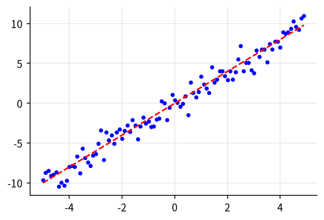

## 2. Figure ⊃ Axes ⊃ Axis

matplotlib의 그림은 세 겹의 객체로 되어 있다.

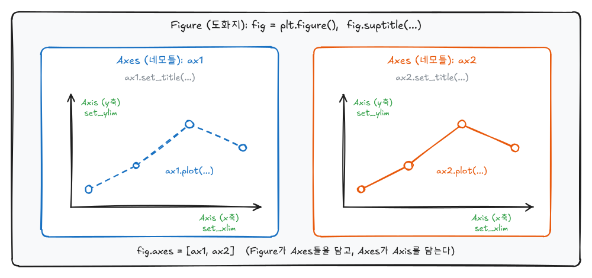

| 객체 | 비유 | 하는 일 |
|---|---|---|
| Figure | 도화지 | 그림 전체. 크기, 전체 제목(`suptitle`) |
| Axes | 도화지 위의 네모틀 | 실제로 그림이 그려지는 칸. `plot`, `set_title` |
| Axis | 네모틀의 x축, y축 | 눈금과 범위. `set_xlim`, `set_ylim` |

> **주의** Axes(액시즈)와 Axis(축)는 이름이 비슷하지만 다르다. Axes는 "그림 한 칸"이고 Axis는 그 칸의 축 하나다. 서브플랏 하나가 Axes 하나다.

`plt.plot()`은 "현재 Figure의 현재 Axes에 그려라"의 줄임말이다. 이것을 풀어서 쓰면 **도화지를 준비하고 → 네모틀을 붙이고 → 네모틀에 그린다.**

```python
fig = plt.figure()            # 도화지
fig.add_axes([0, 0, 1, 1])    # (0, 0) 위치에 가로세로 1인 네모틀
ax1 = fig.axes[0]             # Figure가 가진 Axes 목록에서 첫 번째
ax1.plot([1, 2, 3], 'or')     # 그 Axes에 그린다
```

`fig.add_axes([1, 0, 1, 1])`로 오른쪽에 네모틀을 하나 더 붙이면 서브플랏이 된다. 그린 뒤에도 각 Axes에 접근해 그림을 추가할 수 있다.

```python
fig.add_axes([1, 0, 1, 1])
ax2 = fig.axes[1]
ax2.plot([1, 2, 3], 'ok')
ax1.plot([1, 2, 3], '--')     # 첫 번째 칸에 파선 추가
```

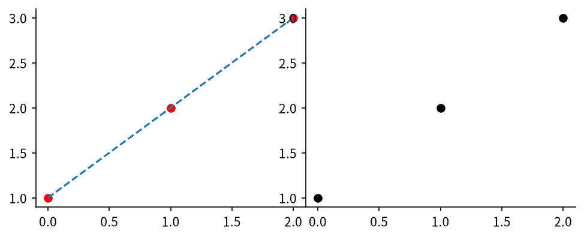

위치를 직접 정하면 칸이 붙어 눈금이 겹친다. 격자 모양으로 칸을 나누는 것은 `fig.subplots`가 알아서 한다.

```python
fig = plt.figure()
fig.subplots(1, 2)            # 1행 2열
ax1, ax2 = fig.axes
ax1.plot([1, 2, 3], 'or')
ax2.plot([1, 2, 3], 'ob')
fig.set_figwidth(10)          # 도화지를 가로로 늘림
```

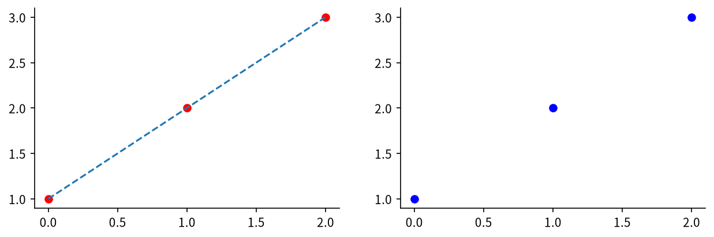

## 3. plt.subplots

실제로는 도화지와 네모틀을 한 번에 만드는 `plt.subplots`를 가장 많이 쓴다. 반환값은 `(Figure, Axes 배열)`이다.

```python
fig, axs = plt.subplots(2, 2)
axs.shape
```

```
(2, 2)
```

Axes 배열은 행렬 모양이므로 `axs[0, 1]`처럼 접근하거나 행렬 모양대로 풀어야 한다.

```python
ax1, ax2, ax3, ax4 = axs        # ValueError: not enough values to unpack (expected 4, got 2)
(ax1, ax2), (ax3, ax4) = axs    # 행렬 모양대로 풀면 된다
```

일렬로 다루고 싶으면 `fig.axes`(평평한 리스트)를 쓴다.

```python
fig, _ = plt.subplots(2, 2)
for ax, fmt, t in zip(fig.axes, ['o:r', 'Xb', 'xm', '.--k'], ['title1', 'title2', 'title3', 'title4']):
    ax.plot(x, y, fmt)
    ax.set_title(t)
```

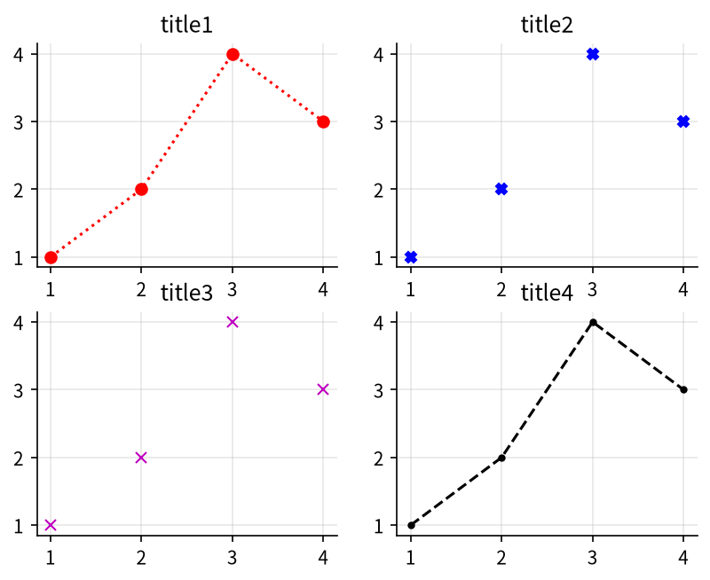

제목이 위 칸의 눈금과 겹친다. `fig.tight_layout()`이 칸 사이 간격을 다시 잡는다. 전체 제목은 `fig.suptitle`이다.

```python
fig.suptitle('sup title')
fig.tight_layout()
```

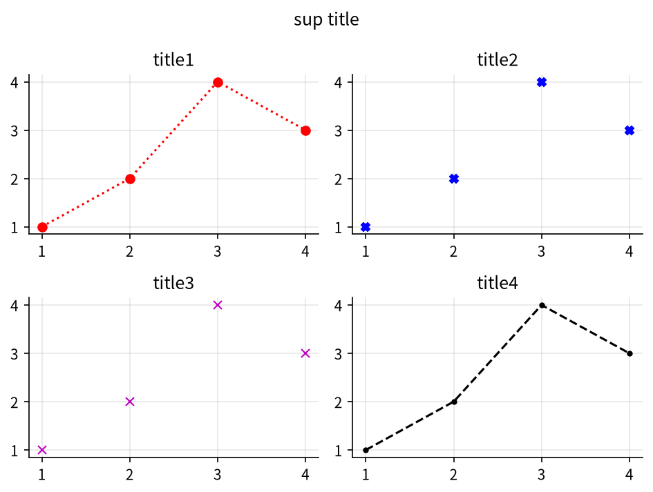

방법이 여럿이라 헷갈리지만 원리는 같다. **Figure가 Axes들을 갖고 있고, 그리는 일은 Axes가 한다.** `plt.subplots`의 반환값으로 받든, `fig.axes`에서 꺼내든 같은 Axes 객체다. 단계적으로 그림을 고칠 때는 `fig`를 변수로 받아 두고 `fig`를 출력해 현재 상태를 확인하면 편하다.

## 4. 제목과 축 범위: plt 방식과 Axes 방식

`plt.title`, `plt.xlim` 같은 함수는 "현재 Axes"에만 작용한다. 서브플랏의 특정 칸을 고칠 때는 Axes의 메서드를 쓴다. 이름에 `set_`이 붙는다.

```python
fig, axs = plt.subplots(1, 2, figsize=(8, 3))
axs[0].plot([1, 2, 3], [4, 5, 6], 'o')
axs[1].plot([1, 2, 3], [4, 5, 6], 'o')
axs[1].set_xlim(-1, 5)
axs[1].set_ylim(3, 7)
```

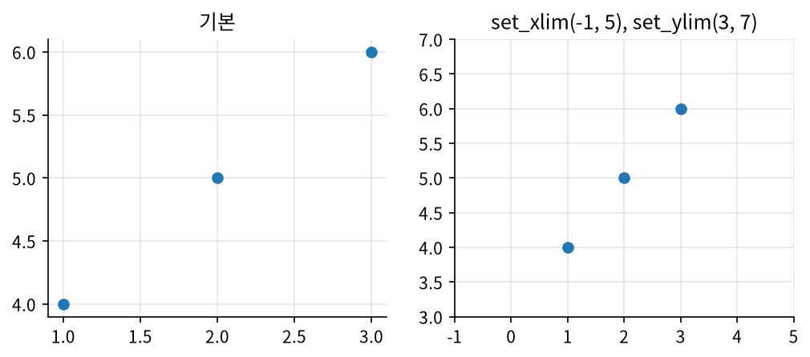

| 하는 일 | plt 방식 (현재 Axes) | Axes 방식 | Figure |
|---|---|---|---|
| 그리기 | `plt.plot` | `ax.plot` | |
| 제목 | `plt.title` | `ax.set_title` | `fig.suptitle` |
| 축 범위 | `plt.xlim`, `plt.ylim` | `ax.set_xlim`, `ax.set_ylim` | |
| 축 이름 | `plt.xlabel` | `ax.set_xlabel` | |
| 크기 | `plt.figure(figsize=(w, h))` | | `fig.set_figwidth`, `fig.set_figheight` |
| 간격 정리 | `plt.tight_layout` | | `fig.tight_layout` |

## 5. seaborn을 Axes에 끼워 넣기

seaborn도 결국 matplotlib의 Axes에 그린다. 함수마다 있는 `ax=` 인자에 원하는 Axes를 넘기면 matplotlib 서브플랏의 한 칸을 seaborn으로 채울 수 있다.

```python
import seaborn as sns
w = [44, 48, 49, 58, 62, 68, 69, 70, 76, 79]            # 몸무게
h = [159, 160, 162, 165, 167, 162, 165, 175, 165, 172]  # 키
g = ['F'] * 5 + ['M'] * 5

fig, (ax1, ax2) = plt.subplots(1, 2, figsize=(8, 3.2))
ax1.plot(w, h, 'o')
sns.scatterplot(x=w, y=h, hue=g, ax=ax2)
ax1.set_title('matplotlib')
ax2.set_title('seaborn')
```

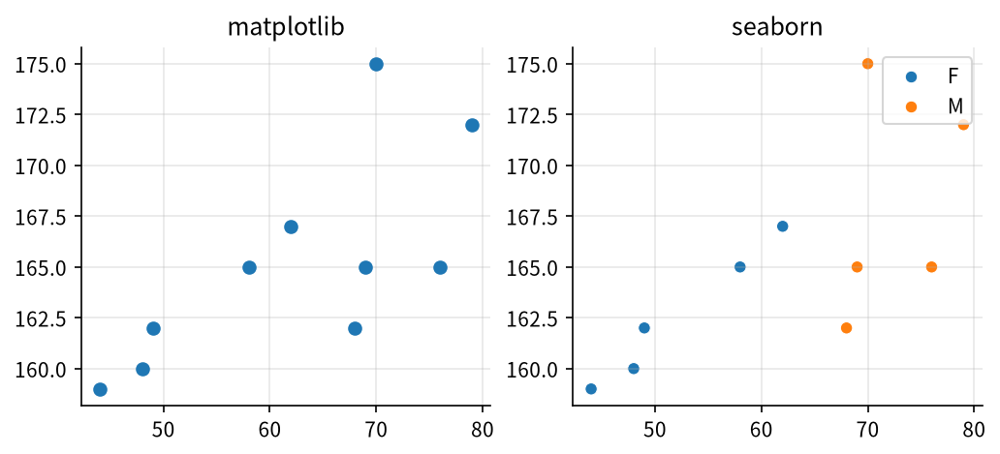

seaborn은 matplotlib에 꽂아 쓰는 플러그인처럼 동작한다. 그래서 seaborn만 익히고 matplotlib을 건너뛰는 것은 좋은 전략이 아니다. 배치와 세부 조정은 결국 matplotlib의 Figure와 Axes로 한다.

## 6. 테마

matplotlib의 기본 모양이 투박하다면 스타일을 바꾼다. `plt.style.available`에 쓸 수 있는 스타일 이름이 있고, `with plt.style.context(...)` 안에서 그린 그림에만 적용된다.

```python
with plt.style.context('seaborn-v0_8-dark'):
    plt.plot([1, 2, 3, 4], [2, 3, 4, 3], 'o--')
```

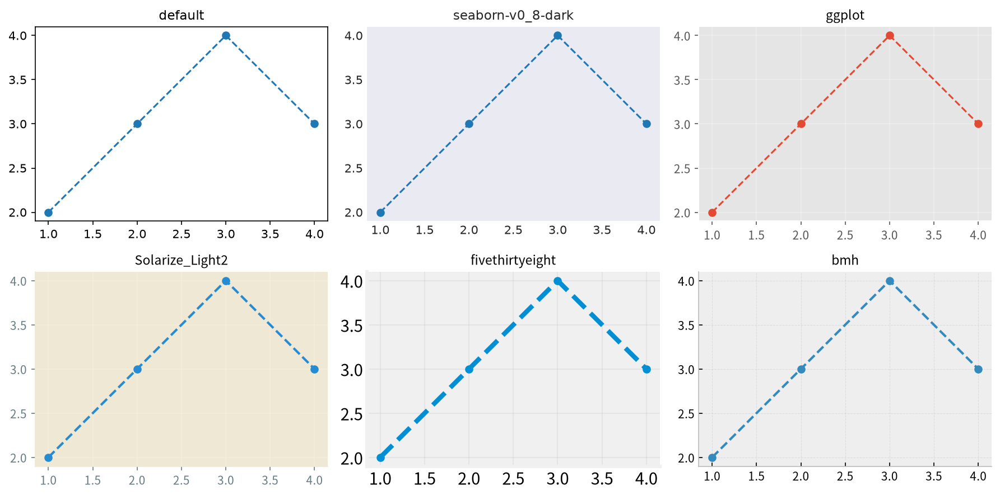

seaborn 계열 스타일의 이름은 matplotlib 3.6부터 `seaborn-dark`에서 `seaborn-v0_8-dark`로 바뀌었다. `sns.set_theme(style='whitegrid', palette='pastel')`처럼 seaborn에서 테마를 정하면 이후의 matplotlib 그림 전체에 적용된다.

손으로 그린 듯한 xkcd 만화 스타일도 있다.

```python
with plt.xkcd():
    plt.plot([1, 2, 3, 4], [2, 3, 4, 3], 'o--')
```

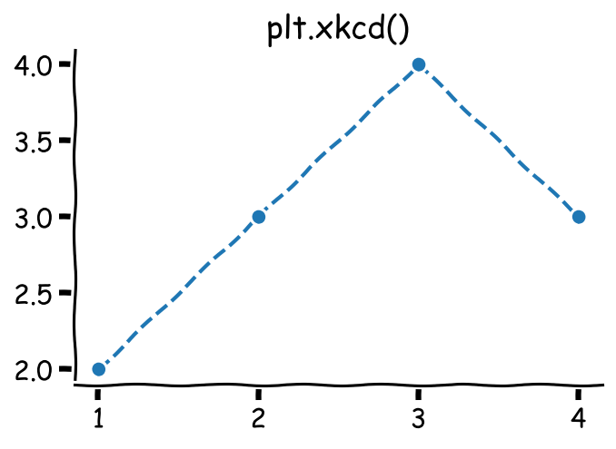

## 정리

- 형식 문자열 `'o:r'` = 점 + 선 + 색. 선 기호를 빼면 산점도다.
- Figure(도화지) ⊃ Axes(그림 한 칸) ⊃ Axis(축). 그리는 일은 Axes가 한다.
- `fig, axs = plt.subplots(2, 2)`의 `axs`는 2×2 배열이고, `fig.axes`는 평평한 리스트다.
- 칸별 조정은 `ax.set_title`, `ax.set_xlim`처럼 `set_`이 붙은 Axes 메서드로 한다. 겹치면 `fig.tight_layout()`.
- seaborn은 `ax=`로 원하는 칸에 그린다.

## 참고자료

- 최규빈, 「데이터시각화」 강의노트 3, 4, 14주차 (전북대학교, 2021)
- [Anatomy of a figure (matplotlib)](https://matplotlib.org/stable/gallery/showcase/anatomy.html)
