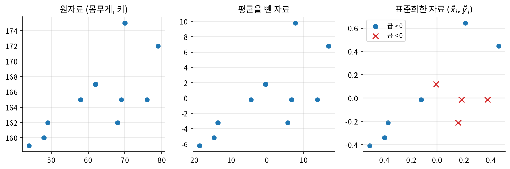
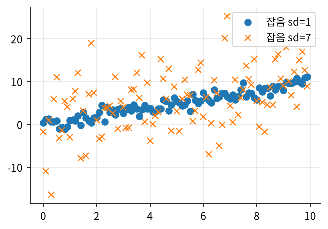
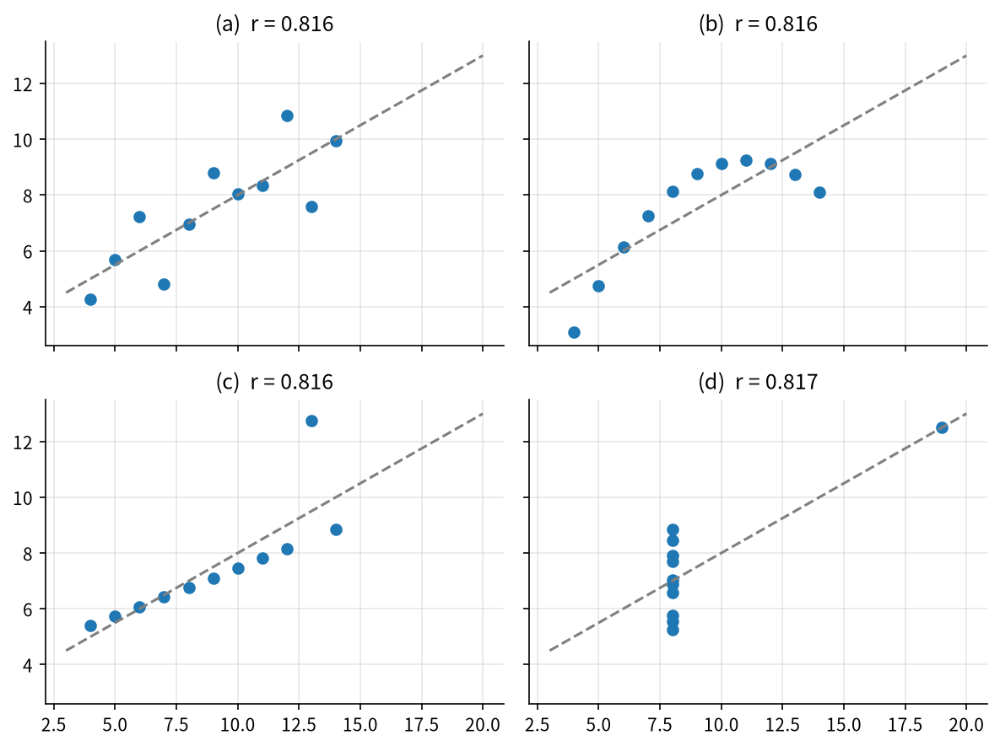
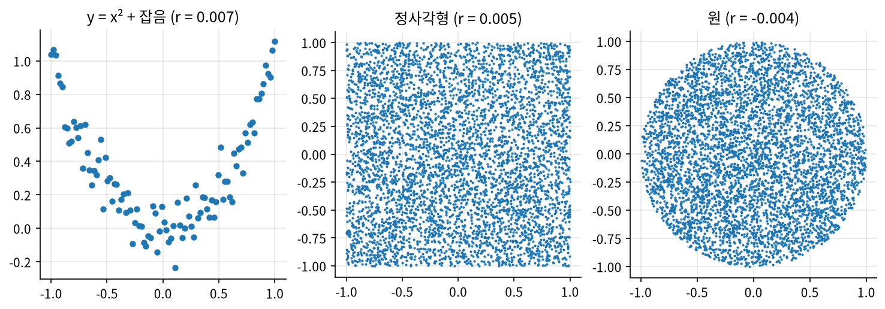
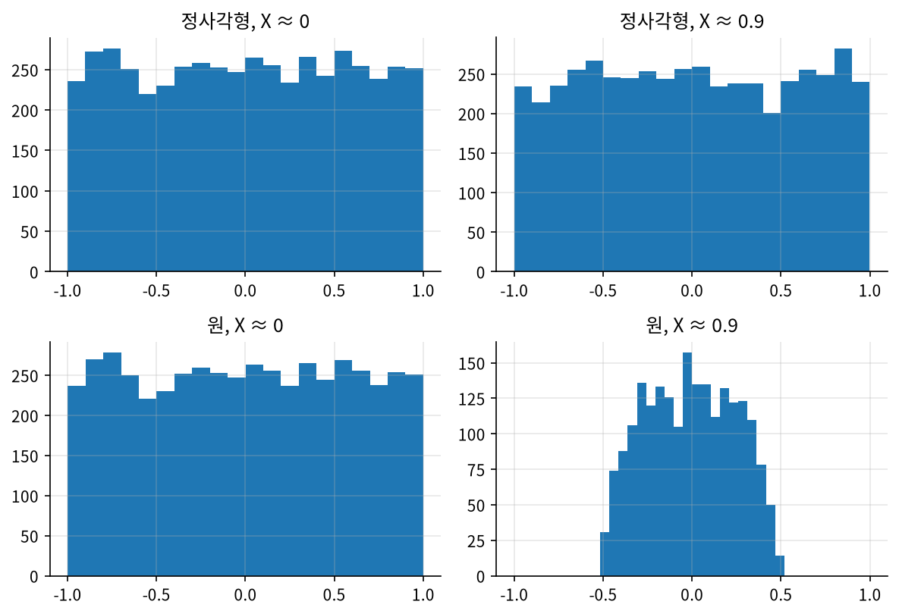
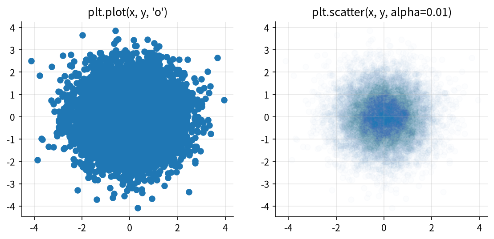
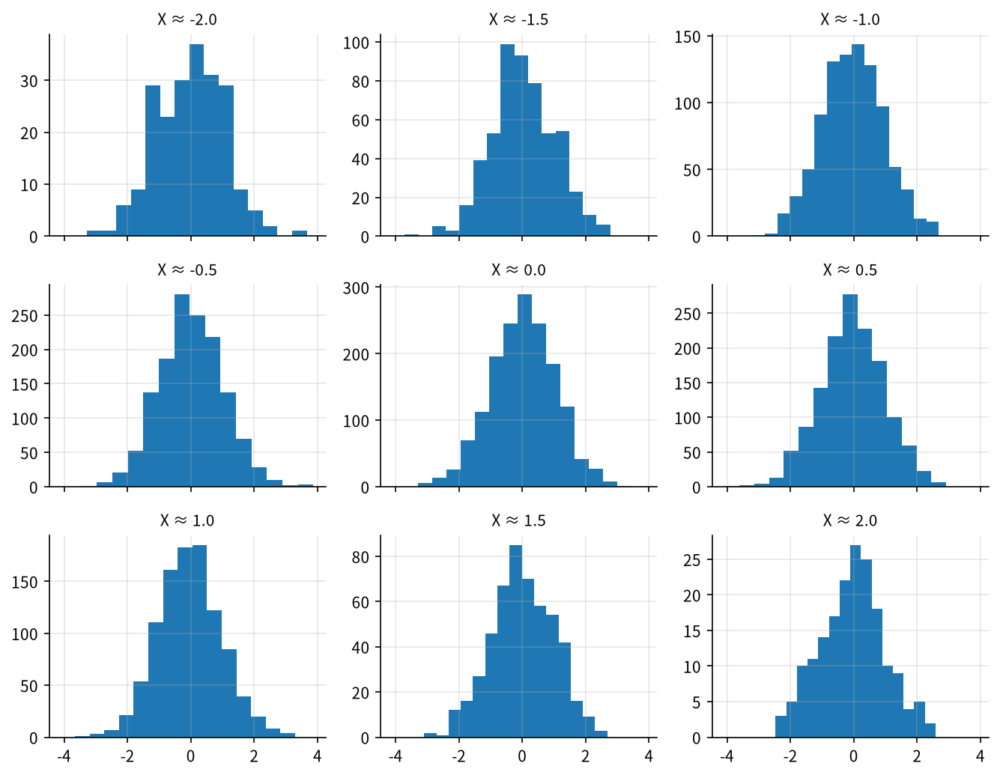

박스플랏과 히스토그램은 변수 하나의 분포를 본다. 두 변수의 **관계**를 보려면 **산점도**(scatter plot)를 그린다. 산점도를 숫자 하나로 요약한 것이 상관계수인데, 이 숫자가 무엇을 재고 무엇을 놓치는지 알아야 산점도를 제대로 읽을 수 있다.

```python
import numpy as np
import matplotlib.pyplot as plt
```

## 1. 산점도

몸무게와 키를 10명에게서 쟀다.

```python
x = np.array([44, 48, 49, 58, 62, 68, 69, 70, 76, 79])            # 몸무게
y = np.array([159, 160, 162, 165, 167, 162, 165, 175, 165, 172])  # 키
plt.plot(x, y, 'o')
```

아래 왼쪽 그림처럼 몸무게가 많이 나가는 사람이 대체로 키도 크다. 두 변수는 정비례 관계가 있어 보인다. 그렇다면 **얼마나** 정비례인가? 이 질문에 답하는 것이 상관계수다.

## 2. 상관계수를 산점도로 읽기

표본상관계수는

$$
r = \frac{\sum_{i=1}^n (x_i - \bar x)(y_i - \bar y)}{\sqrt{\sum_{i=1}^n (x_i - \bar x)^2}\,\sqrt{\sum_{i=1}^n (y_i - \bar y)^2}}
$$

이다. 분모는 $i$와 상관없는 상수이므로 분자 안으로 넣을 수 있다. 분모의 두 제곱근을 $a$, $b$라 하고

$$
\tilde x_i = \frac{x_i - \bar x}{a}, \qquad \tilde y_i = \frac{y_i - \bar y}{b}
$$

로 두면

$$
r = \sum_{i=1}^n \tilde x_i\,\tilde y_i
$$

가 된다. 즉 **각 변수에서 평균을 빼고 퍼진 정도로 나눈 뒤, 짝지어 곱해서 더한 것**이 상관계수다. $a = \sqrt n \times$ `np.std(x)`이다. `np.std`는 기본으로 $n$으로 나누는 표준편차를 준다($n-1$로 나누려면 `ddof=1`).

```python
a = np.sqrt(np.sum((x - x.mean())**2))
b = np.sqrt(np.sum((y - y.mean())**2))
xx = (x - x.mean()) / a
yy = (y - y.mean()) / b
np.sum(xx * yy), np.corrcoef(x, y)[0, 1]
```

```
(0.7139, 0.7139)
```

$a = 36.6$, $b = 15.2$로 몸무게가 키보다 더 퍼져 있지만, 표준화하면 두 변수의 퍼짐이 같아진다. 이제 $\tilde x_i \tilde y_i$의 부호를 산점도에서 읽을 수 있다.



- 1, 3사분면의 점: $\tilde x_i$와 $\tilde y_i$의 부호가 같아 곱이 양수다.
- 2, 4사분면의 점: 곱이 음수다.
- 원점에서 먼 점일수록 곱의 크기가 크다.

이 자료는 10개 중 6개가 1, 3사분면에 있고, 특히 원점에서 먼 점(왼쪽 아래, 오른쪽 위)이 모두 1, 3사분면이라 $r = 0.71$로 양수다. 음수인 4개는 모두 축 근처라 곱이 작다.

이 표현에서 상관계수의 성질이 바로 나온다.

| 성질 | 이유 |
|---|---|
| $-1 \le r \le 1$ | $\sum \tilde x_i^2 = \sum \tilde y_i^2 = 1$이므로 코시-슈바르츠 부등식 |
| $r = \pm 1$이면 점들이 한 직선 위 | 코시-슈바르츠의 등호 조건 $\tilde y_i = \pm\tilde x_i$ |
| $x$를 2배 하거나 상수를 더해도 $r$은 그대로 | 표준화하면 사라진다. 이 자료에서 `np.corrcoef(2*x, y)`도 0.7139 |
| $x$의 부호를 바꾸면 $r$의 부호만 바뀜 | $\tilde x_i$의 부호가 모두 바뀐다 |

### 퍼짐과 상관계수

같은 직선 $y = x$ 주위에 잡음의 크기만 다르게 한 두 자료를 보자.

```python
np.random.seed(43052)
x1 = np.arange(0, 10, 0.1)
y1 = x1 + np.random.normal(loc=0, scale=1.0, size=100)
y2 = x1 + np.random.normal(loc=0, scale=7.0, size=100)
```



두 자료의 기울기는 같지만 상관계수는 $r_1 = 0.947$, $r_2 = 0.419$이다. 상관계수는 **기울기가 아니라 점들이 직선에 얼마나 가깝게 모였는지**를 잰다.

## 3. 앤스콤의 네 자료

통계학 교과서에 자주 나오는 앤스콤(Anscombe)의 네 자료다.

```python
x  = [10, 8, 13, 9, 11, 14, 6, 4, 12, 7, 5]
y1 = [8.04, 6.95, 7.58, 8.81, 8.33, 9.96, 7.24, 4.26, 10.84, 4.82, 5.68]
y2 = [9.14, 8.14, 8.74, 8.77, 9.26, 8.10, 6.13, 3.10, 9.13, 7.26, 4.74]
y3 = [7.46, 6.77, 12.74, 7.11, 7.81, 8.84, 6.08, 5.39, 8.15, 6.42, 5.73]
x4 = [8, 8, 8, 8, 8, 8, 8, 19, 8, 8, 8]
y4 = [6.58, 5.76, 7.71, 8.84, 8.47, 7.04, 5.25, 12.50, 5.56, 7.91, 6.89]

fig, axs = plt.subplots(2, 2, sharex=True, sharey=True)
for ax, xa, ya in zip(fig.axes, [x, x, x, x4], [y1, y2, y3, y4]):
    ax.plot(xa, ya, 'o')
    ax.set_title(f'r = {np.corrcoef(xa, ya)[0, 1]:.3f}')
```



네 자료 모두 $x$의 평균 9, $y$의 평균 7.50, $y$의 분산 4.12~4.13, 상관계수 0.816, 회귀직선 $y = 3 + 0.5x$가 거의 같다. 그런데 그림은 전혀 다르다.

| 자료 | 모양 | 상관계수 0.816의 의미 |
|---|---|---|
| (a) | 직선 주위에 흩어짐 | 적절하다 |
| (b) | 곡선 | 관계는 완전하지만 직선이 아니다. 의미 없음 |
| (c) | 한 점만 빼면 완전한 직선 | 이상치 하나를 빼면 $r = 1.000$ |
| (d) | $x$가 거의 모두 8, 한 점만 19 | 점 하나가 $r$을 만든다. 그 점의 $y$를 3으로 바꾸면 $r = -0.717$ |

교훈은 둘이다. 첫째, **분석하기 전에 항상 그려 본다.** 둘째, 상관계수는 **두 변수가 직선 관계일 때 그 강도를 재는 통계량**이고, 직선 관계라는 가정이 없으면 계산은 되지만 의미가 없다. 통계량은 적절한 가정과 함께 쓸 때만 뜻이 있다.

> **주의** (b)처럼 곡선 모양이라고 상관계수가 0이 되는 것은 아니다. (b)의 $r$은 0.816이다. 또 (d)의 $x = 19$인 점은 $y$값을 바꾸는 것만으로 $r$을 양수에서 음수까지 움직일 수 있다.

## 4. 상관계수 0과 독립

$r$이 0에 가까운 세 자료를 보자.

```python
np.random.seed(43052)
x1 = np.linspace(-1, 1, 100)
y1 = x1**2 + np.random.normal(scale=0.1, size=100)       # 포물선

x2 = np.random.uniform(-1, 1, 100000)                     # 정사각형 안 균등
y2 = np.random.uniform(-1, 1, 100000)

_x = np.random.uniform(-1, 1, 100000)
_y = np.random.uniform(-1, 1, 100000)
x3, y3 = _x[_x**2 + _y**2 < 1], _y[_x**2 + _y**2 < 1]    # 원 안 균등
```



포물선 자료는 $y$가 $x$의 함수인데도 $r = 0.007$이다. $r \approx 0$은 **직선 관계가 약하다**는 뜻이지 관계가 없다는 뜻이 아니다.

정사각형과 원은 더 미묘하다. 둘 다 $r \approx 0$이지만, 두 변수가 **독립**인지는 다르다. 독립은 "$X$의 값을 알아도 $Y$의 분포가 바뀌지 않는다"는 뜻이다. 이를 그림으로 확인하려면 $X$를 어떤 값 근처로 고정하고 그때의 $Y$ 히스토그램을 그려 비교한다.

```python
h = 0.05
fig, axs = plt.subplots(2, 2)
axs[0, 0].hist(y2[(x2 > -h) & (x2 < h)])              # 정사각형, X ≈ 0
axs[0, 1].hist(y2[(x2 > 0.9 - h) & (x2 < 0.9 + h)])   # 정사각형, X ≈ 0.9
axs[1, 0].hist(y3[(x3 > -h) & (x3 < h)])              # 원, X ≈ 0
axs[1, 1].hist(y3[(x3 > 0.9 - h) & (x3 < 0.9 + h)])   # 원, X ≈ 0.9
for ax in fig.axes:
    ax.set_xlim(-1.1, 1.1)
```



정사각형에서는 $X$가 0 근처든 0.9 근처든 $Y$가 $-1$에서 1까지 고르게 퍼진다. $X$를 알아도 $Y$에 대해 새로 아는 것이 없으므로 **독립**이다. 원에서는 $X \approx 0.9$이면 $Y$가 약 $-0.52$에서 $0.52$ 사이로 좁아진다. $X$가 $Y$의 범위에 대한 정보를 주므로 **독립이 아니다**. 그래도 대칭이라 상관계수는 0이다.

| | 무상관 ($r = 0$) | 독립 |
|---|---|---|
| 뜻 | 직선 관계가 없다 | 한 변수를 알아도 다른 변수의 분포가 바뀌지 않는다 |
| 관계 | 독립이면 무상관 | 무상관이어도 독립이 아닐 수 있다 (원, 포물선) |
| 확인 | $r$ 계산 | 조건부 분포(조건부 히스토그램) 비교 |

### 점이 많을 때는 투명도

표준정규분포에서 독립으로 1만 쌍을 뽑아 그리면 점이 겹쳐 가운데가 까맣게 칠해진다. 이 그림은 밀도를 왜곡한다. 가운데에 점이 훨씬 많은데도 바깥과 똑같이 칠해지기 때문이다. 투명도(`alpha`)를 낮추면 점이 겹친 곳일수록 진해져 밀도가 드러난다.

```python
np.random.seed(43052)
x4 = np.random.normal(size=10000)
y4 = np.random.normal(size=10000)
plt.scatter(x4, y4, alpha=0.01)
```



$X$를 $-2$부터 2까지 9개 위치에 고정하고 $Y$의 히스토그램을 그리면 모두 같은 종 모양이다. 독립인 정규분포다.



## 정리

- $r = \sum \tilde x_i \tilde y_i$: 표준화한 값의 곱의 합. 1, 3사분면의 점은 $r$을 키우고 2, 4사분면의 점은 줄인다.
- $r$은 기울기가 아니라 직선에 모인 정도를 잰다. 단위 변환($2x$, $x + c$)에 영향받지 않는다.
- 앤스콤의 네 자료는 상관계수가 모두 0.816이지만 모양이 다르다. 그리기 전에 요약하지 않는다.
- 독립이면 무상관이지만 역은 성립하지 않는다. 독립은 조건부 분포로 확인한다.
- 상관이 있다고 원인인 것은 아니다. 이 문제는 [10편](/posts/dv-10-correlation-causation)에서 다룬다.

## 참고자료

- 최규빈, 「데이터시각화」 강의노트 2, 3주차 (전북대학교, 2021)
- Anscombe, F. J. (1973). Graphs in statistical analysis. *The American Statistician*, 27(1), 17–21.
