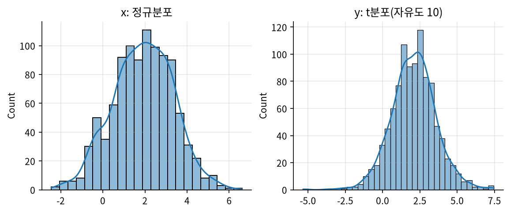
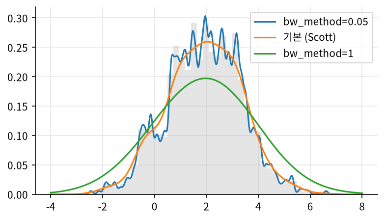
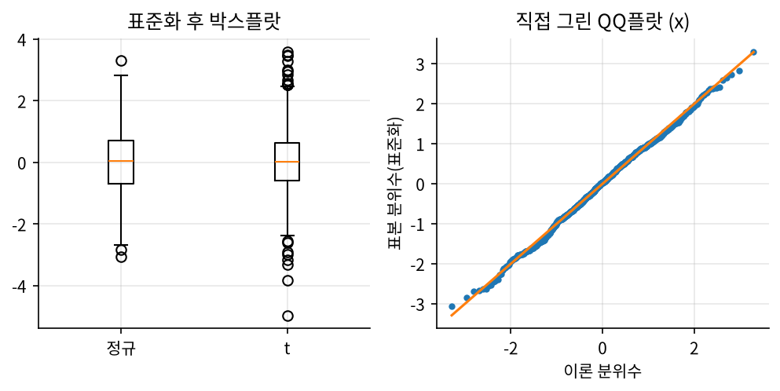
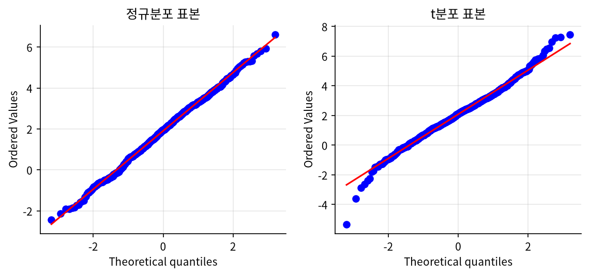
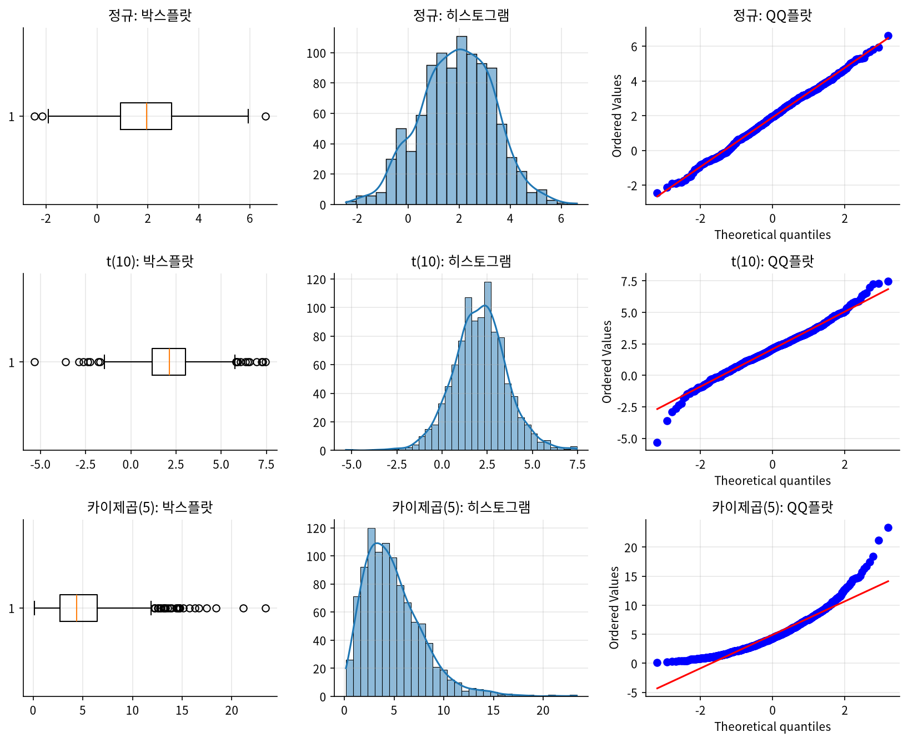

"이 자료는 정규분포를 따르는가?"는 통계 분석에서 가장 자주 하는 질문 중 하나다. [1편](/posts/dv-01-boxplot-histogram)에서는 히스토그램이 종 모양인지 보라고 했지만, 종 모양인 분포는 정규분포 말고도 많다. 이 글은 히스토그램의 한계를 확인하고, 분포를 특정하는 데 더 적합한 **QQ플랏**을 정리한다.

```python
import numpy as np
import matplotlib.pyplot as plt
import seaborn as sns
from scipy import stats
```

## 1. 종 모양이면 정규분포인가

평균 2, 표준편차 1.5인 정규분포 표본 `x`와, 자유도 10인 t분포를 같은 평균과 표준편차로 맞춘 표본 `y`를 1000개씩 만든다. t분포 $t_\nu$의 분산은 $\nu/(\nu-2)$이므로 $\sqrt{10/8}$로 나눠 분산을 1로 맞춘 뒤 1.5를 곱했다.

```python
np.random.seed(43052)
x = np.random.normal(size=1000, loc=2, scale=1.5)
y = stats.t.rvs(df=10, size=1000) / np.sqrt(10/8) * 1.5 + 2
```

seaborn의 `histplot`에 `kde=True`를 주면 히스토그램 위에 매끄러운 밀도곡선을 함께 그린다.

```python
fig, axs = plt.subplots(1, 2, figsize=(9, 3.3))
sns.histplot(x, kde=True, ax=axs[0])
sns.histplot(y, kde=True, ax=axs[1])
```



둘 다 종 모양이다. 히스토그램만 보고는 `y`가 정규분포가 아니라는 것을 알기 어렵다.

### 커널밀도추정

히스토그램 위의 곡선은 **커널밀도추정**(kernel density estimation, KDE)으로 그린 것이다. 관측값마다 작은 종 모양(커널 $K$)을 하나씩 올려놓고 더한다.

$$
\hat f(t) = \frac{1}{nh}\sum_{i=1}^n K\!\left(\frac{t - x_i}{h}\right)
$$

$K$는 보통 표준정규밀도이고, $h$(띠너비, bandwidth)가 각 종의 폭이다. 히스토그램의 구간 수처럼 $h$가 결과를 좌우한다.

```python
for bw in [0.05, None, 1.0]:              # None이면 기본값(Scott 규칙)
    kde = stats.gaussian_kde(x, bw_method=bw)
```



`scipy.stats.gaussian_kde`의 `bw_method`는 띠너비 자체가 아니라 표본 표준편차에 곱하는 배수다. 기본값인 Scott 규칙은 $n^{-1/5}$로, 이 자료에서는 $1000^{-1/5} = 0.251$이고 띠너비는 $0.251 \times 1.42 = 0.36$이다.

### 박스플랏으로 꼬리 보기

두 표본을 표준화해 박스플랏을 나란히 그리면 차이가 조금 드러난다(아래 그림 왼쪽). t분포 쪽에 울타리 밖의 점이 훨씬 많다. 정규분포 표본은 3개, t분포 표본은 20개다. t분포는 정규분포보다 **꼬리가 두껍다**. 가운데는 비슷하지만 극단값이 더 자주 나온다. 박스플랏으로 "꼬리가 두꺼워 보인다"까지는 말할 수 있지만, 어느 쪽으로 얼마나 다른지는 알기 어렵다.

> **주의** "히스토그램이 종 모양이다 → 정규분포다"는 잘못된 추론이다. 종 모양은 정규분포의 필요조건에 가깝지 충분조건이 아니다.

## 2. QQ플랏

QQ플랏(quantile-quantile plot)의 아이디어는 단순하다.

1. 관측값을 작은 것부터 정렬한다: $x_{(1)} \le x_{(2)} \le \cdots \le x_{(n)}$.
2. 정규분포에서 $n$개를 뽑아 정렬했을 때 $i$번째로 나올 **이론적인 값**을 구한다.
3. 둘을 짝지어 산점도를 그린다. 정규분포라면 점들이 직선 위에 놓인다.

2단계에서 시뮬레이션으로 정규분포 표본을 뽑아 정렬할 수도 있지만, 뽑을 때마다 값이 달라진다. 그래서 이론 분위수를 쓴다. $i$번째 값은 대략 누적확률 $i/n$ 지점에 있으므로 $\Phi^{-1}(i/n)$을 쓰면 될 것 같다. 그런데 $i = n$이면 $\Phi^{-1}(1) = \infty$가 된다. 그래서 누적확률을 조금 보정한 **플로팅 위치**(plotting position)를 쓴다. 가장 단순한 것은 $(i - 0.5)/n$이다.

```python
xx = (x - x.mean()) / x.std(ddof=1)      # 표준화
n = len(xx)
m = (np.arange(1, n + 1) - 0.5) / n      # 플로팅 위치
q = stats.norm.ppf(m)                    # 이론 분위수 (ppf = 누적분포함수의 역함수)
plt.plot(q, np.sort(xx), 'o')
plt.plot(q, q, '-')                      # 기준선 y = x
```



점들이 기준선 근처에 모여 있을수록 정규분포에 가깝다.

### scipy.stats.probplot

`stats.probplot`이 같은 그림을 그린다. 두 가지가 다르다. 첫째, 플로팅 위치로 Filliben의 보정값 $m_i = (i - 0.3175)/(n + 0.365)$(양 끝은 따로 계산)을 쓴다. 다른 프로그램은 $(i - 3/8)/(n + 1/4)$를 쓰기도 한다. 어느 쪽이든 그림의 모양은 거의 같다. 둘째, $y$축에 표준화하지 않은 원래 값을 그리고, 기준선으로 점들에 맞춘 회귀직선을 그린다. 그 기울기와 절편이 표준편차와 평균의 추정값이 된다.

```python
fig, axs = plt.subplots(1, 2, figsize=(9, 3.5))
stats.probplot(x, plot=axs[0])
stats.probplot(y, plot=axs[1])
```



정규분포 표본은 처음부터 끝까지 직선 위에 있다. 기준선의 기울기 1.43, 절편 1.91은 표본의 표준편차, 평균과 같다. t분포 표본은 가운데는 직선 위에 있지만 **양 끝에서 벗어난다.**

- 왼쪽 끝: 점이 선보다 **아래**에 있다. 정규분포라면 나와야 할 값보다 더 작은 값이 관측됐다.
- 오른쪽 끝: 점이 선보다 **위**에 있다. 더 큰 값이 관측됐다.

양쪽 모두 정규분포보다 극단적인 값이 나왔으니 꼬리가 두껍다는 뜻이다. 히스토그램에서는 보이지 않던 차이다.

## 3. QQ플랏의 모양 읽기

정규분포, t분포, 자유도 5인 카이제곱분포 표본을 박스플랏, 히스토그램, QQ플랏으로 함께 그린다.

```python
fig, axs = plt.subplots(3, 3, figsize=(11, 9))
for row, v in enumerate([x, y, c]):            # c = np.random.chisquare(df=5, size=1000)
    axs[row, 0].boxplot(v, vert=False)
    sns.histplot(v, kde=True, ax=axs[row, 1])
    stats.probplot(v, plot=axs[row, 2])
fig.tight_layout()
```



| QQ플랏의 모양 | 뜻 | 예 |
|---|---|---|
| 직선 | 정규분포에 가깝다 | 정규 |
| 왼쪽 끝은 아래, 오른쪽 끝은 위 (S자를 눕힌 모양) | 양쪽 꼬리가 두껍다 | t분포 |
| 왼쪽 끝은 위, 오른쪽 끝은 아래 | 양쪽 꼬리가 얇다 | 균등분포 |
| 아래로 볼록한 곡선 | 오른쪽으로 치우쳤다 (오른쪽 꼬리가 길다) | 카이제곱, 지수 |
| 위로 볼록한 곡선 | 왼쪽으로 치우쳤다 | |

카이제곱 표본은 히스토그램에서도 오른쪽으로 치우친 것이 보이고(왜도 1.36), QQ플랏에서는 왼쪽 끝이 0 근처에 눌려 선보다 위에, 오른쪽 끝이 선보다 위로 휘어 올라간다. t분포 표본은 왜도가 $-0.03$으로 대칭이지만 첨도가 1.16으로 정규분포(0)보다 크다.

## 4. 비교

| | 히스토그램 + KDE | 박스플랏 | QQ플랏 |
|---|---|---|---|
| 잘 보이는 것 | 봉우리, 치우침 | 중앙값, 퍼짐, 이상치 수 | 특정 분포와의 차이, 특히 꼬리 |
| 조절할 것 | 구간 수, 띠너비 | 울타리 배수 | 비교할 이론분포 |
| 정규성 판단 | 약함 (종 모양은 많다) | 보조 | 가장 직접적 |

## 정리

- 종 모양 히스토그램만으로 정규분포라고 할 수 없다. t분포도 종 모양이다.
- KDE: $\hat f(t) = \frac{1}{nh}\sum K\big((t - x_i)/h\big)$. 띠너비 $h$에 민감하다.
- QQ플랏: 정렬한 관측값 $x_{(i)}$와 이론 분위수 $\Phi^{-1}(m_i)$의 산점도. $m_i = i/n$은 마지막 값이 무한대가 되므로 $(i - 0.5)/n$ 같은 보정값을 쓴다.
- 양 끝이 기준선 밖으로 벌어지면 꼬리가 두껍고, 한쪽으로 휘면 치우친 분포다.

## 참고자료

- 최규빈, 「데이터시각화」 강의노트 4, 5주차 (전북대학교, 2021)
- [scipy.stats.probplot](https://docs.scipy.org/doc/scipy/reference/generated/scipy.stats.probplot.html)
