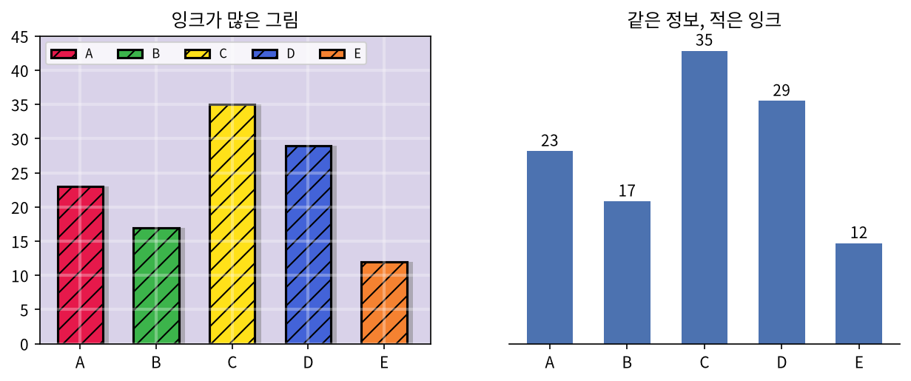
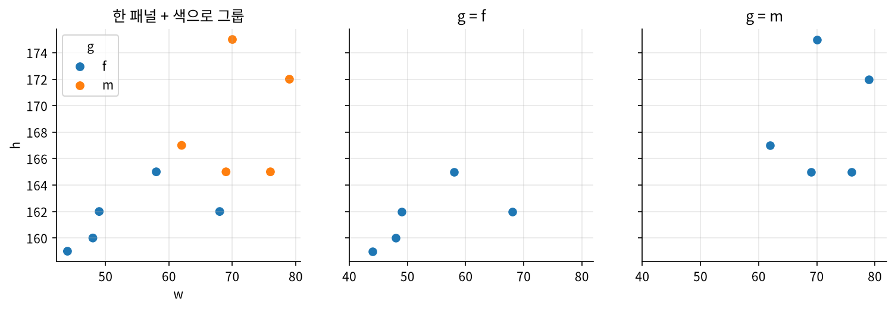
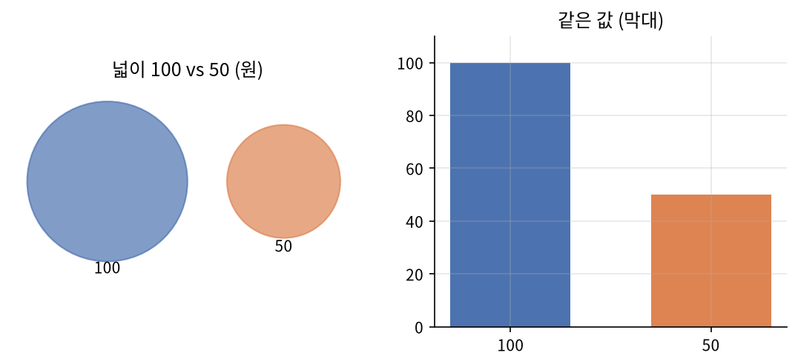
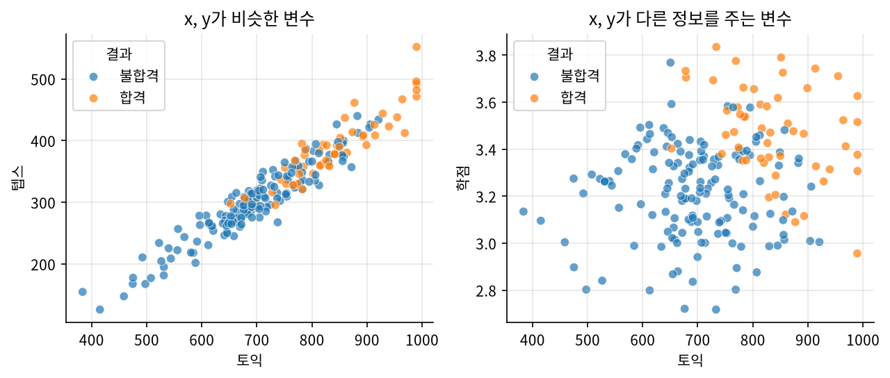
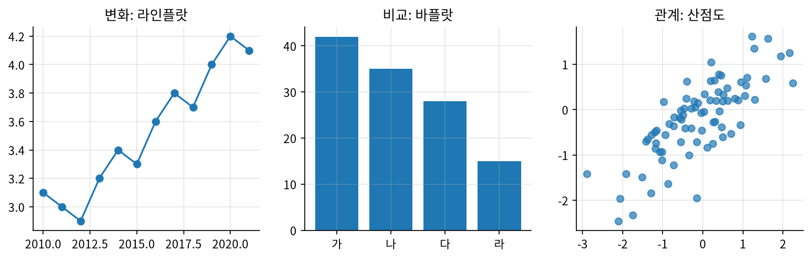

지금까지는 그림을 **어떻게** 그리는지 다뤘다. 이 글은 **무엇을** 그려야 하는지를 다룬다. 시각화 분야의 두 고전, 에드워드 터프티(Edward Tufte)와 알베르토 카이로(Alberto Cairo)의 주장을 정리하고, 그 주장이 코드에서 어떤 선택으로 이어지는지 본다.

## 1. 터프티: 최소한의 잉크로 최대한의 정보

터프티의 핵심은 엄격한 미니멀리즘이다. **최소한의 잉크로 많은 정보를 전달하는 그래프가 좋은 그래프다.** 이를 수치로 표현한 것이 데이터-잉크 비다.

$$
\text{데이터-잉크 비} = \frac{\text{데이터를 표현하는 데 쓴 잉크}}{\text{그래픽 전체를 인쇄하는 데 쓴 잉크}}
$$

배경색, 굵은 격자, 그림자, 무늬, 막대마다 다른 색과 그 색을 설명하는 범례는 데이터를 하나도 더 전달하지 않으면서 잉크를 쓴다. 터프티는 이런 장식을 **차트정크**(chartjunk)라고 부르고, 숫자가 지루하니 장식으로 살려야 한다는 생각은 정보와 독자를 모두 얕보는 것이라고 비판했다.



오른쪽 그림은 $y$축, 격자, 범례를 모두 지웠지만 값을 막대 위에 적어 정보는 오히려 늘었다. 막대 색이 하나뿐이라 범례도 필요 없다.

다만 미니멀리즘을 원칙처럼 따를 필요는 없다. 지우는 것이 목적이 아니라 **데이터가 보이게 하는 것**이 목적이다. 예를 들어 여러 그림의 값을 정확히 비교해야 한다면 축과 격자는 남겨야 한다.

## 2. 미나드: 한 그림에 여러 변수

터프티가 "지금까지 그려진 최고의 통계 그래픽일지도 모른다"고 평한 그림이 샤를 미나드(Charles Minard)의 1869년 도표다. 1812년 나폴레옹의 러시아 원정에서 군대가 줄어드는 과정을 그렸다.


이 그림 하나에 여섯 가지 변수가 들어 있다.

| 변수 | 표현 |
|---|---|
| 병력의 크기 | 띠의 굵기 |
| 위치 (경도, 위도) | 띠가 지나가는 2차원 평면 |
| 이동 방향 | 띠의 색 (진군은 연한 색, 퇴각은 검은색) |
| 날짜 | 아래 기온 그래프의 눈금 |
| 기온 | 아래 선 그래프 |

산점도, 막대그래프, 라인플랏은 변수 두 개를 그리는 데 익숙하다. 변수가 많으면 보통 그림을 여러 장 그린다. 미나드는 **그림을 늘리는 대신 한 그림 안의 표현 수단(굵기, 색, 위치)을 늘렸다.**

같은 생각을 작은 자료에 적용해 보자. 몸무게와 키에 성별이 있는 자료다.

```python
import pandas as pd
import seaborn as sns
df = pd.DataFrame({'w': [44, 48, 49, 58, 62, 68, 69, 70, 76, 79],
                   'h': [159, 160, 162, 165, 167, 162, 165, 175, 165, 172],
                   'g': ['f', 'f', 'f', 'f', 'm', 'f', 'm', 'm', 'm', 'm']})
sns.scatterplot(data=df, x='w', y='h', hue='g')
```



성별마다 그림을 나누면(오른쪽 두 장) 두 그룹을 비교하려고 눈이 왔다 갔다 해야 한다. 색으로 구분하면(왼쪽) 한눈에 비교된다.

그런데 실제로는 왼쪽처럼 그리기가 생각보다 어렵다. 자료가 `여성.csv`, `남성.csv` 두 파일로 따로 주어지면, 두 표를 합치고 성별 열을 붙여야 한다는 생각부터 쉽게 들지 않는다. 좋은 시각화에는 세 가지가 필요하다.

1. **기획력**: 무엇을 어떤 표현 수단에 맡길지. 좋은 시각화를 많이 보면서 기른다.
2. **자료의 모양에 대한 이해**: 그림에 맞는 표의 모양(tidy data). [9편](/posts/dv-09-pandas-reshape)에서 다룬다.
3. **그 모양으로 바꾸는 프로그래밍 능력**: 판다스. [8편](/posts/dv-08-pandas-selection)과 9편에서 다룬다.

## 3. 카이로: 프레젠테이션과 탐색

카이로는 『The Functional Art』(2012)에서 시각화를 두 성격으로 나눴다.

| | 프레젠테이션 | 탐색 (exploration) |
|---|---|---|
| 목적 | 만든 사람이 다듬은 메시지를 전달 | 읽는 사람이 스스로 메시지를 찾음 |
| 예 | 신문 기사의 그래프 | 소설 한 권을 단원, 문단, 문장으로 나눈 나무 모양 그림에 자주 나오는 소재를 색으로 칠한 작품 |
| 읽는 법 | 제목과 강조를 따라간다 | 구조를 이해하고 패턴을 찾는다 |

카이로는 둘이 대립하지 않고 섞을 수 있다고 본다. 예를 들어 해마다 GDP($x$)와 불평등 지수($y$)를 점으로 찍고 연도 순으로 이은 뒤, 정권마다 색을 다르게 하면 언뜻 익숙한 선 그래프지만 읽을 거리가 많다. 점 사이 간격이 넓으면 변화가 빨랐고 좁으면 더뎠다. 어느 정권에서 소득과 불평등이 함께 늘었는지도 보인다. 이런 그림은 그릴 줄도 알아야 하지만, **남이 그린 것을 읽을 줄도** 알아야 한다.

### 메시지를 뒷받침하는 그림

카이로가 든 예 중 하나가 세계 인구다. "가난한 나라는 출산율이 높아 인구가 폭발한다"와 "잘사는 나라는 출산율이 낮아 고령화된다"는 주장에 대해, 실제로는 가난한 나라의 출산율은 줄고 잘사는 나라는 조금 늘어 세계 인구가 안정될 것이라는 반론이 있었다. 카이로는 이 메시지를 전달하려면 전체 평균 한 줄이 아니라 **나라 그룹별 추세선**을 보여줘야 하고, 핵심 선을 제외한 나머지를 회색으로 눌러야 한다고 했다. 어떤 현상을 볼 때 그 부분집합에서도 같은지 확인하는 것은 기본이다. 이 생각은 [10편](/posts/dv-10-correlation-causation)의 심슨의 역설로 이어진다.

같은 맥락에서 상관과 인과를 섞는 해석도 조심해야 한다. "여학생의 중학교 진학률이 낮은 나라일수록 출산율이 높다"는 그림을 보고 "여학생을 학교에 보내지 않으면 출산율이 오른다"고 읽으면 안 된다.

## 4. 장식이 메시지를 흐리는 경우

### 원의 크기로 비교하기

값을 원의 크기로 나타내는 버블차트는 보기 좋지만 비교에는 약하다. 넓이가 절반인 원은 지름이 $1/\sqrt 2 \approx 0.71$배라서, 사람의 눈에는 절반보다 크게 느껴진다.



**크기를 비교하려면 막대**를 쓴다. 막대는 길이만 비교하면 되지만 원은 넓이를 어림해야 한다. 명암(진하기)으로 크기를 나타내는 것도 같은 이유로 비교에 약하다.

반대로 버블이 잘 맞는 경우도 있다. 선거 결과 지도에서 지역마다 원을 그리는 그림은 정확한 수치 비교가 목적이 아니라 **어느 지역에 표가 몰렸는지**가 목적이다. 그래서 가장 중요한 표현 수단인 $x$, $y$ 위치를 모두 지리에 쓰고, 표의 크기는 대략만 보여도 된다.

### 비슷한 성질의 변수 쌍

산점도의 두 축에 거의 같은 정보를 주는 변수를 놓으면 점이 한 직선에 몰리고, 2차원을 쓴 의미가 없다. 아래는 가상의 취업 자료로 같은 합격 여부를 두 가지 산점도로 그린 것이다.



토익과 텝스는 둘 다 영어 실력을 재므로 상관계수가 0.96이다. 사실상 1차원이다. 토익과 학점은 상관계수가 0.23으로 서로 다른 정보를 주고, 합격자가 오른쪽 위에 모이는 패턴이 보인다. 강의에서는 남미 국가들의 인구, 군인 수, 국방 예산을 그린 그림이 같은 문제를 가졌다. 인구가 많으면 군인도 예산도 많으므로, 인구 효과를 뺀 값(인구 대비 군인 수, 인구 대비 예산)을 축으로 쓰고 인구를 점의 크기로 돌리면 "예산을 많이 쓰는데 군인이 적은 나라" 같은 해석이 가능해진다.

## 5. 목적에 맞는 그림

| 목적 | 그림 | 예 |
|---|---|---|
| 시간에 따른 **변화** | 라인플랏 | 연도별 지표 |
| 그룹 간 **비교** | 바플랏 | 지역별 판매량 |
| 두 변수의 **관계** | 산점도 | 몸무게와 키 |
| **분포** | 히스토그램, 박스플랏, QQ플랏 | 점수 분포 |
| **구성비** | 막대(누적), 경우에 따라 파이 | 시장점유율 |



## 정리

- 터프티: 데이터-잉크 비를 높여라. 데이터를 전달하지 않는 장식은 차트정크다.
- 미나드: 그림을 늘리는 대신 한 그림 안의 표현 수단(색, 굵기, 위치)을 늘린다. 그러려면 자료를 그 모양으로 바꿀 줄 알아야 한다.
- 카이로: 프레젠테이션과 탐색은 섞을 수 있다. 그림은 메시지를 뒷받침해야 하고, 부분집합에서도 같은지 확인한다.
- 크기 비교는 원이나 명암보다 막대. 산점도의 두 축은 서로 다른 정보를 주는 변수로.

## 참고자료

- 최규빈, 「데이터시각화」 강의노트 5, 10주차 (전북대학교, 2021)
- Tufte, E. R. (2001). *The Visual Display of Quantitative Information* (2nd ed.). Graphics Press.
- Cairo, A. (2012). *The Functional Art: An Introduction to Information Graphics and Visualization*. New Riders.
- [Charles Minard's map of Napoleon's Russian campaign (Wikimedia Commons)](https://commons.wikimedia.org/wiki/File:Minard.png)
