[앞 글](/posts/dv-06-good-visualization)에서 미나드는 그림을 늘리는 대신 한 그림 안의 표현 수단을 늘렸다. 해들리 위컴(Hadley Wickham)은 이 생각을 체계로 만들었다. 그래프는 **데이터 + 맵핑 + 지옴 + 스탯 + 포지션 + 좌표계 + 면분할**의 조합이라는 것이다. R의 ggplot2가 이 문법을 구현했고, 파이썬에서는 plotnine이 같은 문법을 쓴다.

```python
import numpy as np
import pandas as pd
from plotnine import *
```

## 1. 자료와 기본 산점도

ggplot2에 들어 있는 `mpg` 자료(자동차 234대의 연비)를 쓴다. 강의에서는 rpy2로 R의 자료를 파이썬으로 넘겨 csv로 저장했다. 여기서는 그 파일을 바로 읽는다.

```python
mpg = pd.read_csv('https://raw.githubusercontent.com/guebin/2021DV/master/_notebooks/mpg.csv')
```

| 변수 | 뜻 |
|---|---|
| `displ` | 엔진 크기(배기량, 리터) |
| `hwy` | 고속도로 연비(갤런당 마일). 같은 연료로 얼마나 멀리 가는가 |
| `class` | 차종 (suv, compact, midsize, subcompact, pickup, minivan, 2seater) |
| `drv` | 구동 방식 (f 전륜, r 후륜, 4 사륜) |
| `cyl`, `year` | 실린더 수, 연식(1999, 2008) |

```python
ggplot(data=mpg) + geom_point(mapping=aes(x='displ', y='hwy'))
```

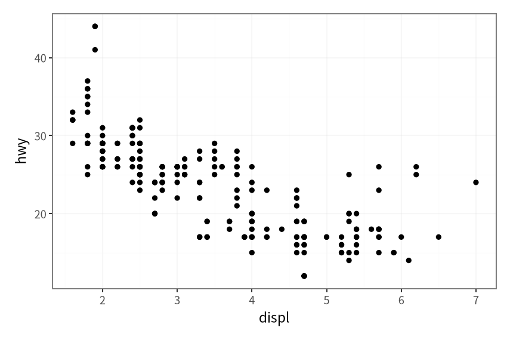

엔진이 큰 차일수록 연비가 낮다. 이 한 줄을 풀어 쓰면 문법이 보인다.

```python
fig = ggplot(data=mpg)               # 1. 도화지를 준비한다 (데이터를 연결)
a1 = aes(x='displ', y='hwy')         # 2. 변수와 에스테틱(x, y)의 대응표를 만든다
point1 = geom_point(mapping=a1)      # 3. 그 대응표대로 점을 찍는 지옴을 만든다
fig + point1                         # 4. 도화지와 지옴을 합친다
```

`aes(...)`는 `{'x': 'displ', 'y': 'hwy'}` 같은 대응표일 뿐이다. `geom_point`는 "이 대응표를 보고 점을 찍어라"이다. `data=`와 `mapping=`은 생략할 수 있다. R의 ggplot2에서는 변수 이름에 따옴표를 쓰지 않는다(`aes(x = displ, y = hwy)`). 파이썬에서는 문자열로 쓴다.

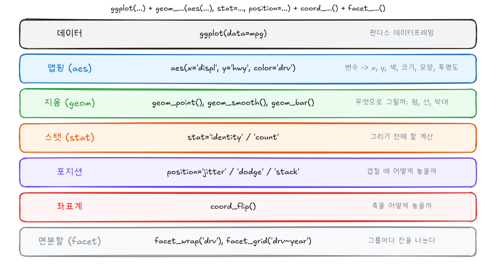

## 2. 맵핑: 변수를 늘리기

`x`, `y` 말고도 점의 크기, 투명도, 모양, 색이 모두 에스테틱이다. 세 번째 변수 `class`를 이 중 하나에 대응시키면 2차원 산점도가 3차원 정보를 담는다.

```python
ggplot(mpg) + geom_point(aes(x='displ', y='hwy', color='class'))
```

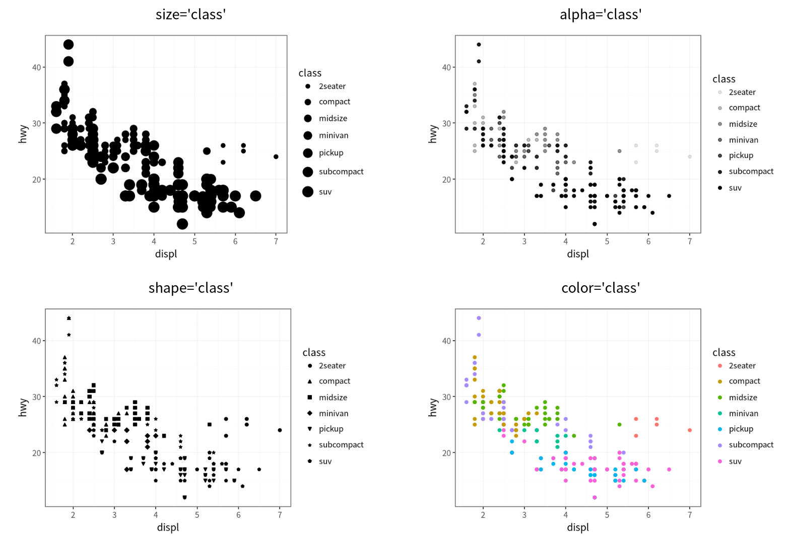

범주형 변수인 `class`에는 색이 가장 잘 맞는다. 크기와 투명도는 순서가 있는 것처럼 보이게 해서(2seater가 가장 작고 suv가 가장 크다) 순서 없는 범주에는 어색하다. 모양은 종류가 많으면 구분하기 어렵다. 색을 보면 오른쪽 위에 떨어진 점들(엔진이 큰데 연비가 좋은 차)이 2seater, 즉 스포츠카라는 것이 보인다.

### 지옴 쌓기

지옴은 `+`로 계속 쌓을 수 있다. `geom_smooth`는 점들을 지나는 매끄러운 추세선(기본은 국소회귀, loess)과 신뢰띠를 그린다.

```python
ggplot(mpg) + geom_point(aes(x='displ', y='hwy', color='class')) + geom_smooth(aes(x='displ', y='hwy'))
```

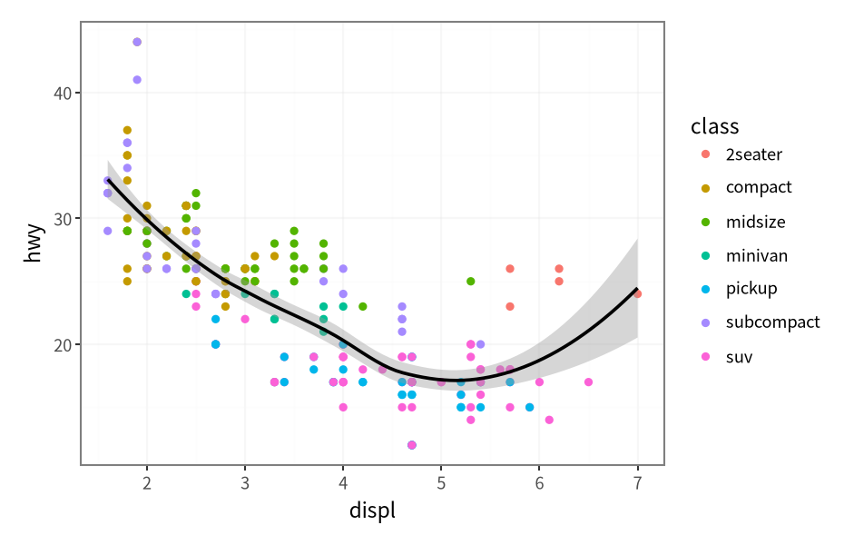

여러 지옴에 공통인 맵핑은 `ggplot()` 쪽으로 빼면 반복을 줄일 수 있다. 지옴 안의 맵핑은 그 지옴에만 적용된다.

```python
ggplot(mpg, aes(x='displ', y='hwy')) + geom_point(aes(color='class')) + geom_smooth()
```

### 4차원

구동 방식 `drv`까지 넣어 보자. 점의 색은 `drv`, 크기는 `class`로 하고, 구동 방식별 추세선을 파선으로, 전체 추세선을 실선으로 그린다.

```python
(ggplot(mpg, aes(x='displ', y='hwy'))
 + geom_point(aes(size='class', color='drv'), alpha=0.3)
 + geom_smooth(aes(color='drv'), linetype='dashed', size=0.7)
 + geom_smooth())
```

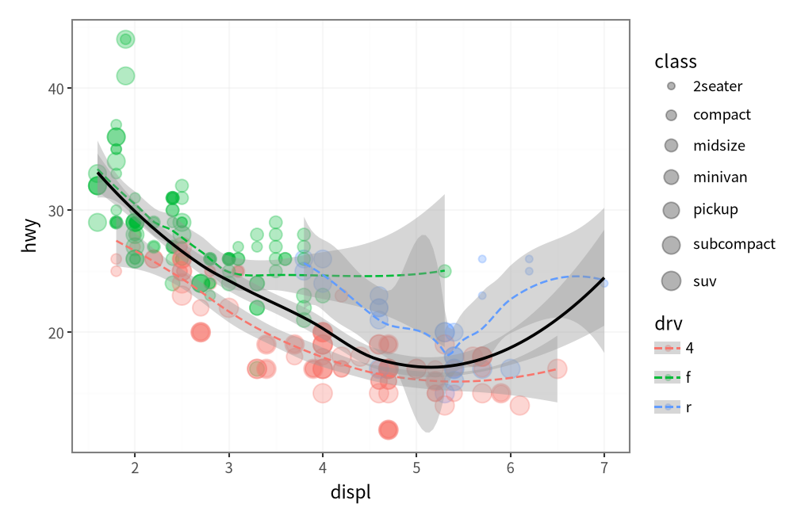

같은 엔진 크기에서 빨간 점(사륜구동)이 대체로 초록 점(전륜구동)보다 아래에 있다. 사륜구동의 연비가 낮다. 구동 방식별 평균 연비도 전륜 28.2, 후륜 21.0, 사륜 19.2이다. `geom_smooth`의 `color='drv'`는 색만 정하는 것이 아니라 **그룹을 나누는** 역할도 한다. 그래서 추세선이 구동 방식마다 따로 그려진다.

| 지옴 | 쓸 수 있는 에스테틱 |
|---|---|
| 점 (`geom_point`) | x, y, 크기, 모양, 색, 투명도 |
| 선 (`geom_smooth`, `geom_line`) | x, y, 선 모양(`linetype`), 색, 굵기 |
| 막대 (`geom_bar`, `geom_col`) | x, y, 채우기 색(`fill`), 테두리 색 |

### 맵핑과 설정

> **주의** `aes()` **안**에 쓰면 변수와의 대응(맵핑)이고, **밖**에 쓰면 고정값(설정)이다. 모든 점을 파랗게 하려면 `geom_point(aes(x='displ', y='hwy'), color='blue')`로 쓴다. `aes(..., color='"blue"')`처럼 안에 쓰면 "blue"라는 값 하나뿐인 변수를 색에 대응시킨 것이 되어, 기본 팔레트의 첫 색(빨강)으로 칠하고 범례에 "blue"가 생긴다.

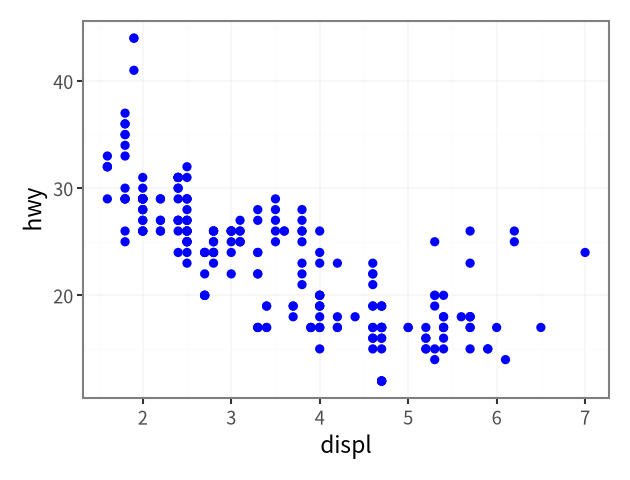

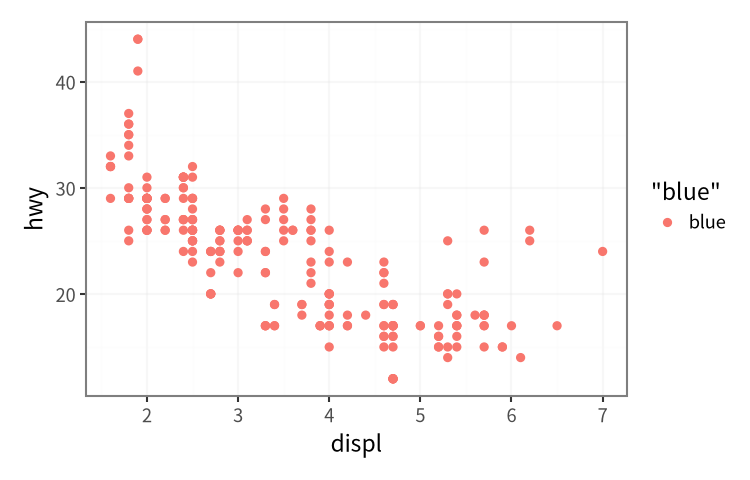

## 3. 스탯: 바플랏의 함정

A그룹 100명, B그룹 200명의 자료가 있다.

```python
np.random.seed(43052)
g = ['A'] * 100 + ['B'] * 200
y = list(np.random.randn(100) * 2 + 2) + list(np.random.randn(200) + 3)
df = pd.DataFrame({'g': g, 'y': y})
ggplot(df) + geom_bar(aes(x='g', fill='g'))
```

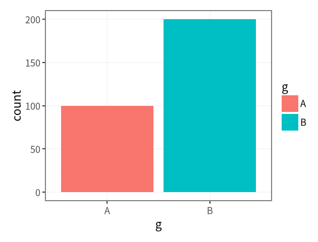

`y`를 주지 않았는데 막대가 그려졌다. `geom_bar`는 기본으로 **그룹별로 개수를 세어**(`stat='count'`) 그 개수를 높이로 쓰기 때문이다. 그리기 전에 하는 이런 계산이 **스탯**이다.

그래서 미리 계산한 값을 높이로 쓰려고 `y`를 맵핑하면 오류가 난다.

```python
td = df.groupby('g').count().reset_index()
ggplot(td) + geom_bar(aes(x='g', y='y', fill='g'))
```

```
PlotnineError: 'stat_count() must not be used with a y aesthetic'
```

값을 그대로 쓰라는 `stat='identity'`를 주거나, 처음부터 그렇게 동작하는 `geom_col`을 쓴다.

| | 하는 일 | y 맵핑 |
|---|---|---|
| `geom_bar()` (`stat='count'`) | 그룹별 개수를 세어 높이로 | 쓰면 오류 |
| `geom_bar(stat='identity')` = `geom_col()` | 주어진 값을 높이로 | 필요 |

판다스로 요약표를 만든 뒤 그리는 경우가 많으므로 `geom_col`을 더 자주 쓴다. 판다스의 `groupby`는 [9편](/posts/dv-09-pandas-reshape)에서 다룬다.

## 4. 포지션, 좌표계, 면분할

그룹별 평균, 중앙값, 표준편차, 범위를 계산해 긴 모양(그룹, 통계량, 값)의 표로 만들었다.

```
   g    stat  value
0  A    mean  1.837
1  B    mean  2.979
2  A  median  1.888
3  B  median  3.026
4  A     std  1.979
5  B     std  0.864
6  A   range  9.380
7  B   range  5.231
```

```python
ggplot(td) + geom_bar(aes(x='stat', y='value', fill='g'), stat='identity')
```

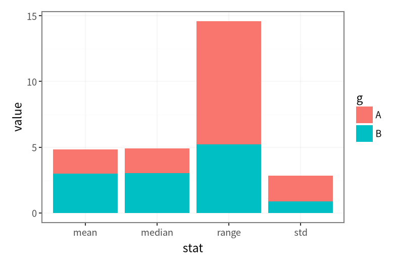

막대가 쌓여서(`position='stack'`, 기본값) 두 그룹을 비교하기 어렵다. `position='dodge'`로 옆으로 나란히 놓는다.

```python
ggplot(td) + geom_bar(aes(x='stat', y='value', fill='g'), stat='identity', position='dodge')
```

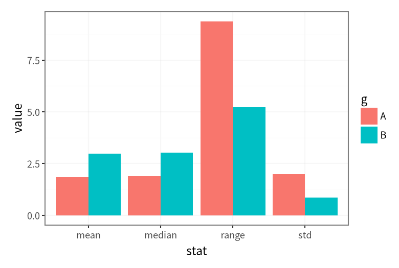

| 포지션 | 하는 일 | 쓰는 곳 |
|---|---|---|
| `stack` | 쌓기 | 막대의 기본값, 구성비 |
| `dodge` | 옆으로 나란히 | 그룹 비교 |
| `identity` | 그대로 겹침 | 히스토그램 겹치기(`alpha`와 함께) |
| `jitter` | 점을 조금씩 흔듦 | 값이 겹치는 이산형 산점도 |

`jitter`는 값이 정수라 점이 겹치는 산점도에 쓴다. 실린더 수와 연비처럼 같은 좌표에 여러 차가 있으면 겹친 점이 하나로 보인다.

```python
ggplot(mpg) + geom_point(aes(x='cyl', y='hwy'), alpha=0.3, position='jitter')
```

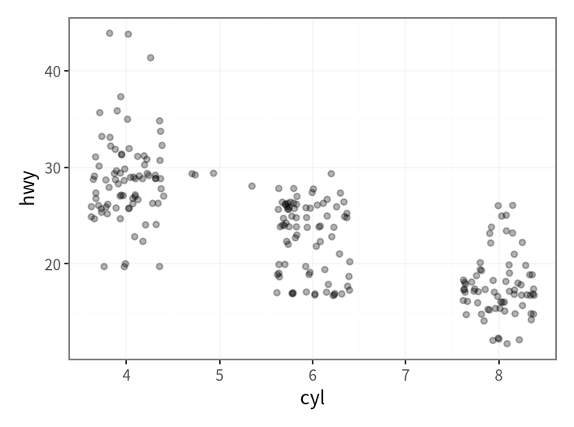

**좌표계**를 바꾸는 `coord_flip()`은 $x$축과 $y$축을 바꾼다. 범주 이름이 길거나 많을 때 가로 막대가 읽기 쉽다.

```python
ggplot(td) + geom_col(aes(x='stat', y='value', fill='g'), position='dodge') + coord_flip()
```

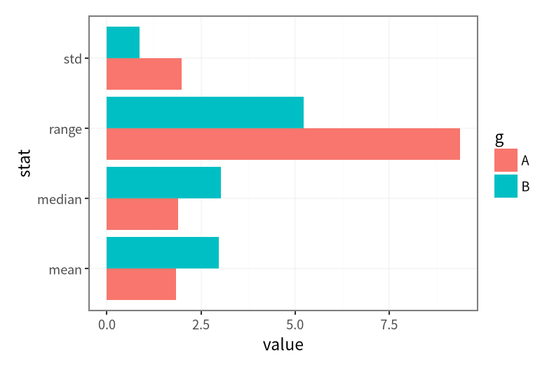

**면분할**은 한 변수의 값마다 칸을 나눠 같은 그림을 반복한다. `facet_wrap('변수')`는 한 변수로 나눠 줄 바꿈하며 늘어놓고, `facet_grid('행변수~열변수')`는 두 변수로 격자를 만든다.

```python
ggplot(td) + geom_col(aes(x='g', y='value', fill='g')) + coord_flip() + facet_wrap('stat')
ggplot(mpg) + geom_point(aes(x='displ', y='hwy'), alpha=0.5) + facet_grid('drv~year')
```

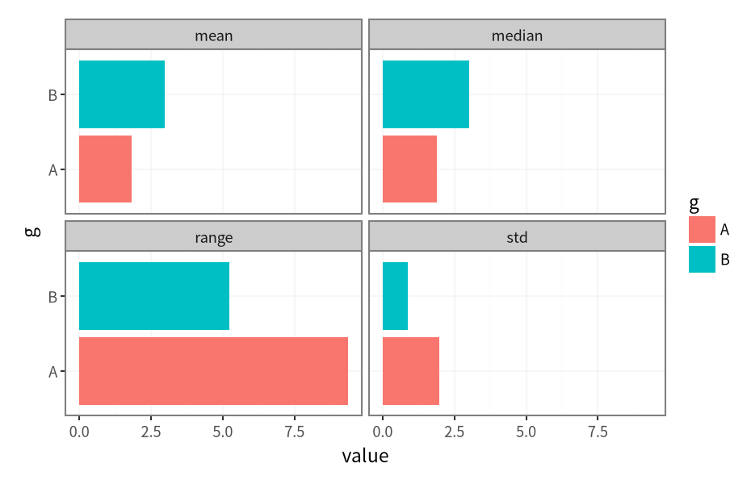

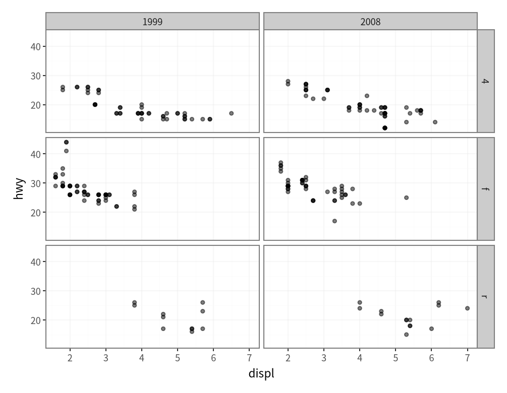

면분할은 색과 함께 고차원을 표현하는 또 하나의 수단이다. 그룹이 많아 색으로 구분하기 어려울 때 특히 쓸모 있다.

## 5. 정리: 일곱 요소

| 요소 | plotnine | 예 |
|---|---|---|
| 데이터 | `ggplot(data=df)` | 판다스 데이터프레임 |
| 맵핑 | `aes(...)` | x, y, color, size, shape, alpha, fill, linetype |
| 지옴 | `geom_*()` | point, smooth, line, bar, col, boxplot, histogram |
| 스탯 | `stat=` | count, identity, bin |
| 포지션 | `position=` | stack, dodge, identity, jitter |
| 좌표계 | `coord_*()` | coord_flip |
| 면분할 | `facet_*()` | facet_wrap, facet_grid |

실제로는 **지옴과 맵핑**만 잘 써도 대부분의 그림을 그릴 수 있다. 맵핑을 생각할 때는 "이 변수를 어떤 표현 수단에 맡길까"를 먼저 정하고, 그 수단을 가진 지옴을 고른다.

- 범주형 변수는 색이나 면분할, 연속형 변수는 위치나 크기에 맡긴다.
- `aes()` 안은 맵핑, 밖은 고정값이다.
- `geom_bar`는 개수를 센다. 계산한 값을 그리려면 `geom_col`.

## 참고자료

- 최규빈, 「데이터시각화」 강의노트 6, 8주차 (전북대학교, 2021)
- Wickham, H. & Grolemund, G. *R for Data Science*, [Data visualisation](https://r4ds.had.co.nz/data-visualisation.html)
- [plotnine 문서](https://plotnine.org/)
